# Circular Separability

CSI4106 Introduction to Artificial Intelligence

Author

Affiliations

Marcel Turcotte [](mailto:marcel.turcotte@uottawa.ca)

School of Electrical Engineering and Computer Science

University of Ottawa

Published

October 13, 2026

This self-study notebook extends Lecture 11’s discussion of nonlinear decision boundaries. We compare two ways to obtain a useful representation: designing features for logistic regression and learning hidden representations with a neural network. It complements the circle dataset in [TensorFlow Playground](https://playground.tensorflow.org).

The Keras examples can be explored now; the training methods, losses, and regularization techniques are developed in Lectures 12–14.

## Data

The inner circle is class 1, and the outer ring is class 0. No straight line can separate these two classes in the original input plane.

``` python
import numpy as np
import matplotlib.pyplot as plt
from sklearn.datasets import make_circles
from sklearn.linear_model import LogisticRegression
from sklearn.model_selection import train_test_split
from sklearn.pipeline import Pipeline
from sklearn.preprocessing import PolynomialFeatures

X_circles, y_circles = make_circles(
    n_samples=1200, factor=0.35, noise=0.06, random_state=42
)


def plot_samples(ax, X, y, labels=("class 0", "class 1")):
    for label in (0, 1):
        ax.scatter(
            X[y == label, 0], X[y == label, 1],
            color=f"C{label}", label=labels[label], s=18,
            edgecolor="k", linewidth=0.2,
        )
    ax.set_xlabel("x₁")
    ax.set_ylabel("x₂")
    ax.set_aspect("equal")
    ax.legend()


fig, ax = plt.subplots(figsize=(5, 5))
plot_samples(ax, X_circles, y_circles,
             labels=("class 0 (outer ring)", "class 1 (inner circle)"))
ax.set_title("Dataset generated with make_circles")
plt.tight_layout()
plt.show()
```

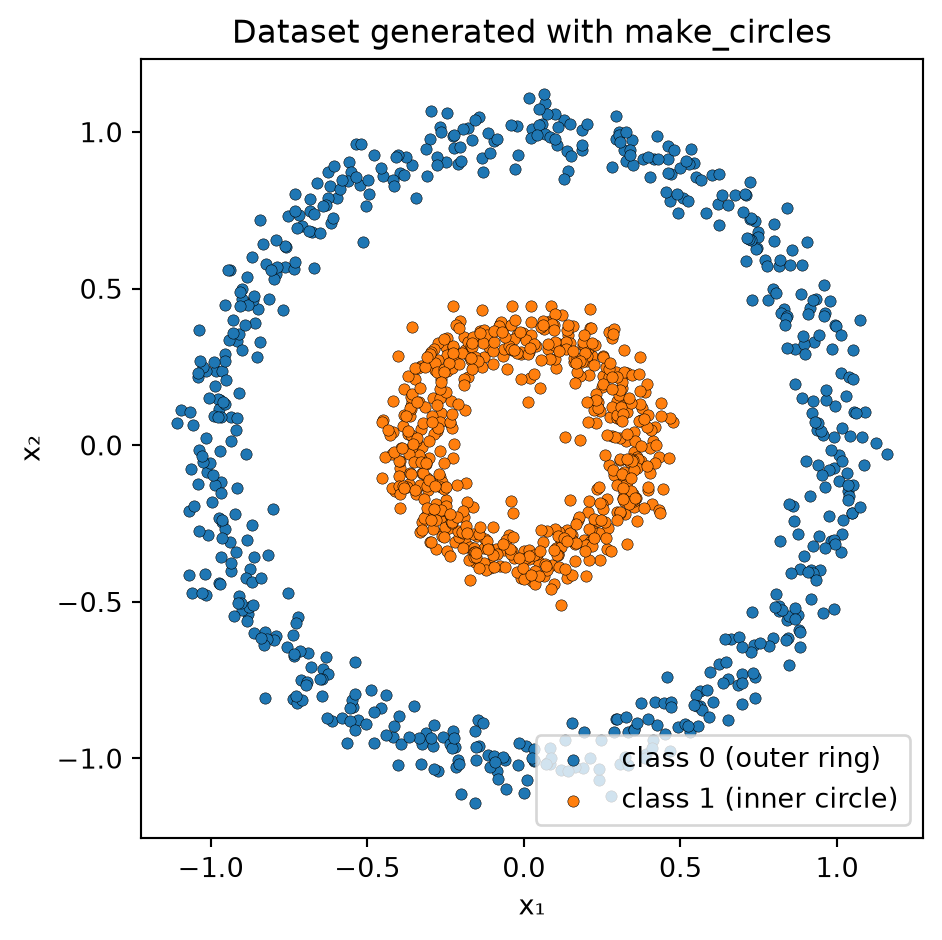

## Feature engineering

Logistic regression using only x_1 and x_2 has a straight decision boundary, so it cannot separate the inner circle from the surrounding ring. Logistic regression can nevertheless produce a nonlinear boundary in the input plane if we give it nonlinear features.

TensorFlow Playground offers x_1^2 and x_2^2 as additional features. A network with no hidden layers and one sigmoid output is logistic regression on the selected features. Keeping the two original inputs and both squared inputs gives four features; selecting only the squared inputs gives two.

For a simpler visualization, combine the squared inputs into one feature:

r = x_1^2 + x_2^2.

Here, r denotes the **squared distance from the origin**, rather than the radius itself. Inner-circle points have small r; outer-ring points have large r. Squaring the distance preserves their ordering, so computing a square root is unnecessary.

For the sample generated above, the two bands are separated in r-space. A threshold r^\* can separate the classes:

\text{inner if } r \< r^\*, \qquad \text{outer if } r \> r^\*.

The same threshold corresponds to a circle in the original input plane. With more noise, the radial bands may overlap, and perfect separation may no longer be possible.

## Fit a model in r-space

All models for a dataset use the same split: 60% training, 20% validation, and 20% test. Only training examples are used to fit the parameters. The neural network uses validation loss for early stopping; the test examples are reserved for the final comparison.

``` python
def split_dataset(X, y):
    X_train, X_holdout, y_train, y_holdout = train_test_split(
        X, y, test_size=0.4, random_state=42, stratify=y
    )
    X_valid, X_test, y_valid, y_test = train_test_split(
        X_holdout, y_holdout, test_size=0.5,
        random_state=42, stratify=y_holdout,
    )
    return X_train, X_valid, X_test, y_train, y_valid, y_test


def radial_features(X):
    return (X[:, 0]**2 + X[:, 1]**2).reshape(-1, 1)


X_train, X_valid, X_test, y_train, y_valid, y_test = split_dataset(
    X_circles, y_circles
)
r_circles = radial_features(X_circles)

clf_raw = LogisticRegression().fit(X_train, y_train)
clf_r = LogisticRegression().fit(radial_features(X_train), y_train)

w = clf_r.coef_[0, 0]
b = clf_r.intercept_[0]
r_threshold = -b / w
print(f"Decision threshold: r* = {r_threshold:.3f}")
```

    Decision threshold: r* = 0.546

The radial model estimates p(y=1\mid r)=\sigma(wr+b). Its decision boundary is where wr+b=0, or r^\*=-b/w. The learned weight is negative because class 1 occupies the smaller radii.

## 3D view

Lifting each point to (x_1,x_2,r) makes the decision boundary a horizontal plane. Rotate the interactive view to see how the plane separates the two bands.

``` python
import plotly.graph_objects as go

gx = np.linspace(X_circles[:, 0].min() - 0.2,
                 X_circles[:, 0].max() + 0.2, 30)
gy = np.linspace(X_circles[:, 1].min() - 0.2,
                 X_circles[:, 1].max() + 0.2, 30)
GX, GY = np.meshgrid(gx, gy)
GZ = np.full_like(GX, r_threshold)

plane = go.Surface(
    x=GX, y=GY, z=GZ, opacity=0.35, showscale=False,
    colorscale=[[0, "gray"], [1, "gray"]], hoverinfo="skip",
    name="decision plane",
)
scatters = [
    go.Scatter3d(
        x=X_circles[y_circles == label, 0],
        y=X_circles[y_circles == label, 1],
        z=r_circles[y_circles == label, 0], mode="markers",
        marker=dict(size=3, color=color), name=name,
        hovertemplate="x₁=%{x:.3f}<br>x₂=%{y:.3f}<br>r=%{z:.3f}<extra></extra>",
    )
    for label, color, name in (
        (0, "#1f77b4", "class 0 (outer ring)"),
        (1, "#ff7f0e", "class 1 (inner circle)"),
    )
]
fig = go.Figure(data=[plane, *scatters])
fig.update_scenes(
    xaxis_title="x₁", yaxis_title="x₂", zaxis_title="r = x₁² + x₂²",
    aspectmode="cube", camera=dict(eye=dict(x=1.6, y=1.6, z=0.9)),
)
fig.update_layout(
    margin=dict(l=0, r=0, b=0, t=40),
    title=f"Decision plane at r* ≈ {r_threshold:.3f}",
)
fig.show()
```

The static view below shows the same relationship for readers whose notebook viewer or PDF export does not display interactive figures.

``` python
fig = plt.figure(figsize=(7, 5))
ax = fig.add_subplot(projection="3d")
ax.plot_surface(GX, GY, GZ, color="gray", alpha=0.25)
for label in (0, 1):
    ax.scatter(
        X_circles[y_circles == label, 0],
        X_circles[y_circles == label, 1],
        r_circles[y_circles == label, 0],
        color=f"C{label}", s=8, label=f"class {label}",
    )
ax.set_xlabel("x₁")
ax.set_ylabel("x₂")
ax.set_zlabel("r = x₁² + x₂²")
ax.set_title(f"Decision plane at r* ≈ {r_threshold:.3f}")
ax.view_init(elev=20, azim=45)
ax.legend()
plt.tight_layout()
plt.show()
```

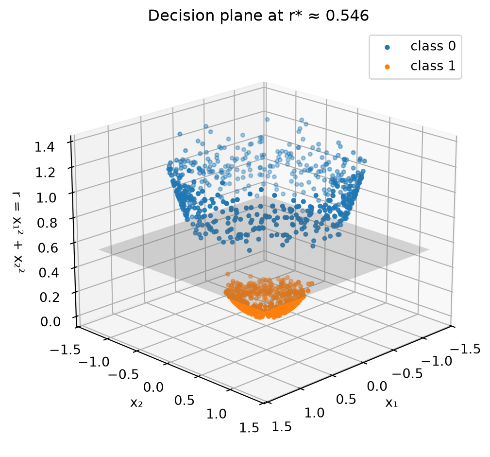

## Linear separability in 1D (r-space)

``` python
plt.figure(figsize=(6, 4))
bins = np.linspace(r_circles.min(), r_circles.max(), 40)
plt.hist(r_circles[y_circles == 0, 0], bins=bins, alpha=0.65,
         label="class 0 (outer ring)")
plt.hist(r_circles[y_circles == 1, 0], bins=bins, alpha=0.65,
         label="class 1 (inner circle)")
plt.axvline(r_threshold, linestyle="--", color="k",
            label=f"threshold r* ≈ {r_threshold:.3f}")
plt.xlabel("r = x₁² + x₂²")
plt.ylabel("count")
plt.title("Separated radial bands")
plt.legend()
plt.tight_layout()
plt.show()
```

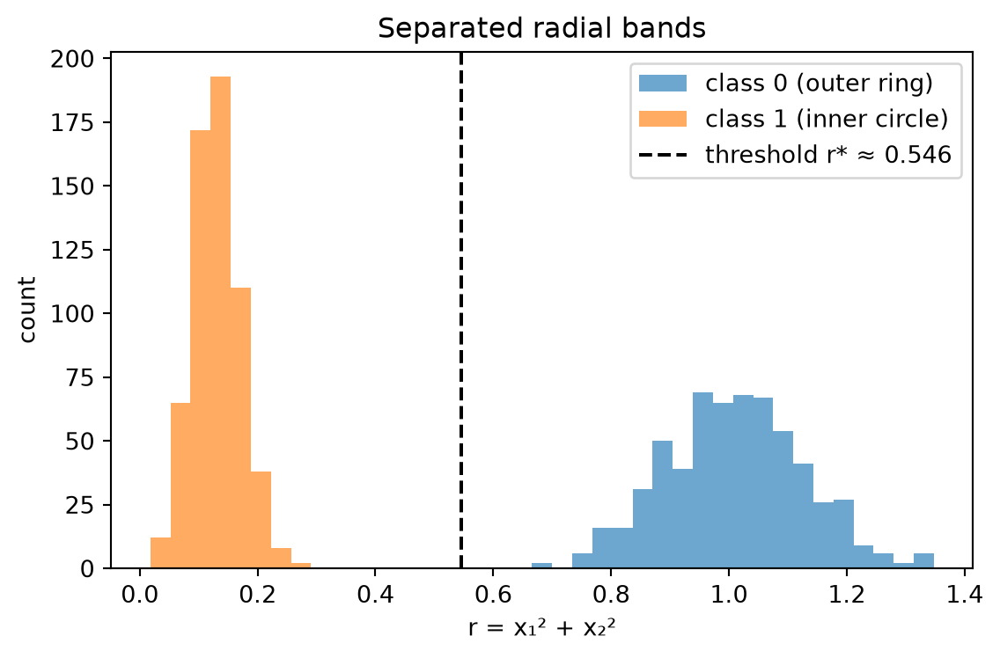

## Logistic model in 1D r-space

The probability of class 1 decreases as the distance from the origin increases. The dashed line marks the probability threshold of 0.5.

``` python
r_sorted = np.sort(r_circles[:, 0])
p_sorted = clf_r.predict_proba(r_sorted.reshape(-1, 1))[:, 1]

fig, ax = plt.subplots(figsize=(6, 4))
ax.plot(r_sorted, p_sorted, color="k", label="p(y=1 | r)")
for label in (0, 1):
    positions = r_circles[y_circles == label, 0]
    ax.scatter(positions, np.full_like(positions, label),
               s=8, alpha=0.5, color=f"C{label}", label=f"class {label}")
ax.axvline(r_threshold, linestyle="--", color="gray", label="p=0.5 threshold")
ax.set_yticks([0, 0.5, 1])
ax.set_ylim(-0.05, 1.05)
ax.set_xlabel("r = x₁² + x₂²")
ax.set_ylabel("p(y=1)")
ax.set_title("Logistic model in r-space")
ax.legend(fontsize=8)
plt.tight_layout()
plt.show()
```

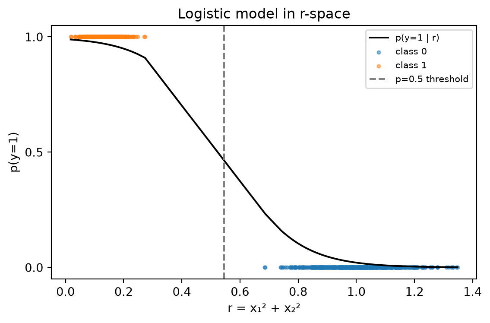

## Decision boundary from radial features

The plotting helpers below will also be used for the quadratic model and the neural networks. Shading shows the estimated probability of class 1; the black contour marks p=0.5. The points show the full generated dataset, while model fitting uses only the training split.

Code

``` python
def make_grid(X):
    xx, yy = np.meshgrid(
        np.linspace(X[:, 0].min() - 0.3, X[:, 0].max() + 0.3, 300),
        np.linspace(X[:, 1].min() - 0.3, X[:, 1].max() + 0.3, 300),
    )
    return xx, yy, np.column_stack((xx.ravel(), yy.ravel()))


def plot_decision_boundary(xx, yy, probabilities, X, y, title):
    probabilities = probabilities.reshape(xx.shape)
    fig, ax = plt.subplots(figsize=(6, 5))
    shading = ax.contourf(xx, yy, probabilities,
                          levels=np.linspace(0, 1, 21), cmap="coolwarm", alpha=0.6)
    boundary = ax.contour(xx, yy, probabilities, levels=[0.5], colors="k")
    ax.clabel(boundary, fmt={0.5: "p=0.5"})
    plot_samples(ax, X, y)
    ax.set_title(title)
    fig.colorbar(shading, ax=ax, label="p(y=1)")
    plt.tight_layout()
    plt.show()


xx, yy, grid = make_grid(X_circles)
p_r = clf_r.predict_proba(radial_features(grid))[:, 1]
plot_decision_boundary(xx, yy, p_r, X_circles, y_circles,
                       "Logistic regression with a radial feature")
```

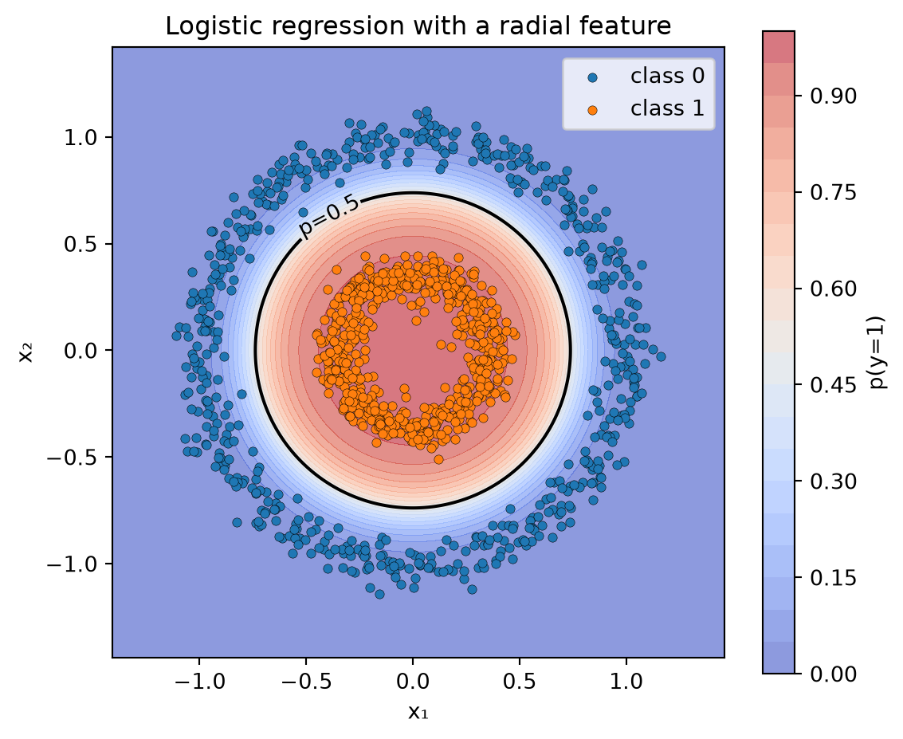

## Decision boundary from quadratic features

[`PolynomialFeatures`](https://scikit-learn.org/stable/modules/generated/sklearn.preprocessing.PolynomialFeatures.html) with degree 2 and no constant column produces five features:

x_1,\quad x_2,\quad x_1^2,\quad x_1x_2,\quad x_2^2.

The radial model constrains the squared inputs to share one coefficient, because wr=w(x_1^2+x_2^2). The quadratic model can weight all five features independently. Both can separate these circles, but their fitted boundaries and probabilities need not be identical. Their default regularization also acts on different parameterizations.

``` python
quad = Pipeline([
    ("poly", PolynomialFeatures(degree=2, include_bias=False)),
    ("logreg", LogisticRegression()),
]).fit(X_train, y_train)

p_quad = quad.predict_proba(grid)[:, 1]
plot_decision_boundary(xx, yy, p_quad, X_circles, y_circles,
                       "Logistic regression with quadratic features")
```

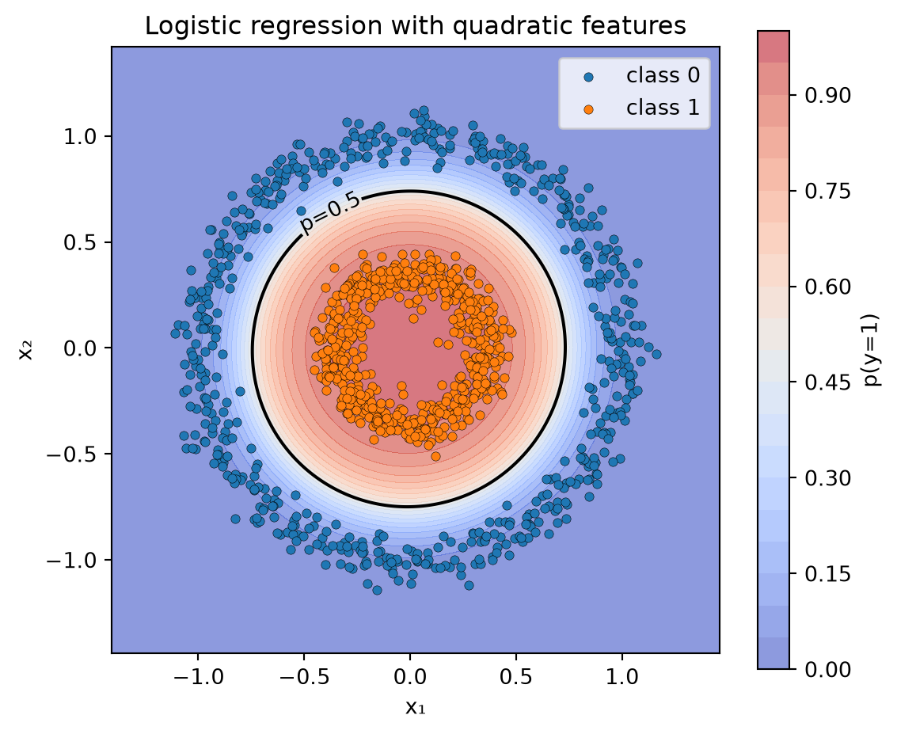

## Neural network

The neural network receives only the original inputs x_1 and x_2. It has **two hidden layers**, each with four units, followed by one sigmoid output: three layers with trainable parameters. The hidden layers use `tanh`, a nonlinear activation, and learn a representation from the training examples.

This is one working configuration, rather than a claim that `tanh` always trains faster or better than other activations. Training success depends on the data, initialization, architecture, and optimization settings.

``` python
from tensorflow import keras


def make_mlp():
    keras.utils.set_random_seed(42)
    model = keras.Sequential([
        keras.layers.Input(shape=(2,)),
        keras.layers.Dense(4, activation="tanh"),
        keras.layers.Dense(4, activation="tanh"),
        keras.layers.Dense(1, activation="sigmoid"),
    ])
    model.compile(
        optimizer=keras.optimizers.Adam(learning_rate=0.01),
        loss="binary_crossentropy", metrics=["accuracy"],
    )
    return model


circle_mlp = make_mlp()
```

Early stopping monitors validation loss and restores the weights from the epoch with the lowest validation loss. This epoch need not have the highest validation accuracy. We therefore evaluate the restored model directly, rather than taking unrelated values from the training history. See the [Keras documentation](https://keras.io/api/callbacks/early_stopping/) for the callback’s parameters.

``` python
circle_history = circle_mlp.fit(
    X_train, y_train, validation_data=(X_valid, y_valid),
    epochs=300, batch_size=64, verbose=0,
    callbacks=[keras.callbacks.EarlyStopping(
        monitor="val_loss", patience=20, restore_best_weights=True,
    )],
)
_, train_accuracy = circle_mlp.evaluate(X_train, y_train, verbose=0)
_, valid_accuracy = circle_mlp.evaluate(X_valid, y_valid, verbose=0)
print(f"Epochs run: {len(circle_history.history['loss'])}")
print(f"Restored model: training accuracy = {train_accuracy:.3f}; "
      f"validation accuracy = {valid_accuracy:.3f}")

p_mlp = circle_mlp.predict(grid, verbose=0).ravel()
plot_decision_boundary(xx, yy, p_mlp, X_circles, y_circles,
                       "Neural network: two hidden layers (4 + 4 units)")
```

    Epochs run: 300
    Restored model: training accuracy = 1.000; validation accuracy = 1.000

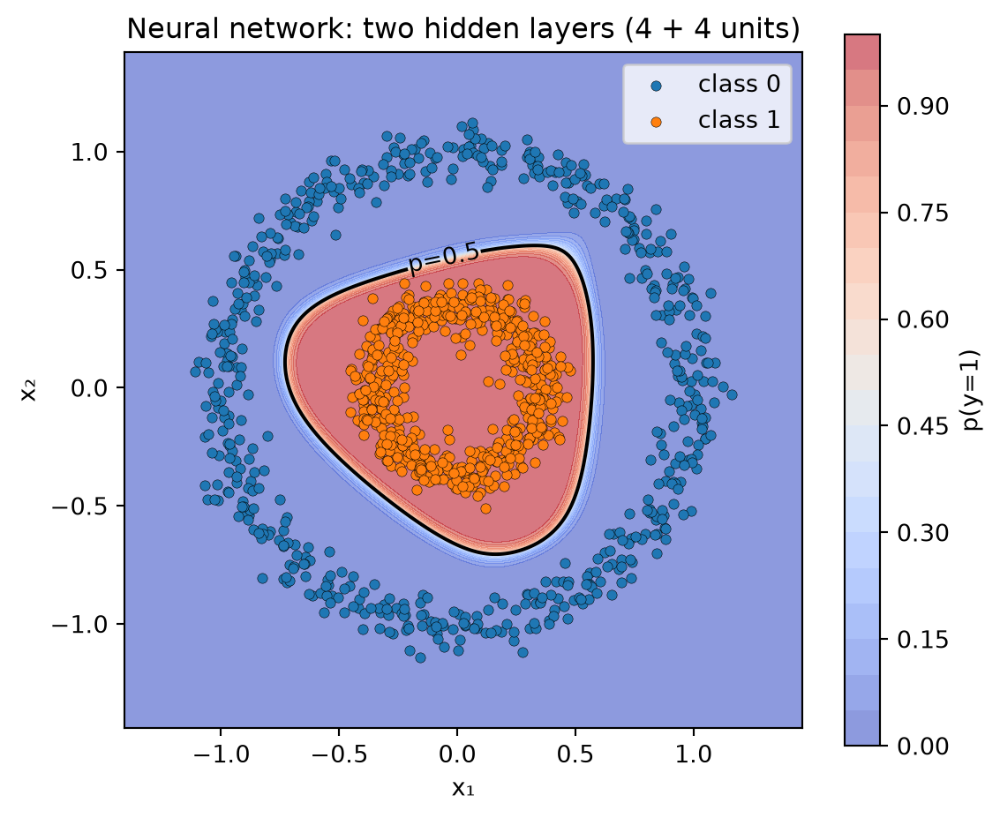

### Final evaluation on the circle test set

The comparison uses the same held-out examples for every model. It illustrates the effect of representation on this dataset; a successful run does not guarantee the same results for other datasets or training settings.

``` python
_, circle_test_accuracy = circle_mlp.evaluate(X_test, y_test, verbose=0)
circle_scores = {
    "Logistic: original inputs": clf_raw.score(X_test, y_test),
    "Logistic: radial feature": clf_r.score(radial_features(X_test), y_test),
    "Logistic: quadratic features": quad.score(X_test, y_test),
    "Neural network: original inputs": circle_test_accuracy,
}
for name, accuracy in circle_scores.items():
    print(f"{name:<34} test accuracy = {accuracy:.3f}")
```

    Logistic: original inputs          test accuracy = 0.471
    Logistic: radial feature           test accuracy = 1.000
    Logistic: quadratic features       test accuracy = 1.000
    Neural network: original inputs    test accuracy = 1.000

## XOR dataset

In Lecture 11, a hidden layer was configured by hand to compute Boolean XOR. Here, a continuous version lets us explore learning a nonlinear boundary. Interpret A as (x_1\>0) and B as (x_2\>0). Class 1 corresponds to A\oplus B: exactly one input is positive, giving the upper-left and lower-right quadrants.

A straight decision boundary cannot separate the classes in the original plane. Both suitable engineered features and a neural network can address this limitation.

``` python
rng = np.random.default_rng(42)
X_xor = rng.uniform(-6, 6, size=(800, 2))
A = X_xor[:, 0] > 0
B = X_xor[:, 1] > 0
y_xor = np.logical_xor(A, B).astype(int)

fig, ax = plt.subplots(figsize=(5, 5))
plot_samples(ax, X_xor, y_xor)
ax.axhline(0, color="gray", linestyle="--")
ax.axvline(0, color="gray", linestyle="--")
ax.set_title("XOR: exactly one input is positive")
plt.tight_layout()
plt.show()
```

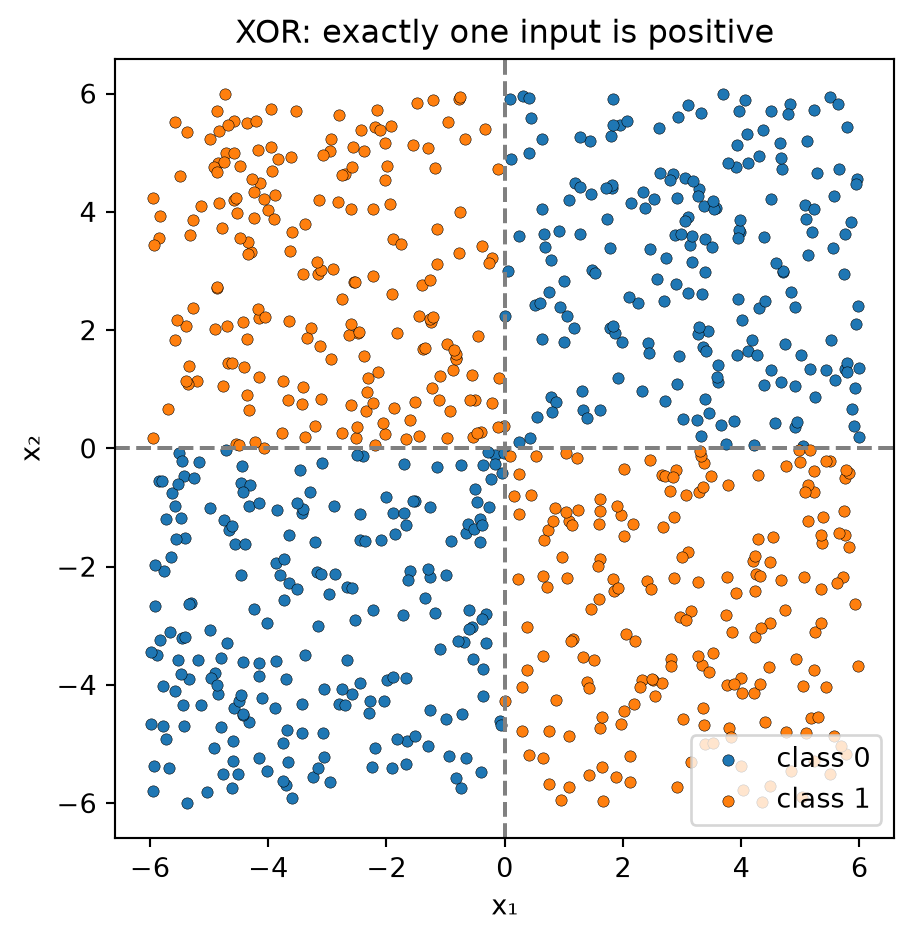

### Does the radial feature still work?

The radial feature discards sign information. Points at the same distance from the origin can belong to either class, so the feature that separated the circles cannot separate XOR. In this sampling distribution, the label is independent of the squared radius; a finite sample may nevertheless show small accidental associations.

``` python
r_xor = radial_features(X_xor)
plt.figure(figsize=(6, 4))
bins = np.linspace(r_xor.min(), r_xor.max(), 40)
for label in (0, 1):
    plt.hist(r_xor[y_xor == label, 0], bins=bins, alpha=0.65,
             label=f"class {label}")
plt.xlabel("r = x₁² + x₂²")
plt.ylabel("count")
plt.title("XOR classes overlap in r-space")
plt.legend()
plt.tight_layout()
plt.show()
```

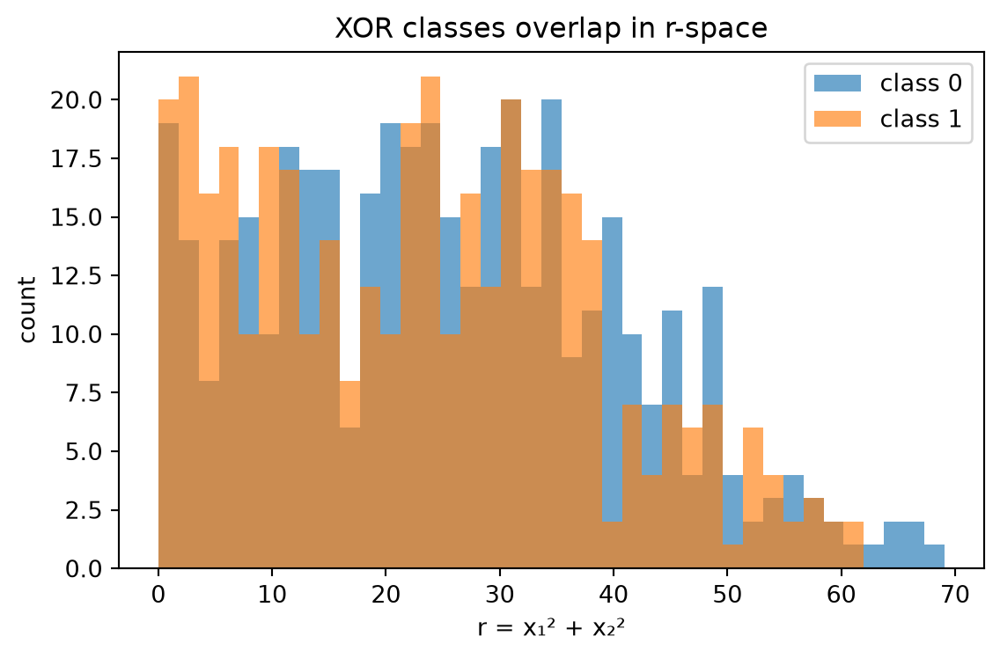

### A feature that preserves the relevant information

The product s=x_1x_2 distinguishes opposite signs from equal signs. Away from the coordinate axes, class 1 has s\<0, while class 0 has s\>0. A threshold at zero separates the classes in this feature space.

The quadratic feature expansion already includes x_1x_2. Thus, the full quadratic model can also represent an XOR boundary, even though the radial feature alone cannot.

``` python
def product_features(X):
    return (X[:, 0] * X[:, 1]).reshape(-1, 1)


X_train, X_valid, X_test, y_train, y_valid, y_test = split_dataset(X_xor, y_xor)
xor_raw = LogisticRegression().fit(X_train, y_train)
xor_radial = LogisticRegression().fit(radial_features(X_train), y_train)
xor_product = LogisticRegression().fit(product_features(X_train), y_train)
xor_quad = Pipeline([
    ("poly", PolynomialFeatures(degree=2, include_bias=False)),
    ("logreg", LogisticRegression()),
]).fit(X_train, y_train)

xx, yy, grid = make_grid(X_xor)
p_product = xor_product.predict_proba(product_features(grid))[:, 1]
plot_decision_boundary(xx, yy, p_product, X_xor, y_xor,
                       "XOR: logistic regression with the product feature")
```

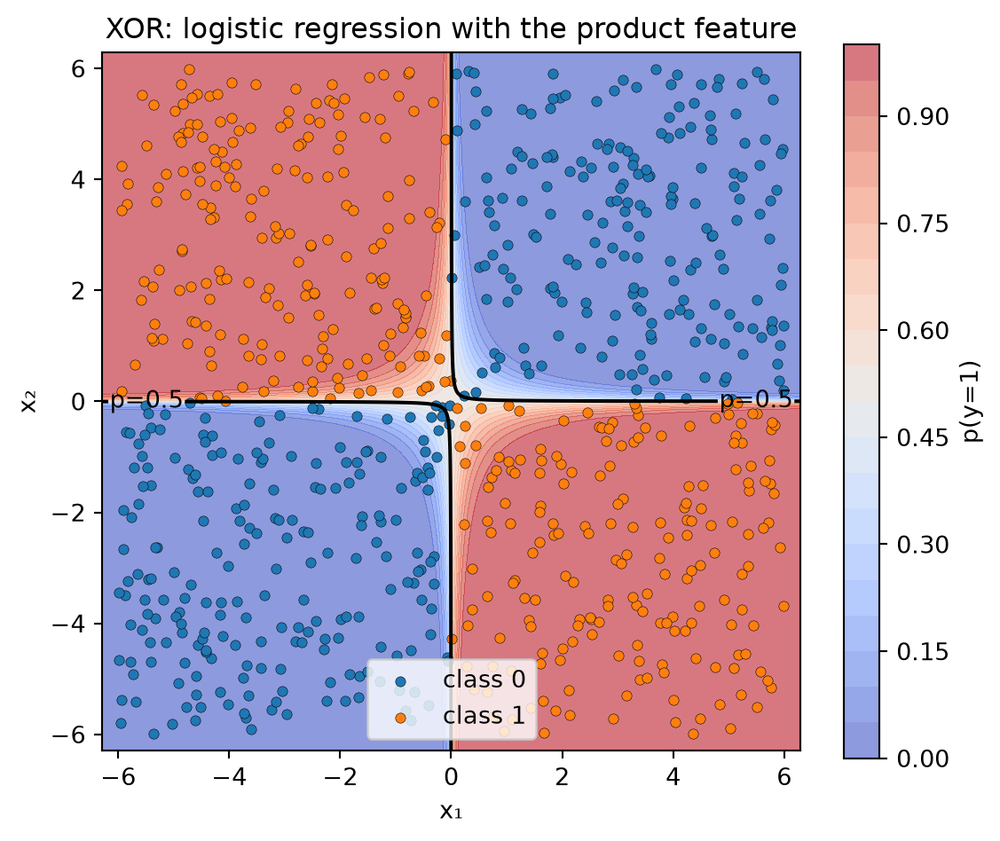

### Learning from the original inputs

We train a fresh neural network with the same architecture and settings used for the circles. Only the original inputs are provided; we do not supply the radial or product features. The plotting helper and model-building function are reused.

``` python
xor_mlp = make_mlp()
xor_history = xor_mlp.fit(
    X_train, y_train, validation_data=(X_valid, y_valid),
    epochs=300, batch_size=64, verbose=0,
    callbacks=[keras.callbacks.EarlyStopping(
        monitor="val_loss", patience=20, restore_best_weights=True,
    )],
)
_, train_accuracy = xor_mlp.evaluate(X_train, y_train, verbose=0)
_, valid_accuracy = xor_mlp.evaluate(X_valid, y_valid, verbose=0)
print(f"Epochs run: {len(xor_history.history['loss'])}")
print(f"Restored model: training accuracy = {train_accuracy:.3f}; "
      f"validation accuracy = {valid_accuracy:.3f}")

p_mlp = xor_mlp.predict(grid, verbose=0).ravel()
plot_decision_boundary(xx, yy, p_mlp, X_xor, y_xor,
                       "XOR: neural network with two hidden layers (4 + 4 units)")
```

    Epochs run: 126
    Restored model: training accuracy = 1.000; validation accuracy = 0.994

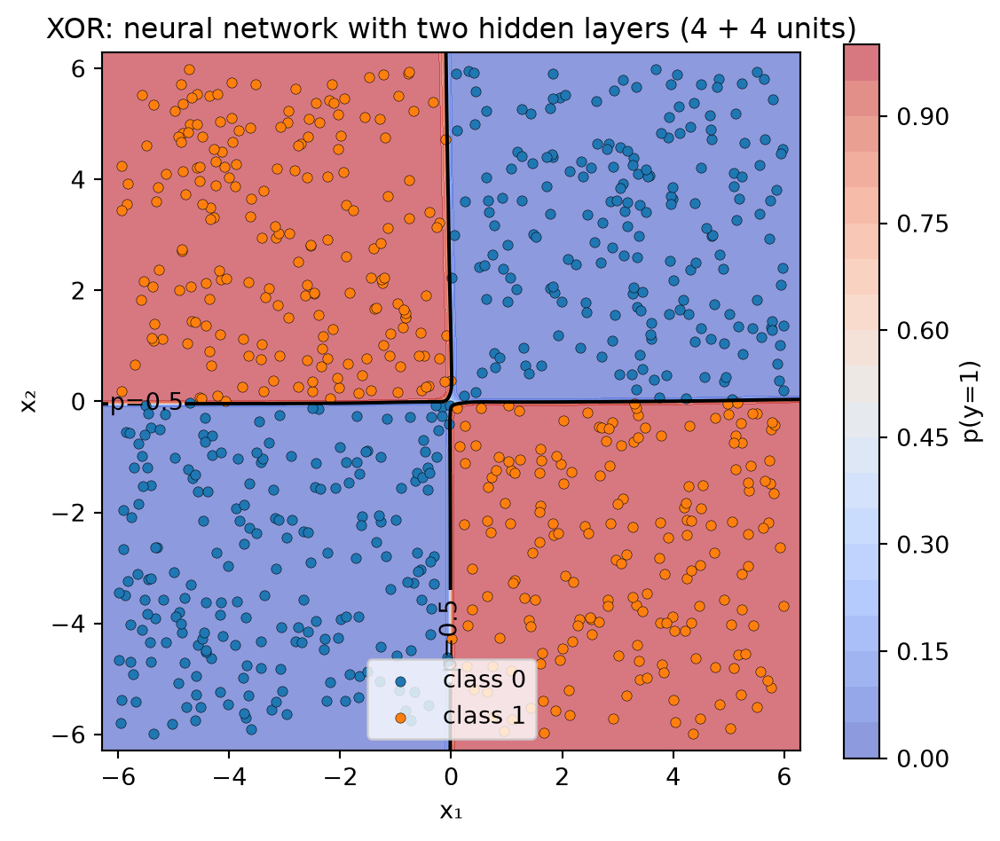

### Final evaluation on the XOR test set

``` python
_, xor_test_accuracy = xor_mlp.evaluate(X_test, y_test, verbose=0)
xor_scores = {
    "Logistic: original inputs": xor_raw.score(X_test, y_test),
    "Logistic: radial feature": xor_radial.score(radial_features(X_test), y_test),
    "Logistic: product feature": xor_product.score(product_features(X_test), y_test),
    "Logistic: quadratic features": xor_quad.score(X_test, y_test),
    "Neural network: original inputs": xor_test_accuracy,
}
for name, accuracy in xor_scores.items():
    print(f"{name:<34} test accuracy = {accuracy:.3f}")
```

    Logistic: original inputs          test accuracy = 0.512
    Logistic: radial feature           test accuracy = 0.556
    Logistic: product feature          test accuracy = 1.000
    Logistic: quadratic features       test accuracy = 0.988
    Neural network: original inputs    test accuracy = 1.000

## Takeaways

- Linear separability depends on the representation. A linear classifier on nonlinear features can have a nonlinear boundary in the original input space.
- Useful features depend on the task: squared radius separates these circles, while the product distinguishes the XOR quadrants.
- Hidden layers provide another way to learn a representation. They do not guarantee that training will find suitable parameters or that a neural network will outperform a model with well-chosen features.
- These experiments illustrate Lecture 11’s distinction between what an architecture can represent and what a training process finds from data.
