# Introduction to Artificial Neural Networks

CSI 4106 - Fall 2026

Author

Marcel Turcotte

Published

Version: Oct 20, 2026 15:33

# Preamble

## Message of the Day

[](https://storage.googleapis.com/gweb-uniblog-publish-prod/images/Male_Fruit_Fly_Hero.width-2200.format-webp.webp)

[5 amazing visuals show how the male fruit fly’s brain map is advancing neuroscience](https://blog.google/innovation-and-ai/technology/research/male-fruit-fly-brain-map/), Google Research, 2026-09-03.

Researchers at HHMI’s Janelia Research Campus, Google Research, and collaborating institutions have generated the first complete map of a male fruit fly brain. It comprises over 166,000 neurons.

As described in the article below, developers created game-playing demonstrations in less than a day by routing game inputs through the fly’s existing, biologically evolved neural circuitry. These demonstrations enabled the fly to play Minecraft, Doom, Beat Saber, and other games while allowing developers to examine how the network processed and responded to these inputs.

- [Scientists mapped a fruit fly’s brain. The internet made it play Doom](https://www.ibm.com/think/news/fruit-fly-connectome-brain-map-minecraft-doom) by Antonia Davison, IBM Think news, 2026-09-22.

## Message of the Day

## Message of the Day (continued)

## Message of the Day (2024)

[](https://www.nobelprize.org/uploads/2024/10/fig_fy_24_4x3-1024x768.jpg)

2 years ago, the timing for this lecture could not have been better since [John J. Hopfield](https://en.wikipedia.org/wiki/John_Hopfield) and [Geoffrey E. Hinton](https://www.cs.toronto.edu/~hinton/) were awarded the [2024 Nobel Prize in Physics](https://www.nobelprize.org/prizes/physics/2024/summary/) “for their fundamental discoveries and inventions enabling machine learning with artificial neural networks.”

## Learning objectives

- **Explain** how weights, biases, and activations determine a network’s forward computation.
- **Explain** why hidden layers with nonlinear activations can represent XOR.
- **Compare** the shapes and output ranges of sigmoid, tanh, and ReLU.
- **State** the assumptions and limits of universal approximation.
- **Build and evaluate** a Keras classifier on Fashion-MNIST using consistent preprocessing and separate training, validation, and test sets.

The course introduced symbolic AI and connectionism as two major approaches to artificial intelligence. Neural networks provide a connectionist model: many simple computational units work together to map inputs to outputs.

Two questions guide this introduction. **Computation** asks what a network does when its parameters are fixed. **Learning** asks how data can be used to choose those parameters. Understanding the computation comes first; the following lectures develop the training methods.

# Introduction

## TensorFlow Playground

[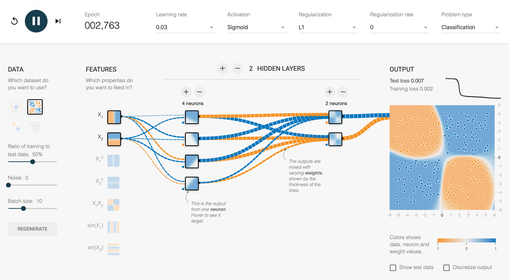](../../assets/images/playground_tensorflow.png)

[playground.tensorflow.org](https://playground.tensorflow.org)

TensorFlow Playground is an interactive demonstration of feedforward neural networks for two-dimensional classification. Its network diagram shows how inputs pass through hidden units to produce an output, while the background shows the resulting decision regions.

The weights determine the computation performed by the network. During training, changes to those weights alter the decision regions. The distinction between computing a prediction and learning the parameters also applies to the larger networks used later in this lecture.

Experiment with TensorFlow Playground to build intuition about how feature transformations and network architecture affect classification. For the nonlinearly separable circle and exclusive OR (XOR) datasets, first try to construct classifiers with no hidden layers by incorporating additional input features. Then, using only the original input features, explore how increasing the number of hidden layers and units enables the network to learn nonlinear decision boundaries.

## Neural Networks (NN)

**Artificial neural networks** are machine learning models built from interconnected computational units, inspired by biological neurons.

- **Computation:** with fixed parameters, a network maps inputs to outputs.
- **Learning:** training uses examples to adjust the parameters.

AKA **artificial neural networks** or **neural nets**, abbreviated as ANN or NN.

## Machine Learning Problems

[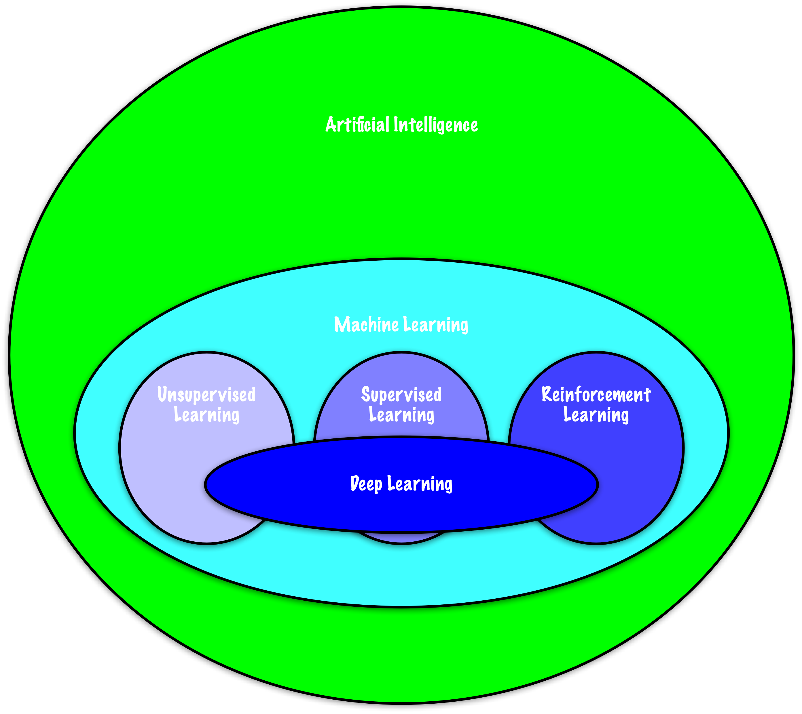](../../assets/images/ai_ml_dl-en.png)

- **Supervised Learning**: Classification, Regression

- **Unsupervised Learning**: Autoencoders, Self-Supervised

- **Reinforcement Learning**: Now an Integral Component

We will begin our exploration within the framework of supervised learning.

## A neuron

[](https://upload.wikimedia.org/wikipedia/commons/3/36/Components_of_neuron.jpg)

**Attribution:** Jennifer Walinga, [CC BY-SA 4.0](https://creativecommons.org/licenses/by-sa/4.0)

Biological neurons receive signals through their connections and transmit signals to other neurons. Artificial neural networks borrow the idea of interconnected units, but use deliberately simplified mathematical computations.

For the models studied here, the useful abstraction is a unit that combines its inputs and produces an output. Composing these units gives a network that performs a more complex computation.

## Interconnected neurons

# An error occurred.

Unable to execute JavaScript.

**Attribution**: [Molecular Mechanism of Synaptic Function](https://www.biointeractive.org/classroom-resources/molecular-mechanism-synaptic-function) from the Howard Hughes Medical Institute (HHMI). Published on YouTube on 2018-11-15.

From biology, we essentially adopt the concept of simple computational units that are interconnected to form a network, which collectively performs complex computations.

While research into understanding biological neural networks is undeniably important, the field of artificial neural networks has incorporated only a limited number of key concepts from this research.

## Neural Mind

> **NOTE:**
>
> **Neurons are just cells.** Alone, they are incapable of thought. But combined into **circuits** hooked up to our bodies in just the right ways, they have allowed human beings to survive, think, communicate, and create all of culture.

A single unit combines its inputs using a weighted sum and a bias, then applies an activation function. For a binary threshold unit, the equation \mathbf{w}^{T}\mathbf{x}+b=0 defines a decision hyperplane. A network composes many such computations, allowing intermediate units to transform the inputs before the output is computed.

## Connectionist

[](https://raw.githubusercontent.com/alexlenail/NN-SVG/master/example.svg)

**Attribution**: LeNail, (2019). NN-SVG: Publication-Ready Neural Network Architecture Schematics. Journal of Open Source Software, 4(33), 747, https://doi.org/10.21105/joss.00747 ([GitHub](https://github.com/alexlenail/NN-SVG))

The term **connectionism** emphasizes the connections between computational units. In the feedforward networks studied here, units are organized into layers, and each connection has an associated weight.

The architecture specifies which units are connected. The weights and biases determine the function computed by that architecture. Training adjusts these parameters using data, so that the network’s predictions better match the targets.

## Hierarchy of concepts

[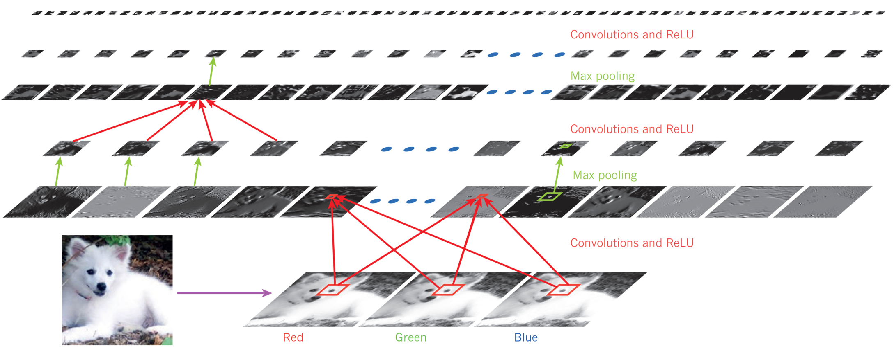](../../assets/images/cnn_lecun_et_al_nature.png)

**Attribution**: LeCun et al. ([2015](#ref-LeCun:2015aa))

In the book “Deep Learning” ([Goodfellow et al. 2016](#ref-Goodfellow:2016aa)), authors Goodfellow, Bengio, and Courville define deep learning as a subset of machine learning that enables computers to “understand the world in terms of a hierarchy of concepts.”

This hierarchical approach is one of deep learning’s most significant contributions. It reduces the need for manual feature engineering and redirects the focus toward the engineering of neural network architectures.

# Basics

## Computation with threshold units

[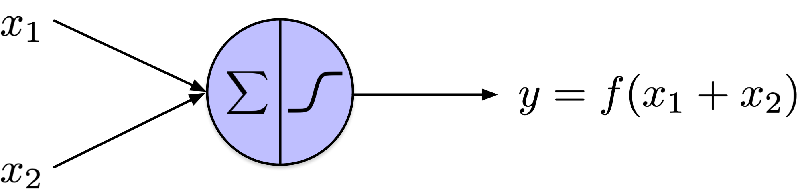](../../assets/images/ann_threhold_unit.png)

where x_1, x_2 \in \\0,1\\ and f(z) is a **step function**:

f(z)= \begin{cases}0, & z\<\theta \\ 1, & z \geq \theta\end{cases}

McCulloch and Pitts ([1943](#ref-McCulloch:1943ab)) connected neural activity with **Boolean computation**.

McCulloch and Pitts studied networks of idealized neurons whose activity is binary: a unit is either active or inactive. Their model used fixed thresholds and excitatory and inhibitory connections ([McCulloch and Pitts 1943](#ref-McCulloch:1943ab)). The threshold-unit examples here provide a simplified illustration of the connection to logic.

The function f(z) is the indicator of the condition z\geq\theta: it returns 1 when the condition holds and 0 otherwise. A unit therefore maps binary inputs to a binary output.

Units implementing AND, OR, and NOT can be composed into circuits that compute Boolean functions. The parameters in these examples are chosen by hand so that the computation is easy to follow.

## Computation with threshold units

f(x_1 + x_2)= \begin{cases}0, & x_1 + x_2 \<\theta \\ 1, & x_1 + x_2 \geq \theta\end{cases}

- With \theta = 2, the unit implements an **AND** logic gate.

- With \theta = 1, the unit implements an **OR** logic gate.

**NOT** can also be implemented with a negative input weight and an appropriate threshold.

For binary x, a unit with input weight -1 and threshold 0 computes NOT: f(-x)=1 when x=0 and f(-x)=0 when x=1. A negative weight alone does not specify a gate; its effect depends on the threshold and the other inputs.

AND and OR require no learning in this illustration: their thresholds have been selected to implement the desired truth tables.

## Networks compute functions

- Networks of threshold units can implement **Boolean functions** by composing logical operations.

- With the connections and thresholds fixed, the network performs a **specified computation**.

- **Learning** introduces a different question: how can data determine the parameters?

McCulloch and Pitts connected idealized neural networks to the mathematical study of computation ([McCulloch and Pitts 1943](#ref-McCulloch:1943ab)). In the examples here, composing threshold units provides a concrete way to compute a Boolean function.

Their broader discussion of Turing computation included networks supplied with a tape and mechanisms for reading and writing it. A fixed feedforward network implements a chosen function. The key idea for this lecture is that simple units can be composed into a network that maps inputs to outputs.

Rosenblatt’s perceptron shifts the emphasis toward learning from examples: some of the parameters are adjusted using data rather than specified entirely by hand.

## Perceptron

# An error occurred.

Unable to execute JavaScript.

The buzz around artificial intelligence isn’t a new trend; in fact, it was already generating excitement back in 1958, as highlighted by a quote from the New York Times.

> **NOTE:**
>
> The Navy revealed the embryo of an electronic computer today that it expects will be able to **walk**, **talk**, **see**, **write**, **reproduce itself**, and be **conscious** of its existence.

- [The Machine That Changed the World - TV Series - 1992](https://www.imdb.com/title/tt1245829/)

The historical footage illustrates both the early enthusiasm for learning machines and the gap between demonstrations and ambitious predictions about their future capabilities.

## Perceptron

# An error occurred.

Unable to execute JavaScript.

## Threshold logic unit

[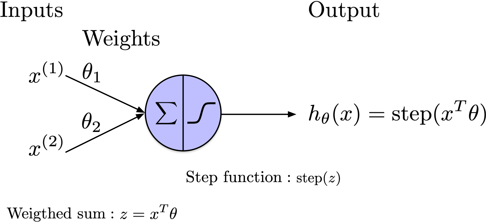](../../assets/images/ann_threhold_unit-00-en.png)

Rosenblatt ([1958](#ref-Rosenblatt:1958aa))

Rosenblatt’s perceptron introduced a model that could learn from examples by adjusting parameters ([Rosenblatt 1958](#ref-Rosenblatt:1958aa)). A weighted threshold unit provides the simplified computational model used here.

Its inputs can be real-valued, but its output is discrete. With the Heaviside step function, the output is either 0 or 1. Each input connection has an associated weight.

The left section of the neuron, denoted by the sigma symbol, represents the computation of a weighted sum of its inputs, expressed as \theta_1 x^{(1)} + \theta_2 x^{(2)} + \ldots + \theta_D x^{(D)} + b.

This sum is then processed through a step function, right section of the neuron, to generate the output.

Here, x and \theta are column vectors. The transpose x^T is a row vector, so x^T\theta is their dot product.

The dot product x^T \theta is then a scalar given by:

x^T \theta = x^{(1)} \theta_1 + x^{(2)} \theta_2 + \cdots + x^{(D)} \theta_D

where x^{(j)} and \theta_j are the components of the vectors x and \theta, respectively. The superscripts on x identify features in these diagrams.

## Simple Step Functions

[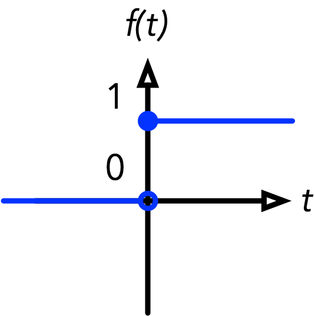](../../assets/images/heavyside.png)

**\text{Heaviside}(t) =**

- 1, if t \geq 0

- 0, if t \< 0

[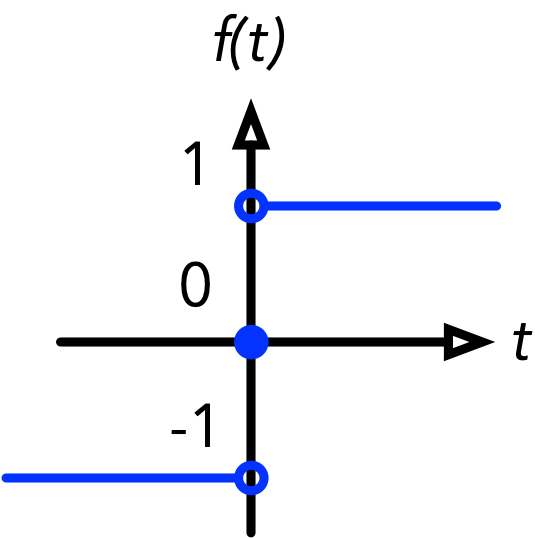](../../assets/images/sign.png)

**\text{sign}(t) =**

- 1, if t \> 0

- 0, if t = 0

- -1, if t \< 0

Common **step functions** include the **Heaviside step function** (0 if the input is negative and 1 otherwise) or the **sign** function (-1 if the input is negative, 0 if the input is zero, 1 otherwise).

## Notation

[](../../assets/images/ann_threhold_unit-01-en.png)

Add an extra feature with a fixed value of 1 to the input. Associate it with weight b = \theta\_{0}, where b is the bias/intercept term.

## Notation

[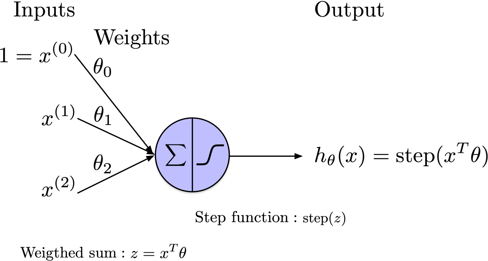](../../assets/images/ann_threhold_unit-02-en.png)

\theta\_{0} = b is the bias/intercept term.

The weighted sum and bias are familiar from logistic regression. Logistic regression passes that score through a sigmoid to obtain a probability; a binary threshold unit applies a step function to obtain a class decision directly. Their decision boundaries are both linear in the input features, but their training procedures differ.

## Perceptron

[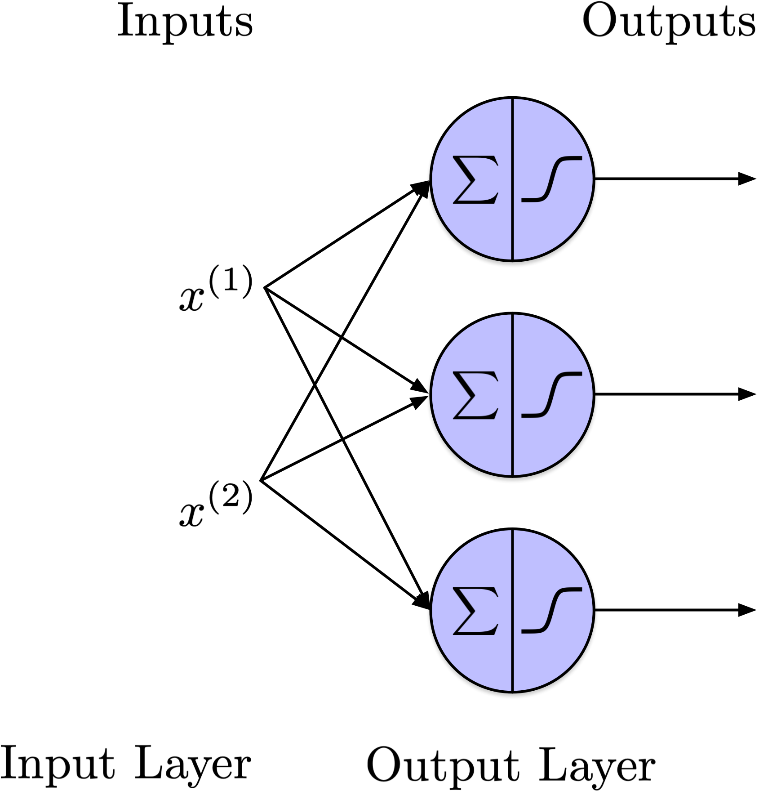](../../assets/images/ann_perceptron-00-en.png)

A **perceptron** consists of one or more **threshold logic units** arranged in a **single layer**, with each unit connected to all inputs. This configuration is referred to as **fully connected** or **dense**.

Since the threshold logic units in this single layer also generate the output, it is referred to as the **output layer**.

## Perceptron

[](../../assets/images/ann_perceptron-00-en.png)

As this perceptron generates multiple outputs simultaneously, it performs **multiple binary predictions**, making it as a **multilabel classifier** (can also be used as multiclass classifier).

Classification tasks, can be further divided into **multilabel** and **multiclass** classification.

1.  **Multiclass Classification:**

    - In multiclass classification, each instance is assigned to one and only one class out of a set of three or more possible classes. The classes are mutually exclusive, meaning that an instance cannot belong to more than one class at the same time.

    - **Example:** Classifying an image as either a cat, dog, or bird. Each image can only belong to one of these categories.

2.  **Multilabel Classification:**

    - In multilabel classification, each instance can be associated with multiple classes simultaneously. The classes are not mutually exclusive, allowing for the possibility that an instance can belong to several classes at once.

    - **Example:** Tagging an image with multiple attributes such as “outdoor,” “sunset,” and “beach.” The image can simultaneously belong to all these labels.

The key difference lies in the relationship between classes: **multiclass classification deals with a single label per instance**, while **multilabel classification handles multiple labels for each instance**.

## Notation

[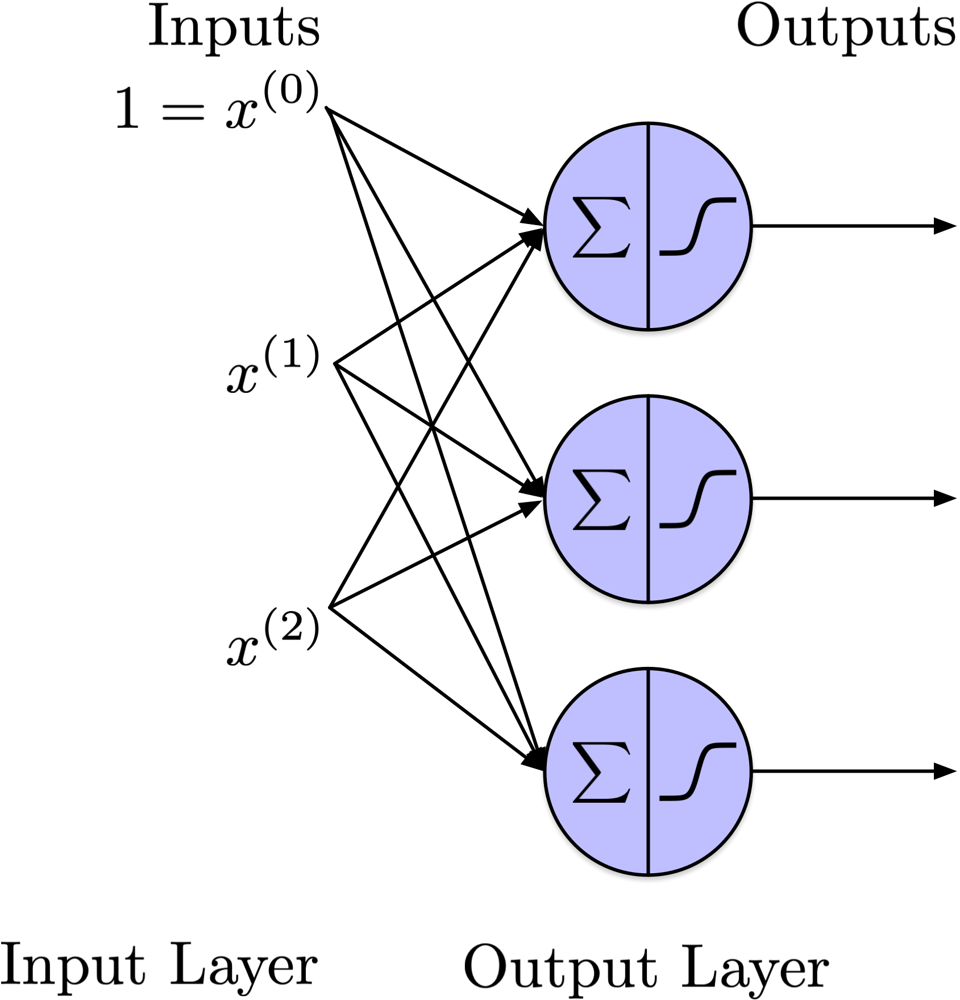](../../assets/images/ann_perceptron-01-en.png)

As before, introduce an additional feature with a value of 1 to the input. **Assign a bias b to each neuron.** Each incoming connection **implicitly** has an associated weight.

## Notation

- X is the input **data matrix** where **each row corresponds to an example** and **each column represents one of the D features**.

- W is the **weight matrix**, structured with one **row per input (feature)** and **one column per neuron**.

- **Bias terms** can be represented separately; both approaches appear in the literature. Here, b is a vector with a **length equal to the number of neurons**.

With neural networks, the **weights** are often denoted by w (vector) or W (matrix), rather than \theta.

## From computation to learning

- The **forward computation** uses the current weights and biases to produce a prediction.
- **Training** adjusts these parameters using examples and their target outputs.
- Rosenblatt’s perceptron established this shift toward **learning from data**.

The distinction is familiar from logistic regression: evaluating a model with fixed parameters and fitting those parameters to data are different operations. This lecture establishes the computations performed by neural networks; the next two lectures develop methods for training multilayer networks.

The perceptron learning rule is outside the scope of this lecture. For modern networks, backpropagation computes gradients, and an optimizer such as stochastic gradient descent uses them to update the parameters.

## A limitation: XOR

[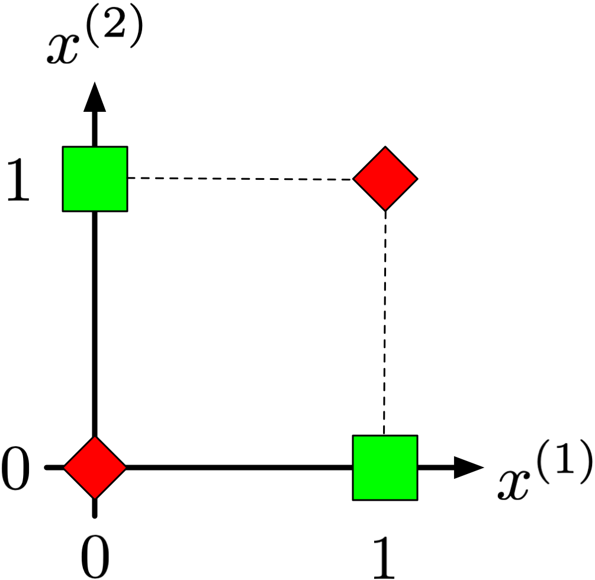](../../assets/images/ann_perceptron_xor.png)

A single threshold unit cannot separate the two XOR classes with **one straight line**. XOR is **not linearly separable** in the original input space.

For binary inputs, XOR is 1 at (0,1) and (1,0), and 0 at (0,0) and (1,1). A threshold unit computes one weighted sum plus a bias, so its decision boundary in this two-dimensional space is a straight line. No such line separates these two classes.

Logistic regression has the same limitation when applied directly to these two inputs. Additional nonlinear features can change what a linear classifier can represent.

Minsky and Papert’s *Perceptrons* analyzed the computational limitations of restricted perceptron models ([Minsky and Papert 1969](#ref-Minsky:1969aa)). These results should not be interpreted as showing that multilayer networks cannot represent XOR. Representing a function and learning suitable parameters are separate questions.

## XOR as a composition of gates

**At least one input is true, and they are not both true:**

A\oplus B=(A\lor B)\land\neg(A\land B)

- **OR** detects whether at least one input is true.
- **AND** detects whether both inputs are true.
- Combining their outputs gives **XOR**.

The minimal expression above connects directly to the AND and OR units in the network diagram. Two other standard expressions are useful for comparison:

\begin{aligned} A\oplus B &= (A\land\neg B)\lor(\neg A\land B) &&\text{(disjunctive normal form)},\\ A\oplus B &= (A\lor B)\land(\neg A\lor\neg B) &&\text{(conjunctive normal form)}. \end{aligned}

The first expression says that exactly one input is true. In the second, A\lor B requires at least one true input, while \neg A\lor\neg B excludes the case where both inputs are true. By De Morgan’s law, \neg A\lor\neg B=\neg(A\land B).

**A Boolean connection:** Geoffrey Hinton is the **great-great-grandson of George Boole**, whose work underlies Boolean algebra. This family connection links the logic used in this example with one of the researchers who helped popularize training multilayer neural networks. [University College Cork’s George Boole bicentenary project](https://georgeboole.com/news/george-booles-great-great-grandson-prof-geoffrey-hinton-wins-nobel-prize-of-computing-.html)

## Multilayer Perceptron

[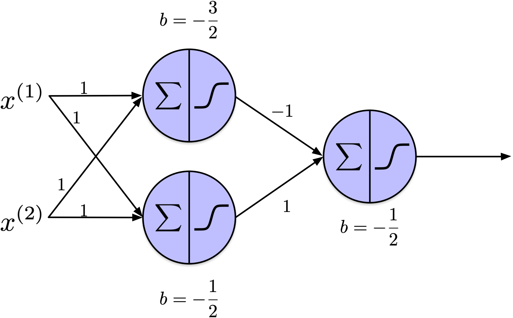](../../assets/images/ann_mlp_xor.png)

A **multilayer perceptron** (MLP) has one or more **hidden layers** between its inputs and output layer. Here, the hidden units compute **AND** (top) and **OR** (bottom).

The input nodes pass the features to the hidden units. The hidden units compute intermediate values, which become inputs to the output unit. For XOR, one hidden layer and one output layer are sufficient: these are two layers of computation, excluding the input nodes.

This hand-configured example uses threshold units to make the logical operations explicit. Modern MLPs typically use activations such as ReLU in their hidden layers; their weights and biases are learned jointly from data.

## XOR: intermediate computations

| A   | B   | Target y | o_1: AND | o_2: OR | o_3: XOR |
|-----|-----|----------|----------|---------|----------|
| 0   | 0   | 0        | 0        | 0       | 0        |
| 0   | 1   | 1        | 0        | 1       | 1        |
| 1   | 0   | 1        | 0        | 1       | 1        |
| 1   | 1   | 0        | 1        | 1       | 0        |

The output unit computes o_2\land\neg o_1. The hidden representation makes XOR **linearly separable**.

In the diagram, A=x^{(1)} and B=x^{(2)}. The outputs o_1 and o_2 identify the AND and OR hidden units, and o_3 is the network’s prediction. The table confirms that o_3=y for all four input combinations.

With the convention H(z)=1 for z\geq0 and H(z)=0 otherwise, AND and OR can be implemented as

o_1=H(A+B-1.5),\qquad o_2=H(A+B-0.5).

An output unit such as o_3=H(o_2-2o_1-0.5) computes o_2\land\neg o_1. The negative weight suppresses the output when both original inputs are true. Several choices of weights and biases produce the same truth table.

The transformed inputs (o_1,o_2) are (0,0), (0,1), and (1,1). The two positive XOR cases both map to (0,1), which a straight line can separate from the negative cases. The network therefore computes an intermediate representation that makes the final classification possible.

**Equivalent OR/NAND construction.** A negative weight with a suitable bias can implement NOT: H(-A+0.5)=\neg A. Likewise, a single threshold unit implements NAND as H(-A-B+1.5). Its preactivation is 1.5,0.5,0.5,-0.5 for inputs (0,0),(0,1),(1,0),(1,1), yielding outputs 1,1,1,0.

The hidden units can therefore also compute h_1=H(A+B-0.5) (OR) and h_2=H(-A-B+1.5) (NAND). An AND output H(h_1+h_2-1.5) then computes XOR. This is an equivalent network; the displayed diagram uses AND and OR hidden units instead.

**Representation and learning.** The weights in this example are supplied by hand. For a general task, the desired outputs of the hidden units are not supplied: training must determine how changing their incoming weights affects the final prediction. This is the **credit assignment problem**.

Minsky and Papert established representational limitations for the restricted models they analyzed and expressed skepticism about multilayer extensions ([Minsky and Papert 1969](#ref-Minsky:1969aa)). Their results did not establish that all neural networks share those limitations. These mathematical results are distinct from the broader historical question of why interest and funding in connectionist research declined. [Bottou’s foreword to the reissued *Perceptrons*](https://leon.bottou.org/publications/pdf/perceptrons-2017.pdf) discusses this distinction and the historical context.

Hard step functions pose an additional obstacle for ordinary gradient-based training: their derivatives are zero away from the threshold and undefined at the threshold. Backpropagation with suitable activation functions provides a way to compute how the loss depends on hidden-layer parameters. Rumelhart, Hinton, and Williams helped popularize this approach in 1986 ([Rumelhart et al. 1986](#ref-Rumelhart:1986aa)). The learning procedure can discover intermediate features instead of requiring a person to choose them.

## Feedforward Neural Network (FNN)

[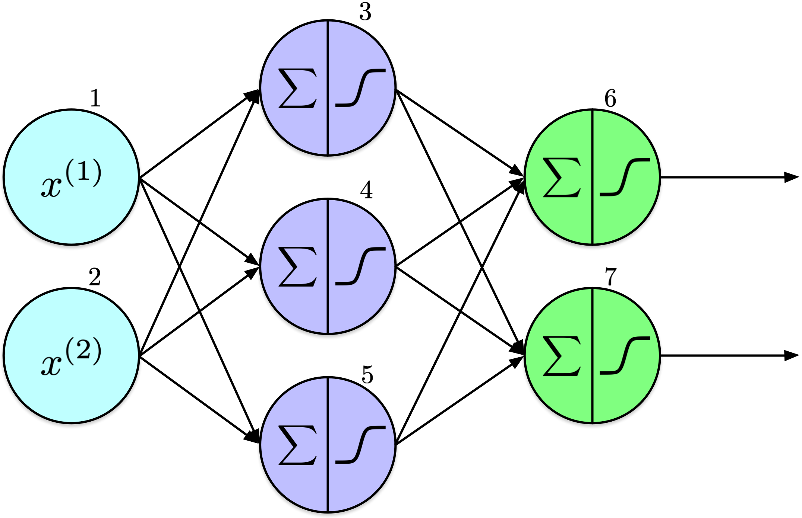](../../assets/images/ann_mlp-07.png)

Information in this architecture flows unidirectionally—from left to right, moving from input to output. Consequently, it is termed a **feedforward neural network**.

The diagram shows **input**, **hidden**, and **output** layers. There are two input nodes, three hidden units, and two output units. Counting only layers that perform parameterized computations, this is a **two-layer network**: one hidden layer and one output layer. Additional hidden layers and units can be added.

It is often useful to include explicit input nodes that do not perform calculations, known as **input units** or **input neurons**. These nodes act as placeholders to introduce input features into the network, passing data directly to the next layer without transformation. In the network diagram, these are the light blue nodes on the left, labeled 1 and 2. Typically, **the number of input units corresponds to the number of features**.

For clarity, nodes are labeled to facilitate discussion of the weights between them, such as w\_{1,5} between nodes 1 and 5. Similarly, the output of a node is denoted by o_k, where k represents the node’s label. For example, for k=3, the output would be o_3.

## Weighted sum and activation

Each computational unit performs **two operations**:

z_j=\sum\_{i\to j} w\_{i,j}o_i+b_j, \qquad o_j=\varphi(z_j).

- z_j: **weighted sum plus bias**, before activation.
- o_j: the unit’s **output**, after applying the activation \varphi.

The sum runs over the nodes connected to unit j. The weight w\_{i,j} connects source node i to destination node j, and b_j is the bias of unit j. The input nodes pass the features unchanged: in the preceding diagram, o_1=x^{(1)} and o_2=x^{(2)}.

The quantity z_j is also called the **preactivation**. The output o_j is the **activation**; some references denote this output by a_j. The notation o_j is retained here to match the diagrams and the XOR example.

The symbol \varphi denotes a general activation function. When the activation is the logistic sigmoid, it is written \sigma. The summation symbol \sum in the left half of a unit represents aggregation, a different operation from the activation in the right half.

## Forward pass (computation)

[](../../assets/images/ann_mlp-07.png)

o_3 = \sigma(w\_{1,3}x^{(1)}+w\_{2,3}x^{(2)}+b_3)

o_4 = \sigma(w\_{1,4}x^{(1)}+w\_{2,4}x^{(2)}+b_4)

o_5 = \sigma(w\_{1,5}x^{(1)}+w\_{2,5}x^{(2)}+b_5)

o_6 = \sigma(w\_{3,6}o_3+w\_{4,6}o_4+w\_{5,6}o_5+b_6)

o_7 = \sigma(w\_{3,7}o_3+w\_{4,7}o_4+w\_{5,7}o_5+b_7)

Compute the **hidden outputs first**, then use them to compute the **final outputs**.

Every right-hand side first forms a weighted sum z_j, then applies the sigmoid to obtain o_j. The output units depend on the hidden units, so the hidden outputs must be available before the final outputs can be computed.

The diagram omits biases for clarity, but each computational unit has its own bias. A bias shifts the unit’s preactivation independently of its inputs. For a threshold unit, it moves the decision boundary away from the origin; for a sigmoid or ReLU unit, it shifts the position of the activation’s transition. Its role does not imply that training will automatically set an unnecessary bias to zero or that adding biases always makes training faster.

These two sigmoid outputs are separate values. A categorical distribution over mutually exclusive classes requires an output function such as the softmax used in the Fashion-MNIST example.

## Numerical forward pass

Code

``` python
import numpy as np
from scipy.special import expit as sigmoid

rng = np.random.default_rng(42)
x1, x2 = 0.5, 0.9

w13, w14, w15, w23, w24, w25 = rng.uniform(-1, 1, size=6)
w36, w46, w56, w37, w47, w57 = rng.uniform(-1, 1, size=6)
b3, b4, b5, b6, b7 = np.zeros(5)
```

``` python
z3 = w13 * x1 + w23 * x2 + b3
o3 = sigmoid(z3)
z4 = w14 * x1 + w24 * x2 + b4
o4 = sigmoid(z4)
z5 = w15 * x1 + w25 * x2 + b5
o5 = sigmoid(z5)
z6 = w36 * o3 + w46 * o4 + w56 * o5 + b6
o6 = sigmoid(z6)
z7 = w37 * o3 + w47 * o4 + w57 * o5 + b7
o7 = sigmoid(z7)

(o6, o7)
```

    (np.float64(0.48638976530233274), np.float64(0.6254814695767328))

This example follows the preceding equations for one input. In the code, `w13` is a short name for w\_{1,3}; `z3` and `o3` distinguish the preactivation and activation of unit 3. The fixed random seed makes the illustrative weights reproducible.

The example has randomized weights and zero biases. Different initial weights let hidden units begin with different computations, breaking symmetry between otherwise identical units. Biases can start at zero and still be learned. This distinction is developed in the training lectures.

The uniform weights here are chosen for a small illustration, rather than as an initialization prescription for deep networks. Keras Dense layers use Glorot uniform weights and zero biases by default. [Keras Dense documentation](https://keras.io/api/layers/core_layers/dense/)

## Forward pass in a deep network

[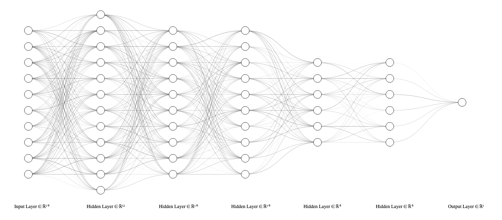](../../assets/images/nn-7layers-bezier-nobias.png)

The same sequence of computations applies to a **deep neural network**, with more hidden layers.

Produced using **NN-SVG**, LeNail ([2019](#ref-LeNail:2019aa)).

## Forward pass with biases

[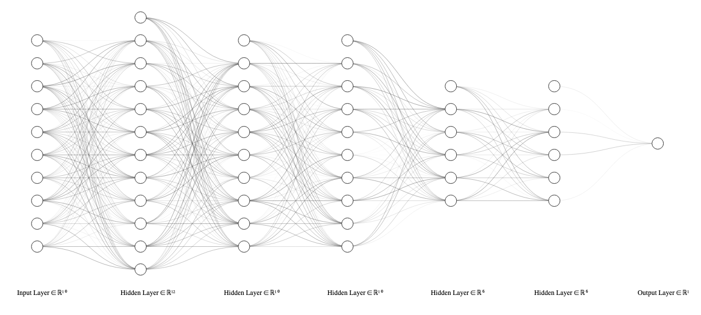](../../assets/images/nn-7layers-bezier-bias.png)

The same network with **bias inputs shown**.

Produced using **NN-SVG**, LeNail ([2019](#ref-LeNail:2019aa)).

## Why nonlinear activations?

- Hidden layers transform their inputs into **intermediate representations**.
- Without nonlinear activations between layers, their composition is still **one affine transformation**.
- Nonlinear activations allow the network to represent more complex input-output relationships.

An affine transformation is a weighted sum plus a bias. For a one-dimensional example, composing h=w_1x+b_1 with y=w_2h+b_2 gives

y=(w_2w_1)x+(w_2b_1+b_2).

This is another affine transformation. The same reasoning applies to matrix-valued computations, so stacking affine layers alone does not give a network the ability to represent XOR in its original inputs. The hidden threshold functions in the XOR example supplied the necessary nonlinearity.

Activation functions have two distinct roles. Their nonlinearity affects what a network can represent; their derivatives affect how it can be trained. The classroom emphasis here is on computation and representation. Backpropagation and the detailed derivative comparisons are developed in Lecture 13.

## Activations and training

- **Backpropagation** computes gradients; an **optimizer** uses them to update parameters.
- The derivatives of a **hard step function** do not provide a useful signal for ordinary gradient-based training.
- Modern networks use activations such as **sigmoid**, **tanh**, and **ReLU**.

A hard step has derivative zero away from the threshold and is not differentiable at the threshold. Sigmoid and tanh provide smooth alternatives. ReLU is differentiable except at zero, where implementations choose a convention; this isolated point does not prevent ordinary backpropagation in practice.

Nonlinearity and trainability are separate considerations: the hard threshold already supplies enough nonlinearity for the hand-configured XOR network, even though its ordinary derivatives are unsuitable for learning its parameters by gradient descent.

## Sigmoid

\sigma(z)=\frac{1}{1+e^{-z}}

Output range: (0,1).

Code

``` python
import matplotlib.pyplot as plt


def relu(z):
    return np.maximum(0, z)


def plot_activation(activation, name, output_limits):
    z = np.linspace(-6, 6, 400)
    fig, ax = plt.subplots(figsize=(5, 3.5))
    ax.plot(z, activation(z), color="black", linewidth=2)
    ax.set(xlabel="$z$", ylabel="Output", title=name, ylim=output_limits)
    ax.grid(True)
    fig.patch.set_alpha(0)
    plt.show()


plot_activation(sigmoid, "Sigmoid", (-0.1, 1.1))
```

[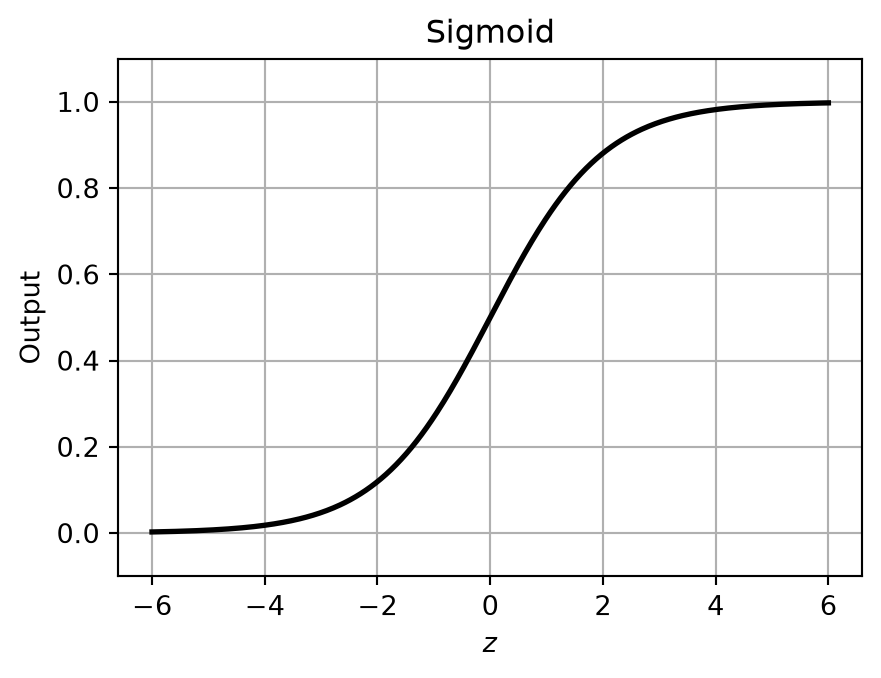](slides_files/figure-html/cell-4-output-1.png)

The sigmoid is familiar from logistic regression. It maps any finite real input to a value strictly between 0 and 1. In a hidden layer, this value is an intermediate activation; it does not automatically have the interpretation of a class probability.

## Hyperbolic tangent (tanh)

\tanh(z)=2\sigma(2z)-1

Output range: (-1,1).

Code

``` python
plot_activation(np.tanh, "Tanh", (-1.1, 1.1))
```

[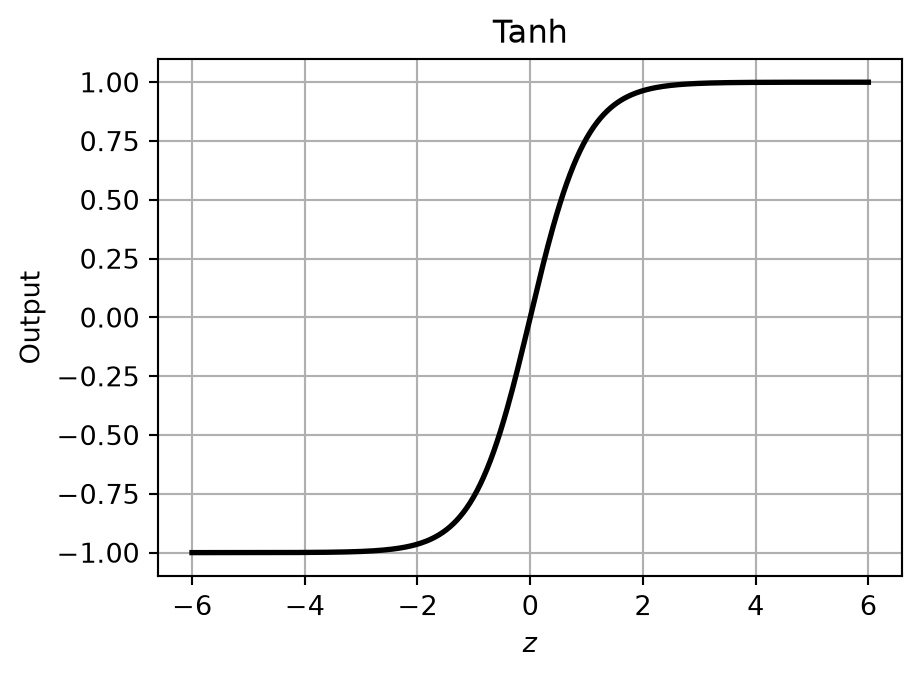](slides_files/figure-html/cell-5-output-1.png)

Unlike the sigmoid, tanh can produce both negative and positive activations, with \tanh(0)=0. Its output range is centered on zero, but a layer’s actual mean activation still depends on its inputs and parameters. This property alone does not guarantee faster convergence.

## Rectified linear unit (ReLU)

\operatorname{ReLU}(z)=\max(0,z)

Output range: \[0,\infty).

Code

``` python
plot_activation(relu, "ReLU", (-0.5, 6.5))
```

[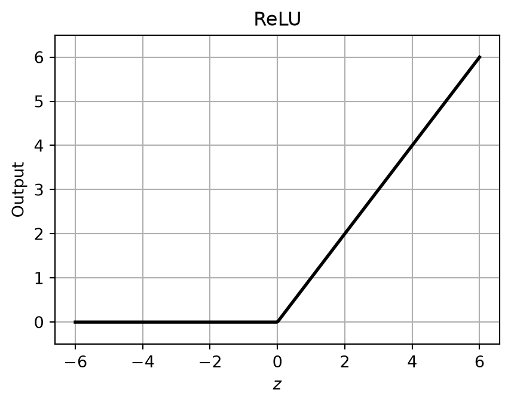](slides_files/figure-html/cell-6-output-1.png)

A common choice for **hidden layers**, including those in the Keras example.

ReLU returns zero for negative inputs and passes positive inputs unchanged. Although each side is linear, the change of slope at zero makes the function nonlinear. Composing affine transformations with ReLU can produce piecewise-linear functions with many regions.

ReLU is a common hidden-layer choice, rather than a universal default for every layer or task. In Keras, a Dense layer without an explicit activation uses the identity (linear) activation. Output activations are chosen to match the prediction task.

## Comparing activation functions

Code

``` python
z = np.linspace(-4, 4, 401)
fig, ax = plt.subplots(figsize=(7, 4))
ax.step(z, (z >= 0).astype(int), where="post", label="Step")
ax.plot(z, sigmoid(z), label="Sigmoid")
ax.plot(z, np.tanh(z), label="Tanh")
ax.plot(z, relu(z), label="ReLU")
ax.set(xlabel="$z$", ylabel="Output", ylim=(-1.2, 4.2))
ax.grid(True)
ax.legend()
plt.show()
```

[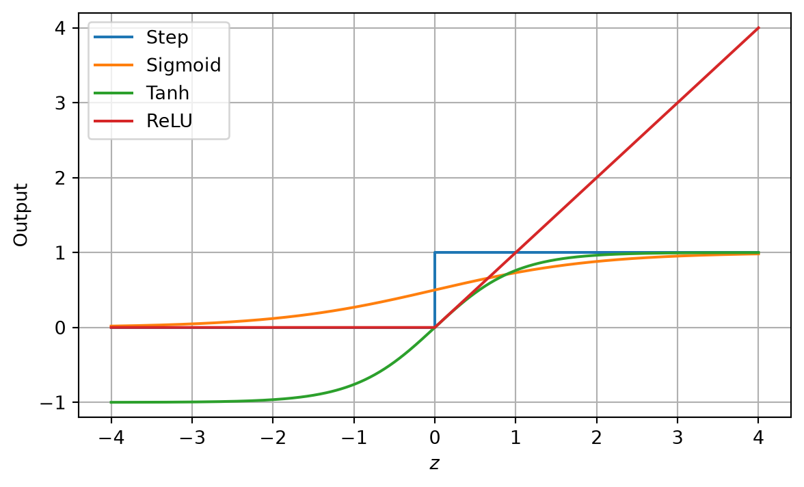](slides_files/figure-html/cell-7-output-1.png)

The step function produces a discrete decision. Sigmoid and tanh produce bounded continuous activations, while ReLU is continuous and unbounded above. These differences affect the intermediate values available to subsequent layers.

This comparison shows the functions themselves. Their derivatives and the consequences for gradient flow are examined in Lecture 13.

# Universal Approximation

## Definition

The **universal approximation theorem (UAT)** establishes that, on a **compact input domain**, a network with a sufficiently wide single hidden layer, **sigmoid activations**, and a **linear output** can approximate any specified **continuous target function** to any desired accuracy.

Cybenko ([1989](#ref-Cybenko:1989aa)); Hornik et al. ([1989](#ref-Hornik:1989aa))

A compact set in \mathbb R^n is both **closed** and **bounded**. A closed interval such as \[-4,2\] is a simple example.

For every continuous target function on this domain and every positive error tolerance, the theorem guarantees a finite network whose error stays below that tolerance throughout the domain. The required width and parameter values can depend on the target and the tolerance ([Cybenko 1989](#ref-Cybenko:1989aa); [Hornik et al. 1989](#ref-Hornik:1989aa)).

This is an **existence result about representation**. It does not guarantee that a training algorithm will find the appropriate parameters, that the network will be small, or that learning from a finite sample will generalize well. It also gives no guarantee about extrapolation outside the specified domain.

The sigmoid version is a convenient classical statement. Broader results cover other activations, including the ReLU used in the visual code example. Nonlinearity alone is not a sufficient activation assumption. [Leshno et al., *Multilayer feedforward networks with a nonpolynomial activation function can approximate any function*](https://pinkus.net.technion.ac.il/files/2021/02/neural.pdf)

## Effect of varying w: sigmoid

Code

``` python
def plot_parameter_effect(activation, name, weights, biases, title):
    x = np.linspace(-10, 10, 400)
    fig, ax = plt.subplots(figsize=(6, 4))
    for w in weights:
        for b in biases:
            ax.plot(x, activation(w * x + b), label=f"w = {w}, b = {b}")
    ax.set(xlabel="$x$", ylabel=f"{name}(wx + b)", title=title)
    ax.grid(True)
    ax.legend()
    plt.show()


plot_parameter_effect(sigmoid, "Sigmoid", weights=[0.5, 1, 2, 5], biases=[0],
                      title="Varying w, with b = 0")
```

[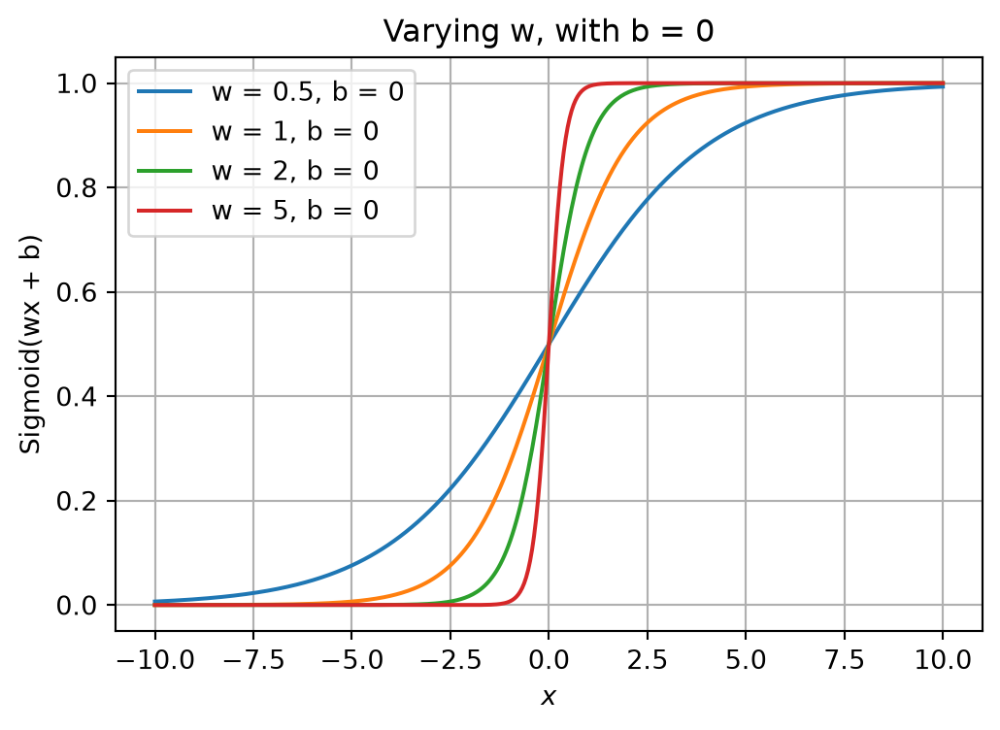](slides_files/figure-html/cell-8-output-1.png)

The weight changes the **steepness** of \sigma(wx+b).

How do negative values of w affect the graph? Explore this question using the Jupyter Notebook accompanying the lecture.

## Effect of varying b: sigmoid

Code

``` python
plot_parameter_effect(sigmoid, "Sigmoid", weights=[1], biases=[-5, -2, 0, 2, 5],
                      title="Varying b, with w = 1")
```

[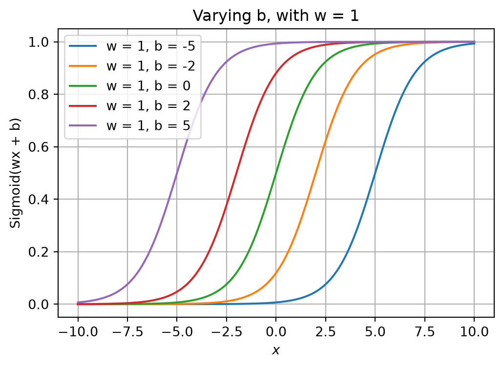](slides_files/figure-html/cell-9-output-1.png)

For fixed w\ne0, the bias moves the transition to x=-b/w.

## Effect of varying w: ReLU

Code

``` python
plot_parameter_effect(relu, "ReLU", weights=[0.5, 1, 2, 5], biases=[0],
                      title="Varying w, with b = 0")
```

[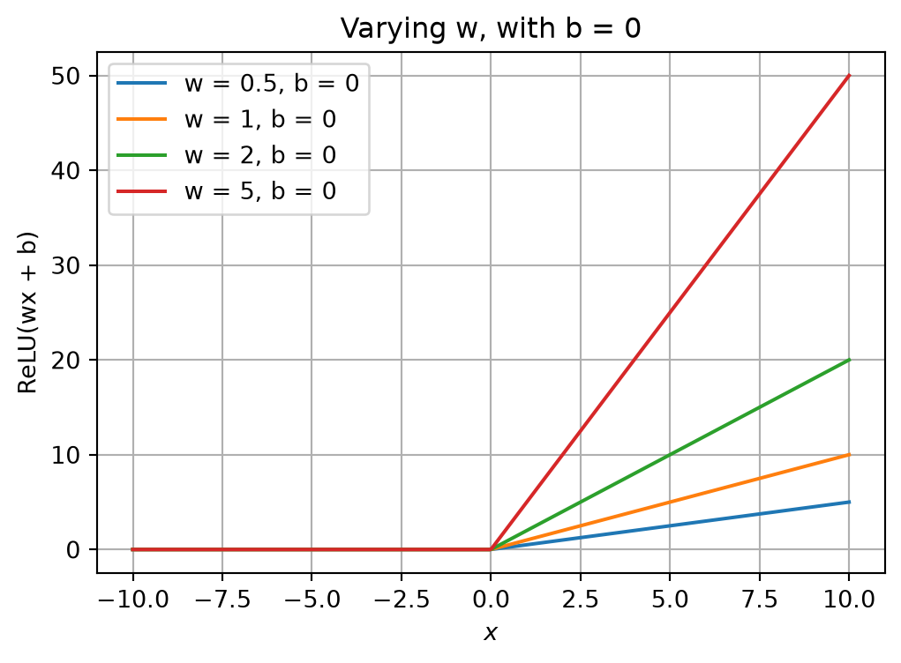](slides_files/figure-html/cell-10-output-1.png)

The weight changes the **slope** of the active part of \operatorname{ReLU}(wx+b).

## Effect of varying b: ReLU

Code

``` python
plot_parameter_effect(relu, "ReLU", weights=[1], biases=[-5, -2, 0, 2, 5],
                      title="Varying b, with w = 1")
```

[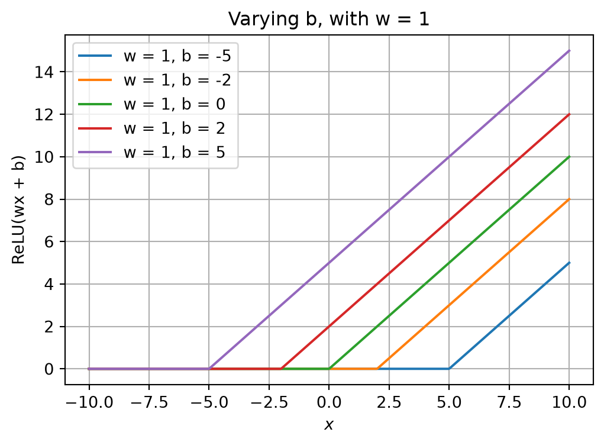](slides_files/figure-html/cell-11-output-1.png)

For fixed w\ne0, the bias moves the **kink** to x=-b/w.

Interactive companion: [Build a function with two ReLU units](../../lectures/11/ReLUBuildingBlocks.llms.md).

## Visual demonstration with code

Approximate the same target curve using networks with **different numbers of hidden units**.

``` python
# Defining the function to be approximated

def f(x):
    return 2 * x**3 + 4 * x**2 - 5 * x + 1

# Generating a dataset, x in [-4,2), f(x) as above

approximation_rng = np.random.default_rng(42)
X = approximation_rng.uniform(-4, 2, size=(1000, 1))

y = f(X.flatten())
```

y = f(x) = 2 x^3 + 4 x^2 - 5 x + 1

## Increasing the number of neurons

``` python
from sklearn.neural_network import MLPRegressor
from sklearn.model_selection import train_test_split

X_train, X_valid, y_train, y_valid = train_test_split(X, y, test_size=0.1, random_state=42)

models = []

sizes = [1, 2, 3, 5, 50]

for n in sizes:
    regressor = MLPRegressor(hidden_layer_sizes=(n,), max_iter=5000, random_state=42)
    regressor.fit(X_train, y_train)
    models.append(regressor) 
```

[MLPRegressor](https://scikit-learn.org/stable/modules/generated/sklearn.neural_network.MLPRegressor.html) is a multi-layer perceptron regressor from sklearn. Its default activation function is `relu`.

## Comparing fitted curves

Code

``` python
colors = plt.colormaps["cool"].resampled(len(sizes))
plot_inputs = np.sort(X_valid, axis=0)

fig, ax = plt.subplots(figsize=(7, 4))
for i, n in enumerate(sizes):
    predictions = models[i].predict(plot_inputs)
    ax.plot(plot_inputs, predictions, color=colors(i), label=f"Hidden units = {n}")
ax.plot(plot_inputs, f(plot_inputs), "r.", label="Target")
ax.set(xlabel="$x$", ylabel="Output")
ax.legend()
plt.show()
```

[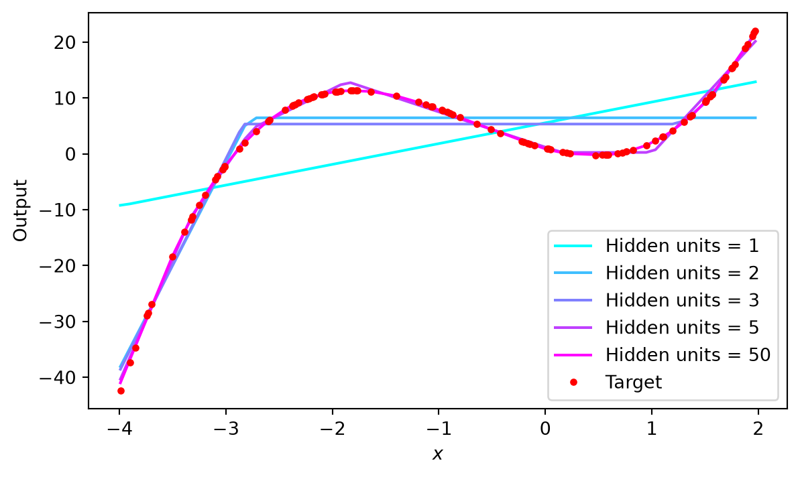](slides_files/figure-html/cell-14-output-1.png)

The target is a known, noise-free cubic function. Each model has one hidden layer; changing its number of units changes the functions the model can represent. The held-out subset is a **validation set**, used here to visualize predictions away from the training examples.

The curves show the networks obtained by a particular training procedure. They illustrate approximation in practice, but do not prove the UAT: a fitted network can fail to find a good approximation even when suitable parameters exist. More hidden units need not produce a better fitted curve in every run.

For a further visual explanation, see [Michael Nielsen’s chapter on universal approximation](http://neuralnetworksanddeeplearning.com/chap4.html).

## Comparing training losses

Code

``` python
fig, ax = plt.subplots(figsize=(7, 4))
for i, n in enumerate(sizes):
    ax.plot(models[i].loss_curve_, color=colors(i), label=f"Hidden units = {n}")
ax.set(title="Training loss", xlabel="Iteration", ylabel="Loss")
ax.legend()
plt.show()
```

[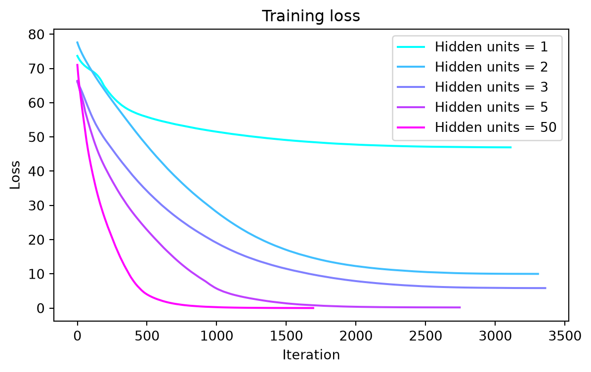](slides_files/figure-html/cell-15-output-1.png)

More hidden units increase **representational capacity**. The loss reached by training also depends on **optimization**.

These are training-loss curves. Independently initialized and trained networks need not achieve losses ordered by their number of hidden units. Their final losses also reflect the optimization procedure and the regularization used by the estimator. The UAT guarantees the existence of an approximation under its assumptions, rather than the success of these particular training runs.

## Universal Approximation

# An error occurred.

Unable to execute JavaScript.

This video effectively conveys the underlying intuition of the universal approximation theorem. (18m 53s)

The video provides a supplementary visual explanation of how weighted activation outputs can combine to approximate a target curve. An output weight scales a hidden unit’s contribution and can reverse its sign. An input bias inside an activation, such as \sigma(wx+b), shifts its transition horizontally when w\ne0; a bias at a linear output shifts the combined curve vertically.

# Let’s code

## Frameworks

[PyTorch](https://pytorch.org/), [TensorFlow](https://www.tensorflow.org/), and [JAX](https://jax.readthedocs.io/en/latest/quickstart.html) provide tools for numerical computation and automatic differentiation.

[Keras](https://keras.io/) provides a high-level API for building and training models with these backends.

A framework supplies operations for computing model outputs and gradients efficiently. A high-level API supplies familiar interfaces for defining a model, fitting it to data, evaluating it, and making predictions.

The example uses Keras through `tf.keras`, with TensorFlow as its backend. The distinction between a network’s forward computation, gradient calculation, and optimizer updates remains the same across frameworks. [Getting started with Keras](https://keras.io/getting_started/)

## Keras

The main steps are:

1.  **Define** the network’s layers.
2.  **Compile** with a loss, an optimizer, and evaluation metrics.
3.  **Fit** the model to training data and monitor validation performance.
4.  **Evaluate** on the test set and make predictions.

Keras was created by François Chollet. Its Sequential API describes a stack of layers in which each layer receives the preceding layer’s output. It is suitable for this feedforward classifier.

The code that follows forms a complete workflow when executed in order. Softmax and categorical cross-entropy are introduced here through their roles in the API; their mathematical details are developed in Lecture 14.

## Fashion-MNIST dataset

[Fashion-MNIST](https://github.com/zalandoresearch/fashion-mnist) contains images of clothing and accessories:

- **60,000 training images** and **10,000 test images**.
- Each image has **28 × 28 grayscale pixels**.
- Each image has **one integer label**, from **10 classes**.

Example adapted from Géron ([2022](#ref-Geron:2022aa)), [*Hands-On Machine Learning*, Chapter 10 notebook](https://github.com/ageron/handson-ml3/blob/main/10_neural_nets_with_keras.ipynb).

## Loading and splitting

``` python
import tensorflow as tf

(X_train_full, y_train_full), (X_test, y_test) = (
    tf.keras.datasets.fashion_mnist.load_data()
)

X_train, y_train = X_train_full[:-5000], y_train_full[:-5000]
X_valid, y_valid = X_train_full[-5000:], y_train_full[-5000:]
```

Use **55,000** examples for training and **5,000** for validation. Reserve the supplied **test set** for final evaluation.

The validation examples are taken from the supplied training partition. They are used to monitor performance during development, but are not used to update the model’s parameters. The test partition remains separate from training and model selection, as discussed in Lecture 8.

## Inspecting and scaling the inputs

``` python
X_train.shape, X_train.dtype
```

    ((55000, 28, 28), dtype('uint8'))

. . .

Convert pixel intensities from **0–255 integers** to **0–1 floating-point values** in every split.

``` python
X_train = X_train.astype("float32") / 255.0
X_valid = X_valid.astype("float32") / 255.0
X_test = X_test.astype("float32") / 255.0
```

The model must receive inputs in the same scale during training, validation, testing, and later prediction. Using raw 0–255 test pixels after training on 0–1 pixels changes the inputs to every weighted sum and invalidates the comparison.

Division by the known pixel bound 255 does not estimate a statistic from the data. Preprocessing that learns a mean, variance, or other statistic must instead be fitted on training data and applied to the other splits using the fitted transformation.

## Images and labels

Code

``` python
class_names = ["T-shirt/top", "Trouser", "Pullover", "Dress", "Coat",
               "Sandal", "Shirt", "Sneaker", "Bag", "Ankle boot"]

plt.figure(figsize=(2, 2))
plt.imshow(X_train[0], cmap="binary")
plt.title(class_names[y_train[0]])
plt.axis("off")
plt.show()
```

[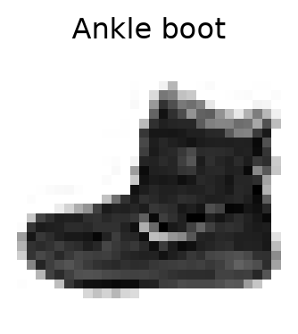](slides_files/figure-html/cell-19-output-1.png)

The target is an integer class index; `class_names` supplies a readable label.

## First 40 images

Code

``` python
fig, axes = plt.subplots(4, 10, figsize=(12, 4.8))
for index, ax in enumerate(axes.flat):
    ax.imshow(X_train[index], cmap="binary", interpolation="nearest")
    ax.set_title(class_names[y_train[index]], fontsize=10)
    ax.axis("off")
plt.tight_layout()
plt.show()
```

[](slides_files/figure-html/cell-20-output-1.png)

## Creating a model

``` python
tf.keras.utils.set_random_seed(42)

model = tf.keras.Sequential([
    tf.keras.Input(shape=(28, 28)),
    tf.keras.layers.Flatten(),
    tf.keras.layers.Dense(300, activation="relu"),
    tf.keras.layers.Dense(100, activation="relu"),
    tf.keras.layers.Dense(10, activation="softmax")
])
```

The Input specifies the shape of one example. Flatten rearranges the 28 × 28 pixels into 784 input features without learning any parameters. The two hidden Dense layers compute weighted sums plus biases, followed by ReLU activations.

The last Dense layer produces ten scores and applies softmax to form a probability distribution over the ten mutually exclusive classes. These output probabilities sum to 1. Hidden-layer activations and output activations serve different purposes.

The seed utility sets the Python, NumPy, and TensorFlow seeds for reproducibility; exact numerical results can still depend on the execution environment. [Keras random-seed utility](https://keras.io/api/utils/python_utils/)

## Model structure and parameters

``` python
model.summary()
```

```
Model: "sequential"
```

```
┏━━━━━━━━━━━━━━━━━━━━━━━━━━━━━━━━━┳━━━━━━━━━━━━━━━━━━━━━━━━┳━━━━━━━━━━━━━━━┓
┃ Layer (type)                    ┃ Output Shape           ┃       Param # ┃
┡━━━━━━━━━━━━━━━━━━━━━━━━━━━━━━━━━╇━━━━━━━━━━━━━━━━━━━━━━━━╇━━━━━━━━━━━━━━━┩
│ flatten (Flatten)               │ (None, 784)            │             0 │
├─────────────────────────────────┼────────────────────────┼───────────────┤
│ dense (Dense)                   │ (None, 300)            │       235,500 │
├─────────────────────────────────┼────────────────────────┼───────────────┤
│ dense_1 (Dense)                 │ (None, 100)            │        30,100 │
├─────────────────────────────────┼────────────────────────┼───────────────┤
│ dense_2 (Dense)                 │ (None, 10)             │         1,010 │
└─────────────────────────────────┴────────────────────────┴───────────────┘
```

```
 Total params: 266,610 (1.02 MB)
```

```
 Trainable params: 266,610 (1.02 MB)
```

```
 Non-trainable params: 0 (0.00 B)
```

A Dense layer with n\_{\mathrm{in}} inputs and n\_{\mathrm{out}} units has (n\_{\mathrm{in}}+1)n\_{\mathrm{out}} trainable parameters, including biases.

There is one weight for every input-to-unit connection and one bias for every unit. The first hidden layer therefore has 784\times300+300=235{,}500 parameters. The second has 300\times100+100=30{,}100, and the output layer has 100\times10+10=1{,}010. The total is 266{,}610 trainable parameters. Flatten has none.

For a batch of m examples, the first hidden layer receives an m\times784 array, uses a 784\times300 weight matrix and a 300-element bias vector, and produces an m\times300 output. This follows the earlier convention of one row per example and one column per unit in the weight matrix.

## Compiling the model

``` python
model.compile(
    loss="sparse_categorical_crossentropy",
    optimizer=tf.keras.optimizers.SGD(learning_rate=0.01),
    metrics=["accuracy"]
)
```

**Loss:** compare the predicted distribution with the integer target label.

**Optimizer:** update parameters using gradients. **Accuracy:** report correct class predictions.

Sparse categorical cross-entropy is appropriate because each example has one integer class label and the model outputs a categorical probability distribution. With one-hot encoded targets, the corresponding loss is categorical cross-entropy. The loss here receives probabilities from softmax, rather than raw logits. [Keras probabilistic losses](https://keras.io/api/losses/probabilistic_losses/)

The `compile` method configures training; it does not fit the parameters. Stochastic gradient descent uses gradients computed by backpropagation to update the weights and biases. The learning rate controls the size of those updates. Accuracy is reported as a metric, while the differentiable loss supplies the training objective.

## Training the model

``` python
history = model.fit(
    X_train, y_train, epochs=30, batch_size=32,
    validation_data=(X_valid, y_valid), verbose=2
)
```

    Epoch 1/30
    1719/1719 - 2s - 874us/step - accuracy: 0.7616 - loss: 0.7239 - val_accuracy: 0.8298 - val_loss: 0.5026
    Epoch 2/30
    1719/1719 - 1s - 715us/step - accuracy: 0.8299 - loss: 0.4894 - val_accuracy: 0.8418 - val_loss: 0.4472
    Epoch 3/30
    1719/1719 - 1s - 715us/step - accuracy: 0.8448 - loss: 0.4434 - val_accuracy: 0.8480 - val_loss: 0.4233
    Epoch 4/30
    1719/1719 - 1s - 693us/step - accuracy: 0.8548 - loss: 0.4154 - val_accuracy: 0.8550 - val_loss: 0.4088
    Epoch 5/30
    1719/1719 - 1s - 707us/step - accuracy: 0.8607 - loss: 0.3951 - val_accuracy: 0.8584 - val_loss: 0.3970
    Epoch 6/30
    1719/1719 - 1s - 702us/step - accuracy: 0.8667 - loss: 0.3790 - val_accuracy: 0.8594 - val_loss: 0.3889
    Epoch 7/30
    1719/1719 - 1s - 704us/step - accuracy: 0.8713 - loss: 0.3656 - val_accuracy: 0.8616 - val_loss: 0.3824
    Epoch 8/30
    1719/1719 - 1s - 710us/step - accuracy: 0.8748 - loss: 0.3539 - val_accuracy: 0.8642 - val_loss: 0.3780
    Epoch 9/30
    1719/1719 - 1s - 705us/step - accuracy: 0.8783 - loss: 0.3432 - val_accuracy: 0.8666 - val_loss: 0.3740
    Epoch 10/30
    1719/1719 - 1s - 720us/step - accuracy: 0.8817 - loss: 0.3336 - val_accuracy: 0.8678 - val_loss: 0.3684
    Epoch 11/30
    1719/1719 - 1s - 719us/step - accuracy: 0.8851 - loss: 0.3247 - val_accuracy: 0.8702 - val_loss: 0.3641
    Epoch 12/30
    1719/1719 - 1s - 695us/step - accuracy: 0.8875 - loss: 0.3165 - val_accuracy: 0.8726 - val_loss: 0.3601
    Epoch 13/30
    1719/1719 - 1s - 701us/step - accuracy: 0.8898 - loss: 0.3089 - val_accuracy: 0.8736 - val_loss: 0.3578
    Epoch 14/30
    1719/1719 - 1s - 716us/step - accuracy: 0.8922 - loss: 0.3017 - val_accuracy: 0.8724 - val_loss: 0.3554
    Epoch 15/30
    1719/1719 - 1s - 720us/step - accuracy: 0.8942 - loss: 0.2951 - val_accuracy: 0.8736 - val_loss: 0.3543
    Epoch 16/30
    1719/1719 - 1s - 688us/step - accuracy: 0.8962 - loss: 0.2887 - val_accuracy: 0.8734 - val_loss: 0.3520
    Epoch 17/30
    1719/1719 - 1s - 682us/step - accuracy: 0.8983 - loss: 0.2829 - val_accuracy: 0.8738 - val_loss: 0.3522
    Epoch 18/30
    1719/1719 - 1s - 692us/step - accuracy: 0.9002 - loss: 0.2771 - val_accuracy: 0.8746 - val_loss: 0.3495
    Epoch 19/30
    1719/1719 - 1s - 734us/step - accuracy: 0.9021 - loss: 0.2717 - val_accuracy: 0.8758 - val_loss: 0.3478
    Epoch 20/30
    1719/1719 - 1s - 727us/step - accuracy: 0.9043 - loss: 0.2664 - val_accuracy: 0.8760 - val_loss: 0.3465
    Epoch 21/30
    1719/1719 - 1s - 729us/step - accuracy: 0.9060 - loss: 0.2615 - val_accuracy: 0.8754 - val_loss: 0.3465
    Epoch 22/30
    1719/1719 - 1s - 753us/step - accuracy: 0.9081 - loss: 0.2565 - val_accuracy: 0.8772 - val_loss: 0.3449
    Epoch 23/30
    1719/1719 - 1s - 709us/step - accuracy: 0.9102 - loss: 0.2519 - val_accuracy: 0.8782 - val_loss: 0.3454
    Epoch 24/30
    1719/1719 - 1s - 724us/step - accuracy: 0.9121 - loss: 0.2471 - val_accuracy: 0.8780 - val_loss: 0.3445
    Epoch 25/30
    1719/1719 - 1s - 737us/step - accuracy: 0.9145 - loss: 0.2427 - val_accuracy: 0.8790 - val_loss: 0.3437
    Epoch 26/30
    1719/1719 - 1s - 704us/step - accuracy: 0.9158 - loss: 0.2384 - val_accuracy: 0.8792 - val_loss: 0.3446
    Epoch 27/30
    1719/1719 - 1s - 698us/step - accuracy: 0.9172 - loss: 0.2341 - val_accuracy: 0.8810 - val_loss: 0.3445
    Epoch 28/30
    1719/1719 - 1s - 710us/step - accuracy: 0.9193 - loss: 0.2299 - val_accuracy: 0.8804 - val_loss: 0.3441
    Epoch 29/30
    1719/1719 - 1s - 704us/step - accuracy: 0.9210 - loss: 0.2260 - val_accuracy: 0.8808 - val_loss: 0.3445
    Epoch 30/30
    1719/1719 - 1s - 711us/step - accuracy: 0.9223 - loss: 0.2220 - val_accuracy: 0.8800 - val_loss: 0.3440

A training step processes one mini-batch and updates the parameters once. An epoch is one complete pass through the training examples. The batch size and learning rate connect this example to the stochastic and mini-batch gradient-descent methods introduced in Lecture 4.

With this call, Keras evaluates the validation set at the end of each epoch without updating parameters on it. The returned History stores the training and validation loss and accuracy for each epoch. [Keras training API](https://keras.io/api/models/model_training_apis/)

Training metrics aggregate mini-batch results while the parameters change during an epoch; validation metrics use the parameters at the end of that epoch. Their curves are therefore not evaluated under exactly the same conditions. Validation results can guide model and hyperparameter choices; the test set is reserved for the final evaluation.

## Training and validation curves

Code

``` python
epochs = np.arange(1, len(history.history["loss"]) + 1)
fig, axes = plt.subplots(1, 2, figsize=(9, 3.5))
for ax, metric, title in zip(axes, ["loss", "accuracy"], ["Loss", "Accuracy"]):
    ax.plot(epochs, history.history[metric], label="Training")
    ax.plot(epochs, history.history[f"val_{metric}"], label="Validation")
    ax.set(xlabel="Epoch", ylabel=title)
    ax.grid(True)
    ax.legend()
axes[1].set_ylim(0, 1)
plt.tight_layout()
plt.show()
```

[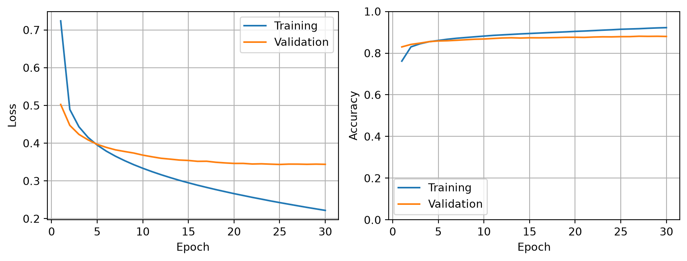](slides_files/figure-html/cell-25-output-1.png)

Loss and accuracy describe different aspects of performance and have different scales. Accuracy lies between 0 and 1, but cross-entropy loss can exceed 1, so the loss axis is not restricted to that interval.

A continuing reduction in training loss together with worsening validation loss can indicate overfitting. Individual fluctuations do not by themselves establish a trend, and training does not guarantee that every epoch improves validation performance. Regularization and early stopping are examined in Lecture 14.

## Final test evaluation

``` python
test_loss, test_accuracy = model.evaluate(X_test, y_test, verbose=0)
print(f"Test loss: {test_loss:.3f}")
print(f"Test accuracy: {test_accuracy:.3f}")
```

    Test loss: 0.362
    Test accuracy: 0.874

The test set estimates performance on held-out examples after the model and training configuration have been chosen. Its inputs receive the same scaling as the training and validation inputs. Test results should not be used to select the architecture or the number of epochs.

## Making predictions

``` python
X_new = X_test[:3]
y_proba = model.predict(X_new, verbose=0)
y_proba.round(2)
```

    array([[0.  , 0.  , 0.  , 0.  , 0.  , 0.33, 0.  , 0.01, 0.  , 0.65],
           [0.  , 0.  , 1.  , 0.  , 0.  , 0.  , 0.  , 0.  , 0.  , 0.  ],
           [0.  , 1.  , 0.  , 0.  , 0.  , 0.  , 0.  , 0.  , 0.  , 0.  ]],
          dtype=float32)

. . .

``` python
y_pred = y_proba.argmax(axis=1)
y_pred
```

    array([9, 2, 1])

. . .

``` python
y_observed = y_test[:3]
y_observed
```

    array([9, 2, 1], dtype=uint8)

The predicted class has the **highest output probability**. Compare it with the **observed class**.

Each row of `y_proba` contains ten class probabilities for one image. `argmax(axis=1)` selects the index of the largest probability in each row. The integer indices correspond to the entries in `class_names`.

A high output probability expresses the model’s confidence in its prediction; it does not establish that the prediction is correct. The observed labels are needed to assess these examples.

## Predicted and observed labels

Code

``` python
fig, axes = plt.subplots(1, 3, figsize=(8, 3))
for ax, image, prediction, observed in zip(axes, X_new, y_pred, y_observed):
    ax.imshow(image, cmap="binary", interpolation="nearest")
    ax.set_title(f"Predicted: {class_names[prediction]}\n"
                 f"Observed: {class_names[observed]}", fontsize=10)
    ax.axis("off")
plt.tight_layout()
plt.show()
```

[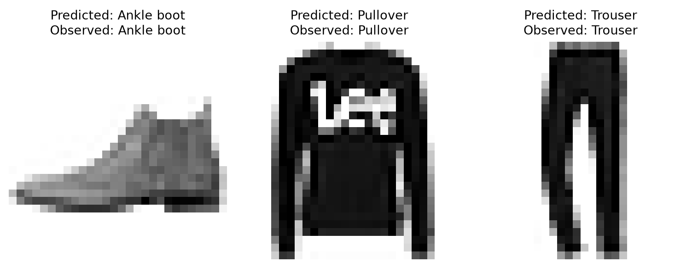](slides_files/figure-html/cell-30-output-1.png)

## Test performance by class

``` python
from sklearn.metrics import classification_report

y_test_proba = model.predict(X_test, verbose=0)
y_test_pred = y_test_proba.argmax(axis=1)
print(classification_report(y_test, y_test_pred,
                            target_names=class_names, digits=3))
```

                  precision    recall  f1-score   support

     T-shirt/top      0.842     0.810     0.826      1000
         Trouser      0.992     0.964     0.978      1000
        Pullover      0.744     0.850     0.793      1000
           Dress      0.824     0.929     0.873      1000
            Coat      0.806     0.794     0.800      1000
          Sandal      0.885     0.986     0.933      1000
           Shirt      0.777     0.618     0.689      1000
         Sneaker      0.944     0.911     0.927      1000
             Bag      0.961     0.963     0.962      1000
      Ankle boot      0.983     0.918     0.949      1000

        accuracy                          0.874     10000
       macro avg      0.876     0.874     0.873     10000
    weighted avg      0.876     0.874     0.873     10000

Overall accuracy can hide differences between classes. The classification report gives the precision, recall, F1 score, and support for each clothing category, using the definitions introduced in Lecture 7. The readable class names make it easier to identify which categories are most difficult for this model.

# Conclusion

## Summary

- **Computation:** a forward pass maps inputs to outputs using weights, biases, and activations.
- **Representation:** nonlinear hidden layers compute intermediate features that can make XOR separable.
- **Learning:** training adjusts parameters; backpropagation computes gradients for an optimizer.
- **Universal approximation:** suitable parameters can exist without a guarantee that training will find them.
- **Implementation:** Keras connects these ideas in a complete Fashion-MNIST classification workflow.
- **Evaluation:** apply consistent preprocessing and distinguish training, validation, and test performance.

## 3Blue1Brown on Deep Learning

- But what is a Neural Network?
  - [youtu.be/aircAruvnKk](https://youtu.be/aircAruvnKk)
  - 19 minutes
- Gradient descent, how neural networks learn?
  - [youtu.be/IHZwWFHWa-w](https://youtu.be/IHZwWFHWa-w)
  - 21 minutes
- What is backpropagation really doing?
  - [youtu.be/Ilg3gGewQ5U](https://youtu.be/Ilg3gGewQ5U)
  - 14 minutes
- Backpropagation calculus
  - [youtu.be/tIeHLnjs5U8](https://youtu.be/tIeHLnjs5U8)
  - 10 minutes

## Next lecture

- We will explore the implementation of artificial neural networks.

## References

Cybenko, George V. 1989. “Approximation by Superpositions of a Sigmoidal Function.” *Mathematics of Control, Signals and Systems* 2: 303–14. <https://api.semanticscholar.org/CorpusID:3958369>.

Géron, Aurélien. 2022. *Hands-on Machine Learning with Scikit-Learn, Keras, and TensorFlow*. 3rd ed. O’Reilly Media, Inc.

Goodfellow, Ian, Yoshua Bengio, and Aaron Courville. 2016. *Deep Learning*. Adaptive Computation and Machine Learning. MIT Press. <https://dblp.org/rec/books/daglib/0040158>.

Hornik, Kurt, Maxwell Stinchcombe, and Halbert White. 1989. “Multilayer Feedforward Networks Are Universal Approximators.” *Neural Networks* 2 (5): 359–66. https://doi.org/<https://doi.org/10.1016/0893-6080(89)90020-8>.

Lakoff, George, and Srini Narayanan. 2025. *The Neural Mind: How Brains Think*. 1st ed. University of Chicago Press. <https://press.uchicago.edu/ucp/books/book/chicago/N/bo243406239.html>.

LeCun, Yann, Yoshua Bengio, and Geoffrey Hinton. 2015. “Deep Learning.” *Nature* 521 (7553): 436–44. <https://doi.org/10.1038/nature14539>.

LeNail, Alexander. 2019. “NN-SVG: Publication-Ready Neural Network Architecture Schematics.” *Journal of Open Source Software* 4 (33): 747. <https://doi.org/10.21105/joss.00747>.

McCulloch, Warren S, and Walter Pitts. 1943. “A logical calculus of the ideas immanent in nervous activity.” *The Bulletin of Mathematical Biophysics* 5 (4): 115–33. <https://doi.org/10.1007/bf02478259>.

Minsky, Marvin, and Seymour Papert. 1969. *Perceptrons: An Introduction to Computational Geometry*. MIT Press.

Rosenblatt, F. 1958. “The perceptron: A probabilistic model for information storage and organization in the brain.” *Psychological Review* 65 (6): 386–408. <https://doi.org/10.1037/h0042519>.

Rumelhart, David E., Geoffrey E. Hinton, and Ronald J. Williams. 1986. “Learning representations by back-propagating errors.” *Nature* 323 (6088): 533–36. <https://doi.org/10.1038/323533a0>.

Russell, Stuart, and Peter Norvig. 2020. *Artificial Intelligence: A Modern Approach*. 4th ed. Pearson. <http://aima.cs.berkeley.edu/>.

------------------------------------------------------------------------

Marcel **Turcotte**

School of Electrical Engineering and **Computer Science** (EE**CS**)

University of Ottawa
