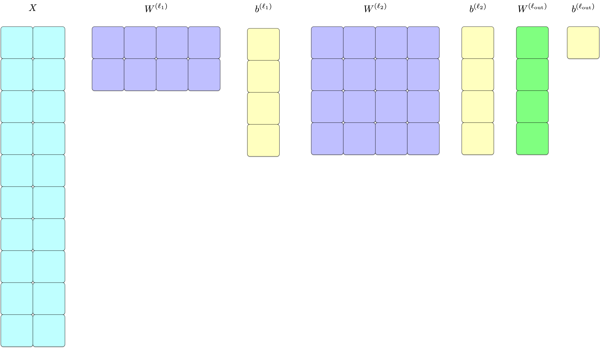
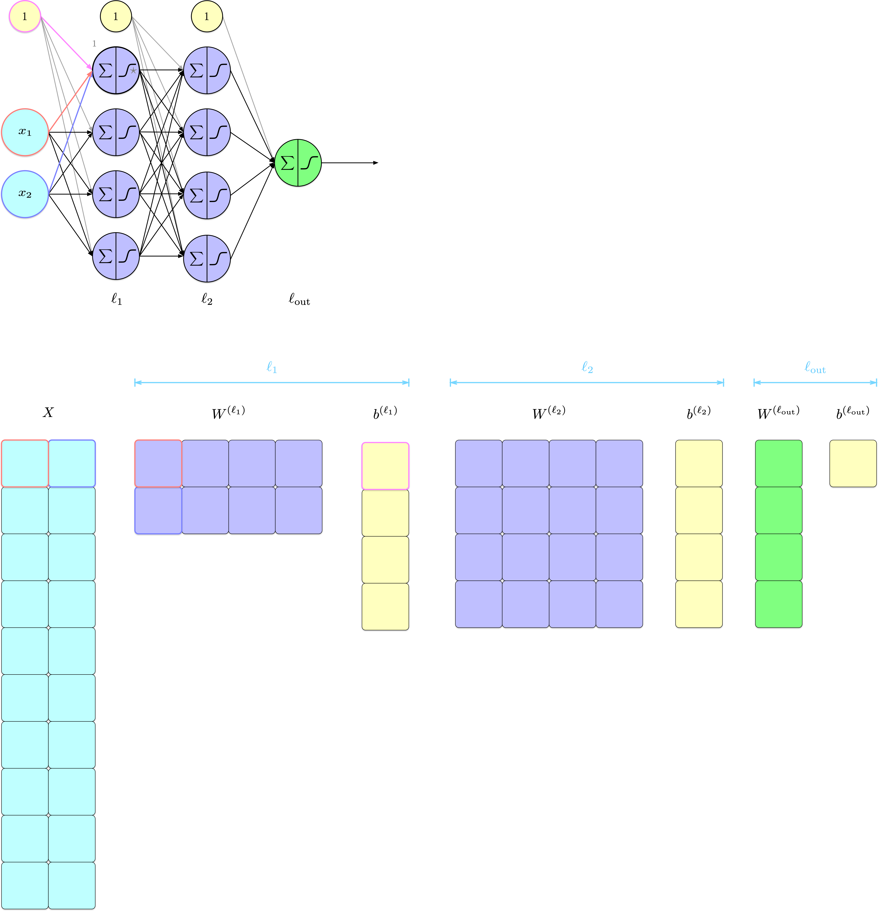
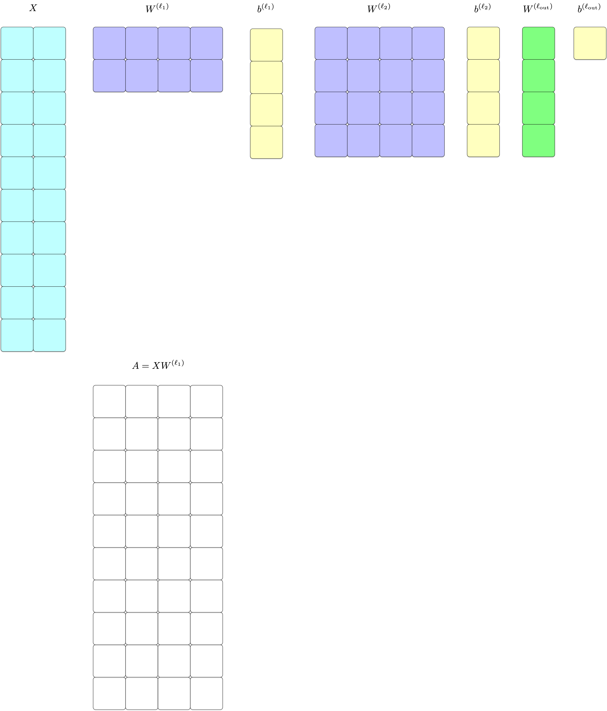
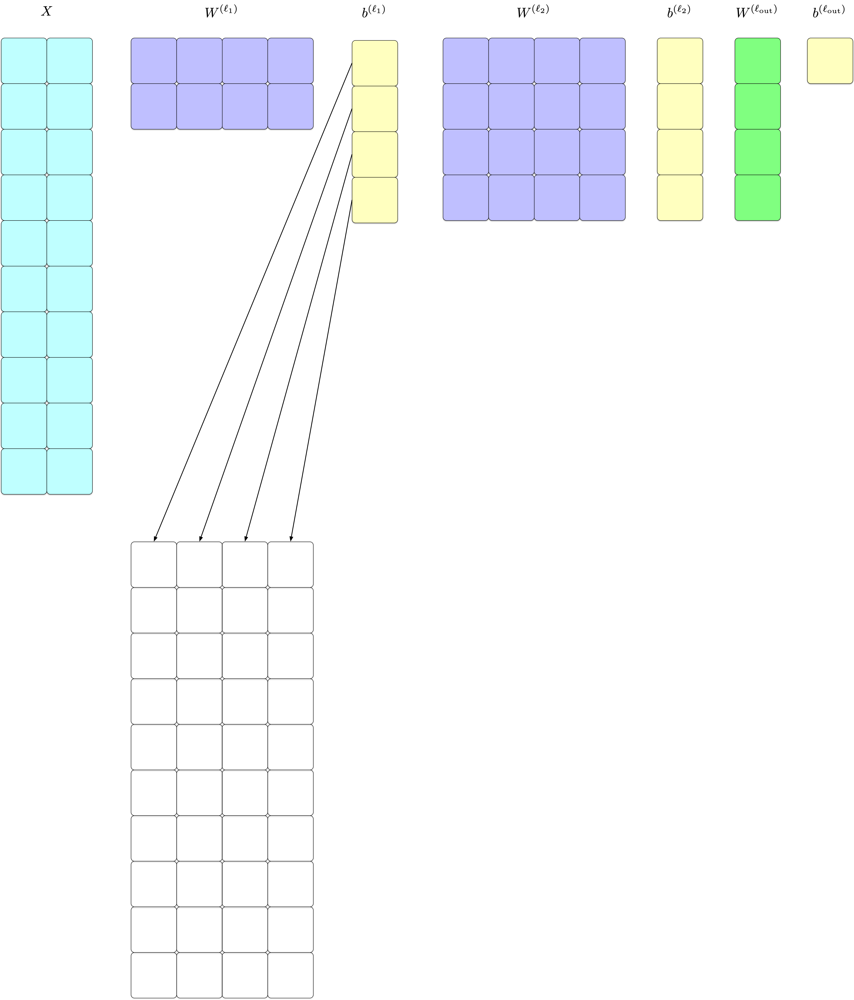
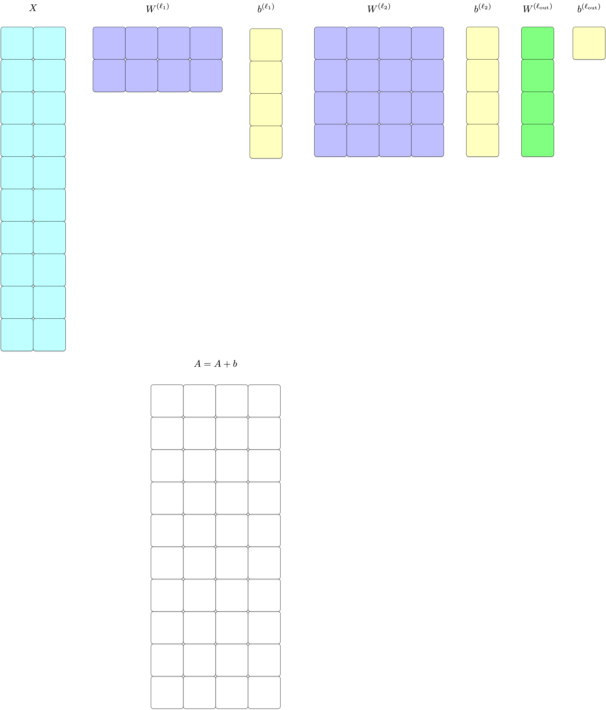
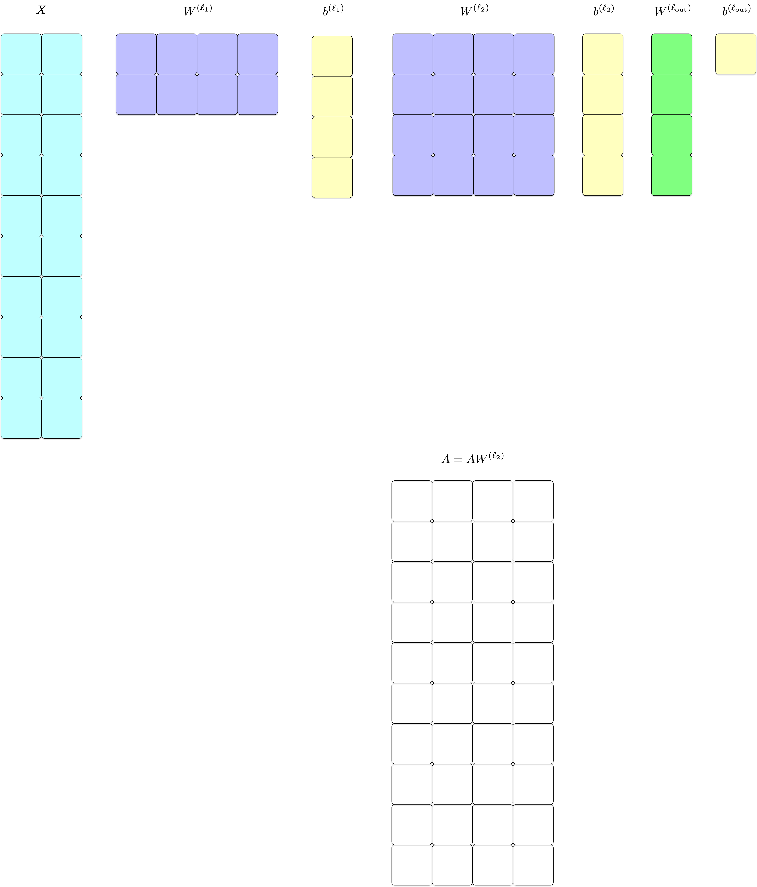
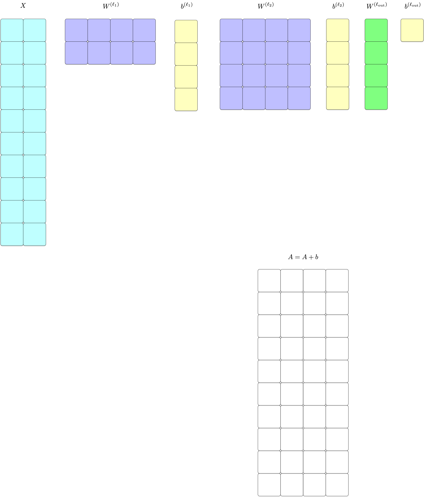
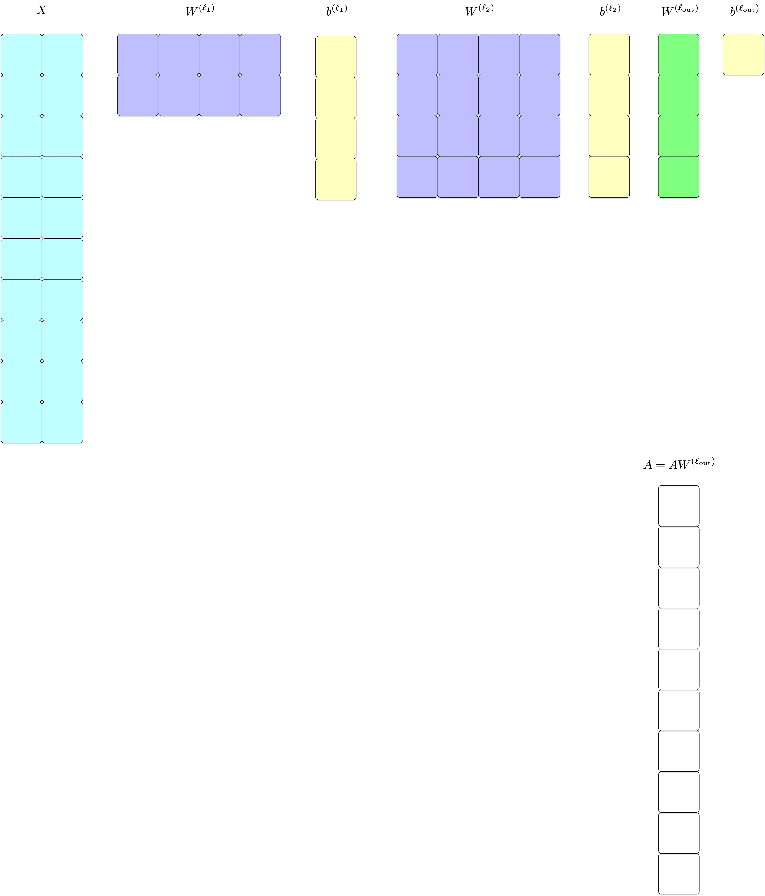
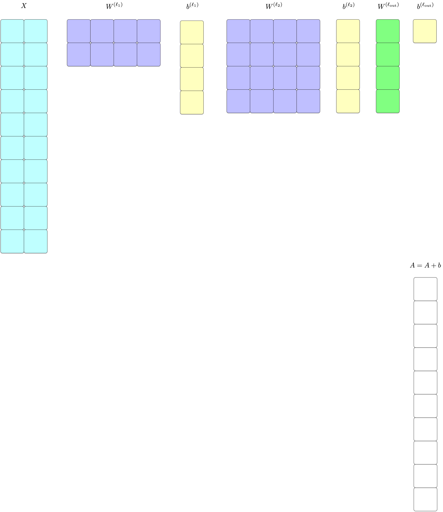

# Implementing Artificial Neural Networks (Part 1)

CSI 4106 - Fall 2026

Author

Marcel Turcotte

Published

Version: Oct 27, 2026 14:10

# Preamble

## Message of the Day

# An error occurred.

Unable to execute JavaScript.

Benaich, N. and Air Street Capital (2026). [*State of AI Report 2026*](https://www.stateof.ai/). Released October 8, 2026. [Watch the accompanying video](https://youtu.be/FBfNXq_R3oo).

The *State of AI Report 2026*, by Nathan Benaich and Air Street Capital, surveys developments in AI research, industry, policy, and safety. The accompanying video provides an overview of the report.

As we study how neural networks are trained, this report connects the underlying methods to the wider field: advances in model capabilities, the computing infrastructure that supports them, and their applications. The report and video are supplementary resources for exploring that broader context.

## Learning objectives

- **Trace** a feedforward network’s computation through its NumPy implementation.
- **Distinguish** predicted probabilities, class labels, and training loss.
- **Explain** how a naïve algorithm probes parameters and applies simultaneous updates.
- **Identify** the computational limitations that motivate backpropagation.

# Naïve MLP

## Data

Show code

``` python
# Generate and plot the "circles" dataset
import numpy as np
import matplotlib.pyplot as plt
from sklearn.datasets import make_circles
from sklearn.model_selection import train_test_split
from sklearn.metrics import accuracy_score

# Generate synthetic data
X, y = make_circles(n_samples=1200, factor=0.35, noise=0.06, random_state=42)

# Separate coordinates for plotting
x1, x2 = X[:, 0], X[:, 1]

# Plot the two classes
plt.figure(figsize=(5, 5))
plt.scatter(x1[y==0], x2[y==0], color="C0", label="class 0 (outer ring)")
plt.scatter(x1[y==1], x2[y==1], color="C1", label="class 1 (inner circle)")
plt.xlabel("x₁")
plt.ylabel("x₂")
plt.title("Dataset generated with make_circles")
plt.axis("equal") # ensures circles look round
plt.legend()
plt.show()
```

[](slides_files/figure-html/cell-2-output-1.png)

Lecture 11 established how a network with fixed parameters computes predictions. The question here is how to choose those parameters from data. A complete NumPy implementation makes the computation and training process accessible through programming before introducing backpropagation.

The dataset has an outer ring (class 0) and an inner circle (class 1). These classes are not linearly separable in the original \\(x_1,x_2)\\ feature space.

The training algorithm probes candidate parameter changes without computing derivatives. Its purpose is to expose the training loop and the cost of repeatedly evaluating the network. Backpropagation will provide an efficient way to compute gradients in the next lecture.

## Architecture

[](../../assets/images/ann_mlp-2-4-4-1.png)

We are implementing the neural network shown above, comprising 1 input layer with 2 units, 2 hidden layers with 4 units each, and 1 output layer with 1 unit. We denote this architecture as \[2, 4, 4, 1\].

Our neural network, a multi-layer perceptron, is designed with two input nodes corresponding to the two features present in our dataset. Through our experimentation using TensorFlow Playground and Keras, as detailed in [CircularSeparability](../../lectures/11/CircularSeparability.llms.md), we determined that a configuration of two hidden layers containing four neurons each is effective for the classification of the samples.

The network has **three parameterized layers**: two hidden layers of four units each and one output layer with a single unit. The two input nodes pass features into the network and are not counted as parameterized layers.

For this implementation, every computational unit uses the sigmoid activation function. The final output estimates the probability of class 1. Using the same activation throughout keeps the forward-pass code short; hidden layers are not generally required to use sigmoid.

In the visualization, the black edges between units denote the model’s weights. Additionally, we have included three nodes that output a constant value of 1 solely for visualization purposes; these nodes do not have a counterpart in the actual model. The gray edges connecting these nodes to other units represent the bias terms.

## Utilities

``` python
def sigmoid(z):
    return 1.0 / (1.0 + np.exp(-z))

def bce_loss(y_true, y_prob, eps=1e-9):

    """Binary cross-entropy loss (average over data)."""

    y_prob = np.clip(y_prob, eps, 1 - eps)

    return -np.mean(y_true * np.log(y_prob) + (1 - y_true) * np.log(1 - y_prob))
```

We are defining two utility functions, `sigmoid` and `bce_loss`. The binary cross-entropy loss has the same definition as that of our [logistic regression model](../../lectures/06/slides.llms.md). Do you remember another name for binary cross-entropy loss?

In `bce_loss`, the probabilities are constrained within the interval \\\[\epsilon, 1-\epsilon\]\\. This clipping ensures that the logarithmic expressions \\\log(0)\\ and \\\log(1-1) = \log(0)\\ are avoided, thus preventing undefined or infinite values during computation.

Both functions are designed to take NumPy arrays (`ndarray`) as input. Namely, the `bce_loss` function calculates the loss for the entire dataset without requiring explicit iteration over individual data points.

## NaïveMLP

The complete implementation is presented below and will be examined in the subsequent slides.

Show code

``` python
class NaiveMLP:

    """
    A minimal MLP for binary classification, trained with a naive
    derivative-free algorithm that applies parameter updates simultaneously.

    This deliberately simple method illustrates the training process and
    its computational cost before backpropagation is introduced.
    """

    def __init__(self, layer_sizes, step=0.1, seed=None):
        
        self.sizes = list(layer_sizes)
        self.step = float(step)
        rng = np.random.default_rng(seed)

        # Initialize weights and biases

        self.W = [rng.standard_normal(size=(in_d, out_d)) * 0.5
                  for in_d, out_d in zip(layer_sizes[:-1], layer_sizes[1:])]

        self.b = [np.zeros(out_d) for out_d in layer_sizes[1:]]

    def forward(self, X):

        """
        Simple forward pass: compute output activations only.

        X: shape (N, input_dim)

        Returns: output probabilities, shape (N,)
        """

        a = X
        for W, b in zip(self.W, self.b):
            a = sigmoid(a @ W + b)

        return a.ravel()

    def predict(self, X, threshold=0.5):

        return (self.forward(X) >= threshold).astype(int)

    def loss(self, X, y):

        return bce_loss(y, self.forward(X))

    def _all_param_tags(self):

        """
        Yields tags referencing every scalar parameter:
        ('W', layer_idx, i, j) or ('b', layer_idx, j)
        """

        for l, W in enumerate(self.W):
            for i in range(W.shape[0]):
                for j in range(W.shape[1]):
                    yield ('W', l, i, j)
            for j in range(self.b[l].shape[0]):
                yield ('b', l, j)

    def _get_param(self, tag):
        kind = tag[0]
        if kind == 'W':
            _, l, i, j = tag
            return self.W[l][i, j]
        else:
            _, l, j = tag
            return self.b[l][j]

    def _set_param(self, tag, val):
        kind = tag[0]
        if kind == 'W':
            _, l, i, j = tag
            self.W[l][i, j] = val
        else:
            _, l, j = tag
            self.b[l][j] = val

    def train(self, X, y, epochs=10, verbose=True):

        """
        Simultaneous update:
        - For each scalar parameter θ, try θ + δ for δ in {−step, 0, +step},
          pick the δ that gives minimal loss.
        - Collect all chosen δ’s, then apply all updates together.
        """

        for ep in range(1, epochs + 1):

            base_loss = self.loss(X, y)
            updates = {}

            # Probe all parameters
            for tag in self._all_param_tags():

                theta = self._get_param(tag)
                best_delta = 0.0
                best_loss = base_loss

                for delta in (-self.step, 0.0, +self.step):
                    self._set_param(tag, theta + delta)
                    trial_loss = self.loss(X, y)
                    if trial_loss < best_loss:
                        best_loss = trial_loss
                        best_delta = delta

                # restore original
                self._set_param(tag, theta)
                updates[tag] = best_delta

            # Apply all deltas together
            for tag, d in updates.items():
                if d != 0.0:
                    self._set_param(tag, self._get_param(tag) + d)

            new_loss = self.loss(X, y)

            if verbose:
                print(f"Epoch {ep:3d}: loss {base_loss:.5f} → {new_loss:.5f}")

            # optional early stop
            if abs(new_loss - base_loss) < 1e-12:
                break
```

To ensure the functionality of the resulting Jupyter Notebook, the whole class has been included here.

## Class Definition

``` python
class NaiveMLP:

    """
    A minimal MLP for binary classification, trained with a naive
    derivative-free algorithm that applies parameter updates simultaneously.

    This deliberately simple method illustrates the training process and
    its computational cost before backpropagation is introduced.
    """
```

## Constructor

``` python
    def __init__(self, layer_sizes, step=0.1, seed=None):
        
        self.sizes = list(layer_sizes)
        self.step = float(step)
        rng = np.random.default_rng(seed)

        # Initialize weights and biases

        self.W = [rng.standard_normal(size=(in_d, out_d)) * 0.5
                  for in_d, out_d in zip(layer_sizes[:-1], layer_sizes[1:])]

        self.b = [np.zeros(out_d) for out_d in layer_sizes[1:]]
```

Memorizing the number of layers, the number of units per layer, and the learning algorithm’s step size. Initializing the weights (\\W\\) and biases (\\b\\).

## Parameters

[](../../assets/images/ann_mlp_params-2-4-4-1-s00.png)

[](../../assets/images/ann_mlp-2-4-4-1.png)

In our running example, the model consists of three layers: \\\ell^{(1)}\\, \\\ell^{(2)}\\, and \\\ell^{(\textrm{out})}\\. Each layer \\\ell\\ is parameterized by a weight matrix \\W^{(\ell)}\\ and a bias vector \\b^{(\ell)}\\. The dataset \\X\\ contains 10 examples, each with two features. Ensure that you understand how the input and output dimensions of each layer determine the dimensions of its weight matrix and bias vector.

## Python detour: weight arrays

``` python
seed = 0

rng = np.random.default_rng(seed)

layer_sizes = [2, 4, 4, 1]

[(in_d, out_d) for in_d, out_d in zip(layer_sizes[:-1], layer_sizes[1:])]
```

    [(2, 4), (4, 4), (4, 1)]

. . .

``` python
[rng.standard_normal(size=(in_d, out_d)) * 0.5 for in_d, out_d in zip(layer_sizes[:-1], layer_sizes[1:])]
```

    [array([[ 0.06286511, -0.06605243,  0.32021133,  0.05245006],
            [-0.26783469,  0.18079753,  0.65200002,  0.47354048]]),
     array([[-0.35186762, -0.63271074, -0.31163723,  0.02066299],
            [-1.16251539, -0.10939583, -0.62295547, -0.36613368],
            [-0.27212949, -0.15815008,  0.20581527,  0.52125668],
            [-0.06426733,  0.68323174, -0.33259734,  0.17575504]]),
     array([[ 0.45173509],
            [ 0.04700615],
            [-0.37174962],
            [-0.46086269]])]

[](../../assets/images/ann_mlp-2-4-4-1.png)

How many weights has this network?

## Python detour: bias arrays

``` python
[out_d for out_d in layer_sizes[1:]]
```

    [4, 4, 1]

. . .

``` python
[np.zeros(out_d) for out_d in layer_sizes[1:]]
```

    [array([0., 0., 0., 0.]), array([0., 0., 0., 0.]), array([0.])]

[](../../assets/images/ann_mlp-2-4-4-1.png)

What is the number of bias terms in this network?

The network consists of a total of 37 parameters, which include 28 weights and 9 bias terms.

## Forward Pass

Returning to the network: compute each layer’s outputs from the preceding layer.

``` python
    def forward(self, X):

        """
        Simple forward pass: compute output activations.
        X: shape (N, input_dim)
        Returns: output probabilities, shape (N,)
        """

        a = X
        for W, b in zip(self.W, self.b):
            a = sigmoid(a @ W + b)

        return a.ravel()
```

[](../../assets/images/ann_mlp-2-4-4-1.png)

Calculating the output activations. Determining the probability of each instance in the dataset \\X\\ belonging to class 1.

The method proceeds sequentially layer-by-layer. In our running example, this involves three distinct processing layers.

**What are `W` and `b`?**

`W` and `b` are lists, each containing three elements. The list `W` comprises weight matrices with dimensions \\2 \times 4\\, \\4 \times 4\\, and \\4 \times 1\\, while `b` consists of bias arrays sized 4, 4, and 1, respectively.

**What is the purpose of `zip(self.W, self.b)`?**

This function pairs each weight matrix with its corresponding bias array, producing one pair for each of the three parameterized layers.

**What does `X` represent?**

The argument `X` contains \\N\\ examples as rows and two features as columns, so its shape is `(N, 2)`. In the circles training split, \\N=900\\. Each iteration of the loop computes the current layer’s outputs for all examples together.

The code uses `a` for activations: these are the unit outputs denoted by \\o\\ in Lecture 11. The expression `a @ W + b` computes preactivations, and `sigmoid(...)` produces the next activations. The final `ravel()` converts the single output column into a one-dimensional array of probabilities. This class assumes one output unit.

## Following the array shapes

For `layer_sizes = [2, 4, 4, 1]`, each row remains one example:

| Layer    | Incoming `a` | `W`      | `b`    | Outgoing `a` |
|:---------|:-------------|:---------|:-------|:-------------|
| Hidden 1 | `(N, 2)`     | `(2, 4)` | `(4,)` | `(N, 4)`     |
| Hidden 2 | `(N, 4)`     | `(4, 4)` | `(4,)` | `(N, 4)`     |
| Output   | `(N, 4)`     | `(4, 1)` | `(1,)` | `(N, 1)`     |

``` python
a = sigmoid(a @ W + b)
```

- `@` combines each example with the layer’s weights.
- **Broadcasting** adds the same bias vector to every row.
- `ravel()` changes the final shape from `(N, 1)` to `(N,)`.

[](../../assets/images/ann_mlp-2-4-4-1.png)

Matrix multiplication requires the number of columns in the incoming activations to match the number of rows in the weight matrix. The number of columns in the result is the number of units in the current layer. Applying the sigmoid elementwise preserves that shape.

Broadcasting does not create a separate trainable bias for each example. Every example uses the same four biases in a four-unit hidden layer, or the same single bias in the output layer. This network therefore has 28 weights and 9 biases, for a total of 37 trainable parameters.

## Following the array shapes (contd)

[](../../assets/images/ann_mlp_params_model-2-4-4-1-s00.png)

The figure depicts the model, including the input vector \\X\\, weight matrices, and bias vectors. For neuron 1 in layer \\\ell_1\\, the pre-activation value is computed as

\\ z_1^{(\ell_1)} = x_1 W\_{1,1}^{(\ell_1)} + x_2 W\_{1,2}^{(\ell_1)} + b_1^{(\ell_1)}. \\

One-based indexing is used throughout for readability.

## Following the array shapes (contd)

[](../../assets/images/ann_mlp_params-2-4-4-1-s01.png)

The figure illustrates the dimensions of the matrix obtained from the intermediate computation \\A = X W^{(\ell_1)}\\.

## Following the array shapes (contd)

[](../../assets/images/ann_mlp_params-2-4-4-1-s01-broadcast.png)

The figure illustrates how NumPy broadcasting adds the bias vector \\b^{(\ell_1)}\\ to each row of the matrix product \\X W^{(\ell_1)}\\. The next screens show the remaining intermediate calculations. Track the input and output dimensions at each step to understand how each operation transforms the matrix shapes.

## Following the array shapes (contd)

[](../../assets/images/ann_mlp_params-2-4-4-1-s02.png)

## Following the array shapes (contd)

[](../../assets/images/ann_mlp_params-2-4-4-1-s03.png)

## Following the array shapes (contd)

[](../../assets/images/ann_mlp_params-2-4-4-1-s04.png)

## Following the array shapes (contd)

[](../../assets/images/ann_mlp_params-2-4-4-1-s05.png)

## Following the array shapes (contd)

[](../../assets/images/ann_mlp_params-2-4-4-1-s06.png)

## Making predictions

``` python
    def predict(self, X, threshold=0.5):

        return (self.forward(X) >= threshold).astype(int)
```

Indeed, predictions, plural.

The `forward` method produces an array of probabilities, each ranging from 0 to 1, indicating the likelihood that a particular example, \\x_i\\, belongs to class 1. By evaluating the expression `self.forward(X) >= threshold`, we obtain an array of boolean values: `True` if the probability is at least the specified `threshold`, and `False` otherwise. These boolean values are subsequently converted into binary values of zeros and ones.

It is important to note that adjusting the decision threshold, `threshold`, allows for the manipulation of the precision-recall trade-off, providing flexibility in model performance.

## Probabilities, labels, and loss

For an example whose true label is **1**:

| Predicted probability | Class at threshold 0.5 | Binary cross-entropy         |
|:----------------------|:-----------------------|:-----------------------------|
| 0.51                  | 1                      | \\-\log(0.51)\approx 0.673\\ |
| 0.99                  | 1                      | \\-\log(0.99)\approx 0.010\\ |

Both predictions are **correct**, but their losses differ.

- `forward(X)` returns **probabilities**.
- `predict(X)` returns **class labels**.
- `loss(X, y)` evaluates the **probabilities** against the targets.

The loss can improve while accuracy stays unchanged. For a positive example, increasing the predicted probability from 0.51 to 0.99 lowers binary cross-entropy even though both values produce class 1. Conversely, a confidently incorrect prediction receives a larger loss.

This is the same binary cross-entropy, or mean negative log-likelihood, used for logistic regression in Lecture 6. The output of the neural network replaces the probability computed by the logistic regression model; the definition of the loss is unchanged.

## Computing the loss

``` python
    def loss(self, X, y):

        return bce_loss(y, self.forward(X))
```

**Quiz:** Why do we use `bce_loss(y, self.forward(X))` rather than `bce_loss(y, self.predict(X))`?

The method averages binary cross-entropy over the dataset.

**Answer:** `forward(X)` returns probabilities, while `predict(X)` converts them into class labels. Using probabilities lets the loss recognize changes in confidence even when the predicted class stays the same. For example, for a positive example, 0.51 and 0.99 both predict class 1, but 0.99 has a lower loss. Clipping prevents `log(0)`; it cannot recover the confidence information discarded by thresholding.

## Discussion

With the exception of the training algorithm, our neural network implementation is now complete.

For those who are not familiar with the back-propagation algorithm, how do you propose to learn the parameters of the model?

. . .

Probe parameter changes → record the best individual changes → apply them together → repeat.

## Pseudocode

``` pseudocode
for each iteration:
    current_loss = compute_loss(network, training_data)
    deltas = {}
    for each parameter p in network:  # weights AND biases
        original_value = value(p)
        best_delta = 0
        best_loss = current_loss
        for delta in [-step, 0, +step]:
            loss_temp = compute_loss_with_replacement(
                p, original_value + delta, training_data)
            if loss_temp < best_loss:
                best_loss = loss_temp
                best_delta = delta
        deltas[p] = best_delta

    # Apply all recorded changes simultaneously
    for each parameter p in network:
        value(p) += deltas[p]
```

This algorithm chooses updates by **trying parameter changes**. Backpropagation will compute **gradients**, which an optimizer uses to choose updates. Both fit into a training loop that evaluates the network and updates its parameters.

Each candidate change is evaluated with every other parameter fixed at its value at the start of the iteration. The temporary replacement is undone after the probe. Only after all parameters have been examined are the recorded changes applied together. In the code, `epochs` counts these complete parameter sweeps; each sweep evaluates the training set many times.

A change that lowers loss on its own may interact badly with changes to other parameters. Applying all selected changes together can therefore undo good individual choices and increase the total loss. Neither decreasing loss nor increasing accuracy is guaranteed at every iteration.

The simultaneous structure connects this example to gradient-based training: information for all updates is collected using the current parameters, then the updates are applied. The next lecture replaces the individual probes with gradients computed by backpropagation.

## Python detour: enumerating parameters

A short Python detour: **generators**, parameter **tags**, and reading or changing array entries.

``` python
    def _all_param_tags(self):

        """
        Yields tags referencing every scalar parameter:
        ('W', layer_idx, i, j) or ('b', layer_idx, j)
        """

        for l, W in enumerate(self.W):
            for i in range(W.shape[0]):
                for j in range(W.shape[1]):
                    yield ('W', l, i, j)
            for j in range(self.b[l].shape[0]):
                yield ('b', l, j)
```

`_all_param_tags` is a generator: it provides the location of each scalar weight and bias without building a separate list first. The following examples explain the Python mechanism used by the training loop.

## Python detour: generators

A **generator** produces values one at a time, pausing at `yield` and resuming when the next value is requested.

``` python
def countdown(n):
    while n > 0:
        yield n
        n -= 1
```

``` python
c = countdown(3)
print(next(c))  # 3
print(next(c))  # 2
print(next(c))  # 1
```

    3
    2
    1

Calling `countdown(3)` creates a generator; it does not immediately run the function body. Each call to `next(c)` resumes the body until the next `yield`. The local state, including `n`, is retained between calls.

## Python detour: consuming an iterator

After its final value, the generator raises `StopIteration`:

``` python
try:
    print(next(c))
except StopIteration:
    print("Caught StopIteration.")
```

    Caught StopIteration.

A `for` loop handles this termination automatically:

``` python
for value in countdown(3):
    print(value)
```

    3
    2
    1

The `for` loop requests successive values until the iterator is exhausted. There is no need to catch `StopIteration` explicitly in that form.

The built-ins `enumerate` and `zip` also return iterators. `enumerate(self.W)` supplies a layer index and its weight matrix, while `zip(self.W, self.b)` pairs each matrix with its bias vector. The parameter generator uses nested loops to yield a tag for every individual weight and bias.

## Python detour: parameter tags

Show code

``` python
class Demo:

    def __init__(self, layer_sizes):
        self.sizes = list(layer_sizes)
        rng = np.random.default_rng(0)
        self.W = [rng.standard_normal(size=(in_d, out_d)) * 0.5
                  for in_d, out_d in zip(layer_sizes[:-1], layer_sizes[1:])]
        self.b = [np.zeros(out_d) for out_d in layer_sizes[1:]]

    def _all_param_tags(self):

        """
        Yields tags referencing every scalar parameter:
        ('W', layer_idx, i, j) or ('b', layer_idx, j)
        """

        for l, W in enumerate(self.W):
            for i in range(W.shape[0]):
                for j in range(W.shape[1]):
                    yield ('W', l, i, j)
            for j in range(self.b[l].shape[0]):
                yield ('b', l, j)

    def show(self):

      for tag in self._all_param_tags():
        print(tag)
```

``` python
d = Demo([2,4,4,1])
d.show()
```

    ('W', 0, 0, 0)
    ('W', 0, 0, 1)
    ('W', 0, 0, 2)
    ('W', 0, 0, 3)
    ('W', 0, 1, 0)
    ('W', 0, 1, 1)
    ('W', 0, 1, 2)
    ('W', 0, 1, 3)
    ('b', 0, 0)
    ('b', 0, 1)
    ('b', 0, 2)
    ('b', 0, 3)
    ('W', 1, 0, 0)
    ('W', 1, 0, 1)
    ('W', 1, 0, 2)
    ('W', 1, 0, 3)
    ('W', 1, 1, 0)
    ('W', 1, 1, 1)
    ('W', 1, 1, 2)
    ('W', 1, 1, 3)
    ('W', 1, 2, 0)
    ('W', 1, 2, 1)
    ('W', 1, 2, 2)
    ('W', 1, 2, 3)
    ('W', 1, 3, 0)
    ('W', 1, 3, 1)
    ('W', 1, 3, 2)
    ('W', 1, 3, 3)
    ('b', 1, 0)
    ('b', 1, 1)
    ('b', 1, 2)
    ('b', 1, 3)
    ('W', 2, 0, 0)
    ('W', 2, 1, 0)
    ('W', 2, 2, 0)
    ('W', 2, 3, 0)
    ('b', 2, 0)

## Python detour: reading a parameter

``` python
    def _get_param(self, tag):
        kind = tag[0]
        if kind == 'W':
            _, l, i, j = tag
            return self.W[l][i, j]
        else:
            _, l, j = tag
            return self.b[l][j]
```

Given a `tag`, either `('W', l, i, j)` or `('b', l, j)`, the method retrieves the weight or the bias term corresponding to the provided indices. `l` designates the **layer**; `i` and `j` are row and column indices of `W[l]`, or `j` is an index in `b[l]`.

## Python detour: changing a parameter

``` python
    def _set_param(self, tag, val):
        kind = tag[0]
        if kind == 'W':
            _, l, i, j = tag
            self.W[l][i, j] = val
        else:
            _, l, j = tag
            self.b[l][j] = val
```

Similar logic, but the method updates `self.W[l][i, j]` or `self.b[l][j] = val`, depending on the type of tag.

## Training (learning)

The Python detour is complete. These helpers let the training loop probe and update **every weight and bias**.

``` python
    def train(self, X, y, epochs=10, verbose=True):

        for ep in range(1, epochs + 1):

            base_loss = self.loss(X, y)
            updates = {}

            # Probe all parameters
            for tag in self._all_param_tags():

                theta = self._get_param(tag)
                best_delta = 0.0
                best_loss = base_loss

                for delta in (-self.step, 0.0, +self.step):
                    self._set_param(tag, theta + delta)
                    trial_loss = self.loss(X, y)
                    if trial_loss < best_loss:
                        best_loss = trial_loss
                        best_delta = delta

                # restore original
                self._set_param(tag, theta)
                updates[tag] = best_delta

            # Apply all deltas together
            for tag, d in updates.items():
                if d != 0.0:
                    self._set_param(tag, self._get_param(tag) + d)

            new_loss = self.loss(X, y)

            if verbose:
                print(f"Epoch {ep:3d}: loss {base_loss:.5f} → {new_loss:.5f}")

            # optional early stop
            if abs(new_loss - base_loss) < 1e-12:
                break
```

The probes use the same baseline parameters, and each parameter is restored before the next one is examined. The dictionary stores the selected changes; the second loop applies them simultaneously. Because interactions are ignored during selection, the combined update can increase loss even when every nonzero change helped in isolation.

The stopping condition checks whether the change in training loss is very small. This is a simple stopping rule for the demonstration, not a guarantee of an optimal solution or successful generalization.

## Training on circles

Does it work?

``` python
X_train, X_test, y_train, y_test = train_test_split(
    X, y, test_size=0.25, random_state=42, stratify=y
)

model = NaiveMLP([2, 4, 4, 1], step=0.06, seed=0)

print("Initial loss:", model.loss(X_train, y_train))

model.train(X_train, y_train, epochs=100)

print("Train acc:", accuracy_score(y_train, model.predict(X_train)))
print("Test acc: ", accuracy_score(y_test, model.predict(X_test)))
```

    Initial loss: 0.7001969055705487
    Epoch   1: loss 0.70020 → 0.69315
    Epoch   2: loss 0.69315 → 0.69547
    Epoch   3: loss 0.69547 → 0.69387
    Epoch   4: loss 0.69387 → 0.69542
    Epoch   5: loss 0.69542 → 0.69384
    Epoch   6: loss 0.69384 → 0.69537
    Epoch   7: loss 0.69537 → 0.69382
    Epoch   8: loss 0.69382 → 0.69531
    Epoch   9: loss 0.69531 → 0.69379
    Epoch  10: loss 0.69379 → 0.69525
    Epoch  11: loss 0.69525 → 0.69361
    Epoch  12: loss 0.69361 → 0.69517
    Epoch  13: loss 0.69517 → 0.69331
    Epoch  14: loss 0.69331 → 0.69503
    Epoch  15: loss 0.69503 → 0.69298
    Epoch  16: loss 0.69298 → 0.69468
    Epoch  17: loss 0.69468 → 0.69257
    Epoch  18: loss 0.69257 → 0.69364
    Epoch  19: loss 0.69364 → 0.69200
    Epoch  20: loss 0.69200 → 0.69173
    Epoch  21: loss 0.69173 → 0.69118
    Epoch  22: loss 0.69118 → 0.68965
    Epoch  23: loss 0.68965 → 0.68970
    Epoch  24: loss 0.68970 → 0.68716
    Epoch  25: loss 0.68716 → 0.68672
    Epoch  26: loss 0.68672 → 0.68417
    Epoch  27: loss 0.68417 → 0.68170
    Epoch  28: loss 0.68170 → 0.67855
    Epoch  29: loss 0.67855 → 0.67406
    Epoch  30: loss 0.67406 → 0.66867
    Epoch  31: loss 0.66867 → 0.66203
    Epoch  32: loss 0.66203 → 0.65492
    Epoch  33: loss 0.65492 → 0.64672
    Epoch  34: loss 0.64672 → 0.63852
    Epoch  35: loss 0.63852 → 0.62948
    Epoch  36: loss 0.62948 → 0.61977
    Epoch  37: loss 0.61977 → 0.60918
    Epoch  38: loss 0.60918 → 0.59844
    Epoch  39: loss 0.59844 → 0.58893
    Epoch  40: loss 0.58893 → 0.57598
    Epoch  41: loss 0.57598 → 0.56310
    Epoch  42: loss 0.56310 → 0.55035
    Epoch  43: loss 0.55035 → 0.53809
    Epoch  44: loss 0.53809 → 0.52214
    Epoch  45: loss 0.52214 → 0.50660
    Epoch  46: loss 0.50660 → 0.49073
    Epoch  47: loss 0.49073 → 0.47591
    Epoch  48: loss 0.47591 → 0.45758
    Epoch  49: loss 0.45758 → 0.44074
    Epoch  50: loss 0.44074 → 0.42251
    Epoch  51: loss 0.42251 → 0.41069
    Epoch  52: loss 0.41069 → 0.38858
    Epoch  53: loss 0.38858 → 0.36998
    Epoch  54: loss 0.36998 → 0.35227
    Epoch  55: loss 0.35227 → 0.34356
    Epoch  56: loss 0.34356 → 0.32577
    Epoch  57: loss 0.32577 → 0.31462
    Epoch  58: loss 0.31462 → 0.29240
    Epoch  59: loss 0.29240 → 0.27704
    Epoch  60: loss 0.27704 → 0.25851
    Epoch  61: loss 0.25851 → 0.25409
    Epoch  62: loss 0.25409 → 0.23884
    Epoch  63: loss 0.23884 → 0.23260
    Epoch  64: loss 0.23260 → 0.21815
    Epoch  65: loss 0.21815 → 0.21238
    Epoch  66: loss 0.21238 → 0.19964
    Epoch  67: loss 0.19964 → 0.19350
    Epoch  68: loss 0.19350 → 0.17787
    Epoch  69: loss 0.17787 → 0.16963
    Epoch  70: loss 0.16963 → 0.15270
    Epoch  71: loss 0.15270 → 0.14804
    Epoch  72: loss 0.14804 → 0.13478
    Epoch  73: loss 0.13478 → 0.13357
    Epoch  74: loss 0.13357 → 0.12381
    Epoch  75: loss 0.12381 → 0.12041
    Epoch  76: loss 0.12041 → 0.10789
    Epoch  77: loss 0.10789 → 0.10512
    Epoch  78: loss 0.10512 → 0.09204
    Epoch  79: loss 0.09204 → 0.08493
    Epoch  80: loss 0.08493 → 0.07447
    Epoch  81: loss 0.07447 → 0.07243
    Epoch  82: loss 0.07243 → 0.06423
    Epoch  83: loss 0.06423 → 0.06479
    Epoch  84: loss 0.06479 → 0.06053
    Epoch  85: loss 0.06053 → 0.05940
    Epoch  86: loss 0.05940 → 0.05501
    Epoch  87: loss 0.05501 → 0.05465
    Epoch  88: loss 0.05465 → 0.05370
    Epoch  89: loss 0.05370 → 0.05036
    Epoch  90: loss 0.05036 → 0.04376
    Epoch  91: loss 0.04376 → 0.04596
    Epoch  92: loss 0.04596 → 0.04283
    Epoch  93: loss 0.04283 → 0.04213
    Epoch  94: loss 0.04213 → 0.04031
    Epoch  95: loss 0.04031 → 0.03879
    Epoch  96: loss 0.03879 → 0.03629
    Epoch  97: loss 0.03629 → 0.03574
    Epoch  98: loss 0.03574 → 0.03499
    Epoch  99: loss 0.03499 → 0.03293
    Epoch 100: loss 0.03293 → 0.03075
    Train acc: 1.0
    Test acc:  1.0

These results illustrate that the naïve algorithm can learn a useful decision boundary. They do not guarantee success for other initializations, step sizes, or datasets. Keep the test set separate from training and parameter-setting choices; validation data are appropriate for selecting such settings. The fixed `step` and `seed` make this demonstration reproducible.

## Visualization

Show code

``` python
# Plot helper: decision boundary in the original (x1, x2) plane

def plot_decision_boundary(model, X, y, title="Naïve MLP decision boundary"):

    # grid over the input plane
    pad = 0.3
    x1_min, x1_max = X[:,0].min()-pad, X[:,0].max()+pad
    x2_min, x2_max = X[:,1].min()-pad, X[:,1].max()+pad

    xx, yy = np.meshgrid(
        np.linspace(x1_min, x1_max, 400),
        np.linspace(x2_min, x2_max, 400)
    )
    grid = np.c_[xx.ravel(), yy.ravel()]

    # predict probabilities on the grid
    p = model.forward(grid).reshape(xx.shape)

    # filled probabilities + p=0.5 contour + data points
    plt.figure(figsize=(3.75, 3.75), dpi=140)
    plt.contourf(xx, yy, p, levels=50, alpha=0.7)
    cs = plt.contour(xx, yy, p, levels=[0.5], linewidths=2)
    plt.scatter(X[:,0], X[:,1], c=y, s=18, edgecolor="k", linewidth=0.2)
    plt.clabel(cs, fmt={0.5: "p=0.5"})
    plt.title(title)
    plt.xlabel("x₁")
    plt.ylabel("x₂")
    plt.tight_layout()
    plt.show()

plot_decision_boundary(model, X, y)
```

[](slides_files/figure-html/cell-16-output-1.png)

## XNOR-like data

Show code

``` python
n_samples = 800
rng = np.random.default_rng(42)

X = rng.uniform(-6, 6, size=(n_samples, 2))
x1, x2 = X[:, 0], X[:, 1]

y = ((x1 * x2) > 0).astype(int)

plt.figure(figsize=(4.5, 4.5))
plt.scatter(X[y == 0, 0], X[y == 0, 1],
            color="C0", label="class 0", edgecolor="k", linewidth=0.3)
plt.scatter(X[y == 1, 0], X[y == 1, 1],
            color="C1", label="class 1", edgecolor="k", linewidth=0.3)

plt.axhline(0, color="gray", linestyle="--", linewidth=1)
plt.axvline(0, color="gray", linestyle="--", linewidth=1)

plt.xlabel("x₁")
plt.ylabel("x₂")
plt.title("XNOR-like data")
plt.xlim(-6, 6)
plt.ylim(-6, 6)
plt.axis("equal")
plt.legend()
plt.tight_layout()
plt.show()
```

[](slides_files/figure-html/cell-17-output-1.png)

XNOR is the complement of XOR: class 1 corresponds to sampled inputs with matching signs. Both problems require a nonlinear decision boundary. The seed and step size were chosen to provide a clear, reproducible demonstration; the naïve algorithm remains sensitive to these choices.

The architecture remains `[2, 4, 4, 1]`. Training determines different parameter values for this new dataset.

## XNOR-like data (continued)

``` python
X_train, X_test, y_train, y_test = train_test_split(
    X, y, test_size=0.25, random_state=42, stratify=y
)

model = NaiveMLP([2, 4, 4, 1], step=0.06, seed=0)

print("Initial loss:", model.loss(X_train, y_train))

model.train(X_train, y_train, epochs=100, verbose=False)

print("Final loss:", model.loss(X_train, y_train))

print("Train acc:", accuracy_score(y_train, model.predict(X_train)))
print("Test acc: ", accuracy_score(y_test, model.predict(X_test)))
```

    Initial loss: 0.7029764953722529
    Final loss: 0.09228049882862682
    Train acc: 0.9866666666666667
    Test acc:  0.98

## XNOR-like data (continued)

``` python
plot_decision_boundary(model, X, y)
```

[](slides_files/figure-html/cell-19-output-1.png)

Our simple neural network, along with its naïve training algorithm, was evaluated on two distinct tests. Despite the simplicity of the model, it successfully learned significantly different decision boundaries without necessitating the engineering of additional features.

For the sake of simplicity and clarity in this example, we utilized the raw data without applying any scaling. However, in practical scenarios, it is customary to scale or normalize features prior to training neural networks or any models that rely on gradient-based optimization. Scaling facilitates faster and more stable convergence of training algorithms, although it introduces additional preprocessing and postprocessing steps. Since the primary objective here is to comprehend the training mechanism rather than optimize for efficiency, we have deliberately chosen to omit scaling in this instance.

Before training,

``` python
from sklearn.preprocessing import StandardScaler

scaler = StandardScaler()

X_train = scaler.fit_transform(X_train)

X_test = scaler.transform(X_test)
```

When plotting in the original feature space, construct the grid in the original coordinates and pass `scaler.transform(grid)` to `model.forward`. The predictions can then be plotted against the unchanged original grid. The model must receive inputs transformed in the same way as its training data.

## Drawbacks

- **Repeated evaluations:** each parameter probe recomputes predictions and loss on the training set.
- **Fixed step size:** the available changes are only `-step`, `0`, and `+step`.
- **Parameter interactions:** individually helpful changes can conflict when applied together.
- **Sensitivity:** results depend on initialization, step size, and the dataset.

The method learns from comparisons of losses. These comparisons provide some directional information about the tested changes, but they do not compute a gradient or use its magnitude to select an update.

A small fixed step may make progress slow, while a large step may skip useful parameter values or cause oscillations. Since all recorded changes are applied together, loss can rise even when individual probes suggested improvements.

Generalization still requires a separate evaluation, as it does for gradient-based training. Overfitting and the need for regularization are not distinctive limitations of this naïve method.

## Why a faster method is needed

Our small network has **37 parameters**.

- Three probes per parameter: \\3\times 37=111\\ loss evaluations.
- One baseline and one final evaluation: **113 evaluations per sweep**.
- Every evaluation runs the network on the **whole training set**.

Backpropagation computes all parameter gradients using a **forward pass** and a **backward pass**. An optimizer then updates the parameters together.

The count describes the implementation shown here, including its zero-change probes. It exposes the cost of repeatedly running a network whose computation we already understand. For a network with many parameters, repeating full evaluations for every parameter becomes expensive.

Backpropagation reuses intermediate results to compute gradients efficiently. Its work still grows with network size; it avoids a separate full-network probe for every scalar parameter. A gradient-based update also requires an appropriate learning rate and does not guarantee that every update lowers loss.

# Closing

## Summary

- Implemented a **complete feedforward network** using NumPy arrays.
- Traced the **shapes** of **inputs**, **weights**, **biases**, and **layer outputs**.
- Distinguished **predicted probabilities**, **class labels**, and **binary cross-entropy**.
- Used a **naïve derivative-free method** to collect parameter changes and apply them simultaneously.
- Connected **repeated loss evaluations** and **parameter interactions** to the need for an efficient gradient computation.

## Next lecture

- Layer notation, the chain rule, and backpropagation.
- Gradient-based training and the behavior of activation derivatives.

## References

Russell, Stuart, and Peter Norvig. 2020. *Artificial Intelligence: A Modern Approach*. 4th ed. Pearson. <http://aima.cs.berkeley.edu/>.

------------------------------------------------------------------------

Marcel **Turcotte**

School of Electrical Engineering and **Computer Science** (EE**CS**)

University of Ottawa
