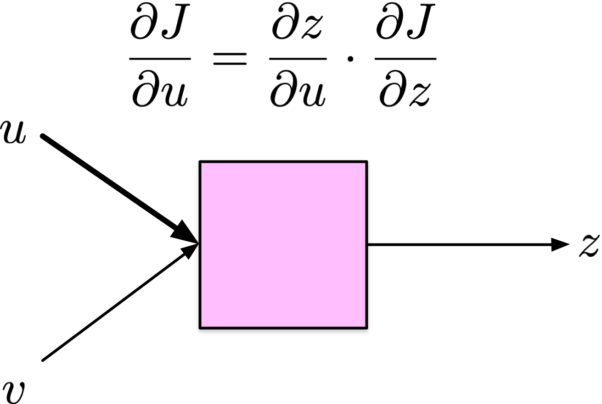
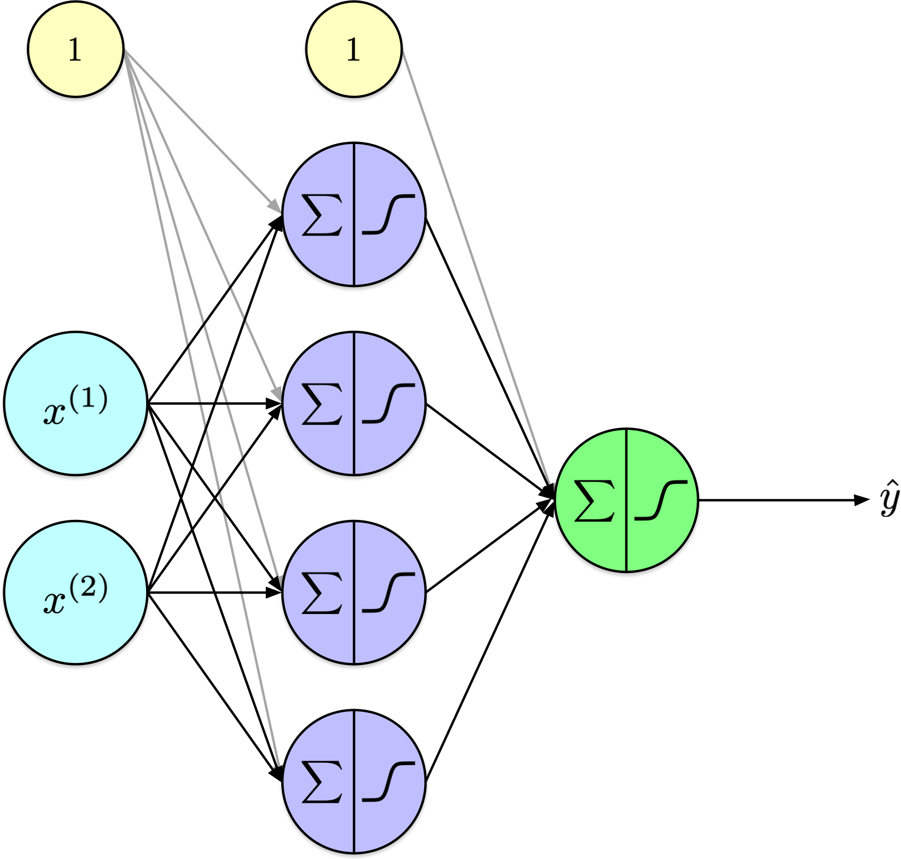
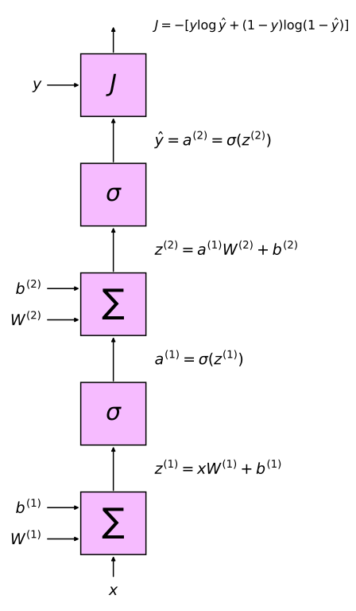

# Training Artificial Neural Networks (Part 2)

CSI 4106 - Fall 2026

Author

Marcel Turcotte

Published

Version: Oct 15, 2026 15:21

# Preamble

## Message of the Day

[](https://media.nature.com/lw767/magazine-assets/d41586-025-03135-z/d41586-025-03135-z_51543916.jpg?as=webp)

[‘Am I redundant?’: how AI changed my career in bioinformatics](https://www.nature.com/articles/d41586-025-03135-z), Nature News, 2025-10-13.

Despite the fact that relatively few students might contemplate a research career, particularly in bioinformatics, the article effectively communicates several key messages. Notably, it is interesting to note that even individuals holding a Ph.D. may feel threatened by the advent of artificial intelligence. The article further illustrates how AI is not eliminating jobs but rather transforming them. In many fields, this transformation redefines roles to those of oversight and supervision.

## Learning objectives

- **Backpropagation Algorithm**:
  - **Discuss** the forward and backward passes, highlighting the calculation of gradients using partial derivatives to update weights.
- **Vanishing Gradient Problem**:
  - **Outline** the issue and present mitigation strategies, such as using activation functions like ReLU or initializing weights with careful consideration.

In the previous lecture, we implemented a feed-forward neural network to illustrate its functionality. To isolate our conceptual understanding of neural networks from their training methods, we employed a naïve derivative-free training algorithm. Today, we will focus on the back-propagation algorithm, a critical element in deep learning techniques.

# Notation

## Units, layers, and activation functions

| Symbol | Meaning |
|:---|:---|
| \\z^{(\ell)}\\ | Preactivations: weighted sums plus biases in layer \\\ell\\ |
| \\a^{(\ell)}\\ | Activations: the layer’s outputs; denoted \\o\\ for units in Lecture 11 |
| \\\varphi\\ | A general activation function, applied elementwise |
| \\\sigma\\ | The logistic sigmoid activation |
| \\W^{(\ell)}, b^{(\ell)}\\ | The layer’s weights and biases |
| \\f\_\ell\\ | The complete layer transformation: affine computation followed by activation |

The symbol \\\varphi\\ always denotes an activation function; \\f\_\ell\\ denotes an entire layer, including its weights and biases. The sigmoid is written \\\sigma\\. Separating these roles avoids using the same symbol for a scalar activation and a complete layer transformation.

The implementation uses `a` for activations. These quantities correspond to the unit outputs \\o\\ in Lecture 11. Lowercase \\a\\ and \\z\\ describe one example, while uppercase \\A\\ and \\Z\\ describe a batch of examples stored as rows. The input activations are \\A^{(0)}=X\\.

## Notation: a two-layer network

One hidden layer and one output layer:

\\ \hat{Y}=f_2(f_1(X)) \\

Each layer computes

\\ f\_\ell(A)=\varphi(AW^{(\ell)}+b^{(\ell)}). \\

[](../../assets/images/ann_mlp-07-01.png)

This follows the NumPy convention from Lecture 12: `a @ W + b`. The weight matrix has shape `(units_in, units_out)`, and the bias vector is broadcast across examples. The input nodes pass features unchanged and are not counted as parameterized layers.

The notation \\\hat{Y}\\ collects network outputs for a batch. In the binary examples, the one-column output contains predicted probabilities, not thresholded labels. Different layers may use different activation functions; \\\varphi\\ stands for the activation chosen for the layer under discussion.

## Notation: a three-layer network

Two hidden layers and one output layer:

\\ \hat{Y}=f_3(f_2(f_1(X))) \\

where

\\ f\_\ell(A)=\varphi(AW^{(\ell)}+b^{(\ell)}). \\

[](../../assets/images/ann_mlp-14-01.png)

## Notation: an \\L\\-layer network

\\ \hat{Y}=f_L(\ldots f_2(f_1(X))\ldots). \\

For \\\ell=1,\ldots,L\\:

\\ Z^{(\ell)}=A^{(\ell-1)}W^{(\ell)}+b^{(\ell)}, \qquad A^{(\ell)}=\varphi(Z^{(\ell)}). \\

The output of one layer becomes the input to the next.

Only the first parameterized layer receives the original input features. Subsequent layers process the preceding layer’s activations. Each layer repeats the same computational pattern with its own parameters.

Adding layers adds computation and stored intermediate values. The regular structure lets the same forward and backward procedures extend to deeper networks; it does not make the cost independent of depth.

# Back-propagation

------------------------------------------------------------------------

[](https://imgs.xkcd.com/comics/machine_learning_2x.png)

**Attribution :** [xkcd.com/1838](https://xkcd.com/1838)

## Back-propagation

**Learning representations by back-propagating errors**

*David E. Rumelhart, *Geoffrey E. Hinton* & Ronald J. Williams*

We describe a new learning procedure, back-propagation, for networks of neurone-like units. The procedure **repeatedly adjusts the weights** of the connections in the network so as to **minimize a measure of the difference between the actual output vector of the net and the desired output vector**. As a result of the weight adjustments, internal ‘**hidden**’ units which are not part of the input or output come to **represent important features of the task domain**, and the regularities in the task are captured by the interactions of these units. The **ability to create useful new features** distinguishes back-propagation from earlier, simpler methods such as the perceptron-convergence procedure.

Rumelhart et al. ([1986](#ref-Rumelhart:1986aa))

I am presenting here the abstract from the seminal Nature publication where Hinton and colleagues introduced the backpropagation algorithm. This abstract is both elegant and informative, effectively capturing the core principles of modern neural networks: the concept of a loss function, the iterative adjustment of weights through the gradient descent algorithm, and the critical role of hidden layers in generating useful task-dependent features.

Nature is a prestigious journal, and it only occasionally publishes content related to computer science.

At the time of this publication, Hinton was affiliated with Carnegie Mellon University. As a reminder, Hinton received the Nobel Prize in Physics in 2024 for his contributions to developing foundational methods in modern machine learning.

The abstract highlights the rationale for using hidden layers in neural networks. The initial hidden layers learn simple representations directly from the input data, while subsequent layers identify associations among these representations. Each layer builds upon the knowledge of previous layers, culminating in the network’s final output.

## Before the back-propagation

- Limitations, such as the **inability to solve the XOR classification task**, essentially **stalled** research on neural networks.

- The perceptron was **limited to a single layer**, and there was **no known method for training a multi-layer perceptron**.

- Single-layer perceptrons are limited to solving classification tasks that are **linearly separable**.

## Back-propagation: contributions

- The model employs **mean squared error** as its **loss function**.

- **Gradient descent** is used to minimize **loss**.

- A **sigmoid activation function** is used instead of a step function, as its **derivative** provides valuable information for gradient descent.

- Shows how updating **internal weights** using a **two-pass** algorithm consisting of a **forward** pass and a **backward** pass.

- **Enables training multi-layer perceptrons.**

## Conceptual Idea

[](../../assets/images/ann_mlp-2-4-4-1.png)

\\J(\theta) = -\frac{1}{N} \sum\_{i=1}^{N} \left\[ y_i \log \hat{y_i} + (1-y_i) \log (1 - \hat{y_i}) \right\]\\

Given a network and parameters that have been initialized randomly, we can generate predictions (\\\hat{y_i}\\); however, for any non-trivial task, these initial predictions are likely to be inaccurate due to the random nature of the parameter initialization.

In the context of a binary classification problem, what level of accuracy might one anticipate?

Correctly, one would anticipate an accuracy of approximately 50%, assuming the dataset is balanced.

To evaluate the model’s performance, we use a loss function, here the binary cross-entropy (also known as negative log likelihood). This loss function averages the loss across all training examples, matching the mean binary cross-entropy used in Lecture 12. The inner term calculates the loss for one example.

In the calculation of the loss, \\\hat{y}\_i = h(x_i) = f_L(\ldots f_2(f_1(x_i))\ldots)\\, where \\f\_\ell(A)=\varphi(AW^{(\ell)}+b^{(\ell)})\\ and \\\varphi\\ without index is an activation function, sigmoid, ReLU, etc.

## Conceptual Idea (continued)

[](../../assets/images/ann_mlp-2-4-4-1.png)

\\\frac {\partial}{\partial \theta_k}J(\theta)\\, for all \\k\\, where the \\\theta_k\\ are `W[l][i,j]` and `b[l][j]`.

In this notation, the index `l` denotes the processing layers within the model. The index `i` refers to the individual units within the preceding layer, denoted as `l-1`, while the index `j` corresponds to the units within the current layer `l`.

How many parameters are present in the model?

The model consists of three weight matrices. The dimensions of these matrices are \\2 \times 4\\, \\4 \times 4\\, and \\4 \times 1\\, containing 8, 16, and 4 weights, respectively. This results in a total of 28 weight parameters.

Additionally, there are three arrays for bias terms, containing 4, 4, and 1 biases, respectively, summing up to 9 bias parameters.

Overall, the model comprises 37 parameters, which is relatively small in comparison to more complex models. For instance, the Keras model discussed in the previous lecture had 266,610 parameters. In contemporary machine learning, it is not uncommon for models to contain millions or even billions of parameters.

## Conceptual Idea (continued)

[](../../assets/images/ann_mlp-2-4-4-1.png)

For a fixed number of epochs: \\\theta = \theta - \alpha \nabla\_\theta J(\theta)\\

Alternative stopping criteria are frequently employed in training algorithms. For example, the process may halt once the training loss reaches a sufficiently low threshold or when the validation loss has increased over a predefined number of epochs.

Model parameters are updated simultaneously, and these updates can be efficiently computed in parallel.

This process is known as gradient descent. As previously discussed, when parameter updates are performed using the entire dataset, the method is referred to as **batch gradient descent**. Conversely, when updates are made using a single training example, it is termed **stochastic gradient descent**. Finally, when a small subset of examples, known as a mini-batch, is used for parameter updates, the method is called **mini-batch gradient descent**.

Our current task involves determining the partial derivatives of the loss function with respect to each of the 37 parameters of our model.

## Backpropagation

- **Backpropagation** is an algorithm for **methodically** computing the **partial derivatives** of a neural network’s loss function with respect to each **weight** and **bias** parameter.

- **Backpropagation** applies the **chain rule** of calculus **recursively** to compute \\\frac{\partial J}{\partial w\_{i,j}^{(\ell)}}\\ for all network parameters \\w\_{i,j}^{(\ell)}\\ efficiently, using intermediate quantities from the forward pass, where \\w\_{i,j}^{(\ell)}\\ denotes the parameter \\w\_{i,j}\\ of the layer \\\ell\\.

## Activation functions and derivatives

Show code

``` python
# Attribution: https://github.com/ageron/handson-ml3/blob/main/10_neural_nets_with_keras.ipynb

import numpy as np
import matplotlib.pyplot as plt

from scipy.special import expit as sigmoid

def relu(z):
    return np.maximum(0, z)

def derivative(f, z, eps=0.000001):
    return (f(z + eps) - f(z - eps))/(2 * eps)

max_z = 4.5
z = np.linspace(-max_z, max_z, 200)

plt.figure(figsize=(11, 3.1))

plt.subplot(121)
plt.plot(z, relu(z), "m-.", linewidth=2, label="ReLU")
plt.plot(z, sigmoid(z), "g--", linewidth=2, label="Sigmoid")
plt.plot(z, np.tanh(z), "b-", linewidth=1, label="Tanh")
plt.grid(True)
plt.title("Activation functions")
plt.axis([-max_z, max_z, -1.65, 2.4])
plt.gca().set_yticks([-1, 0, 1, 2])
plt.legend(loc="lower right", fontsize=13)

plt.subplot(122)
plt.plot(z, derivative(sigmoid, z), "g--", linewidth=2, label="Sigmoid")
plt.plot(z, derivative(np.tanh, z), "b-", linewidth=1, label="Tanh")
plt.plot([-max_z, 0], [0, 0], "m-.", linewidth=2)
plt.plot([0, max_z], [1, 1], "m-.", linewidth=2)
plt.plot([0, 0], [0, 1], "mo", markersize=6, markerfacecolor="white")
plt.grid(True)
plt.title("Derivatives")
plt.axis([-max_z, max_z, -0.2, 1.2])

plt.show()
```

[](slides_files/figure-html/cell-2-output-1.png)

Géron ([2022](#ref-Geron:2022aa)) – [10_neural_nets_with_keras.ipynb](https://github.com/ageron/handson-ml3/blob/main/10_neural_nets_with_keras.ipynb)

Consider the following observations:

- The sigmoid function produces outputs within the open interval \\(0, 1)\\.
- The hyperbolic tangent function (\\\tanh\\) has an image spanning the open interval \\(-1, 1)\\.
- The Rectified Linear Unit (ReLU) function outputs values in the interval \\\[0, \infty)\\.

Additionally, note:

- The maximum derivative value of the sigmoid function is 0.25.
- The maximum derivative value of the \\\tanh\\ function is 1.
- The derivative of the ReLU function is 0 for negative inputs and 1 for positive inputs. At zero, the ordinary derivative is undefined; the open circles mark this break. Implementations choose a value at this point, commonly zero.

Furthermore:

- A ReLU unit’s output need not be 0 or 1. Away from zero, its local derivative is 0 or 1. A parameter gradient also depends on incoming activations and derivatives propagated from later operations.

## Chain rule

Given,

\\ h(x) = f(g(x)) \\

using the **Lagrange** notation, we have

\\ h^\prime(x) = f^\prime(g(x)) g^\prime(x) \\

or equivalently using **Leibniz** notation

\\ \frac{dz}{dx} = \frac{dz}{dy} \cdot \frac{dy}{dx} \\

The **chain rule** is a fundamental concept in calculus used to determine the derivative of a **composite function**. Specifically, if a function \\h\\ is defined as the composition of two differentiable functions, \\f\\ and \\g\\, the chain rule provides a method to compute \\h^\prime\\.

Conceptually, the chain rule asserts that if you know the instantaneous rate of change of \\z\\ with respect to \\y\\, and the rate of change of \\y\\ with respect to \\x\\, you can find the rate of change of \\z\\ with respect to \\x\\. This is achieved by multiplying these two rates of change.

You now see the connection with compact layer notation, \\\hat{Y} = f_L(\ldots f_2(f_1(X))\ldots)\\ where \\f\_\ell(A)=\varphi(AW^{(\ell)}+b^{(\ell)})\\, introduced at the beginning of this lecture.

## Applying the chain rule recursively

[](../../assets/images/ann_partial_Juz.png)

Where \\u\\ is a parameter of the model, one of those \\w\_{i,j}^{(\ell)}\\ and \\b\_{j}^{(\ell)}\\.

Backpropagation simplifies the computational process by decomposing it into a series of elementary steps, where the chain rule is meticulously applied at each stage.

Consider a function depicted by a pink box, parameterized by \\u\\, which produces an output \\z\\. This output \\z\\ serves as the input to another function, eventually culminating in an input to the loss function \\J\\.

The expression \\\frac{\partial J}{\partial u}\\ denotes the partial derivative of \\J\\ with respect to \\u\\. This derivative quantifies the sensitivity of the loss \\J\\ to changes in the parameter \\u\\, indicating whether \\u\\ should be increased or decreased, and by what magnitude, to minimize the loss.

According to the chain rule, if \\\frac{\partial J}{\partial z}\\ is already known, then \\\frac{\partial J}{\partial u}\\ can be computed as \\\frac{\partial z}{\partial u} \cdot \frac{\partial J}{\partial z}\\.

## Computational graph

[](../../assets/images/ann_mlp-2-4-1.png)

[](../../assets/images/ann_comp_graph-row-vectors.svg)

A **two-layer perceptron** and its associated **computational graph**.

The network depicted on the right is more general compared to the one on the left. On the right, \\x\\ is a vector, and the pink boxes denote operations on vectors. Consequently, each layer can accommodate an arbitrarily large number of units.

\\W^{(l)}\\ refers to the weight matrices, \\b^{(l)}\\ to the bias vectors, \\z^{(l)}\\ to the pre-activation vectors, and \\a^{(l)}\\ to the activation vectors, each associated with layer \\l\\.

For illustrative purposes, the representation on the right depicts the loss associated with a single example. To compute the loss over the entire training dataset, one must aggregate these individual losses and subsequently divide the sum by the total number of examples, yielding the average loss.

## Scalar input; one hidden node

Let

\\ J = -\Bigl\[y \\\log(\hat y) + (1-y)\\\log(1-\hat y)\Bigr\] \\

\\ \hat y = a_2 = \sigma(z_2), \quad z_2 = w_2 \cdot a_1 + b_2 \\

\\ a_1 = \sigma(z_1), \quad z_1 = w_1 \cdot x + b_1 \\

[](../../assets/images/ann_comp_graph-row-vectors.svg)

The left side presents the equations for a basic neural network with a scalar input, denoted as \\x\\, and a single hidden node. Each layer in this network is characterized by one weight, and thus, a simplified notation with a single subscript is used.

Conversely, the right side illustrates the network using vector notation. In this context, \\W^{(\ell)}\\ represents the weight matrix for layer \\\ell\\. The dimensions of this matrix are defined as \\\text{input} \times \text{output}\\, where **input** refers to the number of activations from the preceding layer, and **output** indicates the number of nodes in the current layer.

In this discussion, we will concentrate on scalar equations to enhance clarity and simplicity. Although our focus is on scalar forms, the principles extend to the more general case using vector calculus.

## Derivatives

\\ \frac{\partial J}{\partial \hat{y}} \\

\\ \frac{\partial \hat{y}}{\partial z_2} \\

\\ \frac{\partial z_2}{\partial w_2}, \quad \frac{\partial z_2}{\partial b_2}, \quad \frac{\partial z_2}{\partial a_1}, \\

\\ \frac{\partial a_1}{\partial z_1}, \\

\\ \frac{\partial z_1}{\partial w_1}, \quad \frac{\partial z_1}{\partial b_1}, \quad \frac{\partial z_1}{\partial x}, \\

[](../../assets/images/ann_comp_graph-row-vectors.svg)

## Derivatives

Loss derivative w.r.t. \\\hat{y}\\:

\\ \frac{\partial J}{\partial \hat{y}} = -\left(\frac{y}{\hat{y}}-\frac{1-y}{1-\hat{y}}\right) \\

[](../../assets/images/ann_comp_graph-row-vectors.svg)

## Derivatives

\\\hat{y}\\ derivative w.r.t. \\z_2\\:

\\ \frac{\partial \hat{y}}{\partial z_2}=\sigma^{\prime}\left(z_2\right)=\hat{y}(1-\hat{y}) \\

[](../../assets/images/ann_comp_graph-row-vectors.svg)

## Derivatives

Derivative \\z_2 = w_2 a_1 + b_2\\:

\\ \frac{\partial z_2}{\partial w_2}=a_1, \quad \frac{\partial z_2}{\partial b_2}=1, \quad \frac{\partial z_2}{\partial a_1}=w_2 \\

[](../../assets/images/ann_comp_graph-row-vectors.svg)

## Derivatives

Derivative \\a_1 = \sigma(z_1)\\:

\\ \frac{\partial a_1}{\partial z_1}=\sigma^{\prime}\left(z_1\right)=a_1\left(1-a_1\right) \\

[](../../assets/images/ann_comp_graph-row-vectors.svg)

## Derivatives

Derivative \\z_1 = w_1 x + b_1\\:

\\ \frac{\partial z_1}{\partial w_1}=x, \quad \frac{\partial z_1}{\partial b_1}=1, \quad \frac{\partial z_1}{\partial x} = w_1 \\

[](../../assets/images/ann_comp_graph-row-vectors.svg)

## Combined derivatives

For \\w_2\\:

\\ \frac{\partial J}{\partial w_2}=\frac{\partial J}{\partial \hat{y}} \cdot \frac{\partial \hat{y}}{\partial z_2} \cdot \frac{\partial z_2}{\partial w_2}=\left\[-\left(\frac{y}{\hat{y}}-\frac{1-y}{1-\hat{y}}\right)\right\] \cdot(\hat{y}(1-\hat{y})) \cdot a_1 \\

Simplifies to:

\\ \frac{\partial J}{\partial w_2}=(\hat{y}-y) a_1 \\

[](../../assets/images/ann_comp_graph-row-vectors.svg)

## Combined derivatives

For \\b_2\\:

\\ \frac{\partial J}{\partial b_2}=\frac{\partial J}{\partial \hat{y}} \cdot \frac{\partial \hat{y}}{\partial z_2} \cdot \frac{\partial z_2}{\partial b_2}=(\hat{y}-y) \cdot 1=\hat{y}-y \\

[](../../assets/images/ann_comp_graph-row-vectors.svg)

## Combined derivatives

For \\w_1\\:

\\ \frac{\partial J}{\partial w_1}=\frac{\partial J}{\partial \hat{y}} \cdot \frac{\partial \hat{y}}{\partial z_2} \cdot \frac{\partial z_2}{\partial a_1} \cdot \frac{\partial a_1}{\partial z_1} \cdot \frac{\partial z_1}{\partial w_1} \\

Plug in:

\\ =\left\[-\left(\frac{y}{\hat{y}}-\frac{1-y}{1-\hat{y}}\right)\right\] \cdot(\hat{y}(1-\hat{y})) \cdot w_2 \cdot\left(a_1\left(1-a_1\right)\right) \cdot x \\

Simplifies to:

\\ \frac{\partial J}{\partial w_1}=(\hat{y}-y) w_2\left(a_1\left(1-a_1\right)\right) x \\

[](../../assets/images/ann_comp_graph-row-vectors.svg)

## Combined derivatives

For \\b_1\\:

\\ \frac{\partial J}{\partial b_1}=\frac{\partial J}{\partial \hat{y}} \cdot \frac{\partial \hat{y}}{\partial z_2} \cdot \frac{\partial z_2}{\partial a_1} \cdot \frac{\partial a_1}{\partial z_1} \cdot \frac{\partial z_1}{\partial b_1} \\

Plug in:

\\ =(\hat{y}-y) w_2\left(a_1\left(1-a_1\right)\right) \cdot 1 \\

Simplifies to:

\\ \frac{\partial J}{\partial b_1}=(\hat{y}-y) w_2\left(a_1\left(1-a_1\right)\right) \\

[](../../assets/images/ann_comp_graph-row-vectors.svg)

## Key derivatives

\\ \begin{align} \frac{\partial J}{\partial w_2} & = (\hat{y}-y) a_1 \\ \frac{\partial J}{\partial b_2} & = \hat{y}-y \\ \frac{\partial J}{\partial w_1} & = (\hat{y}-y) w_2\left(a_1\left(1-a_1\right)\right) x \\ \frac{\partial J}{\partial b_1} & = (\hat{y}-y) w_2\left(a_1\left(1-a_1\right)\right) \\ \end{align} \\

[](../../assets/images/ann_comp_graph-row-vectors.svg)

**Observation 1:** The computation of key gradients necessitates the activation values from all layers, specifically \\a_1\\ and \\\hat{y} = a_2\\.

## Exploration

``` python
import math
import random

random.seed(42)

def sigma(x):
    return 1 / (1 + math.exp(-x))

alpha = 0.1

def init():

    global w1, w2, b1, b2

    w1 = random.random()
    w2 = random.random()
    b1 = 0
    b2 = 0
```

We consider a straightforward neural network model. It accepts a single scalar input, denoted as \\x\\, and comprises a single hidden node characterized by a weight \\w_1\\ and bias \\b_1\\. It also includes an output node with a weight \\w_2\\ and bias \\b_2\\. In total, the network contains four trainable parameters.

## Forward

``` python
def forward():

    global z1, w1, x, b1, a1, z2, J, y_hat

    z1 = w1 * x + b1
    a1 = sigma(z1)

    z2 = w2 * a1 + b2
    a2 = sigma(z2)

    y_hat = a2

    J = -(y * math.log(y_hat) + (1-y) * math.log(1 - y_hat))
```

In the forward pass, the computations progress sequentially through each layer, calculating both preactivation and activation values, denoted as `z1`, `a1`, `z2`, and `a2`. The value `a2` represents the model’s output, which is subsequently utilized to determine the loss.

## Backward

``` python
def backward():

    global alpha, w1, b1, w2, b2, a1, z1, z2, y, y_hat

    grad_J_w2 = (y_hat - y) * a1
    grad_J_b2 = y_hat - y

    grad_J_w1 = (y_hat - y) * w2 * (a1 * (1-a1)) * x
    grad_J_b1 = (y_hat - y) * w2 * (a1 * (1-a1))

    w2 = w2 - alpha * grad_J_w2
    b2 = b2 - alpha * grad_J_b2

    w1 = w1 - alpha * grad_J_w1
    b1 = b1 - alpha * grad_J_b1
```

During the backward pass, the partial derivatives, or gradients, are calculated for each of the four parameters. Subsequently, these gradients are utilized to update the corresponding weights through a process known as gradient updating.

## Training

``` python
init()

x = 3.14
y = 1

forward()
print(f"Before: y_hat = {y_hat:.2}, loss = {J:.2}")

for i in range(500):
    forward()
    backward()

forward()
print(f"After: y_hat = {y_hat:.2}, loss = {J:.2}")
```

    Before: y_hat = 0.51, loss = 0.68
    After: y_hat = 0.99, loss = 0.01

The training process we have implemented is based on a single data instance. As it stands, our basic network architecture is restricted to processing only this one example, primarily due to the hard-coded nature of the loss function, which is specifically tailored for a single input. However, you can experiment with various parameters to observe their effects on the model’s performance. These parameters include setting `y=0`, adjusting the input value `x`, modifying the learning rate `alpha`, or altering the number of training epochs.

## Key derivatives

\\ \begin{align} \frac{\partial J}{\partial w_2} & = \frac{\partial J}{\partial \hat{y}} \cdot \frac{\partial \hat{y}}{\partial z_2} \cdot \frac{\partial z_2}{\partial w_2}\\ \frac{\partial J}{\partial b_2} & = \frac{\partial J}{\partial \hat{y}} \cdot \frac{\partial \hat{y}}{\partial z_2} \cdot \frac{\partial z_2}{\partial b_2}\\ \frac{\partial J}{\partial w_1} & = \frac{\partial J}{\partial \hat{y}} \cdot \frac{\partial \hat{y}}{\partial z_2} \cdot \frac{\partial z_2}{\partial a_1} \cdot \frac{\partial a_1}{\partial z_1} \cdot \frac{\partial z_1}{\partial w_1}\\ \frac{\partial J}{\partial b_1} & = \frac{\partial J}{\partial \hat{y}} \cdot \frac{\partial \hat{y}}{\partial z_2} \cdot \frac{\partial z_2}{\partial a_1} \cdot \frac{\partial a_1}{\partial z_1} \cdot \frac{\partial z_1}{\partial b_1}\\ \end{align} \\

[](../../assets/images/ann_comp_graph-row-vectors.svg)

**Observation 2:** Notice how some derivatives, such as \\\frac{\partial J}{\partial \hat{y}} \cdot \frac{\partial \hat{y}}{\partial z_2}\\, are computed multiple times.

It is hardly surprising, given that these chains follow the same path within the computational graph.

## Key derivatives

Let

\\ \begin{align} \delta_2 & = \frac{\partial J}{\partial \hat{y}} \cdot \frac{\partial \hat{y}}{\partial z_2} \\ \delta_1 & = \delta_2 \cdot \frac{\partial z_2}{\partial a_1} \cdot \frac{\partial a_1}{\partial z_1} \end{align} \\

Rewrite

\\ \begin{align} \frac{\partial J}{\partial w_2} & = \delta_2 \cdot \frac{\partial z_2}{\partial w_2}\\ \frac{\partial J}{\partial b_2} & = \delta_2 \cdot \frac{\partial z_2}{\partial b_2}\\ \frac{\partial J}{\partial w_1} & = \delta_1 \cdot \frac{\partial z_1}{\partial w_1}\\ \frac{\partial J}{\partial b_1} & = \delta_1 \cdot \frac{\partial z_1}{\partial b_1}\\ \end{align} \\

[](../../assets/images/ann_comp_graph-row-vectors.svg)

Here \\\delta\_\ell=\partial J/\partial z\_\ell\\, so its index matches the layer. In backpropagation, the process progresses from the output layer towards the input layer, systematically calculating and **storing intermediate partial derivatives**.

In our initial discussion, we combined and simplified the partial derivatives. To streamline this process, we can extend the chain rule by multiplying the local derivative with the precomputed partial derivative that traces the path from the output layer to the local processing unit within the computational graph. This approach not only simplifies the process but also facilitates automation.

In the presentation, we simplified the network model by using a single scalar input and two processing units, each equipped with an individual weight and bias. For the purpose of demonstration, we trained this model with a single example. Expanding the model to include additional inputs and processing nodes transforms the weights (\\w\\) into matrices and the biases (\\b\\) into vectors, while the underlying mechanics transition to vector calculus. Adding layers increases the work and intermediate storage required. The same operations repeat in the extended backpropagation loop. In fact, our computational graph representation is already expressed using vector notation.

## Backpropagation: top level

1.  (**Computational Graph Creation**)

2.  **Initialization**

3.  **Forward Pass**

4.  **Compute Loss**

5.  **Backward Pass (Backpropagation)**

6.  **Update the parameters and repeat 3 to 6**.

The algorithm **stops** either after a **predefined number of epochs** or when c**onvergence criteria are satisfied**.

Modern frameworks like TensorFlow and PyTorch build a computational graph to represent the operations and data flow within a neural network. In contrast, our simplified implementation will not utilize this approach.

## Backpropagation: detailed

1.  (Create the **computational graph**.)

2.  Initialize the **weights** and **biases**.

3.  **Forward pass:** starting from the input, compute the output of each operation in the graph, and store these values.

4.  **Compute loss**.

5.  **Backward pass:** starting from the output and moving backward, for each operation.

    1.  Compute the derivative of the output with respect to each of the inputs.

    2.  For each input \\u\\,

\\ \delta_u = \frac{\partial J}{\partial u} = \frac{\partial z}{\partial u} \cdot \frac{\partial J}{\partial z} \\

6.  **Update** the parameters and **repeat 3 to 6**.

## Backpropagation: 2. Initialization

Initialize the **weights** and **biases** of the neural network.

1.  **~~Zero Initialization~~**
    - All weights are **initialized to zero**.
    - Symmetry problems, **all neurons produce identical outputs**, preventing effective learning.
2.  **Random Initialization**
    - Weights are initialized **randomly**, often using a **uniform** or **normal** distribution.
    - **Breaks the symmetry between neurons**, allowing them to learn.
    - If not scaled properly, leads to **slow convergence** or **vanishing/exploding gradients**.

**See also**: Xavier/Glorot and He initialization (later)

Initializing weights and biases to zero works for logistic regression because it is a linear model with a single layer. In logistic regression, each feature’s weight is independently adjusted during training, and the optimization process can converge correctly regardless of the initial weights, provided the data is linearly separable.

However, zero initialization does not work well for neural networks due to their multi-layered structure. Here’s why:

1.  **Symmetry Breaking**: Neural networks require breaking symmetry between neurons in each layer so that they can learn different features. If all weights are initialized to zero, each neuron in a layer will compute the same output and receive the same gradient during backpropagation. This results in the neurons updating identically, preventing them from learning distinct features and effectively rendering multiple neurons redundant.

2.  **Non-Linearity**: Neural networks rely on non-linear transformations between layers to model complex relationships in the data. Zero initialization inhibits the ability of neurons to activate differently, impeding the network’s capacity to capture non-linear patterns.

## Backpropagation: 3. Forward Pass

**For each example** in the training set (or in a mini-batch):

- **Input Layer**: Pass input features to first layer.

- **Hidden Layers**: For each hidden layer, compute the **activations** (output) by applying the **weighted sum of inputs plus bias**, followed by an **activation function** (e.g., sigmoid, ReLU).

- **Output Layer**: Same process as hidden layers. Output layer activations represent the predicted values.

The forward pass is almost identical to applying the network for prediction (`.predict()`), with the exception that intermediate (activation) results are saved, as they are needed for the backward pass.

In practice, it is the **mini-batch** version of this algorithm that is being used. **Stochastic gradient descent** is a special case of mini-batch gradient descent where the **mini-batch size** is **one**.

## Backpropagation: 4. Compute Loss

Calculate the **loss** (**error**) using a suitable loss function by comparing the **predicted values** to the **actual target** values.

More on the various loss functions coming later: **mean squared error** for regression tasks or **cross-entropy** loss for classification tasks.

A smaller loss indicates that the predicted values are closer to the actual target values.

The value of the loss function can serve as a stopping criterion, with backpropagation halting when the loss is sufficiently small.

Crucially, the derivative of the loss function provides essential information for adjusting the network’s weights and bias terms.

## Backpropagation: 5. Backward Pass

- **Output Layer**: Compute the **gradient of the loss** with respect to the output layer’s **weights** and **biases** using the **chain rule of calculus**.

- **Hidden Layers**: **Propagate the error backward** through the network, **layer by layer**. For each layer, compute the gradient of the loss with respect to the weights and biases. Use the derivative of the activation function to help calculate these gradients.

- **Update Weights and Biases**: Adjust the weights and biases using the calculated gradients and a learning rate, which determines the step size for each update.

Common optimization techniques like **gradient descent** or its variants (e.g., Adam) are employed.

At the end of the presentation, links are provided to a series of videos by Herman Kamper. These videos elucidate the intricacies of the backpropagation algorithm across various architectures, both with and without forks, utilizing function composition and graph computation approaches.

While the algorithm is complex due to the numerous cases it entails, its regular structure makes it suitable for automation. Specifically, algorithms like automatic differentiation (autodiff) facilitate this process.

In 1970, [Seppo Ilmari Linnainmaa](https://en.wikipedia.org/wiki/Seppo_Linnainmaa) introduced the algorithm known as reverse mode automatic differentiation in his MSc thesis. Although he did not apply this algorithm to neural networks, it is more general than backpropagation.

## Backpropagation - Purpose

- Algorithm to **train multi-layer perceptrons (MLPs)** by **minimizing a loss function**.
- Enables **hidden layers** to learn **useful internal representations** by adjusting **weights and biases**.

## Backpropagation - Core Idea

- Iteratively adjust parameters to **reduce the difference** between predicted and true outputs.

- Uses **gradient descent** on the **loss function**:

  \\ \theta \leftarrow \theta - \alpha \nabla\_\theta J(\theta) \\

  where \\\alpha\\ is the learning rate.

## Backpropagation - Summary

1.  **Create** the computational graph

2.  **Initialize** weights & biases

3.  **Forward pass:** compute activations & loss.

4.  **Backward pass:** compute gradients using chain rule.

5.  **Update parameters:**

    \\W^{(\ell)} \leftarrow W^{(\ell)} - \alpha \frac{\partial J}{\partial W^{(\ell)}}\\

    \\b^{(\ell)} \leftarrow b^{(\ell)} - \alpha \frac{\partial J}{\partial b^{(\ell)}}\\

6.  **Repeat** until convergence.

# Implementation

## Backpropagation - Forward Pass

- Compute activations layer by layer:

  \\z^{(\ell)} = a^{(\ell-1)} W^{(\ell)} + b^{(\ell)}\\,

  \\a^{(\ell)} = \varphi(z^{(\ell)})\\.

- Obtain prediction \\\hat{y}\\ and compute loss \\J(\hat{y}, y)\\.

## Backpropagation - Backward Pass

- Apply **chain rule** to compute **partial derivatives** of the loss with respect to each parameter efficiently.
- Propagate gradients **from output to input layers**:

\\ \delta^{(\ell)} = (\delta^{(\ell+1)}(W^{(\ell+1)})^\top) \odot \varphi'(z^{(\ell)}) \\

Where \\\odot\\ is the elementwise (Hadamard) product.

- \\\delta^{(\ell)}\\ — the **error term** (or local gradient) for layer \\\ell\\, defined as \\\displaystyle \delta^{(\ell)} = \frac{\partial J}{\partial z^{(\ell)}}\\, the sensitivity of the loss \\J\\ to the preactivation \\z^{(\ell)}\\.

- \\\delta^{(\ell+1)}\\ — the **error term** from the **next layer** (closer to the output). This is already known from the previous step in backpropagation.

- \\\delta^{(\ell+1)}(W^{(\ell+1)})^\top\\ — propagates the next layer’s error **backward through the weights** of layer \\\ell+1\\. Each neuron in layer \\\ell\\ receives a weighted sum of the downstream errors.

- \\\varphi'(z^{(\ell)})\\ — the **derivative of the activation function** at layer \\\ell\\. It scales the error according to how sensitive the neuron’s activation was to changes in its input.

## SimpleMLP

The complete implementation is presented below and will be examined in the subsequent slides.

Show code

``` python
import numpy as np

# Activations & loss

def sigmoid(z):
    return 1.0 / (1.0 + np.exp(-z))

def sigmoid_prime(z):
    s = sigmoid(z)
    return s * (1.0 - s)

def relu(z):
    return np.maximum(0.0, z)

def relu_prime(z):
    return (z > 0).astype(z.dtype)

def bce_loss(y_true, y_prob, eps=1e-9):

    """Binary cross-entropy averaged over samples (with clipping for stability)."""

    y_prob = np.clip(y_prob, eps, 1 - eps)
    return -np.mean(y_true * np.log(y_prob) + (1 - y_true) * np.log(1 - y_prob))

# Initializers

def he_init(rng, fan_in, fan_out):

    # He normal: good for ReLU

    std = np.sqrt(2.0 / fan_in)
    return rng.normal(0.0, std, size=(fan_in, fan_out))

def xavier_init(rng, fan_in, fan_out):

    # Glorot/Xavier normal: good for sigmoid/tanh

    std = np.sqrt(2.0 / (fan_in + fan_out))
    return rng.normal(0.0, std, size=(fan_in, fan_out))


# SimpleMLP (API mirrors NaiveMLP)

class SimpleMLP:

    """
    Minimal MLP for binary classification.

    - Hidden: ReLU (default) with He init; or 'sigmoid' with Xavier init
    - Output: Sigmoid + BCE (δ_L = a_L - y)
    - API: forward -> probas (N,), predict_proba, predict, loss, train
    """

    def __init__(self, layer_sizes, lr=0.1, seed=None, l2=0.0,
                 hidden_activation="relu", lr_decay=None):
        """
        layer_sizes: e.g., [2, 4, 4, 1]
        lr: learning rate
        l2: L2 regularization strength (0 disables)
        hidden_activation: 'relu' (default) or 'sigmoid'
        lr_decay: optional float in (0,1); multiply lr by this every epoch (e.g., 0.9)
        """
        self.sizes = list(layer_sizes)
        self.lr = float(lr)
        self.base_lr = float(lr)
        self.lr_decay = lr_decay
        self.l2 = float(l2)
        self.hidden_activation = hidden_activation
        rng = np.random.default_rng(seed)

        # Initialize weights/biases per layer
        self.W = []
        for din, dout in zip(self.sizes[:-1], self.sizes[1:]):
            if hidden_activation == "relu":
                Wk = he_init(rng, din, dout)
            else:
                Wk = xavier_init(rng, din, dout)
            self.W.append(Wk)
        self.b = [np.zeros(dout) for dout in self.sizes[1:]]

    # activations (hidden vs output)

    def _act(self, z, last=False):
        if last:
            return sigmoid(z)  # output layer
        return relu(z) if self.hidden_activation == "relu" else sigmoid(z)

    def _act_prime(self, z, last=False):
        if last:
            return sigmoid_prime(z)  # rarely needed with BCE+sigmoid
        return relu_prime(z) if self.hidden_activation == "relu" else sigmoid_prime(z)

    # forward (public): returns probabilities (N,)

    def forward(self, X):
        a = X
        L = len(self.W)
        for ell, (W, b) in enumerate(zip(self.W, self.b), start=1):
            a = self._act(a @ W + b, last=(ell == L))
        return a.ravel()

    # Aliases to match NaiveMLP

    def predict_proba(self, X):
        return self.forward(X)

    def predict(self, X, threshold=0.5):
        return (self.predict_proba(X) >= threshold).astype(int)

    def loss(self, X, y):

        # BCE + optional L2
        p = self.predict_proba(X)
        base = bce_loss(y, p)
        if self.l2 > 0:
            reg = 0.5 * self.l2 * sum((W**2).sum() for W in self.W)
            # Normalize reg by number of samples to be consistent with mean loss
            base += reg / max(1, X.shape[0])
        return base

    # internal: forward caches for backprop

    def _forward_full(self, X):
        a = X
        activations = [a]
        zs = []
        L = len(self.W)
        for ell, (W, b) in enumerate(zip(self.W, self.b), start=1):
            z = a @ W + b
            a = self._act(z, last=(ell == L))
            zs.append(z)
            activations.append(a)
        return activations, zs

    # training: mini-batch gradient descent with backprop

    def train(self, X, y, epochs=30, batch_size=None, verbose=True, shuffle=True):

        """
        X: (N, d), y: (N,) in {0,1}
        batch_size: None -> full-batch; else int
        """

        N = X.shape[0]
        idx = np.arange(N)
        B = N if batch_size is None else int(batch_size)

        for ep in range(1, epochs + 1):
            if shuffle:
                np.random.shuffle(idx)
            if self.lr_decay:
                self.lr = self.base_lr * (self.lr_decay ** (ep - 1))

            base_loss = self.loss(X, y)

            for start in range(0, N, B):
                sl = idx[start:start+B]
                Xb = X[sl]
                yb = y[sl].reshape(-1, 1)  # (B,1)

                # Forward caches
                activations, zs = self._forward_full(Xb)
                A_L = activations[-1]          # (B,1)
                Bsz = Xb.shape[0]

                # Backprop
                # Output layer: BCE + sigmoid => delta_L = (A_L - y)

                delta = (A_L - yb)             # (B,1)

                grads_W = [None] * len(self.W)
                grads_b = [None] * len(self.b)

                # Last layer grads

                grads_W[-1] = activations[-2].T @ delta / Bsz   # (n_{L-1}, 1)
                grads_b[-1] = delta.mean(axis=0)                # (1,)

                # Hidden layers: l = L-1 down to 1

                for l in range(2, len(self.sizes)):
                    z = zs[-l]                                  # (B, n_l)
                    sp = self._act_prime(z, last=False)         # (B, n_l)
                    delta = (delta @ self.W[-l+1].T) * sp       # (B, n_l)
                    grads_W[-l] = activations[-l-1].T @ delta / Bsz  # (n_{l-1}, n_l)
                    grads_b[-l] = delta.mean(axis=0)                 # (n_l,)

                # L2 regularization (add to grads)

                if self.l2 > 0:
                    for k in range(len(self.W)):
                        grads_W[k] = grads_W[k] + self.l2 * self.W[k]

                # Gradient step

                for k in range(len(self.W)):
                    self.W[k] -= self.lr * grads_W[k]
                    self.b[k] -= self.lr * grads_b[k]

            new_loss = self.loss(X, y)
            if verbose:
                print(f"Epoch {ep:3d} | loss {base_loss:.5f} → {new_loss:.5f} | Δ={base_loss - new_loss:.5f} | lr={self.lr:.4f}")
```

## Activation functions

``` python
def sigmoid(z):
    return 1.0 / (1.0 + np.exp(-z))

def sigmoid_prime(z):
    s = sigmoid(z)
    return s * (1.0 - s)

def relu(z):
    return np.maximum(0.0, z)

def relu_prime(z):
    return (z > 0).astype(z.dtype)
```

As stated in a previous lecture, the derivative of the sigmoid function is conveniently expressed as the product of the sigmoid function itself and one minus the sigmoid function.

We’re including ReLU as well.

## Loss

``` python
def bce_loss(y_true, y_prob, eps=1e-9):

    """Binary cross-entropy averaged over samples (with clipping for stability)."""

    y_prob = np.clip(y_prob, eps, 1 - eps)

    return -np.mean(y_true * np.log(y_prob) + (1 - y_true) * np.log(1 - y_prob))
```

## Initializers

``` python
def he_init(rng, fan_in, fan_out):

    # He normal: good for ReLU

    std = np.sqrt(2.0 / fan_in)
    return rng.normal(0.0, std, size=(fan_in, fan_out))

def xavier_init(rng, fan_in, fan_out):

    # Glorot/Xavier normal: good for sigmoid/tanh

    std = np.sqrt(2.0 / (fan_in + fan_out))
    return rng.normal(0.0, std, size=(fan_in, fan_out))
```

In the upcoming lecture, we will explore the issue of the vanishing gradient, a common challenge encountered in deep neural networks. One approach to mitigating this problem involves modifying the activation functions and adjusting the weight initialization methods.

## Class definition + constructor

``` python
class SimpleMLP:

    def __init__(self, layer_sizes, lr=0.1, seed=None, l2=0.0,
                 hidden_activation="relu", lr_decay=None):

        self.sizes = list(layer_sizes)
        self.lr = float(lr)
        self.base_lr = float(lr)
        self.lr_decay = lr_decay
        self.l2 = float(l2)
        self.hidden_activation = hidden_activation
        rng = np.random.default_rng(seed)

        # Initialize weights/biases per layer
        self.W = []
        for din, dout in zip(self.sizes[:-1], self.sizes[1:]):
            if hidden_activation == "relu":
                Wk = he_init(rng, din, dout)
            else:
                Wk = xavier_init(rng, din, dout)
            self.W.append(Wk)
        self.b = [np.zeros(dout) for dout in self.sizes[1:]]
```

The constructor aligns with that of `NaiveMLP`, with the key difference being that it retains a learning rate rather than a step value. Additionally, the initialization of weights varies based on the specific activation functions employed.

## Forward (public)

``` python
    def forward(self, X):
        a = X
        L = len(self.W)
        for ell, (W, b) in enumerate(zip(self.W, self.b), start=1):
            a = self._act(a @ W + b, last=(ell == L))
        return a.ravel()
```

. . .

where `_act` is defined as follows:

``` python
    def _act(self, z, last=False):
        if last:
            return sigmoid(z)  # output layer
        return relu(z) if self.hidden_activation == "relu" else sigmoid(z)
```

The `SimpleMLP` model incorporates two distinct implementations of the `forward` method: one tailored for prediction tasks and the other for model training.

## Forward (private)

``` python
    def _forward_full(self, X):
        a = X
        activations = [a]
        zs = []
        L = len(self.W)
        for ell, (W, b) in enumerate(zip(self.W, self.b), start=1):
            z = a @ W + b
            a = self._act(z, last=(ell == L))
            zs.append(z)
            activations.append(a)
        return activations, zs
```

The private method `forward` differs in that it retains both the preactivation values (`zs`) and the activation values (`activations`). This retention is important, as these values are required during the backward propagation phase.

## Training

``` python
    def train(self, X, y, epochs=30, batch_size=None, verbose=True, shuffle=True):

        """
        X: (N, d), y: (N,) in {0,1}
        batch_size: None -> full-batch; else int
        """

        N = X.shape[0]
        idx = np.arange(N)
        B = N if batch_size is None else int(batch_size)

        for ep in range(1, epochs + 1):
            if shuffle:
                np.random.shuffle(idx)
            if self.lr_decay:
                self.lr = self.base_lr * (self.lr_decay ** (ep - 1))

            base_loss = self.loss(X, y)

            for start in range(0, N, B):
                sl = idx[start:start+B]
                Xb = X[sl]
                yb = y[sl].reshape(-1, 1)  # (B,1)

                # Forward caches
                activations, zs = self._forward_full(Xb)
                A_L = activations[-1]          # (B,1)
                Bsz = Xb.shape[0]

                # Backprop
                # Output layer: BCE + sigmoid => delta_L = (A_L - y)

                delta = (A_L - yb)             # (B,1)

                grads_W = [None] * len(self.W)
                grads_b = [None] * len(self.b)

                # Last layer grads

                grads_W[-1] = activations[-2].T @ delta / Bsz   # (n_{L-1}, 1)
                grads_b[-1] = delta.mean(axis=0)                # (1,)

                # Hidden layers: l = L-1 down to 1

                for l in range(2, len(self.sizes)):
                    z = zs[-l]                                  # (B, n_l)
                    sp = self._act_prime(z, last=False)         # (B, n_l)
                    delta = (delta @ self.W[-l+1].T) * sp       # (B, n_l)
                    grads_W[-l] = activations[-l-1].T @ delta / Bsz  # (n_{l-1}, n_l)
                    grads_b[-l] = delta.mean(axis=0)                 # (n_l,)

                # L2 regularization (add to grads)

                if self.l2 > 0:
                    for k in range(len(self.W)):
                        grads_W[k] = grads_W[k] + self.l2 * self.W[k]

                # Gradient step

                for k in range(len(self.W)):
                    self.W[k] -= self.lr * grads_W[k]
                    self.b[k] -= self.lr * grads_b[k]

            new_loss = self.loss(X, y)
            if verbose:
                print(f"Epoch {ep:3d} | loss {base_loss:.5f} → {new_loss:.5f} | Δ={base_loss - new_loss:.5f} | lr={self.lr:.4f}")
```

Our implementation successfully replicates several key features of contemporary frameworks. It provides options to define the batch size and to decide whether to shuffle the data.

In general, you should shuffle the data before (and usually at the start of every epoch during) neural network training.

1.  **Breaks ordering bias:** If the dataset has any underlying order (e.g., sorted by class, time, or difficulty), training sequentially could make the model overfit early batches and generalize poorly.

2.  **Improves stochasticity:** Shuffling ensures each mini-batch provides a representative mix of the data distribution, stabilizing the stochastic gradient descent (SGD) updates and improving convergence.

3.  **Prevents periodic patterns:** Without shuffling, the optimizer might see similar samples repeatedly in the same order, leading to oscillations or slower convergence.

**Exception:**

- **Time-series or sequential data:**

  If the order carries meaning (temporal or causal structure), do **not** shuffle across time.

Our method incorporates a dynamic training schedule that progressively reduces the learning rate as the number of training epochs increases.

## Testing

``` python
from sklearn.preprocessing import StandardScaler
from sklearn.datasets import make_circles
from sklearn.model_selection import train_test_split
from sklearn.metrics import accuracy_score

X, y = make_circles(n_samples=200, factor=0.5, noise=0.08, random_state=1)

X_train, X_test, y_train, y_test = train_test_split(X, y, test_size=0.3, random_state=0, stratify=y)

scaler = StandardScaler()
X_train = scaler.fit_transform(X_train)
X_test = scaler.transform(X_test)

model = SimpleMLP([2, 4, 4, 1], lr=0.3, seed=42, hidden_activation="relu", l2=0.0, lr_decay=0.95)

model.train(X_train, y_train, epochs=150, batch_size=32, verbose=False)

print("Train acc:", accuracy_score(y_train, model.predict(X_train)))
print(" Test acc:", accuracy_score(y_test, model.predict(X_test)))
```

    Train acc: 0.9428571428571428
     Test acc: 0.9166666666666666

## Automatic differentiation

**Automatic differentiation (autodiff)** systematically applies the chain rule to compute exact derivatives of functions expressed as computer programs. It propagates derivatives through elementary operations, either forward (from inputs to outputs) or backward (from outputs to inputs), enabling efficient and precise gradient computation essential for optimization and learning algorithms.

Baydin et al. ([2017](#ref-Baydin:2017aa))

# Training

## Vanishing gradients

- **Vanishing gradient problem**: Gradients become too small, **hindering weight updates**.

- **Stalled** neural network research (again) in early 2000s.

- **Sigmoid** and its derivative (range: 0 to 0.25) were key factors.

- **Common initialization**: Weights/biases from \\\mathcal{N}(0, 1)\\ contributed to the issue.

Glorot and Bengio ([2010](#ref-Glorot:2010aa)) shed light on the problems.

The vanishing gradient problem often occurs with activation functions like the sigmoid and hyperbolic tangent (tanh), leading to difficulties in training deep neural networks due to diminishing gradients that slow down learning.

In contrast, the exploding gradient problem, which involves gradients growing excessively large, is typically observed in architectures such as recurrent neural networks (RNNs).

Both issues can significantly affect the stability and convergence of gradient-based optimization techniques, thereby hindering the effective training of deep models.

## Vanishing gradients: solutions

- **Alternative activation functions**: Rectified Linear Unit (**ReLU**) and its variants (e.g., **Leaky ReLU**, **Parametric ReLU**, and **Exponential Linear Unit**).

- **Weight Initialization**: Xavier (Glorot) or He initialization.

Other techniques exists to mitigate the problem, including those:

- **Batch Normalization**: Implement batch normalization to standardize the inputs to each layer, which can help stabilize and accelerate training by reducing internal covariate shift and maintaining effective gradient flow.

- **Residual Networks**: Use residual connections, as seen in ResNet architectures, which allow gradients to flow more easily through the network by providing shortcut paths that bypass one or more layers.

## Glorot and Bengio

Figure 6

[](../../assets/images/glorot-2010-f6.png)

Figure 7

[](../../assets/images/glorot-2010-f7.png)

Glorot and Bengio ([2010](#ref-Glorot:2010aa)), page 254.

The graphs presented illustrate the normalized histograms of activation values and back-propagated gradients associated with the hyperbolic tangent activation function.

The produce the top diagrams, Glorot and Bengio used an initialization method that was popular at the time, whereas the bottom diagrams have been produced using a new scheme (Glorot).

In Glorot & Bengio (2010), layers are numbered from input (layer 1) to output (layer L).

So:

- Early layers = close to input.
- Later layers = close to output.

Figures 6 and 7 present histograms depicting activation values and gradient values, respectively, for each layer.

- **Activations:**

  In networks suffering from the *vanishing gradient problem*, activations tend to **shrink** as we move from input to output — i.e. lower mean and variance in deeper layers. The deeper you go, the “flatter” the signal becomes.

- **Gradients:**

  Conversely, **gradients vanish** as we go from the output layer back toward the input. Small gradients in early (input-side) layers, somewhat larger near the output.

So:

- Low activations deeper in the network.
- Low gradients *toward the input*.

Glorot & Bengio’s main contributions and messages:

1.  **Root cause identified:**

    They analyzed how the *variance* of activations and gradients evolves across layers, showing that improper initialization causes the signal (both forward and backward) to either vanish or explode exponentially with depth.

2.  **Analytical condition:**

    For stable training, the **variance of activations and gradients** should remain roughly constant across layers.

    This led to the **“Xavier initialization”** (now standard):

\\ \text{Var}(W) = \frac{2}{n\_\text{in} + n\_\text{out}} \\

which keeps signal variance balanced both ways.

3.  **Empirical verification:**

    Figures 6 and 7 demonstrate how poor initialization (e.g., too small or too large) causes vanishing/exploding activations and gradients, while Xavier initialization keeps them stable.

4.  **Broader message:**

    Successful deep learning depends crucially on:

    - Proper **weight initialization** (maintaining signal flow).
    - Appropriate **activation functions** (e.g. sigmoid vs tanh vs ReLU).
    - Balanced **scaling** of activations and gradients during both forward and backward passes.

**Vanishing gradient**

- **Mechanism:**

  In deep networks with saturating nonlinearities (like sigmoid/tanh), backprop multiplies many small derivatives (\<1), causing exponentially smaller gradients in earlier layers.

- **Effect:**

  Early layers learn extremely slowly, effectively “frozen” — while later layers (closer to output) keep adapting.

- **Solutions:**

  - Xavier or He initialization (variance-preserving).
  - Non-saturating activations (ReLU family).

## Glorot and Bengio

**Objective:** Mitigate the unstable gradients problem in deep neural networks.

**Signal Flow:**

- **Forward Direction:** Ensure stable signal propagation for accurate predictions.
- **Reverse Direction:** Maintain consistent gradient flow during backpropagation.

Glorot and Bengio ([2010](#ref-Glorot:2010aa)): pay attention to signal flow in both directions!

## Glorot and Bengio

**Variance Matching:**

- **Forward Pass:** Ensure the output variance of each layer matches its input variance.

- **Backward Pass:** Maintain equal gradient variance before and after passing through each layer.

Keras employs Glorot initialization by default, which is well-suited for activation functions such as **sigmoid**, **tanh**, and **softmax**.

## He initialization

A similar but slightly different initialization method design to work with **ReLU**, as well as **Leaky ReLU**, **ELU**, **GELU**, **Swish**, and **Mish**.

. . .

Ensure that the initialization method **matches** the chosen activation function.

``` python
import tensorflow as tf
from tensorflow.python.keras.layers import Dense

dense = Dense(50, activation="relu", kernel_initializer="he_normal")
```

AKA Kaiming initialization.

- **Glorot Initialization (Xavier Initialization):** This method sets the initial weights based on the number of input and output units for each layer, aiming to keep the variance of activations consistent across layers. It is particularly effective for activation functions like sigmoid and tanh.

- **He Initialization:** This approach adjusts the weight initialization to be suitable for layers using ReLU and its variants, by scaling the variance according to the number of input units only.

## Note

Randomly initializing the weights[^1] is sufficient to **break symmetry** in a neural network, **allowing the bias terms to be set to zero** without impacting the network’s ability to learn effectively.

## Activation Function: Leaky ReLU

Show code

``` python
import numpy as np
import matplotlib.pyplot as plt

# Define the Leaky ReLU function
def leaky_relu(x, alpha=0.21):
    return np.where(x > 0, x, alpha * x)

# Define the derivative of the Leaky ReLU function
def leaky_relu_derivative(x, alpha=0.2):
    return np.where(x > 0, 1, alpha)

# Generate a range of input values
x_values = np.linspace(-4, 4, 400)

# Compute the Leaky ReLU and its derivative
leaky_relu_values = leaky_relu(x_values)
leaky_relu_derivative_values = leaky_relu_derivative(x_values)

# Create the plot
plt.figure(figsize=(5, 3))

# Plot the Leaky ReLU
plt.subplot(1, 2, 1)
plt.plot(x_values, leaky_relu_values, label='Leaky ReLU', color='blue')
plt.title('Leaky ReLU Activation Function')
plt.xlabel('x')
plt.ylabel('f(x)')
plt.grid(True)
plt.axhline(0, color='black',linewidth=0.5)
plt.axvline(0, color='black',linewidth=0.5)
plt.legend()

# Plot the derivative of the Leaky ReLU
plt.subplot(1, 2, 2)
plt.plot(x_values, leaky_relu_derivative_values, label='Derivative of Leaky ReLU', color='red')
plt.title('Derivative of Leaky ReLU')
plt.xlabel('x')
plt.ylabel("f'(x)")
plt.grid(True)
plt.axhline(0, color='black',linewidth=0.5)
plt.axvline(0, color='black',linewidth=0.5)
plt.legend()

# Show the plots
plt.tight_layout()
plt.show()
```

[](slides_files/figure-html/cell-19-output-1.png)

The Leaky ReLU, a variant of the standard ReLU activation function, effectively mitigates the issue of *dying ReLU nodes*. For negative input values, it introduces a linear component with a slope governed by the parameter `negative_slope`.

When the input to the ReLU activation function, the weighted sum plus bias, is negative for all the training examples, the output value of ReLU is zero. But also, its derivative is 0, which effectively deactivates the neuron. Leaky ReLU, or other variants, effectively mitigates the issue.

``` python
import tensorflow as tf
from tensorflow.python.keras.layers import Dense

leaky_relu = tf.keras.layers.LeakyReLU(negative_slope=0.2)
dense = tf.keras.layers.Dense(50, activation=leaky_relu, kernel_initializer="he_normal")
```

Keras proposes 18 [layer activation functions](https://keras.io/api/layers/activations/#available-activations) at the time of writing.

# Prologue

## Summary

[](../../assets/images/angermueller-2016_box-1.png)

**Attribution**: Angermueller et al. ([2016](#ref-Angermueller:2016aa))

## Summary

| Concept | Role |
|----|----|
| **Activation functions** | Introduce non-linearity (e.g., Sigmoid, ReLU). |
| **Loss function** | Measures prediction error (e.g., Binary Cross-Entropy). |
| **Learning rate (α)** | Controls step size in parameter updates. |
| **Gradient descent** | Optimization method for weight adjustment. |
| **Chain rule** | Mechanism for propagating derivatives backward. |
| **Automatic differentiation** | Software implementation of backprop (e.g., TensorFlow, PyTorch). |

## Summary

- **Vanishing Gradient Problem:**
  - Gradients become too small during backpropagation, hindering training.
  - Mitigation strategies include using ReLU activation functions and proper weight initialization (Glorot or He initialization).
- **Weight Initialization:**
  - Random initialization breaks symmetry and allows effective learning.
  - Glorot initialization suits sigmoid and tanh activations.
  - He initialization is optimal for ReLU and its variants.

## 3Blue1Brown

A series of videos, with animations, providing the **intuition** behind the **backpropagation algorithm**.

- [Neural networks](https://www.youtube.com/playlist?list=PLZHQObOWTQDNU6R1_67000Dx_ZCJB-3pi) (playlist)

  - [What is backpropagation really doing?](https://www.youtube.com/watch?v=Ilg3gGewQ5U&list=PLZHQObOWTQDNU6R1_67000Dx_ZCJB-3pi&index=3&t=212s) (12m 47s)
  - [Backpropagation calculus](https://www.youtube.com/watch?v=tIeHLnjs5U8&list=PLZHQObOWTQDNU6R1_67000Dx_ZCJB-3pi&index=4) (10m 18s)

Prerequisite: [Gradient descent, how neural networks learn?](https://www.youtube.com/watch?v=IHZwWFHWa-w&list=PLZHQObOWTQDNU6R1_67000Dx_ZCJB-3pi&index=2) (20m 33s)

## StatQuest

- [Neural Networks Pt. 2: Backpropagation Main Ideas](https://youtu.be/IN2XmBhILt4) (17m 34s)
- [Backpropagation Details Pt. 1: Optimizing 3 parameters simultaneously](https://youtu.be/iyn2zdALii8) (18m 32s)
- [Backpropagation Details Pt. 2: Going bonkers with The Chain Rule](https://youtu.be/GKZoOHXGcLo) (13m 9s)

Prerequisites: [The Chain Rule](https://youtu.be/wl1myxrtQHQ) (18m 24s) & [Gradient Descent, Step-by-Step](https://youtu.be/sDv4f4s2SB8) (23m 54s)

## Herman Kamper

One of the most thorough series of **videos** on the **backpropagation algorithm**.

- [Introduction to neural networks](https://www.youtube.com/playlist?list=PLmZlBIcArwhMHnIrNu70mlvZOwe6MqWYn) (playlist)

  - [Backpropagation (without forks)](https://www.youtube.com/watch?v=6SW1oUztmzg&list=PLmZlBIcArwhMHnIrNu70mlvZOwe6MqWYn&index=7&t=680s) (31m 1s)
  - [Backprop for a multilayer feedforward neural network](https://www.youtube.com/watch?v=dTupaVdrz1k&list=PLmZlBIcArwhMHnIrNu70mlvZOwe6MqWYn&index=8) (4m 2s)
  - [Computational graphs and automatic differentiation for neural networks](https://www.youtube.com/watch?v=fBSm5ElvJEg&list=PLmZlBIcArwhMHnIrNu70mlvZOwe6MqWYn&index=9) (6m 56s)
  - [Common derivatives for neural networks](https://www.youtube.com/watch?v=aqnjXWxiT0o&list=PLmZlBIcArwhMHnIrNu70mlvZOwe6MqWYn&index=10) (7m 18s)
  - [A general notation for derivatives (in neural networks)](https://www.youtube.com/watch?v=Sa5_Gl_sYoI&list=PLmZlBIcArwhMHnIrNu70mlvZOwe6MqWYn&index=11) (7m 56s)
  - [Forks in neural networks](https://www.youtube.com/watch?v=6mmEw738MQo&list=PLmZlBIcArwhMHnIrNu70mlvZOwe6MqWYn&index=12) (13m 46s)
  - [Backpropagation in general (now with forks)](https://www.youtube.com/watch?v=aRkhgm2i4p0&list=PLmZlBIcArwhMHnIrNu70mlvZOwe6MqWYn&index=13) (3m 42s)

## Free book with implementation

In his book, [*Neural Networks and Deep Learning*](http://neuralnetworksanddeeplearning.com/index.html), Michael Nielsen provides a comprehensive Python implementation of a neural network.

## Next lecture

- We will introduce various architectures of artificial neural networks.

## References

Angermueller, Christof, Tanel Pärnamaa, Leopold Parts, and Oliver Stegle. 2016. “Deep Learning for Computational Biology.” *Mol Syst Biol* 12 (7): 878. <https://doi.org/10.15252/msb.20156651>.

Baydin, Atılım Günes, Barak A. Pearlmutter, Alexey Andreyevich Radul, and Jeffrey Mark Siskind. 2017. “Automatic Differentiation in Machine Learning: A Survey.” *J. Mach. Learn. Res.* 18 (1): 5595–637.

Géron, Aurélien. 2022. *Hands-on Machine Learning with Scikit-Learn, Keras, and TensorFlow*. 3rd ed. O’Reilly Media, Inc.

Glorot, Xavier, and Yoshua Bengio. 2010. “Understanding the Difficulty of Training Deep Feedforward Neural Networks.” In *Proceedings of the Thirteenth International Conference on Artificial Intelligence and Statistics*, edited by Yee Whye Teh and Mike Titterington, vol. 9. Proceedings of Machine Learning Research. PMLR. <https://proceedings.mlr.press/v9/glorot10a.html>.

Rumelhart, David E., Geoffrey E. Hinton, and Ronald J. Williams. 1986. “Learning representations by back-propagating errors.” *Nature* 323 (6088): 533–36. <https://doi.org/10.1038/323533a0>.

Russell, Stuart, and Peter Norvig. 2020. *Artificial Intelligence: A Modern Approach*. 4th ed. Pearson. <http://aima.cs.berkeley.edu/>.

------------------------------------------------------------------------

Marcel **Turcotte**

School of Electrical Engineering and **Computer Science** (EE**CS**)

University of Ottawa

## Footnotes

[^1]: Proper initialization of weights, such as using Xavier/Glorot or He initialization, is crucial and should be aligned with the choice of activation function to ensure optimal network performance.
