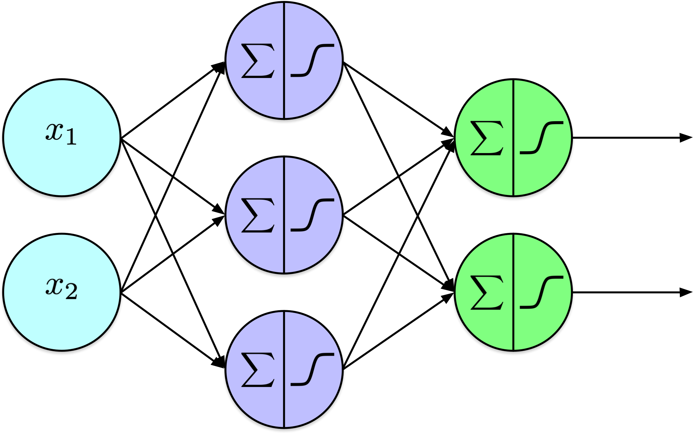
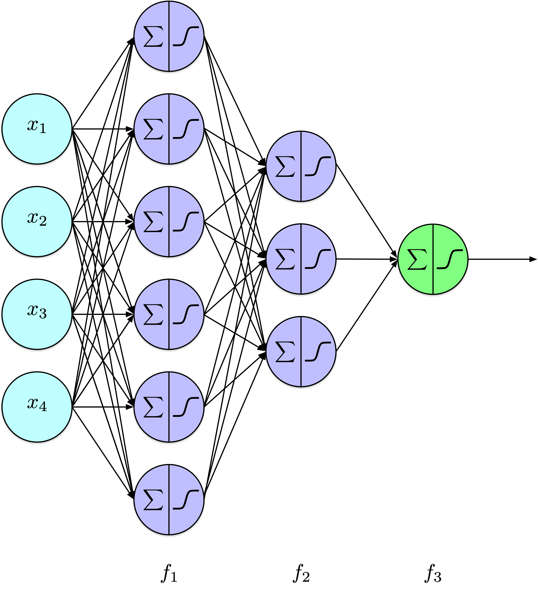
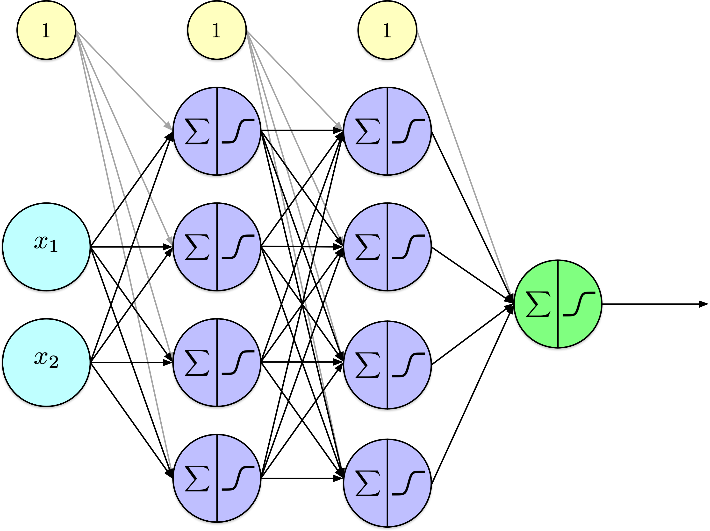
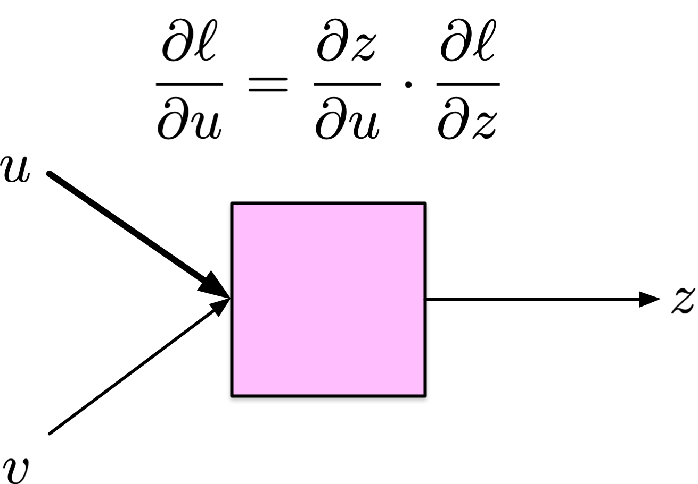
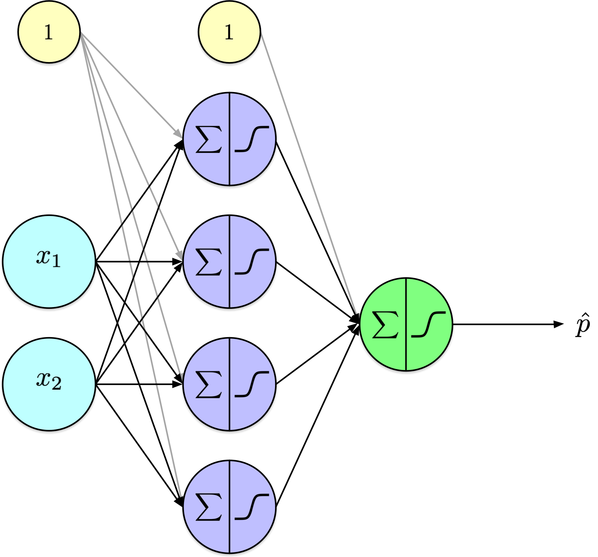
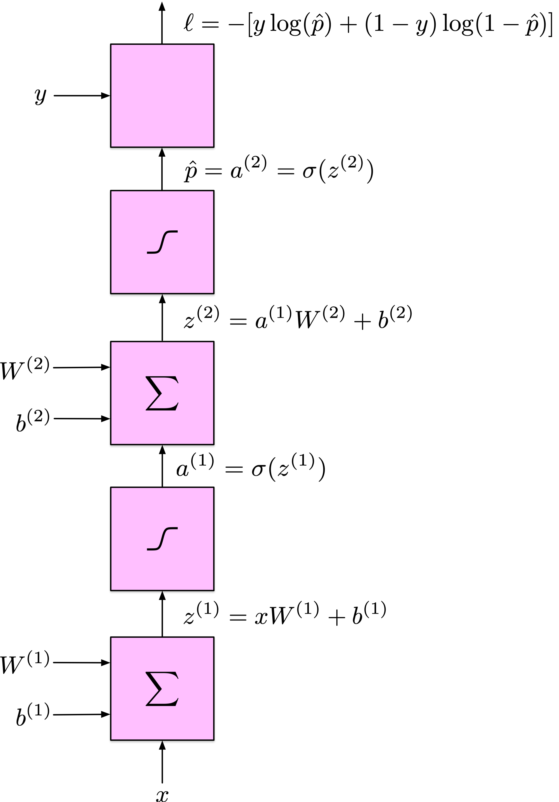
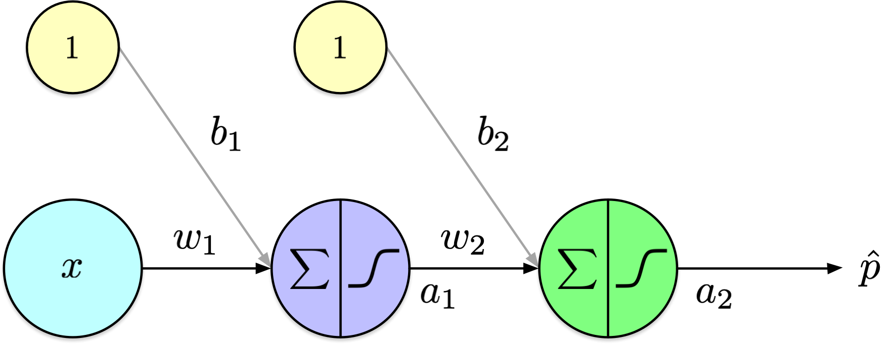
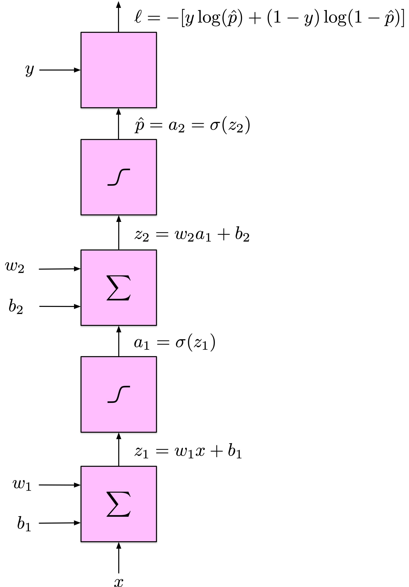
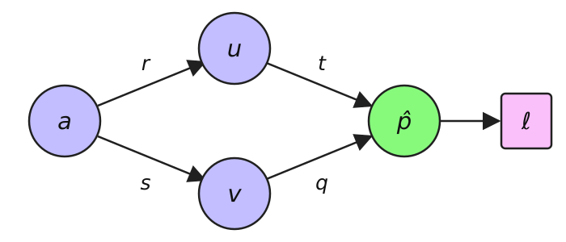

# Implementing Artificial Neural Networks (Part 2)

CSI 4106 - Fall 2026

Author

Marcel Turcotte

Published

Version: Oct 27, 2026 14:10

# Preamble

## Message of the Day

[](https://spectrum.ieee.org/media-library/this-playful-illustration-shows-duolingos-owl-mascot-cut-away-down-the-midline-showing-hidden-inside-a-high-tech-skeleton-sug.jpg?id=32941180&width=2400&height=3067)

[How Duolingo’s AI Learns What You Need to Learn](https://spectrum.ieee.org/duolingo), Bicknell et al. ([2023](#ref-Bicknell:2023aa)).

The article details the evolution of Duolingo’s Birdbrain AI, transitioning from a logistic regression model updated via nightly batch processing to a real-time system utilizing a long short-term memory (LSTM) recurrent neural network.

## Learning objectives

- **Backpropagation Algorithm**:
  - **Explain** error signals and the chain rule along a path and at branches.
  - **Connect** scalar derivatives to the Python and NumPy implementations.
  - **Distinguish** computing gradients from updating parameters.
- **Implementation**:
  - **Explain** a sigmoid MLP with cached forward values and mini-batch backpropagation.

In the previous lecture, we implemented a feed-forward neural network to illustrate its functionality. To isolate our conceptual understanding of neural networks from their training methods, we employed a naïve derivative-free training algorithm. Today, we will focus on the back-propagation algorithm, a critical element in deep learning techniques.

# Notation

## Units, layers, and activation functions

| Symbol | Meaning |
|:---|:---|
| \\z^{(l)}\\ | Preactivations: weighted sums plus biases in layer \\l\\ |
| \\a^{(l)}\\ | Activations: the layer’s outputs; denoted \\o\\ for units in Lecture 11 |
| \\\varphi\\ | A general activation function, applied elementwise |
| \\\sigma\\ | The logistic sigmoid activation |
| \\W^{(l)}, b^{(l)}\\ | The layer’s weights and biases |
| \\f_l\\ | The complete layer transformation: affine computation followed by activation |

The symbol \\\varphi\\ always denotes an activation function; \\f_l\\ denotes an entire layer, including its weights and biases. The sigmoid is written \\\sigma\\. The revised diagrams label complete layer transformations \\f_l\\ rather than \\\phi_l\\, so distinguishing a scalar activation from a complete layer does not depend on recognizing the two visually similar variants \\\phi\\ and \\\varphi\\.

Input features in the diagrams are labelled \\x_i\\ rather than \\x^{(i)}\\. The subscript \\i\\ selects a feature, while parenthesized superscripts, as in \\a^{(l)}\\, \\z^{(l)}\\, and \\W^{(l)}\\, identify a layer. This separates feature indices from layer indices and keeps the diagrams consistent with the equations.

The implementation uses `a` for activations. These quantities correspond to the unit outputs \\o\\ in Lecture 11. Lowercase \\a\\ and \\z\\ describe one example, while uppercase \\A\\ and \\Z\\ describe a batch of examples stored as rows. The input activations are \\a^{(0)}=x\\ for one example and \\A^{(0)}=X\\ for a batch. The layer index is written \\l\\; the per-example loss is written \\\ell\\.

Mathematical layers are numbered from 1, whereas Python lists are indexed from 0: `self.W[0]` and `self.b[0]` correspond to \\W^{(1)}\\ and \\b^{(1)}\\. In a weight \\w\_{i,j}^{(l)}\\, \\i\\ identifies a unit in the preceding layer and \\j\\ identifies a unit in the current layer.

## Probabilities, labels, and loss

For binary classification, as in Lectures 6 and 12:

- \\\hat p\\ is the predicted probability of class 1.
- \\\hat y=\mathbf{1}\[\hat p\geq 0.5\]\\ is the predicted class label.
- \\\ell\\ is the loss for **one example**; \\J\\ is the **mean loss**.

\\ \ell(y,\hat p)=-\left\[y\log\hat p+(1-y)\log(1-\hat p)\right\] \\

\\ \qquad J(\theta)=\frac{1}{N}\sum\_{i=1}^{N}\ell(y_i,\hat p_i). \\

The network’s sigmoid output is a probability. Thresholding it produces a class label, which is useful for reporting accuracy but discards information needed by the loss. This is why Lecture 12 used `bce_loss(y, self.forward(X))` rather than `bce_loss(y, self.predict(X))`.

Backpropagation differentiates the loss through the probability-producing computation. The threshold operation is outside that computation. During the scalar walkthrough, \\\ell\\ refers to the loss of the one example being processed. Averaging over examples will be introduced when returning to batches.

## Notation: a two-layer network

One hidden layer and one output layer:

\\ a^{(2)}=f_2(f_1(x)) \\

Each layer computes

\\ f_l(a)=\varphi(aW^{(l)}+b^{(l)}). \\

[](../../assets/images/ann_mlp-07-01-v2.png)

This follows the NumPy convention from Lecture 12: `a @ W + b`. Here \\x\\ and each activation vector are treated as rows. The weight matrix has shape `(units_in, units_out)`. The input nodes pass features unchanged and are not counted as parameterized layers.

The diagram allows several output units, so \\a^{(2)}\\ denotes the entire output vector. Our binary-classification examples use one sigmoid output unit; its activation is the predicted probability \\\hat p\\. Different layers may use different activation functions; \\\varphi\\ stands for the activation chosen for the layer under discussion.

## Notation: a three-layer network

Two hidden layers and one output layer:

\\ a^{(3)}=f_3(f_2(f_1(x))) \\

where

\\ f_l(a)=\varphi(aW^{(l)}+b^{(l)}). \\

[](../../assets/images/ann_mlp-14-01-v2.png)

## Notation: an \\L\\-layer network

\\ a^{(L)}=f_L(\ldots f_2(f_1(x))\ldots). \\

For \\l=1,\ldots,L\\:

\\ z^{(l)}=a^{(l-1)}W^{(l)}+b^{(l)}, \qquad a^{(l)}=\varphi(z^{(l)}). \\

The output of one layer becomes the input to the next.

Only the first parameterized layer receives the original input features. Subsequent layers process the preceding layer’s activations. Each layer repeats the same computational pattern with its own parameters.

For a batch, replace \\x\\, \\a\\, and \\z\\ by \\X\\, \\A\\, and \\Z\\. Each row then describes one example, and NumPy broadcasts the bias vector across the rows. The output is \\A^{(L)}=f_L(\ldots f_1(X)\ldots)\\.

Adding layers adds computation and stored intermediate values. The regular structure lets the same forward and backward procedures extend to deeper networks; it does not make the cost independent of depth.

# Back-propagation

------------------------------------------------------------------------

[](https://imgs.xkcd.com/comics/machine_learning_2x.png)

**Attribution :** [xkcd.com/1838](https://xkcd.com/1838)

## Back-propagation

**Learning representations by back-propagating errors**

*David E. Rumelhart, *Geoffrey E. Hinton* & Ronald J. Williams*

We describe a new learning procedure, back-propagation, for networks of neurone-like units. The procedure **repeatedly adjusts the weights** of the connections in the network so as to **minimize a measure of the difference between the actual output vector of the net and the desired output vector**. As a result of the weight adjustments, internal ‘**hidden**’ units which are not part of the input or output come to **represent important features of the task domain**, and the regularities in the task are captured by the interactions of these units. The **ability to create useful new features** distinguishes back-propagation from earlier, simpler methods such as the perceptron-convergence procedure.

Rumelhart et al. ([1986](#ref-Rumelhart:1986aa))

This abstract comes from the influential 1986 paper by Rumelhart, Hinton, and Williams that helped popularize backpropagation for learning internal representations. Earlier work on reverse-mode automatic differentiation predates this paper ([Baydin et al. 2017](#ref-Baydin:2017aa)). The abstract connects a loss function, gradient-based parameter updates, and hidden layers that learn useful task-dependent features.

Nature is a prestigious journal, and it only occasionally publishes content related to computer science.

At the time of this publication, Hinton was affiliated with Carnegie Mellon University. As a reminder, Hinton received the Nobel Prize in Physics in 2024 for his contributions to developing foundational methods in modern machine learning.

The abstract highlights the rationale for using hidden layers in neural networks. The initial hidden layers learn simple representations directly from the input data, while subsequent layers identify associations among these representations. Each layer builds upon the knowledge of previous layers, culminating in the network’s final output.

## Representation and learning

- A **single-layer perceptron** can separate only **linearly separable** classes.

- A **multilayer network can represent XOR**, as demonstrated in Lecture 11.

- Learning its hidden-layer parameters requires solving the **credit assignment problem**: how does each parameter affect the final loss?

Representing a function and learning suitable parameters are different questions. The XOR example in Lecture 11 supplied weights by hand. For a new task, training must determine how each hidden-layer parameter influences the loss, even though target values for hidden units are not supplied. Backpropagation computes those sensitivities efficiently. The limitations of restricted perceptron models should not be interpreted as limitations of all multilayer networks.

## Backpropagation in the 1986 paper

- The paper used a **squared-error objective** and **sigmoid units**.

- A **forward pass** computes activations; a **backward pass** computes parameter gradients.

- **Gradient descent** uses those gradients to update the parameters.

- Hidden units can learn **useful internal representations**.

These points describe the historical paper ([Rumelhart et al. 1986](#ref-Rumelhart:1986aa)). Backpropagation is not tied to squared error or to sigmoid hidden units. Our binary-classification walkthrough uses sigmoid units and binary cross-entropy, following Lectures 6 and 12. The loss and activation choices determine the local derivatives, while the backward computation follows the same chain-rule principles.

## Conceptual Idea

[](../../assets/images/ann_mlp-2-4-4-1-v2.png)

\\J(\theta) = -\frac{1}{N} \sum\_{i=1}^{N} \left\[ y_i \log \hat p_i + (1-y_i) \log (1 - \hat p_i) \right\]\\

Given a network and parameters that have been initialized randomly, we can generate probabilities (\\\hat p_i\\), but the parameters have not yet been fitted to the task.

In the context of a binary classification problem, what level of accuracy might one anticipate?

A classifier that guesses labels independently with equal probabilities has an expected accuracy of 50%. This is a useful baseline for a balanced binary task, but a particular randomly initialized network need not achieve that accuracy.

To evaluate the model’s performance, we use a loss function, here the binary cross-entropy (also known as negative log likelihood). This loss function averages the loss across all training examples, matching the mean binary cross-entropy used in Lecture 12. The inner term calculates the loss for one example.

In this binary network, the single output activation is \\\hat p_i=f_L(\ldots f_2(f_1(x_i))\ldots)\\. Here \\x_i\\ denotes example \\i\\ in the dataset; when discussing the features of one example, \\x_j\\ denotes feature \\j\\. The complete layer transformation is \\f_l(a)=\varphi(aW^{(l)}+b^{(l)})\\, with the layer’s chosen activation function \\\varphi\\.

## Conceptual Idea (continued)

[](../../assets/images/ann_mlp-2-4-4-1-v2.png)

\\\frac {\partial}{\partial \theta_k}J(\theta)\\, for all \\k\\, where the \\\theta_k\\ are `W[l][i,j]` and `b[l][j]`.

In this notation, the index `l` denotes the processing layers within the model. The index `i` refers to the individual units within the preceding layer, denoted as `l-1`, while the index `j` corresponds to the units within the current layer `l`.

Pause to consider what these partial derivatives represent. Each quantifies the local rate of change in the loss with respect to a single parameter, holding all other parameters fixed. Its sign indicates whether a small increase in that parameter will increase or decrease the loss, and its magnitude indicates the sensitivity of the loss to that change.

Gradient descent subtracts a multiple of each derivative. A positive derivative leads to a decrease in the parameter; a negative derivative leads to an increase. These are local statements, so the learning rate still matters. Each partial derivative is one component of the gradient vector \\\nabla\_\theta J\\.

The mathematical index \\l\\ starts at 1; Python’s layer index `l` starts at 0. Thus, `W[l][i, j]` corresponds to the entry with mathematical unit indices \\i+1,j+1\\ in \\W^{(l+1)}\\.

How many parameters are present in the model?

The model consists of three weight matrices. The dimensions of these matrices are \\2 \times 4\\, \\4 \times 4\\, and \\4 \times 1\\, containing 8, 16, and 4 weights, respectively. This results in a total of 28 weight parameters.

Additionally, there are three arrays for bias terms, containing 4, 4, and 1 biases, respectively, summing up to 9 bias parameters.

Overall, the model comprises 37 parameters, which is relatively small in comparison to more complex models. For instance, the Fashion-MNIST model discussed in Lecture 11 had 266,610 parameters. In contemporary machine learning, it is not uncommon for models to contain millions or even billions of parameters.

## Conceptual Idea (continued)

[](../../assets/images/ann_mlp-2-4-4-1-v2.png)

For a fixed number of epochs: \\\theta = \theta - \alpha \nabla\_\theta J(\theta)\\

Alternative stopping criteria are frequently employed in training algorithms. For example, training may stop after the validation loss has failed to improve for a predefined number of epochs.

Model parameters are updated simultaneously, and these updates can be efficiently computed in parallel.

This process is known as gradient descent. As previously discussed, when parameter updates are performed using the entire dataset, the method is referred to as **batch gradient descent**. Conversely, when updates are made using a single training example, it is termed **stochastic gradient descent**. Finally, when a small subset of examples, known as a mini-batch, is used for parameter updates, the method is called **mini-batch gradient descent**.

Our current task involves determining the partial derivatives of the loss function with respect to each of the 37 parameters of our model.

## Backpropagation

- **Backpropagation** is an algorithm for **methodically** computing the **partial derivatives** of a neural network’s loss function with respect to each **weight** and **bias** parameter.

- **Backpropagation** applies the **chain rule** of calculus **recursively** to compute both \\\frac{\partial J}{\partial w\_{i,j}^{(l)}}\\ and \\\frac{\partial J}{\partial b_j^{(l)}}\\ for every layer \\l\\, efficiently reusing intermediate quantities from the forward pass.

## Sigmoid and its derivative

\\ \sigma(z)=\frac{1}{1+e^{-z}},\qquad \sigma'(z)=\sigma(z)(1-\sigma(z)). \\

Show code

``` python
import numpy as np
import matplotlib.pyplot as plt
from scipy.special import expit

z_values = np.linspace(-6, 6, 300)
a_values = expit(z_values)
fig, axes = plt.subplots(1, 2, figsize=(10, 3))
axes[0].plot(z_values, a_values)
axes[0].set(title="Sigmoid", xlabel="z", ylabel="activation")
axes[1].plot(z_values, a_values * (1 - a_values))
axes[1].set(title="Sigmoid derivative", xlabel="z", ylabel="local slope")
for ax in axes:
    ax.grid(True)
plt.tight_layout()
plt.show()
```

[](slides_files/figure-html/cell-2-output-1.png)

You are not expected to derive every local derivative manually. A symbolic mathematics library such as SymPy can compute or check these expressions. You are expected to understand the role of the chain rule: combine each local derivative with the loss sensitivity received from downstream operations.

For example, this SymPy calculation checks that the sigmoid derivative equals \\\sigma(z)(1-\sigma(z))\\:

``` python
import sympy as sp
z = sp.symbols("z", real=True)
s = 1 / (1 + sp.exp(-z))
sp.simplify(sp.diff(s, z) - s * (1 - s))  # 0
```

See the [SymPy differentiation tutorial](https://docs.sympy.org/latest/tutorials/intro-tutorial/calculus.html#derivatives) for the `diff` function. SymPy manipulates symbolic expressions; automatic differentiation instead propagates derivative values through the operations executed by a program.

The sigmoid derivative reaches its maximum of \\0.25\\ at \\z=0\\ and approaches zero as \\z\\ tends to either infinity. The derivative is evaluated at the preactivation \\z\\. If the activation \\a=\sigma(z)\\ has already been computed, its local derivative can be evaluated as \\a(1-a)\\. Lecture 14 examines how repeated small factors affect gradient propagation in deeper networks.

## Chain rule

Given,

\\ h(x) = f(g(x)) \\

using the **Lagrange** notation, we have

\\ h^\prime(x) = f^\prime(g(x)) g^\prime(x) \\

or equivalently using **Leibniz** notation

\\ \frac{dv}{dx} = \frac{dv}{du} \cdot \frac{du}{dx}, \qquad u=g(x),\quad v=f(u). \\

The **chain rule** is a fundamental concept in calculus used to determine the derivative of a **composite function**. Specifically, if a function \\h\\ is defined as the composition of two differentiable functions, \\f\\ and \\g\\, the chain rule provides a method to compute \\h^\prime\\.

Conceptually, if you know the instantaneous rate of change of \\v\\ with respect to \\u\\, and the rate of change of \\u\\ with respect to \\x\\, you can find the rate of change of \\v\\ with respect to \\x\\ by multiplying these two rates of change. The temporary variables \\u\\ and \\v\\ avoid reusing \\y\\, which denotes a target in our classification examples.

The same composition appears in the layer notation \\a^{(L)}=f_L(\ldots f_2(f_1(x))\ldots)\\. Backpropagation applies the chain rule to the operations within these layers and to the loss.

Helpful checks when working with derivatives:

- Distinguish an activation’s value from its slope. A local activation derivative is only one factor in the parameter gradient.
- Evaluate local derivatives at the forward pass’s values, and keep the parameters fixed during the backward pass.
- Multiply along a path and sum contributions at branches. Apply the mean-over-examples factor once.
- A zero gradient can result from saturation or cancellation; it does not prove that the loss is small or that the parameters are optimal.
- For debugging a small implementation, a central finite difference can check selected derivatives. This is a numerical check, not the training algorithm. Compare with a tolerance: an excessively small perturbation can introduce floating-point cancellation.

## Applying the chain rule recursively

[](../../assets/images/ann_partial_Juz-v2.png)

For one downstream route: \\\displaystyle\frac{\partial\ell}{\partial u}=\frac{\partial z}{\partial u}\frac{\partial\ell}{\partial z}\\.

Backpropagation simplifies the computational process by decomposing it into a series of elementary steps, where the chain rule is meticulously applied at each stage.

The pink box computes an output \\z\\ from inputs including \\u\\ and \\v\\. The input \\u\\ could be a weight, a bias, or an intermediate activation. Here the loss for one example is denoted \\\ell\\.

The derivative \\\partial\ell/\partial u\\ measures the loss’s local sensitivity to \\u\\. Its sign indicates the effect of a small increase in \\u\\, and its magnitude measures sensitivity; it does not directly specify a suitable parameter update size.

If \\\partial\ell/\partial z\\ is already known, multiplying it by the local derivative \\\partial z/\partial u\\ gives the contribution through \\z\\. The displayed product is the total derivative with respect to \\u\\ only when all of \\u\\’s influence on the loss passes through \\z\\. If \\u\\ also feeds other operations, their contributions must be added. A branching example follows the single-path walkthrough.

## Computational graph

[](../../assets/images/ann_mlp-2-4-1-v2.png)

[](../../assets/images/ann_comp_graph-vectors-v2.png)

A **two-layer perceptron** and its associated **computational graph**.

The left diagram shows a particular network; the right diagram groups the operations by layer. On the right, \\x\\ is a row vector, so the same computational pattern can accommodate different numbers of units in each layer.

\\W^{(l)}\\ refers to the weight matrices, \\b^{(l)}\\ to the bias vectors, \\z^{(l)}\\ to the pre-activation vectors, and \\a^{(l)}\\ to the activation vectors, each associated with layer \\l\\.

The graph represents the loss \\\ell\\ for one example. Its sigmoid output is the predicted probability \\\hat p\\. Averaging the individual losses over the training examples gives \\J\\. These are the same computations used for a batch, with each example occupying one row.

## Scalar input; one hidden node

[](../../assets/images/ann_mlp-1-1-1-v2.png)

Let

\\ \ell = -\Bigl\[y \\\log(\hat p) + (1-y)\\\log(1-\hat p)\Bigr\] \\

\\ \hat p = a_2 = \sigma(z_2), \quad z_2 = w_2 \cdot a_1 + b_2 \\

\\ a_1 = \sigma(z_1), \quad z_1 = w_1 \cdot x + b_1 \\

[](../../assets/images/ann_comp_graph-scalars-v2.png)

We begin with a scalar input and one unit per layer to make every step of the chain rule visible without introducing matrix algebra or multiple unit indices. The hidden layer still requires us to propagate the loss sensitivity through another computation. Larger networks use these same principles, with contributions summed wherever an activation feeds several units.

There is one scalar input, one hidden unit, and one output unit. Each processing layer therefore has one weight, one bias, one preactivation, and one activation. We write these single entries as \\w_l,b_l,z_l,a_l\\. Thus, \\a_1\\ is the single entry of \\a^{(1)}\\, and \\z_1\\ is the single entry of \\z^{(1)}\\; the subscript here identifies the layer because there is only one unit per layer.

Both diagrams represent the same scalar network. The computational graph on the right separates each unit’s affine computation from its sigmoid activation and includes the loss. In the network diagram, the constant inputs of 1 contribute \\b_1\\ and \\b_2\\ through their respective connections. The hidden activation is \\a_1\\, and the output activation is \\a_2=\hat p\\.

This also connects to the complete layer transformations: \\a_1=f_1(x)\\ and \\\hat p=a_2=f_2(a_1)\\. For one example, \\a^{(l)}\\ and \\z^{(l)}\\ describe the layer’s quantities; \\A^{(l)}\\ and \\Z^{(l)}\\ collect the corresponding quantities across examples as rows.

## Derivatives

\\ \frac{\partial \ell}{\partial \hat p} \\

\\ \frac{\partial \hat p}{\partial z_2} \\

\\ \frac{\partial z_2}{\partial w_2}, \quad \frac{\partial z_2}{\partial b_2}, \quad \frac{\partial z_2}{\partial a_1}, \\

\\ \frac{\partial a_1}{\partial z_1}, \\

\\ \frac{\partial z_1}{\partial w_1}, \quad \frac{\partial z_1}{\partial b_1}, \quad \frac{\partial z_1}{\partial x}, \\

[](../../assets/images/ann_comp_graph-scalars-v2.png)

## Derivatives

Loss derivative w.r.t. \\\hat p\\:

\\ \frac{\partial \ell}{\partial \hat p} = -\left(\frac{y}{\hat p}-\frac{1-y}{1-\hat p}\right) \\

[](../../assets/images/ann_comp_graph-scalars-v2.png)

## Derivatives

\\\hat p\\ derivative w.r.t. \\z_2\\:

\\ \frac{\partial \hat p}{\partial z_2}=\sigma^{\prime}\left(z_2\right)=\hat p(1-\hat p) \\

[](../../assets/images/ann_comp_graph-scalars-v2.png)

## Derivatives

Derivative \\z_2 = w_2 a_1 + b_2\\:

\\ \frac{\partial z_2}{\partial w_2}=a_1, \quad \frac{\partial z_2}{\partial b_2}=1, \quad \frac{\partial z_2}{\partial a_1}=w_2 \\

[](../../assets/images/ann_comp_graph-scalars-v2.png)

## Derivatives

Derivative \\a_1 = \sigma(z_1)\\:

\\ \frac{\partial a_1}{\partial z_1}=\sigma^{\prime}\left(z_1\right)=a_1\left(1-a_1\right) \\

[](../../assets/images/ann_comp_graph-scalars-v2.png)

## Derivatives

Derivative \\z_1 = w_1 x + b_1\\:

\\ \frac{\partial z_1}{\partial w_1}=x, \quad \frac{\partial z_1}{\partial b_1}=1, \quad \frac{\partial z_1}{\partial x} = w_1 \\

[](../../assets/images/ann_comp_graph-scalars-v2.png)

## Combined derivatives

For \\w_2\\:

\\ \frac{\partial \ell}{\partial w_2}=\frac{\partial \ell}{\partial \hat p} \cdot \frac{\partial \hat p}{\partial z_2} \cdot \frac{\partial z_2}{\partial w_2}=\left\[-\left(\frac{y}{\hat p}-\frac{1-y}{1-\hat p}\right)\right\] \cdot(\hat p(1-\hat p)) \cdot a_1 \\

Simplifies to:

\\ \frac{\partial \ell}{\partial w_2}=(\hat p-y) a_1 \\

[](../../assets/images/ann_comp_graph-scalars-v2.png)

## Combined derivatives

For \\b_2\\:

\\ \frac{\partial \ell}{\partial b_2}=\frac{\partial \ell}{\partial \hat p} \cdot \frac{\partial \hat p}{\partial z_2} \cdot \frac{\partial z_2}{\partial b_2}=(\hat p-y) \cdot 1=\hat p-y \\

[](../../assets/images/ann_comp_graph-scalars-v2.png)

## Combined derivatives

For \\w_1\\:

\\ \frac{\partial \ell}{\partial w_1}=\frac{\partial \ell}{\partial \hat p} \cdot \frac{\partial \hat p}{\partial z_2} \cdot \frac{\partial z_2}{\partial a_1} \cdot \frac{\partial a_1}{\partial z_1} \cdot \frac{\partial z_1}{\partial w_1} \\

Plug in:

\\ =\left\[-\left(\frac{y}{\hat p}-\frac{1-y}{1-\hat p}\right)\right\] \cdot(\hat p(1-\hat p)) \cdot w_2 \cdot\left(a_1\left(1-a_1\right)\right) \cdot x \\

Simplifies to:

\\ \frac{\partial \ell}{\partial w_1}=(\hat p-y) w_2\left(a_1\left(1-a_1\right)\right) x \\

[](../../assets/images/ann_comp_graph-scalars-v2.png)

## Combined derivatives

For \\b_1\\:

\\ \frac{\partial \ell}{\partial b_1}=\frac{\partial \ell}{\partial \hat p} \cdot \frac{\partial \hat p}{\partial z_2} \cdot \frac{\partial z_2}{\partial a_1} \cdot \frac{\partial a_1}{\partial z_1} \cdot \frac{\partial z_1}{\partial b_1} \\

Plug in:

\\ =(\hat p-y) w_2\left(a_1\left(1-a_1\right)\right) \cdot 1 \\

Simplifies to:

\\ \frac{\partial \ell}{\partial b_1}=(\hat p-y) w_2\left(a_1\left(1-a_1\right)\right) \\

[](../../assets/images/ann_comp_graph-scalars-v2.png)

## Key derivatives

\\ \begin{align} \frac{\partial \ell}{\partial w_2} & = (\hat p-y) a_1 \\ \frac{\partial \ell}{\partial b_2} & = \hat p-y \\ \frac{\partial \ell}{\partial w_1} & = (\hat p-y) w_2\left(a_1\left(1-a_1\right)\right) x \\ \frac{\partial \ell}{\partial b_1} & = (\hat p-y) w_2\left(a_1\left(1-a_1\right)\right) \\ \end{align} \\

[](../../assets/images/ann_comp_graph-scalars-v2.png)

**Observation 1:** The computation of key gradients necessitates the activation values from all layers, specifically \\a_1\\ and \\\hat p = a_2\\.

## Exploration

``` python
import math
import random

random.seed(42)

def sigma(x):
    return 1 / (1 + math.exp(-x))

alpha = 0.1

def init():

    global w1, w2, b1, b2

    w1 = random.random()
    w2 = random.random()
    b1 = 0
    b2 = 0
```

This program implements the preceding equations directly. Its fixed architecture and named scalar variables make each intermediate value, derivative, and parameter update easy to inspect. The later NumPy implementation organizes these same operations into loops and matrix calculations, adding support for multiple units and batches.

The four trainable parameters are \\w_1,b_1,w_2,b_2\\, corresponding to `w1`, `b1`, `w2`, and `b2` in the code.

## Forward

``` python
def forward():

    global z1, a1, z2, a2, loss, p_hat

    z1 = w1 * x + b1
    a1 = sigma(z1)

    z2 = w2 * a1 + b2
    a2 = sigma(z2)

    p_hat = a2

    loss = -(y * math.log(p_hat) + (1-y) * math.log(1 - p_hat))
```

The forward pass computes and retains `z1`, `a1`, `z2`, and `a2`. The variable `p_hat = a2` is the output probability; `loss` is the single-example loss \\\ell\\. The `global` declaration allows the function to retain these values for the backward computation. This deliberately small program uses shared variables so that each line can be compared directly with the scalar equations.

## Backward

``` python
def backward():

    grad_loss_w2 = (p_hat - y) * a1
    grad_loss_b2 = p_hat - y

    grad_loss_w1 = (p_hat - y) * w2 * (a1 * (1-a1)) * x
    grad_loss_b1 = (p_hat - y) * w2 * (a1 * (1-a1))

    return grad_loss_w1, grad_loss_b1, grad_loss_w2, grad_loss_b2
```

The backward pass computes the four parameter derivatives using the values from the forward pass. It does not change any parameter. All derivatives must be evaluated at the same parameter values; in particular, the hidden-layer derivatives use the output weight `w2` that produced the current prediction.

## Gradient step

``` python
def step(gradients):

    global w1, b1, w2, b2

    grad_loss_w1, grad_loss_b1, grad_loss_w2, grad_loss_b2 = gradients

    w1 = w1 - alpha * grad_loss_w1
    b1 = b1 - alpha * grad_loss_b1
    w2 = w2 - alpha * grad_loss_w2
    b2 = b2 - alpha * grad_loss_b2
```

Backpropagation computes the derivatives; gradient descent uses them to update the parameters. The `step` function implements the gradient-descent update from the third Conceptual Idea slide. Although the assignments occur on successive lines, every update uses a gradient computed before any parameter was changed.

## Training

``` python
init()

x = 3.14
y = 1

forward()
print(f"Before: p_hat = {p_hat:.2}, loss = {loss:.2}")

for i in range(500):
    forward()
    gradients = backward()
    step(gradients)

forward()
print(f"After: p_hat = {p_hat:.2}, loss = {loss:.2}")
```

    Before: p_hat = 0.51, loss = 0.68
    After: p_hat = 0.99, loss = 0.01

This demonstration repeatedly trains on one example. Its purpose is to make the computation of each derivative and the resulting parameter update explicit; it does not measure generalization. Neither the architecture nor binary cross-entropy restricts training to one example. A training loop can process several examples, and the later NumPy implementation handles them in batches.

The variables `p_hat` and `loss` correspond to \\\hat p\\ and \\\ell\\. Setting `y=0`, changing `x`, or adjusting `alpha` provides small experiments with the same four-parameter model.

## Key derivatives

\\ \begin{align} \frac{\partial \ell}{\partial w_2} & = \frac{\partial \ell}{\partial \hat p} \cdot \frac{\partial \hat p}{\partial z_2} \cdot \frac{\partial z_2}{\partial w_2}\\ \frac{\partial \ell}{\partial b_2} & = \frac{\partial \ell}{\partial \hat p} \cdot \frac{\partial \hat p}{\partial z_2} \cdot \frac{\partial z_2}{\partial b_2}\\ \frac{\partial \ell}{\partial w_1} & = \frac{\partial \ell}{\partial \hat p} \cdot \frac{\partial \hat p}{\partial z_2} \cdot \frac{\partial z_2}{\partial a_1} \cdot \frac{\partial a_1}{\partial z_1} \cdot \frac{\partial z_1}{\partial w_1}\\ \frac{\partial \ell}{\partial b_1} & = \frac{\partial \ell}{\partial \hat p} \cdot \frac{\partial \hat p}{\partial z_2} \cdot \frac{\partial z_2}{\partial a_1} \cdot \frac{\partial a_1}{\partial z_1} \cdot \frac{\partial z_1}{\partial b_1}\\ \end{align} \\

[](../../assets/images/ann_comp_graph-scalars-v2.png)

**Observation 2:** Notice how some derivatives, such as \\\frac{\partial \ell}{\partial \hat p} \cdot \frac{\partial \hat p}{\partial z_2}\\, are computed multiple times.

It is hardly surprising, given that these chains follow the same path within the computational graph.

## Error signals

Let

\\ \begin{align} \delta_2 & = \frac{\partial \ell}{\partial \hat p} \cdot \frac{\partial \hat p}{\partial z_2} \\ \delta_1 & = \delta_2 \cdot \frac{\partial z_2}{\partial a_1} \cdot \frac{\partial a_1}{\partial z_1} \end{align} \\

Rewrite

\\ \begin{align} \frac{\partial \ell}{\partial w_2} & = \delta_2 \cdot \frac{\partial z_2}{\partial w_2}\\ \frac{\partial \ell}{\partial b_2} & = \delta_2 \cdot \frac{\partial z_2}{\partial b_2}\\ \frac{\partial \ell}{\partial w_1} & = \delta_1 \cdot \frac{\partial z_1}{\partial w_1}\\ \frac{\partial \ell}{\partial b_1} & = \delta_1 \cdot \frac{\partial z_1}{\partial b_1}\\ \end{align} \\

[](../../assets/images/ann_comp_graph-scalars-v2.png)

The **error signal** \\\delta_l=\partial\ell/\partial z_l\\ measures the loss’s sensitivity to a unit’s **preactivation**. Its index matches the layer.

The repeated products have a useful interpretation: \\\delta_2\\ is the sensitivity of the loss to \\z_2\\, and \\\delta_1\\ is the sensitivity to \\z_1\\. These are called error signals. A hidden unit does not need its own target value: its error signal describes how a small change to its preactivation would affect the final loss.

For sigmoid output and binary cross-entropy, \\\delta_2=\hat p-y\\. This simple difference follows from the cancellation in the derivatives already worked out. It is specific to this activation–loss combination; an error signal is not generally a prediction-minus-target difference. The hidden error signal is \\\delta_1=\delta_2w_2a_1(1-a_1)\\.

The parameter derivatives follow from the same signals: \\\partial\ell/\partial w_l=\delta_l a\_{l-1}\\ and \\\partial\ell/\partial b_l=\delta_l\\, with \\a_0=x\\. Reusing these quantities avoids recomputing the same derivative products for different parameters.

## Backward with error signals

``` python
def backward_with_signals():

    delta2 = p_hat - y
    delta1 = delta2 * w2 * a1 * (1 - a1)

    grad_loss_w2 = delta2 * a1
    grad_loss_b2 = delta2
    grad_loss_w1 = delta1 * x
    grad_loss_b1 = delta1

    return grad_loss_w1, grad_loss_b1, grad_loss_w2, grad_loss_b2
```

This function returns the same four derivatives as `backward()`. The difference is how the computation is organized: calculate the output error signal, propagate it to the hidden unit, and reuse each signal for that unit’s weight and bias. The same `step` function can use either set of derivatives.

The forward pass retains activations and preactivations; the backward pass reuses them and computes error signals from the output towards the input. Adding layers repeats this pattern rather than requiring a new derivation of every complete path.

## When an activation feeds two units

[](../../assets/images/ann_backprop-branch.svg)

\\ z_u=ra+b_u,\qquad u=\sigma(z_u) \\

\\ z_v=sa+b_v,\qquad v=\sigma(z_v) \\

\\ \hat p=\sigma(tu+qv+b\_{\mathrm{out}}) \\

With \\\delta_u=\partial\ell/\partial z_u\\ and \\\delta_v=\partial\ell/\partial z_v\\:

\\ \frac{\partial\ell}{\partial a} =\underbrace{r\delta_u}\_{\text{through }u} +\underbrace{s\delta_v}\_{\text{through }v}. \\

**Multiply along a path; add contributions from different downstream paths.**

The shared hidden activation \\a\\ now influences the loss through two later units, \\u\\ and \\v\\, which both affect the same output probability. A change to \\a\\ changes both \\z_u\\ and \\z_v\\, so the chain rule includes both effects. The downstream signals \\\delta_u\\ and \\\delta_v\\ have already been computed from the output loss. Multiplying them by \\r\\ and \\s\\ gives the respective contributions to \\\partial\ell/\partial a\\.

If \\a=\sigma(z_a)\\, its own error signal is

\\ \delta_a=\frac{\partial\ell}{\partial z_a} =(r\delta_u+s\delta_v)\\a(1-a). \\

Collect all contributions before continuing upstream. Contributions can reinforce or oppose one another. They are summed, not averaged over downstream units. Averaging over training examples is a separate operation. This accumulation is a general property of reverse-mode differentiation ([Baydin et al. 2017](#ref-Baydin:2017aa)).

## Branching: Python

``` python
a = sigma(0.0)
r, s = 2.0, -1.0
t, q = 1.0, 1.0
u = sigma(r * a - 1.0)
v = sigma(s * a + 0.5)
p_hat = sigma(t * u + q * v - 1.0)
y = 1

delta_out = p_hat - y
delta_u = delta_out * t * u * (1 - u)
delta_v = delta_out * q * v * (1 - v)

through_u = r * delta_u
through_v = s * delta_v
delta_a = (through_u + through_v) * a * (1 - a)

print(f"Contributions: {through_u:.3f} + {through_v:.3f}")
print(f"d_loss/da: {through_u + through_v:.3f}")
print(f"delta_a: {delta_a:.5f}")
```

    Contributions: -0.250 + 0.125
    d_loss/da: -0.125
    delta_a: -0.03125

The biases are \\b_u=-1\\, \\b_v=0.5\\, and \\b\_{\mathrm{out}}=-1\\. These choices make \\a=u=v=\hat p=0.5\\, keeping the arithmetic simple. Since \\y=1\\, the output signal is \\\delta\_{\mathrm{out}}=-0.5\\, and both downstream hidden signals are \\-0.125\\.

The contribution through \\u\\ is \\2(-0.125)=-0.25\\. The contribution through \\v\\ is \\(-1)(-0.125)=+0.125\\. Their sum is \\-0.125\\: the two effects partly cancel. Multiplying by \\a(1-a)=0.25\\ gives \\\delta_a=-0.03125\\.

This example introduces no new optimization method. It extends the single-path backward computation to a shared activation. In the general network, `delta @ W_next.T` performs these weighted sums for all units together; multiplication by the activation derivative then produces the preceding layer’s error signals.

## Training with backpropagation

1.  **Initialize** the weights and biases.
2.  **Forward pass:** compute activations and retain intermediate values.
3.  **Compute the loss** for the current batch.
4.  **Backward pass:** compute all parameter gradients.
5.  **Gradient step:** update the parameters using those gradients.
6.  **Repeat** for the remaining batches and epochs.

Backpropagation is step 4: the efficient computation of gradients. The optimizer performs step 5. Our optimizer is gradient descent; alternatives such as Adam use the gradients differently. The training loop stops after a chosen number of epochs or according to a stopping criterion, such as validation loss failing to improve.

The scalar program illustrates one example at a time. The later implementation processes a mini-batch at a time, averaging its per-example gradients before updating the parameters. A batch containing the entire training set gives batch gradient descent; a batch of one example gives stochastic gradient descent.

## Backpropagation on a computational graph

- Start at the loss: its derivative with respect to itself is \\\frac{\partial\ell}{\partial\ell}=1\\.
- Visit operations in **reverse computation order**.
- For each input \\u\\, **sum contributions from all downstream uses**:

\\ \frac{\partial\ell}{\partial u} =\sum\_{z\text{ directly uses }u} \frac{\partial z}{\partial u}\frac{\partial\ell}{\partial z}. \\

Collect every contribution before propagating the result further upstream.

The backward pass propagates sensitivities of the final scalar loss. At the loss node itself, the sensitivity is one: changing the loss by a small amount changes that same quantity by exactly the same amount. This is the derivative of the identity function. It initializes the chain rule; multiplying the first local derivative by one leaves that derivative unchanged. It does not mean that the loss value is one.

This initial sensitivity is different from the output unit’s error signal, \\\partial\ell/\partial z\_{\mathrm{out}}\\. For sigmoid output and binary cross-entropy, that signal is \\\hat p-y\\, as derived earlier. Our manual implementation calculates this signal directly; a general graph engine begins with the loss sensitivity of one and works backwards through the loss and output activation to obtain it.

For a graph of scalar operations, the sum ranges over the outputs of operations that directly use \\u\\. Each term is a local derivative multiplied by an already computed downstream sensitivity. A single route gives the product used in the scalar walkthrough; multiple routes give the sum used in the branching example.

An implementation can initialize derivative accumulators to zero, seed the loss accumulator with one, and add each contribution rather than overwrite a previous contribution. Reverse computation order ensures that downstream contributions are available before continuing upstream. Values that do not influence the loss have zero derivative.

The symbol \\\delta\\ is reserved here for a unit’s preactivation sensitivity, \\\partial\ell/\partial z\\. For an arbitrary graph input \\u\\, the derivative is written explicitly as \\\partial\ell/\partial u\\.

Modern frameworks record operations to automate this process. Our NumPy implementation instead uses a manually specified sequence of layer operations and a backward loop, without building a general-purpose graph engine ([Baydin et al. 2017](#ref-Baydin:2017aa)).

## Initialization

- Initialize **weights randomly** to break symmetry between units.
- **Zero biases** are a common choice.
- Scale the weights appropriately for the layer and activation function.

Units with identical incoming weights and biases in the same layer compute identical activations. If they also receive identical downstream signals, their gradients remain identical and they cannot learn distinct features. Random weight initialization breaks this symmetry. Biases can still start at zero because the random weights distinguish the units.

Zero initialization is valid for logistic regression, which has no hidden layer of units whose symmetry must be broken. It does not require the classes to be linearly separable. In a multilayer network, setting all weights to zero can also prevent useful signals from reaching earlier layers. The later discussion of Xavier/Glorot and He initialization explains how weight scale affects training.

## Forward pass and loss

- Apply each layer’s **affine transformation and activation**.
- Retain the **preactivations and activations** needed by the backward pass.
- For binary classification, the sigmoid output is the probability \\\hat p\\.
- Compute the **mean binary cross-entropy** over the current batch.

The probability-producing computation matches `forward()` or `predict_proba()` from Lecture 12. Our training helper additionally retains intermediate values. The method `predict()` thresholds probabilities into labels; that threshold operation is not part of the loss computation or its backward pass.

For a single example, compute \\\ell(y,\hat p)\\. For a batch of \\B\\ examples, compute \\J_B=B^{-1}\sum_i\ell(y_i,\hat p_i)\\. Other tasks require different output activations and losses; for example, regression can use a linear output and mean squared error.

## Backward pass and parameter update

1.  Compute the output layer’s **error signal**.
2.  Move backwards through hidden layers: **weighted sum of downstream signals**, then **activation derivative**.
3.  Use each layer’s activations and error signals to compute its **parameter gradients**.
4.  After all gradients are available, update the parameters:

\\ \theta\leftarrow\theta-\alpha\nabla\_\theta J_B. \\

The backward pass reuses the forward values and parameters that produced the current loss. Updating a later layer before calculating earlier-layer gradients would mix parameter values from different networks. Our implementation therefore stores all parameter gradients before applying updates.

In the single-path example, an error signal is multiplied by one downstream weight. In the branching example, it receives two weighted contributions. The general network performs the same operation with a matrix multiplication. Backpropagation computes derivatives through elementary operations rather than perturbing each parameter to estimate the effect on the loss.

# Implementation

## Backpropagation - Forward Pass

- Compute activations layer by layer:

  \\z^{(l)} = a^{(l-1)} W^{(l)} + b^{(l)}\\,

  \\a^{(l)} = \varphi(z^{(l)})\\.

- For binary classification, the output is a probability \\\hat p\\; compute the single-example loss \\\ell(y,\hat p)\\.

## Backpropagation - Backward Pass

- **Output layer**, for one example with sigmoid output and binary cross-entropy:

\\ \delta^{(L)}=\hat p-y. \\

- **Hidden layers**, in reverse order \\l=L-1,\ldots,1\\:

\\ \delta^{(l)} = (\delta^{(l+1)}(W^{(l+1)})^\top) \odot \varphi'(z^{(l)}) \\

Where \\\odot\\ is the elementwise (Hadamard) product.

The output equation is the scalar walkthrough’s \\\delta_2=\hat p-y\\, now using \\L\\ for the final layer. It applies to our binary classifier with one sigmoid output and binary cross-entropy. Start with this signal, then apply the hidden-layer recurrence from \\L-1\\ down to 1. For a batch, the corresponding output signals are `A_L - yb`; average over examples when forming parameter gradients.

- \\\delta^{(l)}\\ — the row of **error signals** for layer \\l\\ and one example, defined as \\\displaystyle \delta^{(l)} = \frac{\partial\ell}{\partial z^{(l)}}\\, the sensitivity of that example’s loss to the layer’s preactivations.

- \\\delta^{(l+1)}\\ — the **error signals** from the **next layer** (closer to the output). This is already known from the previous step in backpropagation.

- \\\delta^{(l+1)}(W^{(l+1)})^\top\\ — propagates the next layer’s error **backward through the weights** of layer \\l+1\\. Each neuron in layer \\l\\ receives a weighted sum of downstream error signals, just as \\a\\ received \\r\delta_u+s\delta_v\\ in the branching example. The transpose matches our row-vector convention and the `(units_in, units_out)` weight layout.

- \\\varphi'(z^{(l)})\\ — the **derivative of the activation function** at layer \\l\\. It scales the error according to how sensitive the neuron’s activation was to changes in its input.

## From one example to a batch

Stack each example’s activations and error signals as rows of \\A^{(l)}\\ and \\\Delta^{(l)}\\.

For a batch of \\B\\ examples:

\\ \frac{\partial J_B}{\partial W^{(l)}} =\frac{1}{B}(A^{(l-1)})^\top\Delta^{(l)}, \qquad \frac{\partial J_B}{\partial b^{(l)}} =\frac{1}{B}\sum\_{i=1}^{B}\delta_i^{(l)}. \\

``` python
grad_W = activations_prev.T @ delta / batch_size
grad_b = delta.mean(axis=0)
```

In the sum, \\i\\ indexes examples, so \\\delta_i^{(l)}\\ is the row of signals for example \\i\\. Here \\\Delta^{(l)}\\ stacks derivatives of each example’s own loss \\\ell_i\\ with respect to that example’s preactivations. It is not yet the derivative of the mean loss \\J_B\\ with respect to the entire batch matrix \\Z^{(l)}\\; that derivative would already include the factor \\1/B\\. The code’s array `delta` follows this per-example convention. Average once when forming the parameter gradients.

For sigmoid output and binary cross-entropy, the output signals are `delta = A_L - yb`, with both arrays shaped `(B, 1)`. Each hidden layer applies `delta = (delta @ W_next.T) * activation_derivative`. This computes the downstream weighted sums separately for each example; it does not average across units.

If a layer has \\n\_{l-1}\\ inputs and \\n_l\\ units, its activations have shape `(B, n_l)`, its weights have shape `(n_prev, n_l)`, and its error signals have shape `(B, n_l)`. Thus, `activations_prev.T @ delta` has exactly the weight matrix’s shape. Summing the bias contributions across examples gives a vector of shape `(n_l,)`, matching the bias vector.

## SimplerMLP

Sigmoid units, binary cross-entropy, and a constant learning rate.

Show code

``` python
import numpy as np

def sigmoid(z):
    return 1.0 / (1.0 + np.exp(-z))

def sigmoid_prime(z):
    a = sigmoid(z)
    return a * (1.0 - a)

def bce_loss(y_true, y_prob, eps=1e-9):
    """Binary cross-entropy averaged over examples."""
    p = np.clip(y_prob, eps, 1 - eps)
    return -np.mean(y_true * np.log(p) + (1 - y_true) * np.log(1 - p))

def xavier_init(rng, fan_in, fan_out):
    std = np.sqrt(2.0 / (fan_in + fan_out))
    return rng.normal(0.0, std, size=(fan_in, fan_out))

class SimplerMLP:
    """Sigmoid MLP for binary classification; constant learning rate."""

    def __init__(self, layer_sizes, lr=0.1, seed=None):
        self.sizes = list(layer_sizes)
        self.lr = float(lr)
        self.rng = np.random.default_rng(seed)

        self.W = []
        for din, dout in zip(self.sizes[:-1], self.sizes[1:]):
            Wk = xavier_init(self.rng, din, dout)
            self.W.append(Wk)
        self.b = [np.zeros(dout) for dout in self.sizes[1:]]

    def forward(self, X):
        a = X
        for W, b in zip(self.W, self.b):
            a = sigmoid(a @ W + b)
        return a.ravel()

    def predict_proba(self, X):
        return self.forward(X)

    def predict(self, X, threshold=0.5):
        return (self.predict_proba(X) >= threshold).astype(int)

    def loss(self, X, y):
        p = self.predict_proba(X)
        return bce_loss(y, p)

    def _forward_full(self, X):
        a = X
        activations = [a]
        zs = []
        for W, b in zip(self.W, self.b):
            z = a @ W + b
            a = sigmoid(z)
            zs.append(z)
            activations.append(a)
        return activations, zs

    def train(self, X, y, epochs=30, batch_size=None, verbose=True):
        """X: (N, d), y: (N,); batch_size=None uses the full dataset."""
        N = X.shape[0]
        idx = np.arange(N)
        B = N if batch_size is None else int(batch_size)

        for ep in range(1, epochs + 1):
            self.rng.shuffle(idx)

            base_loss = self.loss(X, y)

            for start in range(0, N, B):
                sl = idx[start:start + B]
                Xb = X[sl]
                yb = y[sl].reshape(-1, 1)
                Bsz = Xb.shape[0]

                activations, zs = self._forward_full(Xb)
                A_L = activations[-1]

                # Each row is a single example's preactivation sensitivity.
                delta = A_L - yb
                grads_W = [None] * len(self.W)
                grads_b = [None] * len(self.b)

                # Average parameter gradients over examples exactly once.
                grads_W[-1] = activations[-2].T @ delta / Bsz
                grads_b[-1] = delta.mean(axis=0)

                for k in range(len(self.W) - 2, -1, -1):
                    z = zs[k]
                    d_act = sigmoid_prime(z)
                    delta = (delta @ self.W[k + 1].T) * d_act
                    grads_W[k] = activations[k].T @ delta / Bsz
                    grads_b[k] = delta.mean(axis=0)

                # All gradients use the weights from the same forward pass.
                for k in range(len(self.W)):
                    self.W[k] -= self.lr * grads_W[k]
                    self.b[k] -= self.lr * grads_b[k]

            new_loss = self.loss(X, y)
            if verbose:
                print(f"Epoch {ep:3d} | loss {base_loss:.5f} -> {new_loss:.5f} | lr={self.lr:.4f}")
```

The complete implementation follows the structure of `NaiveMLP` from Lecture 12 but replaces parameter probing with gradients computed by backpropagation. All hidden and output units use sigmoid; the output is one probability per example.

The class has no regularization or learning-rate schedule. Lecture 14 extends this same structure as `SimpleMLP`. Both classes use the same core methods, parameter layout, cache lists, and backward computation; `SimpleMLP` adds configuration options. Their notebooks are self-contained; inheritance or importing one lecture’s notebook into another is not required.

## Activation and derivative

``` python
def sigmoid(z):
    return 1.0 / (1.0 + np.exp(-z))

def sigmoid_prime(z):
    a = sigmoid(z)
    return a * (1.0 - a)
```

`sigmoid_prime` receives the preactivation \\z\\, not the activation \\a\\. It computes \\a=\sigma(z)\\ and returns \\a(1-a)\\. This is a local derivative, not a complete parameter gradient.

`SimplerMLP` calls `sigmoid` and `sigmoid_prime` directly because every unit uses the same activation. Lecture 14 introduces activation-selection helpers when `SimpleMLP` adds a choice for hidden units.

## Loss

``` python
def bce_loss(y_true, y_prob, eps=1e-9):
    """Binary cross-entropy averaged over examples."""
    p = np.clip(y_prob, eps, 1 - eps)
    return -np.mean(y_true * np.log(p) + (1 - y_true) * np.log(1 - p))
```

`forward` and `predict_proba` return probabilities. Only `predict` thresholds them into class labels. The loss is the mean binary cross-entropy, without a penalty term. Clipping avoids taking the logarithm of a floating-point probability equal to zero or one. Production libraries commonly use a combined loss computed from logits for stronger numerical stability.

## Initializing parameters

``` python
def xavier_init(rng, fan_in, fan_out):
    std = np.sqrt(2.0 / (fan_in + fan_out))
    return rng.normal(0.0, std, size=(fan_in, fan_out))
```

Weights are sampled randomly and scaled using the layer widths; biases start at zero. This is the Xavier/Glorot initialization used for sigmoid units. The mathematical motivation and other initialization choices are developed in Lecture 14. The generator created from `seed` controls both initialization and the order of examples during training.

## Class definition + constructor

``` python
class SimplerMLP:

    def __init__(self, layer_sizes, lr=0.1, seed=None):
        self.sizes = list(layer_sizes)
        self.lr = float(lr)
        self.rng = np.random.default_rng(seed)

        self.W = []
        for din, dout in zip(self.sizes[:-1], self.sizes[1:]):
            Wk = xavier_init(self.rng, din, dout)
            self.W.append(Wk)
        self.b = [np.zeros(dout) for dout in self.sizes[1:]]
```

The constructor accepts only the architecture, learning rate, and seed. Weight matrices have shape `(units_in, units_out)` and biases have shape `(units_out,)`, matching `a @ W + b`.

## Forward (public)

``` python
    def forward(self, X):
        a = X
        for W, b in zip(self.W, self.b):
            a = sigmoid(a @ W + b)
        return a.ravel()
```

`forward()` returns probabilities with shape `(N,)`. `predict_proba()` is an alias for this computation, and `predict()` applies a threshold. Every layer applies sigmoid, so the loop does not need a layer counter or a special case for the output layer. `SimpleMLP` retains this layer-by-layer computation but adds activation selection in Lecture 14.

## Forward (private)

``` python
    def _forward_full(self, X):
        a = X
        activations = [a]
        zs = []
        for W, b in zip(self.W, self.b):
            z = a @ W + b
            a = sigmoid(z)
            zs.append(z)
            activations.append(a)
        return activations, zs
```

The helper `_forward_full` retains preactivations and activations for backpropagation. Mathematical layer \\l\\ corresponds to `activations[l]` and `zs[l - 1]`; `activations[0]` is the input matrix \\X\\. Both classes retain these arrays in exactly the same order.

## Training

``` python
    def train(self, X, y, epochs=30, batch_size=None, verbose=True):
        """X: (N, d), y: (N,); batch_size=None uses the full dataset."""
        N = X.shape[0]
        idx = np.arange(N)
        B = N if batch_size is None else int(batch_size)

        for ep in range(1, epochs + 1):
            self.rng.shuffle(idx)

            base_loss = self.loss(X, y)

            for start in range(0, N, B):
                sl = idx[start:start + B]
                Xb = X[sl]
                yb = y[sl].reshape(-1, 1)
                Bsz = Xb.shape[0]

                activations, zs = self._forward_full(Xb)
                A_L = activations[-1]

                # Each row is a single example's preactivation sensitivity.
                delta = A_L - yb
                grads_W = [None] * len(self.W)
                grads_b = [None] * len(self.b)

                # Average parameter gradients over examples exactly once.
                grads_W[-1] = activations[-2].T @ delta / Bsz
                grads_b[-1] = delta.mean(axis=0)

                for k in range(len(self.W) - 2, -1, -1):
                    z = zs[k]
                    d_act = sigmoid_prime(z)
                    delta = (delta @ self.W[k + 1].T) * d_act
                    grads_W[k] = activations[k].T @ delta / Bsz
                    grads_b[k] = delta.mean(axis=0)

                # All gradients use the weights from the same forward pass.
                for k in range(len(self.W)):
                    self.W[k] -= self.lr * grads_W[k]
                    self.b[k] -= self.lr * grads_b[k]

            new_loss = self.loss(X, y)
            if verbose:
                print(f"Epoch {ep:3d} | loss {base_loss:.5f} -> {new_loss:.5f} | lr={self.lr:.4f}")
```

The output signal `A_L - yb` is the already simplified sigmoid/BCE derivative. Do not multiply it by the sigmoid derivative again. Hidden signals require multiplication by both downstream weights and the local sigmoid derivative.

The backward loop uses a Python index `k`: `W[k]` belongs to mathematical layer \\k+1\\. At that point, `delta` holds the next layer’s signals; `delta @ W[k + 1].T` sums their contributions for the current layer. The bias gradient averages those signals over examples, while the weight gradient also includes the preceding activations.

All gradients are computed before any parameter is updated. The learning rate remains constant throughout training.

This implementation assumes independent training examples and shuffles their indices at the start of every epoch. The same indices select rows from `X` and `y`, so features remain paired with their targets. Shuffling changes which examples share a mini-batch and avoids repeatedly presenting the same sequence of batches.

If training depends on chronological or sequence order, the implementation must be modified to preserve that order. For example, a stateful sequence model may carry information from one batch to the next. Temporal data do not always prohibit shuffling: independently processed time windows may be shuffled after a chronological train/validation/test split, provided the order within each window is retained. Any other training procedure that deliberately relies on example order also needs a different policy. The [TensorFlow time-series tutorial](https://www.tensorflow.org/tutorials/structured_data/time_series) illustrates shuffled training windows, while the [Keras stateful-RNN guidance](https://keras.io/api/layers/recurrent_layers/rnn/) requires ordered batches.

## Testing

``` python
from sklearn.datasets import make_circles
from sklearn.model_selection import train_test_split
from sklearn.preprocessing import StandardScaler
from sklearn.metrics import accuracy_score

X, y = make_circles(n_samples=200, factor=0.5, noise=0.08, random_state=1)
X_train, X_test, y_train, y_test = train_test_split(
    X, y, test_size=0.3, random_state=0, stratify=y)

scaler = StandardScaler()
X_train = scaler.fit_transform(X_train)
X_test = scaler.transform(X_test)

model = SimplerMLP([2, 4, 4, 1], lr=0.3, seed=42)
model.train(X_train, y_train, epochs=2000, batch_size=32, verbose=False)

print("Train acc:", accuracy_score(y_train, model.predict(X_train)))
print(" Test acc:", accuracy_score(y_test, model.predict(X_test)))
```

    Train acc: 1.0
     Test acc: 1.0

The circular dataset and train/test split match the later `SimpleMLP` example. Standardization is fitted on the training data only. This shallow sigmoid network uses a constant learning rate and more training epochs; the settings illustrate a complete working example rather than a comparison of optimized models. Test accuracy is reported after training, not used to select the settings.

## Automatic differentiation

**Automatic differentiation (autodiff)** systematically applies the chain rule to compute exact derivatives of functions expressed as computer programs. It propagates derivatives through elementary operations, either forward (from inputs to outputs) or backward (from outputs to inputs), enabling efficient and precise gradient computation essential for optimization and learning algorithms.

Baydin et al. ([2017](#ref-Baydin:2017aa))

Here “exact” distinguishes the use of local derivative rules from finite-difference approximations; the computed values still have floating-point rounding error. Autodiff does not need to expand a complete symbolic expression for the loss. SymPy is useful for obtaining or checking local formulas, while an autodiff engine applies those formulas to the values and operations encountered during execution.

# Epilogue

## Summary

[](../../assets/images/angermueller-2016_box-1.png)

**Attribution**: Angermueller et al. ([2016](#ref-Angermueller:2016aa))

## Summary

| Concept | Role |
|----|----|
| **Activation functions** | Introduce non-linearity (sigmoid in `SimplerMLP`). |
| **Loss function** | Measures prediction error (e.g., Binary Cross-Entropy). |
| **Learning rate (α)** | Controls step size in parameter updates. |
| **Gradient descent** | Optimization method for weight adjustment. |
| **Chain rule** | Mechanism for propagating derivatives backward. |
| **Automatic differentiation** | Automates derivative computation; backpropagation uses reverse mode. |

## From backpropagation to implementation

- Store the forward pass’s activations and preactivations.
- Compute error signals backwards; add contributions at branches.
- Average parameter gradients over examples, then update all parameters.
- `SimplerMLP` implements this process with sigmoid units and a constant learning rate.

## 3Blue1Brown

A series of videos, with animations, providing the **intuition** behind the **backpropagation algorithm**.

- [Neural networks](https://www.youtube.com/playlist?list=PLZHQObOWTQDNU6R1_67000Dx_ZCJB-3pi) (playlist)

  - [What is backpropagation really doing?](https://www.youtube.com/watch?v=Ilg3gGewQ5U&list=PLZHQObOWTQDNU6R1_67000Dx_ZCJB-3pi&index=3&t=212s) (12m 47s)
  - [Backpropagation calculus](https://www.youtube.com/watch?v=tIeHLnjs5U8&list=PLZHQObOWTQDNU6R1_67000Dx_ZCJB-3pi&index=4) (10m 18s)

Prerequisite: [Gradient descent, how neural networks learn?](https://www.youtube.com/watch?v=IHZwWFHWa-w&list=PLZHQObOWTQDNU6R1_67000Dx_ZCJB-3pi&index=2) (20m 33s)

## StatQuest

- [Neural Networks Pt. 2: Backpropagation Main Ideas](https://youtu.be/IN2XmBhILt4) (17m 34s)
- [Backpropagation Details Pt. 1: Optimizing 3 parameters simultaneously](https://youtu.be/iyn2zdALii8) (18m 32s)
- [Backpropagation Details Pt. 2: Going bonkers with The Chain Rule](https://youtu.be/GKZoOHXGcLo) (13m 9s)

Prerequisites: [The Chain Rule](https://youtu.be/wl1myxrtQHQ) (18m 24s) & [Gradient Descent, Step-by-Step](https://youtu.be/sDv4f4s2SB8) (23m 54s)

## Herman Kamper

One of the most thorough series of **videos** on the **backpropagation algorithm**.

- [Introduction to neural networks](https://www.youtube.com/playlist?list=PLmZlBIcArwhMHnIrNu70mlvZOwe6MqWYn) (playlist)

  - [Backpropagation (without forks)](https://www.youtube.com/watch?v=6SW1oUztmzg&list=PLmZlBIcArwhMHnIrNu70mlvZOwe6MqWYn&index=7&t=680s) (31m 1s)
  - [Backprop for a multilayer feedforward neural network](https://www.youtube.com/watch?v=dTupaVdrz1k&list=PLmZlBIcArwhMHnIrNu70mlvZOwe6MqWYn&index=8) (4m 2s)
  - [Computational graphs and automatic differentiation for neural networks](https://www.youtube.com/watch?v=fBSm5ElvJEg&list=PLmZlBIcArwhMHnIrNu70mlvZOwe6MqWYn&index=9) (6m 56s)
  - [Common derivatives for neural networks](https://www.youtube.com/watch?v=aqnjXWxiT0o&list=PLmZlBIcArwhMHnIrNu70mlvZOwe6MqWYn&index=10) (7m 18s)
  - [A general notation for derivatives (in neural networks)](https://www.youtube.com/watch?v=Sa5_Gl_sYoI&list=PLmZlBIcArwhMHnIrNu70mlvZOwe6MqWYn&index=11) (7m 56s)
  - [Forks in neural networks](https://www.youtube.com/watch?v=6mmEw738MQo&list=PLmZlBIcArwhMHnIrNu70mlvZOwe6MqWYn&index=12) (13m 46s)
  - [Backpropagation in general (now with forks)](https://www.youtube.com/watch?v=aRkhgm2i4p0&list=PLmZlBIcArwhMHnIrNu70mlvZOwe6MqWYn&index=13) (3m 42s)

## Free book with implementation

In his book, [*Neural Networks and Deep Learning*](http://neuralnetworksanddeeplearning.com/index.html), Michael Nielsen provides a comprehensive Python implementation of a neural network.

## Next lecture

- Gradient propagation, activation functions, and initialization.
- Extend `SimplerMLP` to `SimpleMLP` with activation choices, L2, and learning-rate decay.
- Softmax, cross-entropy, and regularization.

## References

Angermueller, Christof, Tanel Pärnamaa, Leopold Parts, and Oliver Stegle. 2016. “Deep Learning for Computational Biology.” *Mol Syst Biol* 12 (7): 878. <https://doi.org/10.15252/msb.20156651>.

Baydin, Atılım Günes, Barak A. Pearlmutter, Alexey Andreyevich Radul, and Jeffrey Mark Siskind. 2017. “Automatic Differentiation in Machine Learning: A Survey.” *J. Mach. Learn. Res.* 18 (1): 5595–637.

Bicknell, Klinton, Claire Brust, and Burr Settles. 2023. “How Duolingo’s AI Learns What You Need to Learn: The Language-Learning App Tries to Emulate a Great Human Tutor.” *IEEE Spectrum* 60 (3): 28–33. <https://doi.org/10.1109/MSPEC.2023.10061631>.

Rumelhart, David E., Geoffrey E. Hinton, and Ronald J. Williams. 1986. “Learning representations by back-propagating errors.” *Nature* 323 (6088): 533–36. <https://doi.org/10.1038/323533a0>.

Russell, Stuart, and Peter Norvig. 2020. *Artificial Intelligence: A Modern Approach*. 4th ed. Pearson. <http://aima.cs.berkeley.edu/>.

------------------------------------------------------------------------

Marcel **Turcotte**

School of Electrical Engineering and **Computer Science** (EE**CS**)

University of Ottawa
