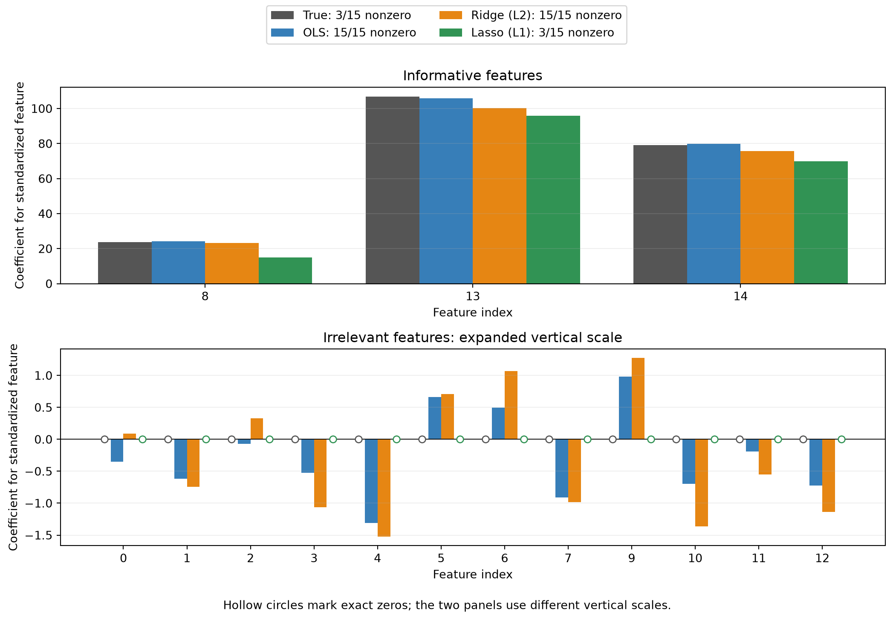

# Regularization: shrinkage and sparsity

A companion to Lecture 14

Author

Marcel Turcotte

Published

October 27, 2026

This notebook isolates the effect of L1 and squared L2 penalties in linear regression. We know the true coefficients of the synthetic data, so we can compare them with ordinary least squares (OLS), Ridge, and Lasso. OLS is the unregularized baseline; Ridge and Lasso apply L2 and L1 regularization, respectively. Lecture 14 applies the same penalty ideas to neural-network weights.

The purpose is to distinguish **shrinkage** from **sparsity**. This experiment does not establish which estimator predicts best on unseen data.

## Data and models

Fifteen features are generated, but only three have nonzero true coefficients. We standardize each feature to zero sample mean and unit sample variance before fitting the models. The generated features already have comparable scales, so standardization makes only a small numerical difference here; it makes the preprocessing assumption explicit.

``` python
import numpy as np
import matplotlib.pyplot as plt
from sklearn.datasets import make_regression
from sklearn.linear_model import LinearRegression, Ridge, Lasso
from sklearn.preprocessing import StandardScaler

X, y, true_coef = make_regression(n_samples=200, n_features=15, n_informative=3,
                                 noise=10.0, coef=True, random_state=42)
scaler = StandardScaler()
X_scaled = scaler.fit_transform(X)

# Express the known coefficients in the same coordinates as the fitted models.
true_coef_scaled = true_coef * scaler.scale_
coefficient_models = {
    'OLS': LinearRegression().fit(X_scaled, y),
    'Ridge (L2)': Ridge(alpha=10.0).fit(X_scaled, y),
    'Lasso (L1)': Lasso(alpha=10.0).fit(X_scaled, y)
}
```

## Why standardize?

Feature units affect coefficient penalties. Multiplying a feature’s values by 100 allows its coefficient to be divided by 100 while preserving the same predictions, but changes the penalty on that coefficient. Standardization puts the penalties on a common scale across features. It does not itself create the sparsity associated with L1 regularization. See the [StandardScaler documentation](https://scikit-learn.org/stable/modules/generated/sklearn.preprocessing.StandardScaler.html).

For a feature transformed as x'\_j=(x_j-\mu_j)/s_j, its coefficient in standardized coordinates is w'\_j=s_jw_j. Centering is absorbed by the fitted intercept. The plot and table below compare **true and estimated coefficients in these same standardized coordinates**: each coefficient describes the predicted change in the target for a one-standard-deviation increase in its feature, holding the other features fixed.

All generated observations are used as training data for this coefficient demonstration. When evaluating prediction on held-out data, fit the scaler only on training data and reuse it to transform validation and test data; a scikit-learn pipeline keeps that preprocessing with the model.

## Compare coefficients

The informative and irrelevant features use **separate vertical scales**. The expanded scale in the lower panel makes small nonzero coefficients visible. Hollow circles identify coefficients that are exactly zero, measured before display rounding.

``` python
series = [('True', true_coef_scaled)] + [
    (name, fitted.coef_) for name, fitted in coefficient_models.items()
]
colors = ['#555555', '#377eb8', '#e68613', '#319354']
groups = [
    (true_coef != 0, 'Informative features'),
    (true_coef == 0, 'Irrelevant features: expanded vertical scale')
]
fig, axes = plt.subplots(2, 1, figsize=(11, 7.5))
for ax, (mask, title) in zip(axes, groups):
    feature_indices = np.flatnonzero(mask)
    positions = np.arange(len(feature_indices))
    for offset, ((name, values), color) in enumerate(zip(series, colors)):
        x_positions = positions + (offset-1.5)*0.2
        nonzero = np.count_nonzero(values)
        ax.bar(x_positions, values[mask], width=0.2, color=color,
               label=f'{name}: {nonzero}/15 nonzero')
        zeros = values[mask] == 0
        ax.scatter(x_positions[zeros], values[mask][zeros], s=35,
                   facecolors='white', edgecolors=color, zorder=4)
    ax.set(xticks=positions, xticklabels=feature_indices, xlabel='Feature index',
           ylabel='Coefficient for standardized feature', title=title)
    ax.axhline(0, color='black', linewidth=0.7)
    ax.grid(axis='y', alpha=0.2)
handles, labels = axes[0].get_legend_handles_labels()
fig.legend(handles, labels, loc='upper center', ncol=2)
fig.text(0.5, 0.01, 'Hollow circles mark exact zeros; the two panels use different vertical scales.',
         ha='center')
fig.tight_layout(rect=(0, 0.035, 1, 0.91))
plt.show()
```



``` python
print(f"{'Feature':<9} {'True':>10} {'OLS':>10} {'Ridge':>10} {'Lasso':>10}")
for index, value in enumerate(true_coef_scaled):
    estimates = [fitted.coef_[index] for fitted in coefficient_models.values()]
    print(f"{index:<9} {value:>10.2f}" + ''.join(f'{estimate:>10.2f}' for estimate in estimates))

print('\nCounts and sparsity, measured before rounding:')
print(f"{'Estimator':<12} {'Nonzero':>9} {'Exactly zero':>14} {'Sparsity':>11}")
for name, fitted in coefficient_models.items():
    nonzero = np.count_nonzero(fitted.coef_)
    zeros = len(fitted.coef_) - nonzero
    sparsity = 100*zeros/len(fitted.coef_)
    print(f'{name:<12} {nonzero:>9} {zeros:>14} {sparsity:>10.1f}%')
print('True informative indices:', np.flatnonzero(true_coef))
print('Lasso nonzero indices:   ', np.flatnonzero(coefficient_models['Lasso (L1)'].coef_))
```

    Feature         True        OLS      Ridge      Lasso
    0               0.00     -0.35      0.09      0.00
    1               0.00     -0.62     -0.75     -0.00
    2               0.00     -0.07      0.33      0.00
    3               0.00     -0.53     -1.06     -0.00
    4               0.00     -1.31     -1.52     -0.00
    5               0.00      0.66      0.71      0.00
    6               0.00      0.50      1.07      0.00
    7               0.00     -0.91     -0.98     -0.00
    8              23.71     24.13     23.25     15.02
    9               0.00      0.98      1.27      0.00
    10              0.00     -0.70     -1.36     -0.00
    11              0.00     -0.19     -0.55     -0.00
    12              0.00     -0.72     -1.13     -0.00
    13            106.95    105.85    100.34     95.86
    14             79.06     79.87     75.69     69.79

    Counts and sparsity, measured before rounding:
    Estimator      Nonzero   Exactly zero    Sparsity
    OLS                 15              0        0.0%
    Ridge (L2)          15              0        0.0%
    Lasso (L1)           3             12       80.0%
    True informative indices: [ 8 13 14]
    Lasso nonzero indices:    [ 8 13 14]

With these fixed settings, OLS and Ridge retain fifteen nonzero coefficients and Lasso retains three, giving 80% exact-zero sparsity. Here Lasso selects the three informative features. This is an illustration, not a guarantee of recovering true features in other datasets, particularly when predictors are correlated.

L2 encourages smaller weights collectively and generally retains a dense solution. It penalizes the total squared coefficient magnitude; an individual coefficient need not become smaller than its OLS estimate when predictors are correlated. Even independently generated features have some correlation in a finite sample.

L1 encourages sparsity: the corner of the absolute-value penalty at zero allows the optimum to have exactly zero coefficients, and Lasso’s coordinate-descent solver can find these sparse solutions. These zeros are a property of the optimization problem. Display rounding is not used to decide whether a coefficient is zero. See the [Lasso user guide](https://scikit-learn.org/stable/modules/linear_model.html#lasso).

## What do the penalty coefficients mean?

The two `alpha=10` values were chosen for a qualitative demonstration. They are not matched penalty strengths. [Ridge](https://scikit-learn.org/stable/modules/generated/sklearn.linear_model.Ridge.html) minimizes

\\y-Xw\\\_2^2+\alpha\\w\\\_2^2,

whereas [Lasso](https://scikit-learn.org/stable/modules/generated/sklearn.linear_model.Lasso.html) minimizes

\frac{1}{2N}\\y-Xw\\\_2^2+\alpha\\w\\\_1.

Here X denotes the standardized feature matrix and w its coefficients. The fitted intercept is omitted from these compact expressions and is not penalized. Different data-loss normalizations and penalty definitions mean that coefficients from different APIs need interpretation before comparison.

## Connection to neural networks

The penalty idea extends to entries of the neural network’s weight matrices. In `SimpleMLP`, the objective is mean BCE plus \lambda/2 times the sum of squared weights, and the added gradient is \lambda W. Biases are not penalized.

L1 encourages sparse connections in a neural network, but ordinary gradient updates need not return exact zeros. An input feature is fully disconnected only when all of its outgoing weights are zero; a single zero connection does not establish feature removal.

## What this experiment establishes

The figures illustrate coefficient shrinkage and sparsity. The three estimators retain different numbers of features; similar-looking coefficients on the informative features do not establish equal predictive performance. Nor does a sparser model automatically predict better.

To compare prediction on unseen examples, use separate training, validation, and test data, choose each estimator’s penalty using validation results, and report final test errors. Regularization that is too strong can underfit. The fixed penalty values here serve the coefficient demonstration and have not been selected for prediction accuracy.

[Return to Lecture 14](../../lectures/14/index.llms.md).
