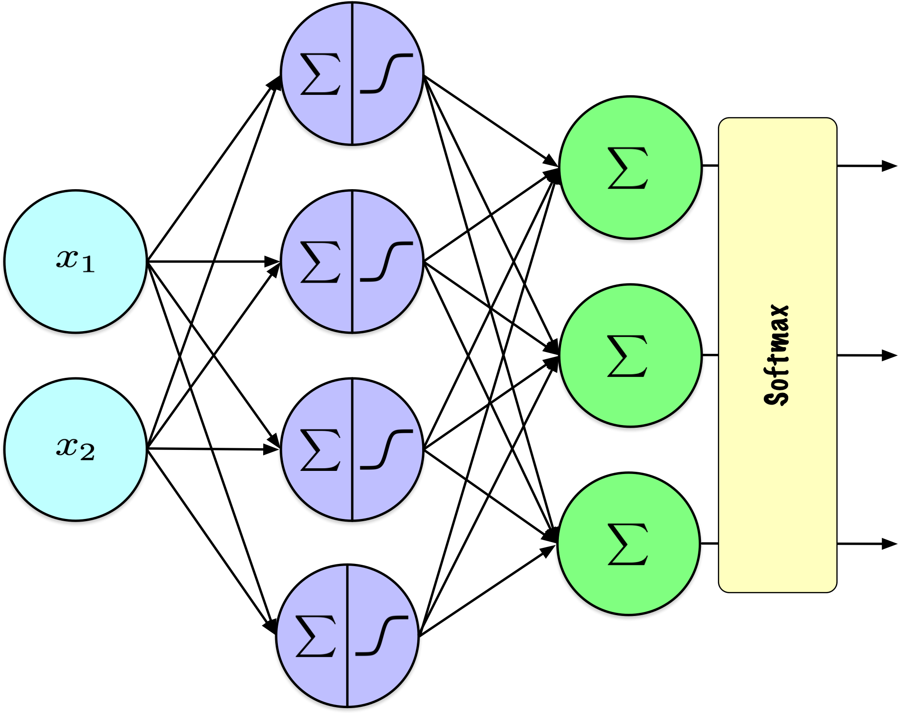
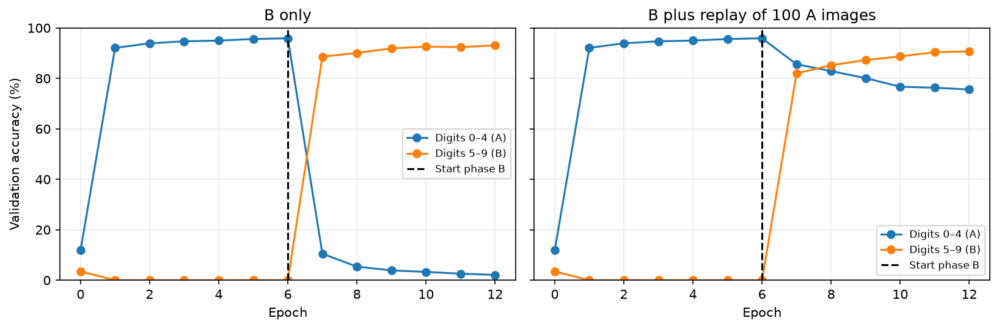

# Training neural networks: challenges and practical choices

CSI 4106 - Fall 2026

Author

Marcel Turcotte

Published

Version: Oct 30, 2026 12:05

# Preamble

## Message of the Day

# An error occurred.

Unable to execute JavaScript.

[The collie and the pug \| HackMIT keynote 2026](https://youtu.be/0Ge3jKLDJaA), Posted on YouTube on 2026-09-24.

> **NOTE:**
>
> Grant Sanderson explores the evolving relationship between technical understanding and the act of building in modern software development. By comparing the motivations of different approaches, this keynote encourages attendees to reflect on their own goals for learning and creation during the event.

[Grant Sanderson](https://www.linkedin.com/in/grant-sanderson-950a6239b) is the creator of [3Blue1Brown](https://www.youtube.com/c/3blue1brown), a YouTube channel known for exceptionally clear, visual explanations of mathematics. His work helped popularize intuitive, animation-driven math education online.

## Learning objectives

- **Explain** how loss landscapes, activation derivatives, and initialization affect optimization.
- **Distinguish** vanishing gradients, exploding gradients, and overfitting.
- **Choose** output activations and losses for regression, binary, multilabel, and multiclass tasks.
- **Explain** L1, L2, dropout, and early stopping, and interpret their effects in code.
- **Compare** `SimplerMLP` with `SimpleMLP` and distinguish inference from further learning.
- **Recognize** catastrophic forgetting and explain how replay can improve retention.

Lecture 13 computed gradients with backpropagation. This presentation examines what can still go wrong: optimization can stall or become unstable, a model can overfit, and further training can damage earlier capabilities. Output and loss choices specify the prediction problem; initialization, update rules, and regularization affect how we solve it.

# Loss landscapes and optimization

## We have gradients. What could still go wrong?

Backpropagation was popularized in **1986**. Why did deep learning take off much later?

- The **loss landscape** describes the objective as a function of the parameters.
- A gradient describes the **local** change in that objective.
- Progress also depends on the starting parameters and the learning rate.

The influential 1986 paper by Rumelhart, Hinton, and Williams helped popularize backpropagation for training multilayer neural networks ([Rumelhart et al. 1986](#ref-Rumelhart:1986aa)). As Lecture 13 noted, earlier work on the method and reverse-mode automatic differentiation predates that paper. The year marks an influential demonstration and popularization, rather than the beginning of all relevant work.

Practical successes appeared well before the modern deep-learning boom. Networks trained with backpropagation were used for handwriting and cheque recognition in the 1990s. Broader adoption of large, deep networks developed later, with speech-recognition advances around 2009 and the 2012 ImageNet image-classification competition serving as influential milestones ([LeCun et al. 2015](#ref-LeCun:2015aa)). Thus, the decades-long progression concerns the scale and breadth of deep learning’s success; it does not mean that earlier neural networks were uniformly ineffective.

Larger labeled datasets and faster computation, particularly graphics processing units (GPUs), worked alongside suitable architectures and improved training choices. AlexNet’s 2012 ImageNet result combined GPU training, ReLU activations, dropout, and additional training examples generated by transforming existing images ([Krizhevsky et al. 2012](#ref-Krizhevsky:2012aa)). Backpropagation supplied the gradients within this larger practical recipe. The activation, initialization, optimization, and regularization choices in this presentation help explain why computing those gradients is only part of making learning work.

Backpropagation answers how the current loss changes when parameters change. Useful learning also requires an appropriate objective, effective updates, generalization to unseen examples, and retention when learning continues. The first difficulty is already visible in a one-parameter objective: a correct local direction need not lead to a globally best solution.

The same gradient algorithm can behave differently on different objectives. A one-dimensional plot lets us inspect a complete toy landscape. A real neural network usually has many parameters: a drawn valley or plateau is an illustration of a possible difficulty, not a complete picture of that network’s objective. A stationary point need not be a global minimum. High-dimensional objectives can also have saddle points, where the loss rises in some directions and falls in others; a one-dimensional plot cannot show all that geometry.

A **local minimum** is at least as good as nearby parameter values; a **global minimum** is at least as good as every allowed parameter value. A **stationary point** has zero gradient, where the objective is differentiable. Such a point can be a minimum, a maximum, or a saddle. **Convergence** refers to an iterative procedure approaching limiting parameter values or an objective value; it does not by itself establish global optimality. Lecture 4 introduced the local/global distinction and convexity.

Lecture 11 distinguished the existence of useful parameters from finding them. Backpropagation supplies an efficient gradient computation; it does not remove that distinction.

## Where will gradient descent take us?

Start at each green point. With a small fixed learning rate, where might the updates stop?

Show code

``` python
import numpy as np
import matplotlib.pyplot as plt

def gradient_descent_1d(gradient, start, learning_rate, steps, clip_value=None):
    trajectory = [float(start)]
    for _ in range(steps):
        g = float(gradient(trajectory[-1]))
        if not np.isfinite(g):
            break  # The toy objective has no finite derivative here.
        if clip_value is not None:
            g = np.clip(g, -clip_value, clip_value)
        trajectory.append(trajectory[-1] - learning_rate * g)
    return np.asarray(trajectory)

def plot_landscape(objective, trajectory, ax, title, show_trajectory=True):
    left = min(-1.2, trajectory.min())
    right = max(1.2, trajectory.max())
    padding = 0.05 * (right - left)
    theta = np.linspace(left - padding, right + padding, 800)
    ax.plot(theta, objective(theta), color='black', linewidth=1.5)
    if show_trajectory:
        ax.plot(trajectory, objective(trajectory), 'o-', color='#377eb8',
                markersize=3, linewidth=0.8, alpha=0.65)
    ax.scatter(trajectory[0], objective(trajectory[0]), color='#4daf4a',
               s=45, zorder=4, label='Start')
    if show_trajectory:
        ax.scatter(trajectory[-1], objective(trajectory[-1]), color='#d95f02',
                   s=45, zorder=5, label='End')
    ax.set(title=title, xlabel=r'$\theta$', ylabel=r'$J(\theta)$')
    ax.grid(alpha=0.25)
    return theta


fig, axes = plt.subplots(1, 3, figsize=(11, 3.2))
overview = [
    ('Convex baseline', lambda t: t**2, lambda t: 2*t, 0.9, 0.1),
    ('Local minima', lambda t: 0.8*np.sin(4*t)+0.5*t**2,
     lambda t: 3.2*np.cos(4*t)+t, 0.5, 0.05),
    ('Suboptimal flat region', lambda t: (np.maximum(0, t)-1)**2,
     lambda t: 2*(t-1) if t > 0 else 0.0, -0.8, 0.1)
]
for index, (ax, (_, objective, gradient, start, rate)) in enumerate(zip(axes, overview)):
    trajectory = gradient_descent_1d(gradient, start, rate, steps=60)
    plot_landscape(objective, trajectory, ax, f'Landscape {index+1}',
                   show_trajectory=False)
axes[0].legend(fontsize=8)
fig.tight_layout()
plt.show()
```

[](slides_files/figure-html/cell-2-output-1.png)

Each plot shows an objective and a starting parameter value, before revealing the updates. The gradient describes the slope at the current point; it does not inspect the whole landscape. A horizontal region can therefore stop the updates even when better parameter values exist elsewhere. The next figure shows the trajectories using the stated gradient-descent procedure.

## Three landscapes, three trajectories

Show code

``` python
fig, axes = plt.subplots(1, 3, figsize=(11, 3.2))
for ax, (title, objective, gradient, start, rate) in zip(axes, overview):
    trajectory = gradient_descent_1d(gradient, start, rate, steps=60)
    plot_landscape(objective, trajectory, ax, title)
axes[0].legend(fontsize=8)
fig.tight_layout()
plt.show()
```

[](slides_files/figure-html/cell-3-output-1.png)

[Loss landscapes and gradient descent ](../../lectures/14/loss_functions.llms.md): complete experiments, heatmaps, and clipping comparisons.

The convex baseline approaches its minimum. The nonconvex example reaches a local minimum selected by its starting point. In the third example, J(\theta)=(\operatorname{ReLU}(\theta)-1)^2: every negative parameter value has loss 1 and gradient zero, but \theta=1 has loss zero. This is a suboptimal flat region, not an objective that is constant everywhere.

The companion notebook also includes singular and discontinuous toy objectives. Those illustrate failures of ordinary differentiability. They should be distinguished from gradient attenuation or amplification through a network’s layers.

In those examples, a discontinuity is a jump in the objective’s value. The square-root cusp has a sharp tip and a derivative whose magnitude becomes unbounded near that tip. These properties concern the toy objective itself, whereas the next section studies products of finite derivatives through a network.

# Gradient propagation and initialization

## What happens along a longer path?

Lecture 13 used one hidden unit. What happens when many backward transformations are composed?

Show code

``` python
distance = np.arange(21)
fig, ax = plt.subplots(figsize=(8, 3.5))
for factor in (0.5, 1.0, 1.5):
    ax.semilogy(distance, factor**distance, 'o-', label=f'Multiplier per step: {factor}')
ax.set(xlabel='Number of backward transformations', ylabel='Signal magnitude',
       title='A scalar path with incoming signal 1')
ax.grid(alpha=0.3)
ax.legend()
fig.tight_layout()
plt.show()
```

[](slides_files/figure-html/cell-4-output-1.png)

The **multiplier per step**, also called the local factor here, combines a weight with an activation derivative. Recall Lecture 13’s scalar notation: z_l is the preactivation of the unit in layer l, w\_{l+1} is the weight connecting it to the next unit, and the **error signal** \delta_l=\partial\ell/\partial z_l measures the loss’s sensitivity to that preactivation. With one unit per layer, backpropagation gives

\delta_l=\underbrace{w\_{l+1}\varphi'(z_l)}\_{q_l}\\\delta\_{l+1}.

The factor \varphi'(z_l) is the activation’s local derivative evaluated at the cached preactivation. Thus q_l is the multiplier applied when the signal moves one step towards the input. It is not the learning rate or an entire parameter gradient. The plot deliberately uses the **same positive multiplier q at every step**, starting with signal magnitude 1. After d backward steps the magnitude is q^d: q=0.5 halves it at each step, q=1 preserves it, and q=1.5 increases it by 50% per step. The vertical axis is logarithmic so that both attenuation and amplification remain visible.

In an actual network the factors depend on the layer and example, can be negative, and need not be equal. Negative factors can reverse the signal’s sign; this plot uses positive factors to isolate changes in magnitude.

The landscapes illustrated a local objective’s geometry. This example isolates a different mechanism: composing many local derivatives can change the signal’s scale dramatically, even when every individual factor is finite.

This is a single-path illustration. A general network also sums contributions at branches, as in Lecture 13. The sigmoid derivative’s bound of 0.25 does not bound all complete parameter gradients because weights and other paths also contribute.

## Vanishing gradients

- Backpropagation repeatedly multiplies **weights and local activation derivatives**.
- Small factors can make early-layer gradients too small for effective learning.
- Saturated sigmoid units have derivatives close to zero.

Recall \sigma'(z)=\sigma(z)(1-\sigma(z))\leq 0.25.

Lecture 13’s scalar example contained one hidden derivative. A deeper network introduces more such factors along each path. The sigmoid derivative approaches zero for large positive or negative preactivations, so saturated units can strongly attenuate the signal propagated upstream.

An activation is **saturated** when changing its input produces very little change in its output, so its local derivative is close to zero. For a sigmoid, this occurs near either end of its output range. **Upstream** means towards the inputs along the backward computation; **downstream** means towards the output and loss.

Weights also enter these products and different paths contribute sums: the bound of 0.25 on a sigmoid’s local derivative is not a bound on every complete parameter gradient. Gradients can shrink or grow depending on the combined transformations. Both vanishing and exploding gradients can occur in feed-forward as well as recurrent networks.

For sigmoid output with binary cross-entropy, the output error signal simplifies to \hat p-y. The explicit sigmoid factor cancels there, but hidden sigmoid units still contribute their activation derivatives. This is why the simplified output formula does not remove the hidden-layer problem.

## Exploding gradients

- Repeated transformations can **amplify** backward signals.
- Large gradients can cause **large parameter updates** and unstable training.
- Suitable initialization and a sensible learning rate help; **gradient clipping** can limit updates.

Exploding gradients do not require an activation with an infinite derivative. Multiplying a sequence of finite transformations can suffice. The difficulty can occur in feedforward and recurrent networks. Large derivatives at a cusp in a scalar objective are a different mechanism, although clipping can bound an update in either situation.

## Activation functions and their derivatives

Which slopes keep a backward signal useful? Does ReLU solve every problem?

Show code

``` python
# Attribution: https://github.com/ageron/handson-ml3/blob/main/10_neural_nets_with_keras.ipynb

import numpy as np
import matplotlib.pyplot as plt

from scipy.special import expit as sigmoid

def relu(z):
    return np.maximum(0, z)

def derivative(f, z, eps=0.000001):
    return (f(z + eps) - f(z - eps))/(2 * eps)

max_z = 4.5
z = np.linspace(-max_z, max_z, 200)

plt.figure(figsize=(11, 3.1))

plt.subplot(121)
plt.plot(z, relu(z), "m-.", linewidth=2, label="ReLU")
plt.plot(z, sigmoid(z), "g--", linewidth=2, label="Sigmoid")
plt.plot(z, np.tanh(z), "b-", linewidth=1, label="Tanh")
plt.grid(True)
plt.title("Activation functions")
plt.axis([-max_z, max_z, -1.65, 2.4])
plt.gca().set_yticks([-1, 0, 1, 2])
plt.legend(loc="lower right", fontsize=13)

plt.subplot(122)
plt.plot(z, derivative(sigmoid, z), "g--", linewidth=2, label="Sigmoid")
plt.plot(z, derivative(np.tanh, z), "b-", linewidth=1, label="Tanh")
plt.plot([-max_z, 0], [0, 0], "m-.", linewidth=2)
plt.plot([0, max_z], [1, 1], "m-.", linewidth=2)
plt.plot([0, 0], [0, 1], "mo", markersize=6, markerfacecolor="white")
plt.grid(True)
plt.title("Derivatives")
plt.axis([-max_z, max_z, -0.2, 1.2])

plt.show()
```

[](slides_files/figure-html/cell-5-output-1.png)

Géron ([2022](#ref-Geron:2022aa)) – [10_neural_nets_with_keras.ipynb](https://github.com/ageron/handson-ml3/blob/main/10_neural_nets_with_keras.ipynb)

Activation choice affects gradient propagation and therefore training. You need to interpret these slopes and how the chain rule uses them, rather than manually derive every expression.

Sigmoid’s maximum derivative is 0.25, and its derivative approaches zero at both extremes. The \tanh derivative has maximum one at zero and also approaches zero in its saturated tails.

For ReLU, the derivative is zero for negative preactivations and one for positive preactivations. At zero the ordinary derivative is undefined; implementations choose a value by convention, commonly zero. The open circles mark the missing ordinary derivative. The activation itself can take any nonnegative value: it is the derivative, away from zero, that takes values zero or one.

**Sparsity** means that many entries are exactly zero. ReLU produces sparse activations because it outputs zero for nonpositive inputs; this describes the activations for particular examples, rather than saying that the weights are zero. A zero activation for one example is normal. A unit that remains in this region across the relevant training inputs receives no data-loss gradient through its activation and may remain inactive: the dying ReLU problem. This is persistent inactivity, not simply one zero output. Changes in upstream representations can sometimes reactivate a unit, so inactivity is not invariably irreversible. See [Lu et al. (2019)](https://arxiv.org/abs/1903.06733).

ReLU’s positive-side derivative avoids one source of attenuation, but does not make the entire gradient equal to one. Incoming activations, downstream weights, other activation derivatives, and path sums still matter. Leaky ReLU retains a small negative-side slope, reducing this particular risk.

## Keeping a gradient on the negative side

What if a ReLU unit stays inactive across the training examples?

Show code

``` python
import numpy as np
import matplotlib.pyplot as plt

# Define the Leaky ReLU function
def leaky_relu(x, alpha=0.2):
    return np.where(x > 0, x, alpha * x)

# Define the derivative of the Leaky ReLU function
def leaky_relu_derivative(x, alpha=0.2):
    return np.where(x > 0, 1, alpha)

# Generate a range of input values
x_values = np.linspace(-4, 4, 400)

# Compute the Leaky ReLU and its derivative
leaky_relu_values = leaky_relu(x_values)
leaky_relu_derivative_values = leaky_relu_derivative(x_values)

# Create the plot
plt.figure(figsize=(5, 3))

# Plot the Leaky ReLU
plt.subplot(1, 2, 1)
plt.plot(x_values, leaky_relu_values, label='Leaky ReLU', color='blue')
plt.title('Leaky ReLU Activation Function')
plt.xlabel('x')
plt.ylabel('f(x)')
plt.grid(True)
plt.axhline(0, color='black',linewidth=0.5)
plt.axvline(0, color='black',linewidth=0.5)
plt.legend()

# Plot the derivative of the Leaky ReLU
plt.subplot(1, 2, 2)
plt.plot([-4, 0], [0.2, 0.2], label='Derivative of Leaky ReLU', color='red')
plt.plot([0, 4], [1, 1], color='red')
plt.plot([0, 0], [0.2, 1], 'o', color='red', markerfacecolor='white')
plt.title('Derivative of Leaky ReLU')
plt.xlabel('x')
plt.ylabel("f'(x)")
plt.grid(True)
plt.axhline(0, color='black',linewidth=0.5)
plt.axvline(0, color='black',linewidth=0.5)
plt.legend()

# Show the plots
plt.tight_layout()
plt.show()
```

[](slides_files/figure-html/cell-6-output-1.png)

The Leaky ReLU, a variant of the standard ReLU activation function, effectively mitigates the issue of *dying ReLU nodes*. For negative input values, it introduces a linear component with a slope governed by the parameter `negative_slope`.

Leaky ReLU retains a nonzero negative-side derivative, reducing the risk of persistent inactivity through a zero activation gradient. At zero its ordinary derivative is undefined when the two slopes differ; an implementation chooses a convention. The open circles distinguish this mathematical point from the code’s chosen value.

``` python
import keras

leaky_relu = keras.layers.LeakyReLU(negative_slope=0.2)
dense = keras.layers.Dense(50, activation=leaky_relu, kernel_initializer="he_normal")
```

See the [Keras activation functions](https://keras.io/api/layers/activations/) for other choices.

## Why not start every weight at the same value?

Randomly initialized **weights** break symmetry between units. **Biases** can start at zero.

Units with identical initial parameters and identical roles can receive identical gradients. Random weight initialization gives them different starting computations. Choosing an initialization scale appropriate to the activation helps signal propagation; it does not guarantee convergence or optimal performance.

## Glorot and Bengio

Random weights break symmetry. Does their scale matter?

Activations

[](../../assets/images/glorot-2010-f6.png)

Backward signals

[](../../assets/images/glorot-2010-f7.png)

Glorot and Bengio ([2010](#ref-Glorot:2010aa)), page 254.

These figures compare standard initialization (top) with the normalized initialization proposed by Glorot and Bengio (bottom), for a network with \tanh units ([Glorot and Bengio 2010, 254](#ref-Glorot:2010aa)). Figure 6 shows activation histograms; Figure 7 shows back-propagated-gradient histograms. With the standard initialization, activations become more concentrated near zero in later layers, while back-propagated gradients are more concentrated near zero closer to the input. Normalized initialization reduces the discrepancy across layers in these experiments.

These are distributions for the reported setup, not a universal rule that vanishing gradients always imply small forward activations. A saturated sigmoid can have an activation near one and a derivative near zero. The paper also distinguishes back-propagated signals from weight gradients; their layerwise distributions need not behave identically.

The Xavier/Glorot normal initializer balances input and output layer widths using \operatorname{Var}(W)=2/(n\_{\mathrm{in}}+n\_{\mathrm{out}}). It is the scaled random initialization already used by `SimplerMLP`. Here n\_{\mathrm{in}} and n\_{\mathrm{out}} count the inputs and outputs of the layer. The variance refers to each sampled weight entry; the normal distribution’s standard deviation is the square root of that variance.

## He initialization

For ReLU hidden layers, He normal initialization uses

\operatorname{Var}(W)=\frac{2}{n\_{\mathrm{in}}}.

``` python
def he_init(rng, fan_in, fan_out):
    std = np.sqrt(2.0 / fan_in)
    return rng.normal(0.0, std, size=(fan_in, fan_out))
```

Also called Kaiming initialization.

The scaling accounts for the rectifier’s effect on signal variance. `SimpleMLP` will use He initialization for ReLU hidden layers and Xavier/Glorot initialization for sigmoid layers, including the output layer. These are initialization rules, not guarantees about the entire training trajectory. See [He et al. (2015)](https://arxiv.org/abs/1502.01852) for the rectifier analysis.

## Which choices help gradients propagate?

- **Alternative activation functions**: Rectified Linear Unit (**ReLU**) and its variants (e.g., **Leaky ReLU**, **Parametric ReLU**, and **Exponential Linear Unit**).

- **Weight Initialization**: Xavier (Glorot) or He initialization.

Activation functions and initialization influence the propagation of signals in both directions. ReLU avoids saturation for positive preactivations, but its zero derivative on the negative side creates the persistent-inactivity risk illustrated earlier. Activation choice and initialization scale work together; neither guarantees stable gradients in an arbitrarily deep network. Normalization layers and residual connections provide other approaches beyond this worked implementation. Even with suitable initial conditions, unusually large updates can still occur, motivating control of the update itself.

The additional activation names are further-reading examples. **Parametric ReLU (PReLU)** learns the negative-side slope that Leaky ReLU fixes in advance. **Exponential Linear Unit (ELU)** uses a linear positive branch and an exponential negative branch that approaches a negative limiting value. The worked NumPy implementation uses sigmoid and ReLU; these additional variants are not required to follow its code.

For context, **normalization layers** rescale intermediate activations using statistics such as means and variances. A **residual connection** adds a block’s input to its output when the dimensions match, providing an additional route for information and backward signals. These approaches are named here as further directions rather than developed in this implementation.

## Gradient clipping

How could we limit an excessively large gradient-descent step while preserving its direction?

For a gradient vector g and threshold c\>0:

\widetilde g = \begin{cases} g, & \\g\\\_2\leq c,\\ c\\g/\\g\\\_2, & \\g\\\_2\>c. \end{cases}

The update uses \widetilde g. Its norm is bounded by c.

``` python
optimizer = keras.optimizers.SGD(learning_rate=0.01, global_clipnorm=1.0)
```

Global-norm clipping rescales the concatenated parameter gradient when necessary while preserving its direction. This differs from clipping each coordinate separately; the two coincide for a scalar gradient. With learning rate \alpha, the corresponding gradient-descent step has norm at most \alpha c.

Here g is a vector containing the derivatives with respect to all parameters, laid out as one list; one coordinate corresponds to one weight or bias. Its **L2 or Euclidean norm** is \\g\\\_2=\sqrt{\sum_j g_j^2}, the vector’s length. The threshold c bounds this combined length, rather than bounding each entry separately. The general norm definitions appear later in the regularization section.

Clipping does not repair vanishing gradients or guarantee convergence. The companion notebook compares clipped and unclipped updates with identical settings and shows a cusp example where fixed-size updates keep oscillating. Initialization, activation choice, clipping, and the learning-rate schedule address different aspects of training.

## Learning-rate decay

Could smaller steps help later in training? What if we reduce them too soon?

At epoch t=1,2,\ldots, with decay factor 0\<\gamma\<1:

\alpha_t=\alpha_1\gamma^{t-1}.

``` python
if self.lr_decay is not None:
    self.lr = self.base_lr * self.lr_decay ** (ep - 1)
```

The first epoch uses the initial learning rate; subsequent epochs use progressively smaller steps. With `lr_decay=None`, the learning rate stays constant. Decay changes the optimizer’s step size, not the derivative formulas or the objective. It is different from L2 regularization and from weight decay. Reducing the learning rate too quickly can prevent useful progress; it does not repair vanishing gradients.

An **epoch** here is one pass through the training examples, possibly divided into mini-batches. **Weight decay** means directly shrinking weights during parameter updates.

# Output layers

## Should the output activation also change?

We replaced a hidden sigmoid with ReLU. Should we do the same at the output?

For **regression**, the output must match the target’s dimensions and range:

- **\# of output neurons**:
  - 1 per dimension
- **Output layer activation function**:
  - Linear for unconstrained targets; ReLU/softplus for nonnegative targets; scaled sigmoid/tanh for bounded targets.
- **Loss function**:
  - [MeanSquaredError](https://www.tensorflow.org/api_docs/python/tf/keras/losses/MeanSquaredError)

In an [object detection problem](https://keras.io/guides/keras_cv/object_detection_keras_cv/), determining the **bounding box** exemplifies a regression task where the output is multidimensional.

The preceding section changed hidden activations to influence gradient propagation. The output has an additional obligation: its values must represent the required predictions. Replacing the output sigmoid with ReLU changes the model’s possible outputs and their interpretation, rather than simply improving an internal derivative.

In a feed-forward network, activation functions in the hidden layers are chosen mainly for their impact on performance and convergence, while the activation function in the output layer is selected according to the requirements of the task.

- **Hidden layers:**

  The activation function (e.g., sigmoid, tanh, ReLU) mainly affects *training dynamics* — such as gradient flow, nonlinearity strength, and convergence rate. The choice is typically empirical, guided by performance, numerical stability, and optimization behavior.

- **Output layer:**

  The activation function is determined by the **nature of the prediction task**:

  - *Regression*: linear, ReLU, or softplus (depending on range constraints)
  - *Binary classification*: sigmoid
  - *Multi-class classification*: softmax
  - *Multi-label classification*: sigmoid (per output unit)

**Softplus** is the smooth function \operatorname{softplus}(z)=\log(1+e^z). It produces strictly positive values for finite inputs and approaches zero for very negative inputs, making it one option for positive regression outputs. ReLU can also represent an exact zero. **Linear** output activation means the identity function: the output is the affine score itself. See the [Keras activation definitions](https://keras.io/api/layers/activations/).

Examples of **multi-output regression problems** (2–4 outputs) include:

- **2 outputs:**

  - Predicting both the **latitude and longitude** of a location from an image.
  - Estimating the **width and height** of a bounding box in object detection.
  - Forecasting **temperature and humidity** simultaneously.

- **3 outputs:**

  - Predicting the **x, y, z coordinates** of a point in space (e.g., hand-joint localization).
  - Estimating **RGB color values** from spectral measurements.

- **4 outputs:**

  - Predicting **bounding box coordinates** — (x\_{min}, y\_{min}, x\_{max}, y\_{max}) — in object detection.

## Can these probabilities describe one exclusive choice?

Separate sigmoids give \[0.8,\\0.7,\\0.1\]. Could several labels apply? Could exactly one class apply?

[](../../assets/images/ann_mlp_multilabel-09-00-v2.png)

Independent sigmoid outputs suit multi-label predictions; their probabilities need not sum to one.

The proposed values sum to 1.6. They can be probabilities of separate labels that may coexist, such as several objects present in one image. They cannot directly form a distribution over an exhaustive set of mutually exclusive classes, whose probabilities must sum to one. This difference concerns the meaning of the outputs, not simply the number of output units.

## One shared output distribution

What properties should the output have when exactly one of K classes is correct?

[](../../assets/images/ann_mlp_softmax-09-00-v2.png)

**Softmax** ensures that all activation outputs fall between 0 and 1 and collectively sum to 1.

An output **logit** is an unrestricted real-valued score before the final sigmoid or softmax converts scores into probabilities. In the diagram these are the output layer’s preactivations. The diagram applies softmax to the whole output vector: each probability depends on every output logit through the shared denominator. Sigmoid outputs for a multilabel task are instead computed elementwise and need not sum to one.

The required properties motivate the construction: outputs should be nonnegative, sum to one, and support gradient computation. Softmax is a standard differentiable way to obtain such a distribution from unrestricted scores; these requirements alone do not uniquely determine its exponential formula.

The \operatorname{argmax} function is not suitable for optimization via gradient-based methods because it is piecewise constant, with zero derivatives away from ties and undefined derivatives at relevant boundaries. In contrast, the softmax function offers both a probabilistic interpretation and a computable derivative, making it more effective for such applications.

The \operatorname{argmax} function can be applied *a posteriori* to trained networks for class prediction.

As in Lecture 11, **argmax** returns the index of a largest entry. It selects a class, whereas softmax returns the complete vector of class probabilities.

## From scores to a probability distribution

The **softmax** function is an **activation function** used in **multi-class classification problems** to convert a vector of raw scores into **probabilities that sum to 1**.

Given K output logits \mathbf{z} = \[z_1, z_2, \ldots, z_K\]:

\hat p_k=\operatorname{softmax}(\mathbf{z})\_k = \frac{e^{z_k}}{\sum\_{j=1}^{K} e^{z_j}}

Here \hat p_k is the predicted probability of class k.

The output logits are real-valued scores. Exponentiation makes their transformed values positive, and normalization makes the probabilities sum to one. Equal logits give probability 1/K to every class. Adding the same constant to every logit leaves the probabilities unchanged.

Softmax preserves ordering: the largest logit and largest probability identify the same class. Probability ratios satisfy \hat p_i/\hat p_j=e^{z_i-z_j}. These are relative scores, not a guarantee that the probabilities are calibrated or that the prediction is correct. Zero probabilities are permitted in probability distributions generally; positivity is a property of mathematical softmax at finite logits.

**Probability calibration** concerns agreement between predicted probabilities and observed frequencies. For example, among examples assigned approximately 0.8 probability of a particular class, a calibrated model should place about 80% in that class. Producing numbers that sum to one does not establish this agreement.

## What do differences between scores imply?

Which class wins? How does the gap between scores affect its probability?

|      z_1 |      z_2 |      z_3 | \hat p_1 | \hat p_2 | \hat p_3 | \sum |
|---------:|---------:|---------:|---------:|---------:|---------:|-----:|
| **1.47** |    -0.39 |     0.22 | **0.69** |     0.11 |     0.20 | 1.00 |
|     5.00 | **6.00** |     4.00 |     0.24 | **0.67** |     0.09 | 1.00 |
|     0.90 |     0.80 | **1.10** |     0.32 |     0.29 | **0.39** | 1.00 |
|    -2.00 | **2.00** |    -3.00 |     0.02 | **0.98** |     0.01 | 1.00 |

Softmax values for a vector of length 3.

1.  **Maintains Relative Order**: The softmax function preserves the relative order of the input values. If one input is greater than another, its corresponding output will also be greater.

2.  **Interpreted as probabilities**: Each value is in the range 0 to 1. The output values from the softmax function are normalized to sum to one, which allows them to be interpreted as probabilities.

3.  **Relative Differences**: When the differences among logits are small, probabilities remain close to uniform. When all logits are identical, every output probability is \frac{1}{K}.

4.  **Rounding**: Displayed probabilities can sum to 1.01 in the last row because each entry was rounded separately. The unrounded probabilities sum to one. Numerical stability requires the shifted computation discussed next.

These properties make the softmax function particularly useful for multi-class classification tasks in machine learning.

### Computing softmax safely

What happens if the logits are 1000, 1001, and 999?

Subtracting the largest logit leaves the probabilities unchanged:

\hat p_k=\frac{e^{z_k-m}}{\sum_j e^{z_j-m}},\qquad m=\max_j z_j.

Show code

``` python
logits = np.array([1000.0, 1001.0, 999.0])
exp_scores = np.exp(logits-logits.max())
probabilities = exp_scores/exp_scores.sum()
print('Probabilities:', probabilities.round(4))
print('Sum:', probabilities.sum())
```

    Probabilities: [0.2447 0.6652 0.09  ]
    Sum: 0.9999999999999999

Directly exponentiating very large positive scores can overflow. Subtracting the maximum prevents that overflow. Very small probabilities can still underflow, so production libraries usually combine the loss with the logits using stable log-sum-exp computations. See [SciPy softmax](https://docs.scipy.org/doc/scipy/reference/generated/scipy.special.softmax.html).

**Overflow** occurs when a computed magnitude exceeds the range of the floating-point representation; **underflow** can round a sufficiently small nonzero result to zero. A **numerically stable** computation avoids unnecessary losses of accuracy or range caused by intermediate operations.

**Log-sum-exp** names the function \log\left(\sum_j e^{z_j}\right). It can be evaluated in the shifted form

\log\left(\sum_j e^{z_j}\right) =m+\log\left(\sum_j e^{z_j-m}\right),\qquad m=\max_j z_j.

A combined cross-entropy implementation can use this expression rather than taking the logarithm of a probability that has already underflowed to zero. See [SciPy logsumexp](https://docs.scipy.org/doc/scipy/reference/generated/scipy.special.logsumexp.html).

When the final Dense layer returns logits, use a cross-entropy loss configured with `from_logits=True`. When it returns softmax probabilities, use `from_logits=False`. Applying softmax first and then declaring the values to be logits changes the objective.

## Same predicted class, same loss?

The true class is Setosa. Both predictions select it:

- \[0.25,\\\mathbf{0.51},\\0.24\]
- \[0.005,\\\mathbf{0.99},\\0.005\]

**Cross-entropy** rewards probability assigned to the true class:

\ell = -\sum\_{k=1}^{K} y_k \log(\hat p_k)

One-hot target: y. Predicted class probabilities: \hat p_k.

Both vectors have their largest component in the Setosa position. Accuracy therefore treats these two predictions equally, whereas a probability-based training objective can distinguish them. Cross-entropy gives losses -\log(0.51)\approx0.6733 and -\log(0.99)\approx0.0101. The lower loss rewards more probability on the true class. This recalls Lecture 12’s use of probabilities from `forward` rather than thresholded labels from `predict` when computing BCE.

- The target vector y is expressed as a one-hot encoded vector of length K, where the element corresponding to the true class is set to 1, and all other elements are 0.

- Consequently, in the summation over classes, only the term associated with the true class contributes a non-zero value.

- Therefore, the cross-entropy loss for a single example is given by -\log(\hat p_k), where \hat p_k is the predicted probability for the true class.

- The predicted probability \hat p_k is derived from the softmax function applied in the output layer of the neural network.

## Cross-entropy: a worked example

- **Classification Problem**: 3 classes
  - Versicolour, Setosa, Virginica.
- **One-Hot Encoding**:
  - Setosa = \[0, 1, 0\].
- **Softmax Outputs & Loss**:
  - \[0.22,\mathbf{0.7}, 0.08\]: Loss = -\log(0.7) = 0.3567.
  - \[0.7, \mathbf{0.22}, 0.08\]: Loss = -\log(0.22) = 1.5141.
  - \[0.7, \mathbf{0.08}, 0.22\]: Loss = -\log(0.08) = 2.5257.

Among the softmax outputs, cross-entropy evaluates only the component corresponding to k=2 (Setosa), as the other entries in the one-hot encoded vector are zero. Here mathematical class indices run from 1 to 3. This relevant element is highlighted in bold. A higher probability for the true class produces a smaller loss; the three examples give losses of 0.3567, 1.5141, and 2.5257.

## How strongly should confident mistakes be penalized?

Show code

``` python
import numpy as np
import matplotlib.pyplot as plt

# Generate an array of p values from just above 0 to 1
p_values = np.linspace(0.001, 1, 1000)

# Compute the natural logarithm of each p value
ln_p_values = - np.log(p_values)

# Plot the graph
plt.figure(figsize=(8, 6))
plt.plot(p_values, ln_p_values, label=r'$-\log(\hat p_k)$', color='b')

# Add labels and title
plt.xlabel(r'$\hat p_k$')
plt.ylabel(r'loss')
plt.title(r'Graph of $-\log(\hat p_k)$ for $\hat p_k$ from 0 to 1')
plt.grid(True)
plt.axhline(0, color='gray', lw=0.5)  # Add horizontal line at y=0
plt.axvline(0, color='gray', lw=0.5)  # Add vertical line at x=0

# Display the plot
plt.legend()
plt.show()
```

[](slides_files/figure-html/cell-8-output-1.png)

- In the summation, only the term where y_k = 1 contributes a non-zero value.

- Due to the negative sign preceding the summation, the value of the function is -\log(\hat p_k).

- If the predicted probability \hat p_k is near 1, the loss approaches zero, indicating minimal penalty.

- Conversely, as \hat p_k nears 0, indicating an incorrect prediction, the loss approaches infinity. This strongly penalizes assigning very low probability to the true class; it does not by itself guarantee faster convergence.

## From one example to a dataset

For a dataset with N examples, the **average cross-entropy loss** over all examples is computed as:

J = -\frac{1}{N} \sum\_{i=1}^{N} \sum\_{k=1}^{K} y\_{i,k} \log(\hat p\_{i,k})

Where:

- i indexes over the different **examples** in the dataset.
- y\_{i,k} and \hat p\_{i,k} are the **true** and **predicted probabilities** for class k of example i, respectively.

## What changes in the backward pass?

- **Integer class labels:** use sparse categorical cross-entropy.
- **One-hot target vectors:** use categorical cross-entropy.
- With softmax and categorical cross-entropy, one example’s output signal is

\frac{\partial\ell}{\partial z_k}=\hat p_k-y_k.

``` python
output_layer = keras.layers.Dense(10)  # Logits: no softmax here.
loss = keras.losses.SparseCategoricalCrossentropy(from_logits=True)
```

The equation uses a one-hot target vector. A sparse loss accepts the true class index and computes the equivalent loss without requiring that vector to be stored. This is the multiclass counterpart of Lecture 13’s sigmoid/BCE output signal. Do not multiply the already simplified signal by an additional activation derivative. For batches, average parameter gradients over examples once, as before.

In **sparse categorical cross-entropy**, “sparse” refers to this compact target encoding. It does not mean that the model’s weights are sparse.

The probabilities \hat p_k are not class decisions. Applying argmax gives the predicted class label. `SimpleMLP` below retains a single sigmoid output and BCE; the MNIST companion uses Keras for the ten-class model.

## Matching classification outputs and losses

| Task        | Output units  | Activation        | Loss                      |
|:------------|:--------------|:------------------|:--------------------------|
| Binary      | One           | Sigmoid           | Binary cross-entropy      |
| Multi-label | One per label | Separate sigmoids | Binary cross-entropy      |
| Multiclass  | One per class | Shared softmax    | Categorical cross-entropy |

The task determines what the outputs mean and which data loss to minimize.

This table consolidates the probability-output configurations discussed above. A multiclass Keras model can instead return logits and use a categorical loss with `from_logits=True`; the sparse version accepts integer class labels. These choices specify the data objective. Even an appropriate objective can be optimized beyond the point of best performance on unseen examples, which motivates the validation curves in the next section.

## Further viewing: argmax and softmax

# An error occurred.

Unable to execute JavaScript.

This supplementary video revisits the distinction between choosing a class and constructing differentiable class probabilities. The next section returns to the training process: a falling training loss alone is insufficient evidence that predictions on unseen examples are improving.

# Regularization

## Which checkpoint would you deploy?

Training error keeps decreasing. Does the validation curve support training longer?

Show code

``` python
from copy import deepcopy
from sklearn.metrics import root_mean_squared_error
from sklearn.preprocessing import StandardScaler
from sklearn.pipeline import make_pipeline
from sklearn.preprocessing import PolynomialFeatures
from sklearn.linear_model import SGDRegressor

# Construct noisy quadratic data and reserve validation examples.
np.random.seed(42)
m = 100
X = 6 * np.random.rand(m, 1) - 3
y = 0.5 * X ** 2 + X + 2 + np.random.randn(m, 1)
X_train, y_train = X[: m // 2], y[: m // 2, 0]
X_valid, y_valid = X[m // 2 :], y[m // 2 :, 0]

preprocessing = make_pipeline(PolynomialFeatures(degree=90, include_bias=False),
                              StandardScaler())
X_train_prep = preprocessing.fit_transform(X_train)
X_valid_prep = preprocessing.transform(X_valid)
sgd_reg = SGDRegressor(penalty=None, eta0=0.002, random_state=42)
n_epochs = 500
best_valid_rmse = float('inf')
train_errors, val_errors = [], []  # extra code – it's for the figure below

for epoch in range(n_epochs):
    sgd_reg.partial_fit(X_train_prep, y_train)
    y_valid_predict = sgd_reg.predict(X_valid_prep)
    val_error = root_mean_squared_error(y_valid, y_valid_predict)
    if val_error < best_valid_rmse:
        best_valid_rmse = val_error
        best_model = deepcopy(sgd_reg)

    # extra code – we evaluate the train error and save it for the figure
    y_train_predict = sgd_reg.predict(X_train_prep)
    train_error = root_mean_squared_error(y_train, y_train_predict)
    val_errors.append(val_error)
    train_errors.append(train_error)

# extra code – this section generates and saves Figure 4–20
best_epoch = np.argmin(val_errors)
plt.plot(val_errors, "b-", linewidth=3, label="Validation set")
plt.plot(train_errors, "r--", linewidth=2, label="Training set")
plt.legend(loc="upper right")
plt.xlabel("Epoch")
plt.ylabel("RMSE")
plt.axis([0, n_epochs, 0, 3.5])
plt.grid()
plt.show()
```

[](slides_files/figure-html/cell-9-output-1.png)

**Attribution**: Géron ([2022](#ref-Geron:2022aa)), [04_training_linear_models.ipynb](https://github.com/ageron/handson-ml3/blob/main/04_training_linear_models.ipynb).

The earlier output and loss choices defined what the model should predict. This figure introduces a second criterion for assessing progress: performance on examples not used for the updates. The lowest validation error identifies a more promising checkpoint than the final epoch, despite the continuing improvement in training error.

A **checkpoint** is a saved copy of the model’s parameters at a particular training step. The vertical axis uses **root mean squared error (RMSE)**, the square root of MSE introduced in Lecture 4; lower values indicate smaller prediction errors, in the target’s original units.

The code intentionally runs all 500 epochs to show the complete curves and stores the best model without marking it on the plot. It therefore demonstrates checkpoint selection. An actual early-stopping procedure also halts the updates when its stopping criterion is met. Validation curves can fluctuate; a patience period avoids stopping at the first small reversal. The curve motivates the stopping rule introduced next.

## Why regularize?

An appropriate loss and effective updates can still produce **overfitting**.

- Training loss measures fit to the supplied examples.
- Validation performance helps identify choices that generalize.
- Stronger regularization can also cause underfitting.

The divergence between the training and validation curves explains why reducing training loss is not the only goal. Regularization influences learning to favor solutions that generalize. Stopping earlier controls how long parameters are adjusted; penalties change the objective; dropout changes training computations. Their usefulness and strength should be assessed with validation data; the test set is reserved for the final evaluation.

## Early stopping

How could the validation curve become a stopping rule?

Monitor a validation metric. Stop after a chosen number of epochs without meaningful improvement, and recover the best parameters.

Geoffrey Hinton calls this the *“beautiful free lunch.”*

## Stop and restore the best parameters

For a compiled Keras model with prepared training and validation data:

``` python
early_stopping = keras.callbacks.EarlyStopping(
    monitor="val_loss", patience=5, restore_best_weights=True)
    
model.fit(X_train, y_train, validation_data=(X_valid, y_valid),
          epochs=100, callbacks=[early_stopping])
```

Restoring the best weights is an explicit choice: Keras does not enable it by default. Patience controls how many epochs without improvement are allowed before stopping. A minimum improvement can also be set using `min_delta`. Use validation data for this choice, not the test set. See [Keras EarlyStopping](https://keras.io/api/callbacks/early_stopping/).

## Adding a penalty to the objective

Besides choosing when to stop, can we influence which solutions training prefers?

J\_{\mathrm{reg}}(W,b)=J\_{\mathrm{data}}(W,b)+\Omega(W).

The data loss matches the prediction task. The penalty discourages selected weight configurations.

The data term can be mean squared error, mean absolute error, BCE, or categorical cross-entropy. For example, MAE averages \|\hat y_i-y_i\| over regression examples. A penalty is added separately and is minimized together with that data term. This presentation penalizes weights, not biases, unless a different choice is explicitly stated.

## How could we measure weight size?

Would these two weight vectors receive the same penalty?

| Weights | Sum of absolute values | Sum of squares |
|:--------|-----------------------:|---------------:|
| (4,0)   |                      4 |             16 |
| (2,2)   |                      4 |              8 |

L1 uses \\\mathbf w\\\_1=\sum_j\|w_j\|; the usual L2 penalty uses \\\mathbf w\\\_2^2=\sum_j w_j^2.

The two vectors have the same sum of absolute values, but distributing the magnitude across both entries reduces the sum of squares. This comparison explains how the penalties measure weight size differently; it does not by itself prove that L1 will produce a sparse fitted model. The data-loss term also influences the optimum.

The L1 norm is also called the Manhattan norm. The L2 or Euclidean norm is the square root of the sum of squares; the usual L2 regularization penalty uses its square, not the norm itself.

A **norm** assigns a non-negative length to a vector.

For p\geq1, the **\ell_p norm** of a vector \mathbf{z} = \[z_1, z_2, \ldots, z_n\] is defined as:

\\\mathbf{z}\\\_p = \left( \sum\_{i=1}^{n} \|z_i\|^p \right)^{1/p}

With larger p, the \ell_p norm increasingly highlights larger z_i values due to exponentiation.

A **norm** is nonnegative and is zero only for the zero vector. Scaling a vector by a scalar c scales its norm by \|c\|: \\c\mathbf z\\=\|c\|\\\\\mathbf z\\. The **triangle inequality**, \\\mathbf u+\mathbf v\\\leq\\\mathbf u\\+\\\mathbf v\\, says that the length of a sum is at most the sum of the lengths.

## \ell_1 and \ell_2 regularization

Let \mathbf w collect all weight entries. The nonnegative coefficients \lambda_1 and \lambda_2 control the penalties; zero disables the corresponding term.

J\_{\mathrm{reg}}=J\_{\mathrm{data}}(W,b) +\lambda_1\\\mathbf w\\\_1 +\frac{\lambda_2}{2}\\\mathbf w\\\_2^2.

The L1 term sums absolute weight values. The usual L2 penalty sums squared weight values; it uses the squared Euclidean or Frobenius norm, rather than the unsquared norm. The factor one-half is a convention that makes its derivative \lambda_2 W, matching `SimpleMLP` later in this presentation. Coefficient conventions differ across libraries.

## Shrinkage and sparsity

- **\ell_1 Regularization**:
  - Encourages **sparsity**; suitable solvers can set coefficients exactly to zero.
  - Can support **feature selection**, particularly in linear models.
- **\ell_2 Regularization**:
  - Promotes **small, distributed weights** for stability.
  - Shrinks weights collectively and usually retains a dense solution.

An advanced example: [Regularization with correlated features ](../../lectures/14/kong_and_yu-2018.llms.md).

A **sparse coefficient vector** has many exact zeros; a **dense** vector has few or none. **Feature selection** means retaining a subset of the original input features. In a linear model, a zero coefficient removes that feature’s term from the prediction. Whether the selected subset improves prediction must be evaluated separately. **Correlated features** vary together; their overlapping information can affect which coefficients are selected or how weight is distributed between them.

## Which coefficients actually disappear?

Show code

``` python
import numpy as np
import matplotlib.pyplot as plt
from sklearn.datasets import make_regression
from sklearn.linear_model import LinearRegression, Ridge, Lasso
from sklearn.preprocessing import StandardScaler

X, y, true_coef = make_regression(n_samples=200, n_features=15, n_informative=3,
                                 noise=10.0, coef=True, random_state=42)
scaler = StandardScaler()
X_scaled = scaler.fit_transform(X)

# Express the known coefficients in the same coordinates as the fitted models.
true_coef_scaled = true_coef * scaler.scale_
coefficient_models = {
    'OLS': LinearRegression().fit(X_scaled, y),
    'Ridge (L2)': Ridge(alpha=10.0).fit(X_scaled, y),
    'Lasso (L1)': Lasso(alpha=10.0).fit(X_scaled, y)
}

series = [('True', true_coef_scaled)] + [
    (name, fitted.coef_) for name, fitted in coefficient_models.items()
]
colors = ['#555555', '#377eb8', '#e68613', '#319354']
groups = [
    (true_coef != 0, 'Informative features'),
    (true_coef == 0, 'Irrelevant features: expanded vertical scale')
]
fig, axes = plt.subplots(2, 1, figsize=(11, 4.8))
for ax, (mask, title) in zip(axes, groups):
    feature_indices = np.flatnonzero(mask)
    positions = np.arange(len(feature_indices))
    for offset, ((name, values), color) in enumerate(zip(series, colors)):
        x_positions = positions + (offset-1.5)*0.2
        nonzero = np.count_nonzero(values)
        ax.bar(x_positions, values[mask], width=0.2, color=color,
               label=f'{name}: {nonzero}/15 nonzero')
        zeros = values[mask] == 0
        ax.scatter(x_positions[zeros], values[mask][zeros], s=35,
                   facecolors='white', edgecolors=color, zorder=4)
    ax.set(xticks=positions, xticklabels=feature_indices, xlabel='Feature index',
           ylabel='Standardized coefficient', title=title)
    ax.axhline(0, color='black', linewidth=0.7)
    ax.grid(axis='y', alpha=0.2)
handles, labels = axes[0].get_legend_handles_labels()
fig.legend(handles, labels, loc='upper center', ncol=2)
fig.text(0.5, 0.01, 'Hollow circles mark exact zeros; the two panels use different vertical scales.',
         ha='center')
fig.tight_layout(rect=(0, 0.035, 1, 0.91))
plt.show()
```

[](slides_files/figure-html/cell-10-output-1.png)

[Regularization: shrinkage and sparsity ](../../lectures/14/regularization.llms.md).

This linear-regression example isolates the penalty’s effect. Fifteen predictors are generated, but only three have nonzero true coefficients. The informative and irrelevant features use different vertical scales so that small nonzero estimates remain visible. Hollow circles identify exact zeros. With these fixed settings, OLS and Ridge retain fifteen nonzero coefficients; Lasso retains three, giving 80% exact-zero sparsity and identifying the informative predictors in this dataset.

**Ordinary least squares (OLS)** fits a linear model by minimizing the **residual sum of squares (RSS)**. A residual is an observed target minus its prediction; RSS sums the squared residuals over examples. This is the least-squares objective from Lecture 4 under its statistical name. **Ridge** adds a squared L2 coefficient penalty, while **Lasso** adds an L1 coefficient penalty. See the [scikit-learn linear-model definitions](https://scikit-learn.org/stable/modules/linear_model.html).

OLS is the unregularized baseline. The equal numeric alpha values do not imply equal penalty strengths. Scikit-learn Ridge minimizes RSS plus alpha times the squared L2 norm, whereas Lasso divides RSS by 2N before adding its L1 penalty. The settings were chosen for a qualitative comparison, not a matched-strength benchmark.

The models use standardized features: each is centered using its training mean and divided by its training standard deviation. The true coefficients are converted to the same coordinates. Changing feature units changes the coefficient needed to preserve a prediction, and therefore its penalty; standardization makes the scale assumption explicit. The generated features already have similar scales, so it makes only a small numerical difference here. For held-out evaluation, fit the scaler only on training data. The companion notebook explains the coefficient conversion and prints the complete counts.

L2 penalizes total squared weight magnitude. In a finite sample, correlations can cause an individual Ridge coefficient to increase relative to OLS even while the overall norm decreases. Lasso’s successful selection here is not a general guarantee.

This comparison concerns coefficients, not held-out prediction performance. L1 in a neural network encourages sparse connections, but ordinary gradient updates need not produce exact zeros. An input feature is disconnected only when all its outgoing connections are zero.

## Adding L2 in Keras

``` python
import keras

l2 = 0.001
regularizer = keras.regularizers.L2(l2 / 2)
dense = keras.layers.Dense(50, kernel_regularizer=regularizer)
```

For a Dense layer, the **kernel** is its weight matrix. Apply the penalty to each layer whose weights should be penalized.

Keras `L2(c)` adds c\sum w^2, so its derivative is 2cW. Using `c=l2/2` matches the \lambda/2 convention in this presentation and `SimpleMLP`. A numeric penalty coefficient is meaningful only together with its library’s definition. `kernel_regularizer` does not penalize the bias; that is a separate option. See [Keras regularizers](https://keras.io/api/layers/regularizers/).

## What if some activations were unavailable?

Could a model learn to rely less on particular combinations of hidden activations?

During training, dropout randomly masks activations to discourage reliance on particular combinations of features.

Hinton et al. ([2012](#ref-Hinton:2012aa))

Weight penalties influence which parameter values are preferred. Dropout instead changes the computation during training: different examples encounter different masks. The parameters must support useful predictions across these masked computations. Whether this helps generalization is an empirical question assessed with validation data.

## Why scale the retained activations?

An activation equals 4 and is dropped half the time. What happens to its expected contribution?

For dropout rate 0\leq p\<1, each activation is retained with probability 1-p:

\widetilde a=\frac{m}{1-p}a,\qquad m\sim\operatorname{Bernoulli}(1-p).

- A dropped activation becomes zero for that computation.
- A retained activation is scaled by 1/(1-p).

Without scaling, the example activation contributes either 0 or 4, with expected value 2. With p=0.5, scaling a retained activation by two gives contributions 0 or 8 and restores expected value 4. This is the motivation for the factor in inverted dropout.

The **mask** m is a binary random variable: m=1 retains the activation and m=0 drops it. Writing m\sim\operatorname{Bernoulli}(1-p) means P(m=1)=1-p and P(m=0)=p, using the Bernoulli distribution introduced in Lecture 6. The **expected value** is the probability-weighted average over possible mask draws; it need not equal any particular draw’s result. Here a is the original activation and \widetilde a is its masked, scaled value.

The scaling preserves the activation’s expected value, not its exact value in every batch. Standard dense dropout normally samples masks per example and activation; a shared mask across examples is a different configuration. A unit can be retained on some examples and dropped on others in the same batch. A new mask is drawn during subsequent training computations.

The parameters are not permanently removed. A masked activation contributes no gradient through that path for that example, while other examples and other objective terms may still produce parameter updates. Sparse activations from dropout and persistent dying ReLU are different phenomena.

## Training and inference

Should these random masks remain active when producing ordinary predictions?

| Mode      | Drop activations? | Rescale retained activations? |
|:----------|:------------------|:------------------------------|
| Training  | Yes, at rate p    | Yes, by 1/(1-p)               |
| Inference | No                | No                            |

This is the inverted-dropout convention used by Keras. Because scaling is performed during training, no additional dropout scaling is needed at inference. Dropout can help generalization, but no universal accuracy improvement or optimal rate applies to every model and dataset. Select the rate using validation data. See [Keras Dropout](https://keras.io/api/layers/regularization_layers/dropout/).

## Dropout in the Fashion-MNIST model

``` python
import keras
from keras.models import Sequential
from keras.layers import InputLayer, Dropout, Flatten, Dense

model = keras.Sequential([
    InputLayer(shape=[28, 28]),
    Flatten(),
    Dropout(rate=0.2),
    Dense(300, activation="relu"),
    Dropout(rate=0.2),
    Dense(100, activation="relu"),
    Dropout(rate=0.2),
    Dense(10, activation="softmax")
])
```

Adding `Dropout` layers to the Fashion-MNIST model from Lecture 11.

The rate can differ by layer. This example adds dropout to the familiar Fashion-MNIST architecture; its presence alone is not evidence of improved performance. Compare validation behavior with an otherwise comparable model and choose rates on that basis.

# Extending the implementation

## From SimplerMLP to SimpleMLP

Which choices require code changes, and where do they enter the computation?

| Component | `SimplerMLP` (Lecture 13) | `SimpleMLP` |
|:---|:---|:---|
| Hidden activation | Sigmoid | Sigmoid or ReLU |
| Initialization | Glorot | He for ReLU; Glorot for sigmoid |
| Output | Sigmoid probability | Sigmoid probability |
| Learning rate | Constant | Constant or exponential decay |
| Loss | Mean BCE | Mean BCE plus optional L2 |
| Example order | Shuffle every epoch | Optional shuffling (default: on) |
| Caches and backward loop | Same structure | Same structure |
| Prediction and training API | Same methods | Same methods |

The new class extends the previous implementation while retaining its computational structure. Both are binary classifiers with one sigmoid output. Changing the hidden activation requires a matching local derivative and suitable initialization, but the chain rule and backward loop remain the same.

Each addition answers a problem encountered earlier: activation helpers select local slopes, initialization controls the starting weight scale, L2 changes the objective and its gradient, and a schedule changes update size over epochs. The caches, parameter orientation, and gradient-collection procedure remain aligned with Lecture 13.

This class implements a selected subset of the lecture’s choices. It retains binary BCE and does not implement multiclass softmax, dropout, early stopping, or gradient clipping. The Keras examples and companions illustrate those broader tools. Separating these scopes keeps the NumPy implementation readable while preserving the connection between concepts and code.

Setting `hidden_activation="sigmoid"`, `l2=0.0`, and `lr_decay=None` recovers the `SimplerMLP` computation. With the same seed and the default `shuffle=True`, the two classes initialize and shuffle identically. `SimpleMLP` adds a `shuffle` option to `train`: setting `shuffle=False` preserves the supplied example order across epochs. This is useful when training depends on that order, as discussed in Lecture 13; it does not by itself make this feedforward classifier a sequence model. The complete definition and focused excerpts follow below. They remain available for independent notebook execution.

## SimpleMLP

Show code

``` python
import numpy as np

def sigmoid(z):
    return 1.0 / (1.0 + np.exp(-z))

def sigmoid_prime(z):
    a = sigmoid(z)
    return a * (1.0 - a)

def bce_loss(y_true, y_prob, eps=1e-9):
    """Binary cross-entropy averaged over examples."""
    p = np.clip(y_prob, eps, 1 - eps)
    return -np.mean(y_true * np.log(p) + (1 - y_true) * np.log(1 - p))

def xavier_init(rng, fan_in, fan_out):
    std = np.sqrt(2.0 / (fan_in + fan_out))
    return rng.normal(0.0, std, size=(fan_in, fan_out))

def relu(z):
    return np.maximum(0.0, z)

def relu_prime(z):
    return (z > 0).astype(float)

def he_init(rng, fan_in, fan_out):
    std = np.sqrt(2.0 / fan_in)
    return rng.normal(0.0, std, size=(fan_in, fan_out))

class SimpleMLP:
    """Binary MLP with optional ReLU hidden units, L2, and learning-rate decay."""

    def __init__(self, layer_sizes, lr=0.1, seed=None, l2=0.0,
                 hidden_activation="relu", lr_decay=None):
        self.sizes = list(layer_sizes)
        self.lr = float(lr)
        self.base_lr = float(lr)
        self.l2 = float(l2)
        self.hidden_activation = hidden_activation
        self.lr_decay = lr_decay
        self.rng = np.random.default_rng(seed)

        self.W = []
        L = len(self.sizes) - 1
        for l, (din, dout) in enumerate(zip(self.sizes[:-1], self.sizes[1:]), start=1):
            if l < L and self.hidden_activation == "relu":
                Wk = he_init(self.rng, din, dout)
            else:
                Wk = xavier_init(self.rng, din, dout)
            self.W.append(Wk)
        self.b = [np.zeros(dout) for dout in self.sizes[1:]]

    def _act(self, z, last=False):
        if last:
            return sigmoid(z)
        return relu(z) if self.hidden_activation == "relu" else sigmoid(z)

    def _act_prime(self, z, last=False):
        if last:
            return sigmoid_prime(z)
        return relu_prime(z) if self.hidden_activation == "relu" else sigmoid_prime(z)

    def forward(self, X):
        a = X
        L = len(self.W)
        for l, (W, b) in enumerate(zip(self.W, self.b), start=1):
            a = self._act(a @ W + b, last=(l == L))
        return a.ravel()

    def predict_proba(self, X):
        return self.forward(X)

    def predict(self, X, threshold=0.5):
        return (self.predict_proba(X) >= threshold).astype(int)

    def loss(self, X, y):
        p = self.predict_proba(X)
        base = bce_loss(y, p)
        if self.l2 > 0:
            base += 0.5 * self.l2 * sum((W ** 2).sum() for W in self.W)
        return base

    def _forward_full(self, X):
        a = X
        activations = [a]
        zs = []
        L = len(self.W)
        for l, (W, b) in enumerate(zip(self.W, self.b), start=1):
            z = a @ W + b
            a = self._act(z, last=(l == L))
            zs.append(z)
            activations.append(a)
        return activations, zs

    def train(self, X, y, epochs=30, batch_size=None, verbose=True, shuffle=True):
        """X: (N, d), y: (N,); batch_size=None uses the full dataset."""
        N = X.shape[0]
        idx = np.arange(N)
        B = N if batch_size is None else int(batch_size)

        for ep in range(1, epochs + 1):
            if shuffle:
                self.rng.shuffle(idx)
            if self.lr_decay is not None:
                self.lr = self.base_lr * self.lr_decay ** (ep - 1)

            base_loss = self.loss(X, y)

            for start in range(0, N, B):
                sl = idx[start:start + B]
                Xb = X[sl]
                yb = y[sl].reshape(-1, 1)
                Bsz = Xb.shape[0]

                activations, zs = self._forward_full(Xb)
                A_L = activations[-1]

                # Each row is a single example's preactivation sensitivity.
                delta = A_L - yb
                grads_W = [None] * len(self.W)
                grads_b = [None] * len(self.b)

                # Average parameter gradients over examples exactly once.
                grads_W[-1] = activations[-2].T @ delta / Bsz
                grads_b[-1] = delta.mean(axis=0)

                for k in range(len(self.W) - 2, -1, -1):
                    z = zs[k]
                    d_act = self._act_prime(z, last=False)
                    delta = (delta @ self.W[k + 1].T) * d_act
                    grads_W[k] = activations[k].T @ delta / Bsz
                    grads_b[k] = delta.mean(axis=0)

                if self.l2 > 0:
                    for k in range(len(self.W)):
                        grads_W[k] += self.l2 * self.W[k]

                # All gradients use the weights from the same forward pass.
                for k in range(len(self.W)):
                    self.W[k] -= self.lr * grads_W[k]
                    self.b[k] -= self.lr * grads_b[k]

            new_loss = self.loss(X, y)
            if verbose:
                print(f"Epoch {ep:3d} | loss {base_loss:.5f} -> {new_loss:.5f} | lr={self.lr:.4f}")
```

## Choosing hidden activations

If the forward activation changes, which local derivative must the backward pass use?

``` python
    def _act(self, z, last=False):
        if last:
            return sigmoid(z)
        return relu(z) if self.hidden_activation == "relu" else sigmoid(z)

    def _act_prime(self, z, last=False):
        if last:
            return sigmoid_prime(z)
        return relu_prime(z) if self.hidden_activation == "relu" else sigmoid_prime(z)
```

The output remains sigmoid for binary classification. ReLU is an option only for hidden units. Lecture 13 called `sigmoid` and `sigmoid_prime` directly. Here the helpers `_act` and `_act_prime` select the activation and its derivative, and the flag `last` identifies the output layer. The forward and cached-forward methods now call `_act`; the backward loop calls `_act_prime`. Its multiplication by `W_next.T` and its averaging over examples are unchanged.

## L2 in the objective and gradient

J\_{\mathrm{reg}}=J\_{\mathrm{BCE}}+ \frac{\lambda}{2}\sum\_{l=1}^{L}\\W^{(l)}\\\_F^2.

``` python
base += 0.5 * self.l2 * sum((W ** 2).sum() for W in self.W)

# After computing the mean data-loss gradients:
grads_W[k] += self.l2 * self.W[k]
```

The coefficient `l2` is \lambda. The data loss is averaged over examples; the penalty is added separately, with no additional division by dataset or mini-batch size. Consequently, its derivative is \lambda W in every batch. This keeps the reported objective and the update’s gradient consistent. Biases are not penalized in this implementation.

The Frobenius norm squared is simply the sum of squared entries of a weight matrix. This implements the squared L2 penalty introduced earlier. L2 discourages large weights; it does not change the local activation derivatives or directly repair gradient propagation.

## Same API, extended model

``` python
from sklearn.datasets import make_circles
from sklearn.model_selection import train_test_split
from sklearn.preprocessing import StandardScaler
from sklearn.metrics import accuracy_score

X, y = make_circles(n_samples=200, factor=0.5, noise=0.08, random_state=1)
X_train, X_test, y_train, y_test = train_test_split(
    X, y, test_size=0.3, random_state=0, stratify=y)

scaler = StandardScaler()
X_train = scaler.fit_transform(X_train)
X_test = scaler.transform(X_test)

model = SimpleMLP([2, 4, 4, 1], lr=0.3, seed=42,
                  hidden_activation="relu", l2=0.001, lr_decay=0.995)
model.train(X_train, y_train, epochs=500, batch_size=32, verbose=False)

print("Train acc:", accuracy_score(y_train, model.predict(X_train)))
print(" Test acc:", accuracy_score(y_test, model.predict(X_test)))
```

    Train acc: 1.0
     Test acc: 1.0

This uses the same data, split, preprocessing, and architecture as the `SimplerMLP` example. It demonstrates how to enable the additional options. Because the activation, training duration, penalty, and schedule differ, these two runs are illustrative workflows rather than a controlled claim that one setting is universally better. Both constructors’ seeds control weights and shuffling. All gradients are still collected before updates.

Once a model has been trained and evaluated, a different question arises: what happens to its existing capabilities if its parameters are adjusted using new data?

# Further learning and retention

## Inference and further learning

The model works well. Can it keep learning from new examples without losing earlier capabilities?

- **Inference:** compute predictions using the current parameters.
- **Further learning:** update parameters using an explicit training process.
- Evaluate updates on **earlier capabilities** as well as new data.

A model does not ordinarily change its weights merely by receiving another prediction request. Feedback, an objective, and an update procedure are needed for learning. A training pipeline can periodically produce a new model version, or it can update continuously.

**Online learning** updates a model incrementally as new observations arrive, rather than relying only on a fixed training dataset and a separate retraining run. **Fine-tuning** means further training a previously trained model. **Continual learning** studies learning from successive data or tasks while retaining earlier capabilities. These terms describe learning processes; ordinary inference computes outputs without performing such updates.

Production neural networks can learn online; real-time recommendation systems such as [Monolith](https://arxiv.org/abs/2209.07663) provide examples. The distinction is between inference and a deliberate update process, not a universal prohibition on online training. See [Google’s static/dynamic training discussion](https://developers.google.com/machine-learning/crash-course/production-ml-systems/static-vs-dynamic-training).

## Will learning B preserve skill A?

| Phase | Training data    | Evaluate afterwards |
|:------|:-----------------|:--------------------|
| A     | MNIST digits 0–4 | Both groups         |
| B     | MNIST digits 5–9 | Both groups         |

Keep the same ten output classes and the original labels throughout.

After phase B, what do you predict will happen to accuracy on digits 0–4?

The model first trains on digits 0–4 and then continues training on digits 5–9. Its output dimension and the meaning of every class label stay fixed. The second phase therefore tests whether learning new classes preserves earlier predictions without additional old examples. This differs from ordinary inference, which leaves the parameters unchanged.

**MNIST** contains 28-by-28 grayscale images of handwritten digits 0–9. It differs from Fashion-MNIST, the clothing-image dataset used earlier. A **class-incremental** setup introduces classes in successive phases and evaluates the model’s ability to recognize all classes seen so far; after phase B here, that means all ten digits.

This is a class-incremental setup: all ten classes are available for every prediction. Restricting predictions to the task’s known class group would answer a different, easier question. See [van de Ven and Tolias (2019)](https://arxiv.org/abs/1904.07734).

## What happened to the earlier classes?

Test accuracy in the recorded MNIST run:

| Checkpoint   | Digits 0–4 (A) | Digits 5–9 (B) |
|:-------------|---------------:|---------------:|
| After A      |          97.0% |           0.0% |
| After B only |           2.3% |          93.8% |

Which examples were absent from phase B? How could we put some of that information back?

**Catastrophic forgetting:** further training can sharply reduce performance on earlier tasks.

These are stage-end test accuracies from the companion’s recorded run, not the validation accuracies plotted on the following slide. They use all ten output classes at every evaluation. Exact values can vary with backend and hardware, but this run illustrates a pronounced loss of earlier class accuracy alongside successful learning of the newer classes.

The second training objective contains no examples requiring the earlier predictions to remain correct. Its updates can interfere with shared representations and favor recent classes. The original test images and their labels do not change. A decline is not evidence that every useful old representation has been erased.

The missing old examples suggest a direct intervention: retain a small memory and mix some earlier examples into later updates. That proposal is tested next, using the same initial learned parameters and update count for both phase-B branches.

## Could a small memory help?

What would change if some phase-B updates also included earlier examples?

[](catastrophic_forgetting_accuracy.png)

[Catastrophic forgetting on MNIST ](../../lectures/14/catastrophic_forgetting.llms.md): reproduce the experiment and inspect stage-end test results.

The panels share the same phase-A training history and start phase B from identical learned parameters. Both phase-B branches have the same batch size and number of parameter updates. The second branch uses half of each batch for replay from a balanced memory of 100 old training images, changing the data mixture within that budget.

A **balanced memory** stores equal numbers from each earlier class: here, 20 images from each of the five A classes. **Retention** is continued performance on earlier data after subsequent training.

This use of stored earlier examples is called replay. In this run it substantially improves retention while the model still learns the newer classes; it does not preserve the earlier accuracy perfectly.

The figure uses validation accuracy to follow both capabilities. The companion records predeclared stage-end measurements on MNIST’s official test set and reports the drop in A accuracy separately. New-task performance alone would hide the retention problem.

Replay reintroduces an objective on earlier data. Ordinary zero-centered L2 discourages large weights; it does not explicitly preserve previous predictions. As further reading, [elastic weight consolidation (EWC)](https://arxiv.org/abs/1612.00796) penalizes changes away from previously learned parameter values, with stronger penalties for parameters estimated to be important to earlier tasks. Catastrophic forgetting matters during periodic batch fine-tuning as well as online updates.

# Epilogue

## Summary

- **Optimization:** a correct local gradient does not guarantee successful training.
- **Gradient propagation:** activation choice, initialization, clipping, and update size address different difficulties.
- **Outputs and losses:** choose the output representation and objective together; distinguish logits, probabilities, and class labels.
- **Generalization:** L1/L2, dropout, and early stopping can help; evaluate their strength with validation data.
- **Implementation:** `SimpleMLP` preserves the backpropagation structure while adding training choices.
- **Retention:** further training can cause forgetting; evaluate old capabilities and consider mechanisms such as replay.

## Next lecture

For images, could an architecture use spatial structure instead of treating every input connection alike?

- Convolutional neural networks address this architectural question.

## References

Géron, Aurélien. 2022. *Hands-on Machine Learning with Scikit-Learn, Keras, and TensorFlow*. 3rd ed. O’Reilly Media, Inc.

Glorot, Xavier, and Yoshua Bengio. 2010. “Understanding the Difficulty of Training Deep Feedforward Neural Networks.” In *Proceedings of the Thirteenth International Conference on Artificial Intelligence and Statistics*, edited by Yee Whye Teh and Mike Titterington, vol. 9. Proceedings of Machine Learning Research. PMLR. <https://proceedings.mlr.press/v9/glorot10a.html>.

Hinton, Geoffrey E., Nitish Srivastava, Alex Krizhevsky, Ilya Sutskever, and Ruslan Salakhutdinov. 2012. “Improving Neural Networks by Preventing Co-Adaptation of Feature Detectors.” *CoRR* abs/1207.0580. <http://arxiv.org/abs/1207.0580>.

Krizhevsky, Alex, Ilya Sutskever, and Geoffrey E Hinton. 2012. “ImageNet Classification with Deep Convolutional Neural Networks.” In *Advances in Neural Information Processing Systems*, edited by F. Pereira, C. J. Burges, L. Bottou, and K. Q. Weinberger, vol. 25. Curran Associates, Inc. <https://proceedings.neurips.cc/paper_files/paper/2012/file/c399862d3b9d6b76c8436e924a68c45b-Paper.pdf>.

LeCun, Yann, Yoshua Bengio, and Geoffrey Hinton. 2015. “Deep Learning.” *Nature* 521 (7553): 436–44. <https://doi.org/10.1038/nature14539>.

Rumelhart, David E., Geoffrey E. Hinton, and Ronald J. Williams. 1986. “Learning representations by back-propagating errors.” *Nature* 323 (6088): 533–36. <https://doi.org/10.1038/323533a0>.

Russell, Stuart, and Peter Norvig. 2020. *Artificial Intelligence: A Modern Approach*. 4th ed. Pearson. <http://aima.cs.berkeley.edu/>.

------------------------------------------------------------------------

Marcel **Turcotte**

School of Electrical Engineering and **Computer Science** (EE**CS**)

University of Ottawa
