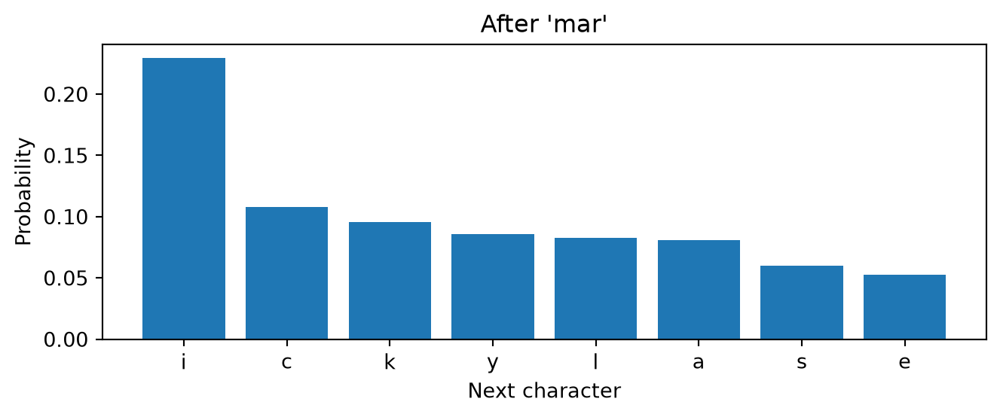

# From next-character prediction to name generation (optional)

A companion to Lectures 14 and 15

Author

Marcel Turcotte

Published

November 11, 2026

**This material will not appear on course tests.**

How could a classifier invent a name? Train it to predict the next character, sample from its prediction, and use that character to make the next prediction.

Students often ask whether CSI 4106 covers large language models (LLMs). Studying language models in depth draws on representation learning, word embeddings, recurrent neural networks, transformers, pretraining, and fine-tuning. These notebooks use the feedforward and convolutional networks from Lectures 14 and 15 to illustrate **self-supervised learning** and **autoregressive generation**, two ideas behind LLMs.

The second notebook applies the same approach to passages from Shakespeare. [Tiny Shakespeare notebook](https://turcotte.xyz/teaching/csi-4106/lectures/15/shakespeare_generation.html)

## From a name to training examples

A context holds the characters that precede the target. At the start of a name, fill the context with `.`. After the last letter, use `.` as the target so the model can learn when to stop. With a context of three characters, `emma` gives these examples.

| Context | Target |
|---------|--------|
| `...`   | `e`    |
| `..e`   | `m`    |
| `.em`   | `m`    |
| `emm`   | `a`    |
| `mma`   | `.`    |

The names provide their own prediction targets, including the boundary we add after each name. This is **self-supervised learning**.

## Prepare the data

Run from a fresh kernel with NumPy, Matplotlib, and TensorFlow with Keras. The setup loads distinct spellings from a list drawn from 2018 US Social Security Administration data. It uses the bundled file or downloads the pinned copy. We split whole names before building contexts so all examples from each name stay together. [makemore dataset](https://github.com/karpathy/makemore)

Show setup and data loading

``` python
import os
os.environ["KERAS_BACKEND"] = "tensorflow"

from pathlib import Path

import numpy as np
import matplotlib.pyplot as plt
import tensorflow as tf
from tensorflow import keras

SEED = 42
CONTEXT_LENGTH = 8
HIDDEN_UNITS = 128
FILTERS = 32
KERNEL_SIZE = 3
EPOCHS = 12
BATCH_SIZE = 256
LEARNING_RATE = 0.003

keras.utils.set_random_seed(SEED)
print(f"TensorFlow {tf.__version__}, Keras backend: {keras.backend.backend()}")

DATA_URL = (
    "https://raw.githubusercontent.com/karpathy/makemore/"
    "988aa59e4d8fefa526d06f3b453ad116258398d4/names.txt"
)
DATA_HASH = "0a30b5557f192f32ab962680889aac5f6fda0f4cecf40a6d0b5694f58ea8cc4d"
data_path = keras.utils.get_file(
    fname="makemore_names.txt", origin=DATA_URL, file_hash=DATA_HASH,
    cache_dir=".", cache_subdir="data"
)
raw_names = Path(data_path).read_text(encoding="utf-8").splitlines()
names = np.array(sorted(set(raw_names)))

rng = np.random.default_rng(SEED)
names = rng.permutation(names)
train_end = int(0.8 * len(names))
valid_end = int(0.9 * len(names))
train_names = names[:train_end]
valid_names = names[train_end:valid_end]
test_names = names[valid_end:]

print(f"Whole-name split: {len(train_names):,} training, "
      f"{len(valid_names):,} validation, {len(test_names):,} test")
```

    TensorFlow 2.21.0, Keras backend: tensorflow
    Whole-name split: 23,595 training, 2,949 validation, 2,950 test

The model uses eight characters of context. Each character has an integer ID and a one-hot vector, with one entry set to 1. The input shape `(8, 27)` gives eight positions and 27 channels for the letters and `.`. The target is the ID of the following character.

``` python
vocabulary = ".abcdefghijklmnopqrstuvwxyz"
VOCAB_SIZE = len(vocabulary)
char_to_id = {char: index for index, char in enumerate(vocabulary)}
BOUNDARY = char_to_id["."]

def make_examples(words, context_length):
    contexts, targets = [], []
    for word in words:
        context = [BOUNDARY] * context_length
        for char in word + ".":
            target = char_to_id[char]
            contexts.append(context)
            targets.append(target)
            context = context[1:] + [target]
    return np.asarray(contexts, dtype="int32"), np.asarray(targets, dtype="int32")

train_contexts, y_train = make_examples(train_names, CONTEXT_LENGTH)
valid_contexts, y_valid = make_examples(valid_names, CONTEXT_LENGTH)
test_contexts, y_test = make_examples(test_names, CONTEXT_LENGTH)

one_hot = np.eye(VOCAB_SIZE, dtype="float32")
X_train = one_hot[train_contexts]
X_valid = one_hot[valid_contexts]
X_test = one_hot[test_contexts]
print("Training inputs:", X_train.shape, "Targets:", y_train.shape)
```

    Training inputs: (168962, 8, 27) Targets: (168962,)

## Predict the next character

The feedforward model flattens the context, applies a ReLU layer, and returns a logit for each possible next character. Cross-entropy rewards the model for assigning high probability to the observed next character. The targets are integer IDs and Keras receives the logits directly.

An influential neural language model used a fixed number of preceding words and learned word vectors jointly with its prediction network. Here we apply that fixed-context idea to one-hot characters. [Bengio, Ducharme, Vincent, and Jauvin (2003)](https://www.jmlr.org/papers/v3/bengio03a.html)

``` python
mlp = keras.Sequential([
    keras.layers.Input(shape=(CONTEXT_LENGTH, VOCAB_SIZE)),
    keras.layers.Flatten(),
    keras.layers.Dense(HIDDEN_UNITS, activation="relu"),
    keras.layers.Dense(VOCAB_SIZE)
], name="feedforward")

def train_model(model):
    model.compile(
        optimizer=keras.optimizers.Adam(learning_rate=LEARNING_RATE),
        loss=keras.losses.SparseCategoricalCrossentropy(from_logits=True)
    )
    model.fit(
        X_train, y_train, validation_data=(X_valid, y_valid),
        epochs=EPOCHS, batch_size=BATCH_SIZE, shuffle=True, verbose=0
    )
    print(f"{model.name}: {model.count_params():,} parameters")

train_model(mlp)
```

    feedforward: 31,259 parameters

Which character might come after `mar`? Softmax turns the scores into a probability distribution. The `end` bar represents the boundary symbol.

``` python
def next_probabilities(model, prefix, temperature=1.0):
    context = [BOUNDARY] * CONTEXT_LENGTH + [char_to_id[char] for char in prefix]
    context = np.array([context[-CONTEXT_LENGTH:]], dtype="int32")
    logits = model(one_hot[context], training=False)
    probabilities = keras.ops.softmax(logits / temperature, axis=-1)
    return keras.ops.convert_to_numpy(probabilities)[0]
```

Show probability plot code

``` python
prompt = "mar"
probabilities = next_probabilities(mlp, prompt)
top = np.argsort(probabilities)[-8:][::-1]
labels = ["end" if index == BOUNDARY else vocabulary[index] for index in top]
fig, ax = plt.subplots(figsize=(7, 3))
ax.bar(labels, probabilities[top])
ax.set(xlabel="Next character", ylabel="Probability", title=f"After '{prompt}'")
fig.tight_layout()
plt.show()
```



## Sample a name

During training, the context comes from the data. During generation, append a sampled character and use the most recent eight characters to predict again. This feedback loop is **autoregressive generation**. Each name ends when we sample `.` or reach the limit on new characters.

``` python
def generate_name(model, rng, prefix, temperature=1.0, max_new_characters=24):
    name = prefix
    for _ in range(max_new_characters):
        probabilities = next_probabilities(model, name, temperature)
        token = rng.choice(VOCAB_SIZE, p=probabilities)
        if token == BOUNDARY:
            break
        name += vocabulary[token]
    return name

def show_samples(model, prefix, temperature=1.0, count=6):
    rng = np.random.default_rng(SEED)
    names = [generate_name(model, rng, prefix, temperature) for _ in range(count)]
    print(f"{model.name}: {', '.join(names)}")

show_samples(mlp, prompt)
```

    feedforward: marritl, marymi, mariclio, mareles, marriyah, mariaan

## Add a one-dimensional convolution

A width-three filter looks for patterns in neighboring characters and reuses its weights across the context. The convolution turns `(8, 27)` into `(6, 32)`. Flattening keeps the positions of the filter responses available to the Dense layers. Both models train for twelve epochs on the same examples.

``` python
keras.utils.set_random_seed(SEED)
cnn = keras.Sequential([
    keras.layers.Input(shape=(CONTEXT_LENGTH, VOCAB_SIZE)),
    keras.layers.Conv1D(FILTERS, KERNEL_SIZE, padding="valid", activation="relu"),
    keras.layers.Flatten(),
    keras.layers.Dense(HIDDEN_UNITS, activation="relu"),
    keras.layers.Dense(VOCAB_SIZE)
], name="convolutional")

train_model(cnn)
show_samples(cnn, prompt)
```

    convolutional: 30,811 parameters
    convolutional: marrish, marylyn, mariyah, marchar, marquovi, maria

## Try a different sampling temperature

The preceding samples use temperature 1. A lower temperature concentrates probability on the leading choices, while a higher one spreads it out. Which setting produces more varied continuations of `mar`?

``` python
for temperature in (0.6, 1.4):
    print(f"Temperature {temperature}")
    show_samples(mlp, prompt, temperature=temperature)
```

    Temperature 0.6
    feedforward: marley, marcylie, marius, marian, marose, marynn
    Temperature 1.4
    feedforward: marshos, marynn, marietti, marelas, marrhyni, marj

## Compare held-out predictions

The table reports cross-entropy in nats per target on the same held-out names for both networks. Lower is better. The bigram reference predicts the next character from counts of what follows the previous character in training.

Show final evaluation code

``` python
bigram_counts = np.ones((VOCAB_SIZE, VOCAB_SIZE))
np.add.at(bigram_counts, (train_contexts[:, -1], y_train), 1)
bigram_probabilities = bigram_counts / bigram_counts.sum(axis=1, keepdims=True)
bigram_test_loss = -np.log(bigram_probabilities[test_contexts[:, -1], y_test]).mean()

test_losses = {"Bigram": bigram_test_loss}
for label, model in (("Feedforward", mlp), ("Conv1D", cnn)):
    test_losses[label] = model.evaluate(X_test, y_test, batch_size=BATCH_SIZE, verbose=0)

print(f"{'Model':<15} {'Test cross-entropy (nats/target)':>33}")
for label, loss in test_losses.items():
    print(f"{label:<15} {loss:>33.3f}")
```

    Model            Test cross-entropy (nats/target)
    Bigram                                      2.449
    Feedforward                                 2.049
    Conv1D                                      2.051

## References

- Bengio, Y., Ducharme, R., Vincent, P., and Jauvin, C. (2003). *Journal of Machine Learning Research*, **3**, 1137–1155. [A Neural Probabilistic Language Model](https://www.jmlr.org/papers/v3/bengio03a.html).
- Karpathy, A. [makemore](https://github.com/karpathy/makemore).
