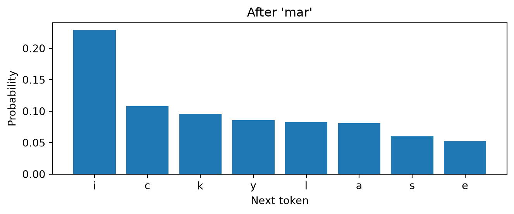
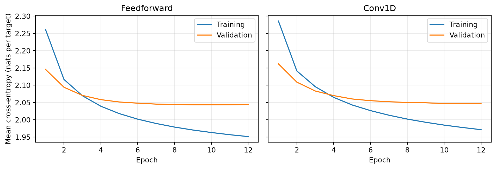

# From next-character prediction to name generation

A companion to Lectures 14 and 15

Author

Marcel Turcotte

Published

November 5, 2026

How could a classifier invent a name? Instead of asking it to choose a complete name, ask it to predict **one character at a time**. Its output is a distribution over possible next characters. Sampling from that distribution repeatedly turns the classifier into a generator.

This self-study notebook connects Lecture 14’s multiclass classification and cross-entropy to Lecture 15’s one-dimensional convolutions. We first train a feedforward neural network, then replace its first layer with `Conv1D`. Both models use the same examples, objective, training budget, and generation code.

By the end, you should be able to construct next-character training examples, explain autoregressive generation, distinguish training from sampling, and describe how context length and temperature affect the result.

## A research foundation: neural probabilistic language models

[Bengio, Ducharme, Vincent, and Jauvin (2003)](https://www.jmlr.org/papers/v3/bengio03a.html) developed an influential **neural probabilistic language model**. Their feedforward network takes a fixed number of preceding **words**, looks up a learned vector for each word, concatenates those vectors, and predicts a softmax distribution over the next word. Training jointly learns the word vectors and the prediction network by increasing the probability assigned to observed text.

The learned word vectors are **distributed representations**: a word is described by several learned numerical coordinates. Sharing this representation across contexts helps the model generalize beyond exact word sequences seen during training. This is a central contribution of the paper.

Our feedforward model follows its **fixed-context neural prediction principle**, with deliberate simplifications. We predict characters rather than words, use fixed one-hot character vectors rather than learned word embeddings, and use a ReLU hidden layer rather than the paper’s `tanh` layer. This is a teaching adaptation, rather than a reproduction of the original architecture or results. An embedding layer would be a natural later extension: it replaces each token’s one-hot vector with a learned vector selected from a shared matrix.

## Preparation

Run this notebook from a fresh kernel, in order. It requires NumPy, Matplotlib, and TensorFlow with Keras. The setup selects **TensorFlow as the Keras backend** before importing the framework. Training is small enough to explore on a CPU; the measured time will depend on the machine.

``` python
import os
os.environ["KERAS_BACKEND"] = "tensorflow"

from pathlib import Path
from time import perf_counter

import numpy as np
import matplotlib.pyplot as plt
import tensorflow as tf
from tensorflow import keras

SEED = 42
CONTEXT_LENGTH = 8
HIDDEN_UNITS = 128
FILTERS = 32
KERNEL_SIZE = 3
EPOCHS = 12
BATCH_SIZE = 256
LEARNING_RATE = 0.003

keras.utils.set_random_seed(SEED)
print(f"TensorFlow {tf.__version__}; Keras backend: {keras.backend.backend()}")
```

    TensorFlow 2.21.0; Keras backend: tensorflow

## Names as a training corpus

We use the names file from Andrej Karpathy’s [makemore project](https://github.com/karpathy/makemore). Its README attributes the names to US Social Security Administration data for 2018. The file contains 32,033 entries, including repeated names. These are a particular collection of spellings, rather than a representative sample of all names or languages. Each distinct spelling is included once; longer names contribute more next-character targets. We are not modeling population frequencies.

The course copy is in `data/makemore_names.txt`. If the notebook is downloaded without that file, Keras downloads it into the current directory’s `data` folder. A fixed repository revision and SHA-256 checksum identify the data.

``` python
DATA_URL = (
    "https://raw.githubusercontent.com/karpathy/makemore/"
    "988aa59e4d8fefa526d06f3b453ad116258398d4/names.txt"
)
DATA_HASH = "0a30b5557f192f32ab962680889aac5f6fda0f4cecf40a6d0b5694f58ea8cc4d"
data_path = keras.utils.get_file(
    fname="makemore_names.txt", origin=DATA_URL, file_hash=DATA_HASH,
    cache_dir=".", cache_subdir="data"
)
raw_names = Path(data_path).read_text(encoding="utf-8").splitlines()
names = np.array(sorted(set(raw_names)))

rng = np.random.default_rng(SEED)
names = rng.permutation(names)
train_end = int(0.8 * len(names))
valid_end = int(0.9 * len(names))
train_names = names[:train_end]
valid_names = names[train_end:valid_end]
test_names = names[valid_end:]

print(f"File entries: {len(raw_names):,}; distinct names: {len(names):,}")
print(f"Whole-name split: {len(train_names):,} training, "
      f"{len(valid_names):,} validation, {len(test_names):,} test")
print("Some training names:", ", ".join(train_names[:12]))
```

    File entries: 32,033; distinct names: 29,494
    Whole-name split: 23,595 training, 2,949 validation, 2,950 test
    Some training names: tayma, adaiah, sirus, camilla, universe, carlynn, airabella, alakai, cowan, leighland, yenifer, penny

We remove duplicates and split **whole names before constructing windows**. Otherwise, different overlapping windows from the same name could occur in both training and evaluation data. Validation loss helps us inspect learning; the test set is reserved for the final comparison. The twelve-epoch budget and both architectures are specified in advance.

## A token, a context, and a target

A **token** is one unit in the sequence. Here, tokens are lowercase letters plus a boundary symbol, `.`. The vocabulary is fixed in advance, so it does not need to be learned from the held-out names. Character IDs are labels, with no meaningful numerical distance between them.

At the beginning of a name, we fill the context with boundary symbols. During training, a boundary symbol **as a target** means that the name has ended. During generation, sampling it stops the name. The same symbol serves both purposes, as in many character-level names examples.

For example, with a three-character context, `emma` supplies five examples:

| Context | Target |
|---------|--------|
| `...`   | `e`    |
| `..e`   | `m`    |
| `.em`   | `m`    |
| `emm`   | `a`    |
| `mma`   | `.`    |

Each name supplies one target per letter plus an end target. The text itself supplies the labels: **self-supervised learning** creates a prediction task from observed data without separately annotating the desired next token.

``` python
vocabulary = ".abcdefghijklmnopqrstuvwxyz"
VOCAB_SIZE = len(vocabulary)
char_to_id = {char: index for index, char in enumerate(vocabulary)}

def make_examples(words, context_length):
    contexts, targets = [], []
    for word in words:
        context = [0] * context_length
        for char in word + ".":
            target = char_to_id[char]
            contexts.append(context)
            targets.append(target)
            context = context[1:] + [target]
    return np.asarray(contexts, dtype="int32"), np.asarray(targets, dtype="int32")

example_contexts, example_targets = make_examples(["emma"], 3)
for context, target in zip(example_contexts, example_targets):
    print("".join(vocabulary[index] for index in context), "->", vocabulary[target])

train_contexts, y_train = make_examples(train_names, CONTEXT_LENGTH)
valid_contexts, y_valid = make_examples(valid_names, CONTEXT_LENGTH)
test_contexts, y_test = make_examples(test_names, CONTEXT_LENGTH)

one_hot = np.eye(VOCAB_SIZE, dtype="float32")
X_train = one_hot[train_contexts]
X_valid = one_hot[valid_contexts]
X_test = one_hot[test_contexts]
print("Training inputs:", X_train.shape, "Targets:", y_train.shape)
```

    ... -> e
    ..e -> m
    .em -> m
    emm -> a
    mma -> .
    Training inputs: (168962, 8, 27) Targets: (168962,)

Each input has shape `(8, 27)`: eight positions, each with 27 character channels. One channel is 1 at each position, and the others are 0. A batch has shape `(batch_size, 8, 27)`. This is the same one-hot sequence representation used for the four nucleotide channels in the biological-sequence companion.

We may shuffle training windows because each window is a complete prediction example. The order **within** each window is preserved.

## Feedforward prediction

The first model flattens the context into a vector, computes a ReLU hidden layer, and returns one **logit**, or unnormalized score, for each possible next character. Flattening retains the order through the fixed vector positions.

The training loss for an observed target character c_t is

\ell_t = -\log p\_\theta(c_t \mid c\_{t-k},\ldots,c\_{t-1}),

where k is the context length and \theta contains the network’s parameters. The mean loss J averages over training targets. Assigning greater probability to the observed next character lowers the loss.

`SparseCategoricalCrossentropy` accepts integer class IDs as targets. With `from_logits=True`, Keras combines softmax and cross-entropy stably. There is no separate softmax layer during training. Keras computes the gradients and Adam uses them to update the parameters; NumPy prepares the examples.

``` python
mlp = keras.Sequential([
    keras.layers.Input(shape=(CONTEXT_LENGTH, VOCAB_SIZE)),
    keras.layers.Flatten(),
    keras.layers.Dense(HIDDEN_UNITS, activation="relu"),
    keras.layers.Dense(VOCAB_SIZE)
], name="feedforward")

def train_model(model):
    model.compile(
        optimizer=keras.optimizers.Adam(learning_rate=LEARNING_RATE),
        loss=keras.losses.SparseCategoricalCrossentropy(from_logits=True)
    )
    start = perf_counter()
    history = model.fit(
        X_train, y_train, validation_data=(X_valid, y_valid),
        epochs=EPOCHS, batch_size=BATCH_SIZE, shuffle=True, verbose=0
    )
    print(f"{model.name}: {model.count_params():,} parameters; "
          f"{perf_counter() - start:.1f} s training")
    return history

mlp_history = train_model(mlp)
```

    feedforward: 31,259 parameters; 6.8 s training

## Inspect the next-character distribution

Before generating a complete name, inspect one prediction. Which characters would you expect after `mar`? Several next characters can be reasonable even though each training example has only one observed target.

``` python
def next_probabilities(model, prefix, temperature=1.0):
    context = ([0] * CONTEXT_LENGTH + [char_to_id[char] for char in prefix])
    context = np.array([context[-CONTEXT_LENGTH:]], dtype="int32")
    logits = model(one_hot[context], training=False)
    probabilities = keras.ops.softmax(logits / temperature, axis=-1)
    return keras.ops.convert_to_numpy(probabilities)[0]

prefix = "mar"
probabilities = next_probabilities(mlp, prefix)
top = np.argsort(probabilities)[-8:][::-1]
labels = ["end" if vocabulary[index] == "." else vocabulary[index] for index in top]
fig, ax = plt.subplots(figsize=(7, 3))
ax.bar(labels, probabilities[top])
ax.set(xlabel="Next token", ylabel="Probability", title=f"After '{prefix}'")
fig.tight_layout()
plt.show()
```



## Autoregressive generation

An **autoregressive model** predicts each token from preceding tokens. To generate a name, sample a next character, append it, and predict again. The same trained network is reused at every step. Its parameters remain fixed throughout generation.

During training, contexts contain observed letters from the data. During generation, they also contain the model’s previous sampled letters. An unfortunate prediction can therefore change all subsequent predictions.

The generation loop stops at `.` or at an explicit length limit. A prefix prompts the model with an existing beginning; all prefix characters must be lowercase letters from the vocabulary.

``` python
def generate_name(model, rng, prefix="", temperature=1.0, max_new_characters=24):
    name = prefix
    for _ in range(max_new_characters):
        probabilities = next_probabilities(model, name, temperature)
        token = rng.choice(VOCAB_SIZE, p=probabilities)
        if token == 0:
            return name, True
        name += vocabulary[token]
    return name, False

def show_samples(model, prefix="", temperature=1.0, count=12):
    rng = np.random.default_rng(SEED)
    samples = [generate_name(model, rng, prefix, temperature) for _ in range(count)]
    print(", ".join((name or "<empty>") + ("" if ended else " [length limit]")
                    for name, ended in samples))
    return samples

mlp_samples = show_samples(mlp)
print("\nContinuations of 'mar':")
show_samples(mlp, prefix="mar", count=6);
```

    petrayco, jaynna, kavionnie, jafiry, gialiana, mattella, ashon, kairelli, kadelyn, akennie, rabar, brayleigh

    Continuations of 'mar':
    marritl, marymi, mariclio, mareles, marriyah, mariaan

## Sampling temperature

For logits z_j and temperature T\>0, the sampling probabilities are

p_j(T)=\frac{\exp(z_j/T)}{\sum_i\exp(z_i/T)}.

At T=1, we sample from the model’s predicted distribution. Lower temperatures concentrate probability on high-scoring choices; higher temperatures flatten the distribution. Temperature changes sampling, without retraining the network. Greedy decoding always chooses a largest logit; it is a separate deterministic decoding rule.

Before running the cell, predict which temperature will yield more varied spellings. Does greater variety necessarily improve plausibility?

``` python
for temperature in (0.6, 1.0, 1.4):
    print(f"Temperature {temperature}:")
    show_samples(mlp, temperature=temperature, count=6)
```

    Temperature 0.6:
    mark, wilen, shera, arlien, marachin, dalani
    Temperature 1.0:
    petrayco, jaynna, kavionnie, jafiry, gialiana, mattella
    Temperature 1.4:
    rhyobync, jaynnbel, slonylia, adniya, jadien, soluth

## Introduce a one-dimensional convolution

The second model receives exactly the same `(8, 27)` inputs. A width-three kernel examines three neighboring characters, across all 27 channels. Each filter reuses its weights at every valid position. With 32 filters and no padding, the resulting shape is `(6, 32)` for each example.

`Flatten` preserves the locations of these responses before the Dense layers combine them. A local pattern near the final character can influence the prediction differently from the same pattern near the start of the context. The Dense prediction head can use information from the whole eight-character window, even though each individual convolutional response sees three positions.

Every input window contains **only characters preceding its one target**. Consequently, ordinary `padding="valid"` does not expose future characters. If we instead predicted the next character at every position of a complete sequence, we would need causal convolutions or another constraint preventing each prediction from using later characters. See the [Keras Conv1D documentation](https://keras.io/api/layers/convolution_layers/convolution1d/).

``` python
keras.utils.set_random_seed(SEED)
cnn = keras.Sequential([
    keras.layers.Input(shape=(CONTEXT_LENGTH, VOCAB_SIZE)),
    keras.layers.Conv1D(FILTERS, KERNEL_SIZE, padding="valid", activation="relu"),
    keras.layers.Flatten(),
    keras.layers.Dense(HIDDEN_UNITS, activation="relu"),
    keras.layers.Dense(VOCAB_SIZE)
], name="convolutional")

cnn_history = train_model(cnn)
cnn_samples = show_samples(cnn)
```

    convolutional: 30,811 parameters; 9.4 s training
    pessatus, jaymon, kavir, yusek, anny, gianm, matteus, dega, roskel, angelise, alanna, darklynn

At the default settings, the MLP has 31,259 parameters and the CNN has 30,811. Both receive the same number of mini-batch updates. Their internal computations and elapsed times differ. This is a focused illustration of two architectures under similar budgets; one run cannot establish that either is generally better.

## Follow learning and evaluate once

Cross-entropy measures the probability assigned to observed next characters, which matters when several next letters are plausible. We report it in **nats per target** because the loss uses natural logarithms. The average includes end-of-name targets and weights every target equally, so longer names contribute more targets.

The training curves show the losses recorded during optimization. Validation loss is measured after each epoch with the resulting parameters. A widening gap can indicate overfitting; additional epochs need not improve generalization.

``` python
fig, axes = plt.subplots(1, 2, figsize=(10, 3.5), sharey=True)
for ax, history, title in zip(
    axes, (mlp_history, cnn_history), ("Feedforward", "Conv1D")
):
    epochs = np.arange(1, len(history.history["loss"]) + 1)
    ax.plot(epochs, history.history["loss"], label="Training")
    ax.plot(epochs, history.history["val_loss"], label="Validation")
    ax.set(title=title, xlabel="Epoch")
    ax.legend()
    ax.grid(alpha=0.25)
axes[0].set_ylabel("Mean cross-entropy (nats per target)")
fig.tight_layout()
plt.show()
```



For a simple reference, a **bigram model** uses only the immediately preceding character. We count adjacent token pairs in the training examples and add one to every count, so unseen pairs still receive positive probability. This baseline learns from the same training names without a neural network.

The final table evaluates the two networks after the predeclared twelve epochs. **Perplexity** is \exp(J): a lower value indicates less uncertainty under this loss. It is meaningful to compare these values here because the models use identical tokens and test examples. It is not a score for how convincing a generated name sounds.

``` python
bigram_counts = np.ones((VOCAB_SIZE, VOCAB_SIZE))
np.add.at(bigram_counts, (train_contexts[:, -1], y_train), 1)
bigram_probabilities = bigram_counts / bigram_counts.sum(axis=1, keepdims=True)
bigram_test_loss = -np.log(bigram_probabilities[test_contexts[:, -1], y_test]).mean()

test_losses = {"Bigram": bigram_test_loss}
for label, model in (("Feedforward", mlp), ("Conv1D", cnn)):
    test_losses[label] = model.evaluate(X_test, y_test, batch_size=BATCH_SIZE, verbose=0)

print(f"{'Model':<15} {'Test cross-entropy':>20} {'Perplexity':>12}")
for label, loss in test_losses.items():
    print(f"{label:<15} {loss:>20.3f} {np.exp(loss):>12.2f}")
```

    Model             Test cross-entropy   Perplexity
    Bigram                         2.449        11.57
    Feedforward                    2.049         7.76
    Conv1D                         2.051         7.77

## Does generation reproduce training names?

A generated spelling may be present in the training set, present only in a held-out set, or absent from the corpus. Here we check only whether a completed sample occurs in the training set. Being absent does not by itself establish plausibility, originality outside this corpus, or successful generalization. These small samples illustrate the distinction rather than estimate a reliable novelty rate.

``` python
training_spellings = set(train_names)
for label, samples in (("Feedforward", mlp_samples), ("Conv1D", cnn_samples)):
    completed = [name for name, ended in samples if ended and name]
    reproduced = sum(name in training_spellings for name in completed)
    print(f"{label}: {reproduced} of {len(completed)} completed, nonempty samples "
          "occur in the training set")
```

    Feedforward: 2 of 12 completed, nonempty samples occur in the training set
    Conv1D: 4 of 12 completed, nonempty samples occur in the training set

## A concrete limit on memory

Both models see only the final eight characters of a sufficiently long prefix. Two prefixes with identical final contexts must therefore produce identical next-character distributions. Their earlier characters cannot affect that prediction, regardless of training time or model confidence.

``` python
prefix_a, prefix_b = "annamarie", "joannamarie"
print("Visible suffix:", prefix_a[-CONTEXT_LENGTH:])
for model in (mlp, cnn):
    difference = np.max(np.abs(next_probabilities(model, prefix_a)
                               - next_probabilities(model, prefix_b)))
    print(f"{model.name}: largest probability difference = {difference:.1e}")
```

    Visible suffix: nnamarie
    feedforward: largest probability difference = 0.0e+00
    convolutional: largest probability difference = 0.0e+00

## What carries over to large language models?

The central mechanism carries over: tokens form contexts, a network predicts next-token logits, cross-entropy trains those predictions, and repeated sampling generates a continuation. A prompt supplies initial tokens. During ordinary generation the learned parameters are fixed, while the visible context changes.

Our toy model learns spelling patterns in a restricted corpus. Modern autoregressive transformer language models use learned token representations and attention to combine information within a much larger context; their tokens often represent pieces of words. Their scale, data, architecture, and subsequent instruction training support capabilities that this experiment does not test. Understanding our generator establishes the prediction-and-generation mechanism; explaining attention and instruction-following requires additional material.

## Experiments to try

1.  Change the context length to 3 or 5, restart the kernel, and rerun the training and sampling cells, skipping the final test-evaluation cell. Compare validation loss and samples before drawing conclusions. Changing context length also changes the parameter counts in these architectures.
2.  Generate several continuations of the same prefix. Explain why repeated sampling can produce different names from fixed parameters.
3.  Replace sampling with greedy decoding. Compare diversity and repeated outputs.
4.  Change the convolutional kernel width while keeping it no larger than the context. Predict the feature-map shape before running the model.

Use the validation set for these choices. Skip the cell that computes the final test table while experimenting, then run it once after deciding on settings. Repeated selection based on test results turns the test set into another validation set.

## References

- Bengio, Y., Ducharme, R., Vincent, P., and Jauvin, C. (2003). [A Neural Probabilistic Language Model](https://www.jmlr.org/papers/v3/bengio03a.html). *Journal of Machine Learning Research*, **3**, 1137–1155. The fixed-context feedforward approach and jointly learned word representations are developed in Section 2 and Figure 1.
- Karpathy, A. [makemore](https://github.com/karpathy/makemore). Educational autoregressive names models and the source of our data. The dataset revision and checksum are specified in the loading cell above.
