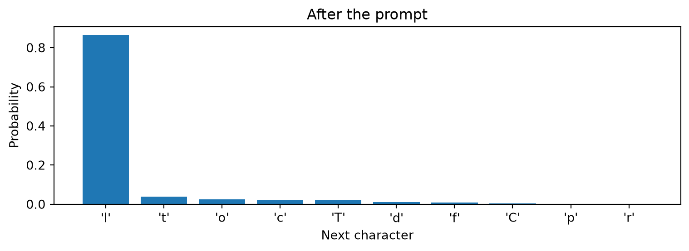
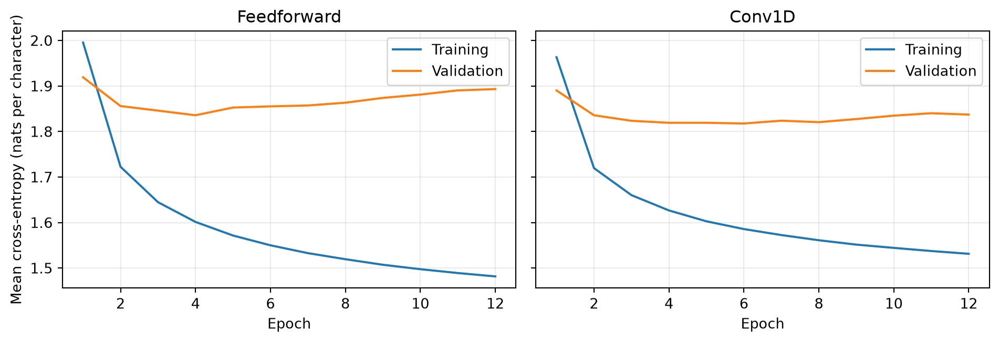

# Learning to generate text, one character at a time

A Tiny Shakespeare companion to Lectures 14 and 15

Author

Marcel Turcotte

Published

November 5, 2026

How much of a play could a network learn by predicting its next character? Spaces, word spellings, speaker labels, and the meaning of a conversation all operate at different scales. We will train two small networks and inspect which of these patterns emerge.

This independently executable self-study notebook connects Lecture 14’s multiclass classification and cross-entropy to Lecture 15’s one-dimensional convolutions. We first use a feedforward neural network, then a `Conv1D` network. Both learn from the same text, predict one character after a fixed context, and use the same generation procedure.

The learning objectives are to construct next-character examples, explain autoregressive text generation, compare dense and convolutional processing of a context, and distinguish plausible local text from sustained coherence.

## Research foundation

[Bengio, Ducharme, Vincent, and Jauvin (2003)](https://www.jmlr.org/papers/v3/bengio03a.html) developed an influential neural probabilistic language model. A feedforward network receives a fixed number of preceding words and predicts the next word. The original model jointly learns a shared vector representation for each word and a prediction network operating on the concatenated vectors. These learned representations help transfer information between different word contexts.

We adapt its **fixed-context neural prediction principle**. Our tokens are characters, our inputs are fixed one-hot vectors, and our hidden activation is ReLU rather than the paper’s `tanh`. The experiment does not reproduce its learned word embeddings or its reported results. It lets us examine the prediction-and-generation mechanism using the layers already studied.

## Preparation

Run from a fresh kernel, in order. NumPy, Matplotlib, and TensorFlow with Keras are required. Select the TensorFlow backend before importing the framework. The default experiment uses the whole corpus and trains two networks; it takes longer than a short names experiment. Each training call reports its elapsed time.

``` python
import os
os.environ["KERAS_BACKEND"] = "tensorflow"

from pathlib import Path
from time import perf_counter

import numpy as np
import matplotlib.pyplot as plt
import tensorflow as tf
from tensorflow import keras

SEED = 42
CONTEXT_LENGTH = 32
HIDDEN_UNITS = 128
FILTERS = 64
KERNEL_SIZE = 3
EPOCHS = 12
BATCH_SIZE = 256
LEARNING_RATE = 0.003

keras.utils.set_random_seed(SEED)
print(f"TensorFlow {tf.__version__}; Keras backend: {keras.backend.backend()}")
```

    TensorFlow 2.21.0; Keras backend: tensorflow

## The corpus and its partitions

**Tiny Shakespeare** is a subset of Shakespeare’s works distributed with Andrej Karpathy’s [char-rnn project](https://github.com/karpathy/char-rnn#data). It contains approximately 1.1 million characters. Preserve capitalization, punctuation, spaces, and newlines: each is part of what the network must learn. A period is an ordinary character, rather than a special instruction to stop.

The course copy is `data/tiny_shakespeare.txt`. If it is absent, Keras downloads the same corpus into the current directory’s `data` folder. A fixed source revision and SHA-256 checksum identify the file.

``` python
DATA_URL = (
    "https://raw.githubusercontent.com/karpathy/char-rnn/"
    "6f9487a6fe5b420b7ca9afb0d7c078e37c1d1b4e/data/tinyshakespeare/input.txt"
)
DATA_HASH = "86c4e6aa9db7c042ec79f339dcb96d42b0075e16b8fc2e86bf0ca57e2dc565ed"
data_path = keras.utils.get_file(
    fname="tiny_shakespeare.txt", origin=DATA_URL, file_hash=DATA_HASH,
    cache_dir=".", cache_subdir="data"
)
text = Path(data_path).read_text(encoding="utf-8")
train_end = int(0.8 * len(text))
valid_end = int(0.9 * len(text))
train_text = text[:train_end]
valid_text = text[train_end:valid_end]
test_text = text[valid_end:]

print(f"Corpus: {len(text):,} characters")
print(f"Partitions: {len(train_text):,} training, "
      f"{len(valid_text):,} validation, {len(test_text):,} test")
print("\nBeginning of the training text:\n")
print(train_text[:350])
```

    Corpus: 1,115,394 characters
    Partitions: 892,315 training, 111,539 validation, 111,540 test

    Beginning of the training text:

    First Citizen:
    Before we proceed any further, hear me speak.

    All:
    Speak, speak.

    First Citizen:
    You are all resolved rather to die than to famish?

    All:
    Resolved. resolved.

    First Citizen:
    First, you know Caius Marcius is chief enemy to the people.

    All:
    We know't, we know't.

    First Citizen:
    Let us kill him, and we'll have corn at our own price.
    I

We split the continuous text into **contiguous 80%, 10%, and 10% blocks before constructing windows**. No context or target will cross a partition boundary. Randomly splitting overlapping windows would place nearly identical passages in training and evaluation data.

These blocks need not contain the same characters, topics, or speakers in the same proportions. Evaluation asks how well the model predicts later held-out text from this compilation; it is not a test on independent authors or genres. Validation curves are available during development. The test block is reserved for the final evaluation of the specified experiment.

## Character IDs and one-hot inputs

A **token** is one unit in a sequence. Here each character is a token, including spaces and newlines. Build the vocabulary from the training block and reuse that mapping for validation, test, and generation. In this particular split, every held-out character also occurs in training.

Character IDs identify categories; their numerical distances have no meaning. One-hot encoding replaces each ID with a vector containing one 1 and otherwise 0s. This gives one channel per character type, as in the nucleotide-sequence representation in Lecture 15’s biological-sequence companion.

``` python
vocabulary = sorted(set(train_text))
VOCAB_SIZE = len(vocabulary)
char_to_id = {char: index for index, char in enumerate(vocabulary)}

def encode(passage):
    return np.array([char_to_id[char] for char in passage], dtype="int32")

train_ids = encode(train_text)
valid_ids = encode(valid_text)
test_ids = encode(test_text)

print("Vocabulary size:", VOCAB_SIZE)
print("Characters:", repr("".join(vocabulary)))
print("First twelve IDs:", train_ids[:12])
```

    Vocabulary size: 65
    Characters: "\n !$&',-.3:;?ABCDEFGHIJKLMNOPQRSTUVWXYZabcdefghijklmnopqrstuvwxyz"
    First twelve IDs: [18 47 56 57 58  1 15 47 58 47 64 43]

## Construct examples one batch at a time

At a starting position s, the next-character training example is

\underbrace{c_s,\ldots,c\_{s+k-1}}\_{\text{context of length }k} \quad\longrightarrow\quad c\_{s+k}.

Sliding the start one character to the right produces another example. The text supplies its own labels: this is **self-supervised learning**. Training contexts contain the actual preceding characters from the corpus.

At the default settings, each input has shape `(32, 65)`, and each target is one integer ID. Storing every overlapping input as a float32 one-hot array would require several gigabytes. Instead, store the text’s integer IDs and one starting index per example. Convert only the current batch to one-hot vectors.

The helper uses a [TensorFlow data pipeline](https://www.tensorflow.org/guide/data). It batches starting positions, gathers their contexts and targets, and converts the contexts to one-hot vectors. `prefetch` prepares upcoming batches while the model works on the current batch. Shuffling changes the order of complete examples while preserving character order within every context.

``` python
def make_dataset(token_ids, training=False):
    tokens = tf.constant(token_ids)
    starts = tf.data.Dataset.from_tensor_slices(
        np.arange(len(token_ids) - CONTEXT_LENGTH, dtype="int32")
    )
    if training:
        starts = starts.shuffle(len(token_ids) - CONTEXT_LENGTH, seed=SEED)

    def make_batch(start_positions):
        positions = start_positions[:, None] + tf.range(CONTEXT_LENGTH)[None, :]
        contexts = tf.gather(tokens, positions)
        targets = tf.gather(tokens, start_positions + CONTEXT_LENGTH)
        return tf.one_hot(contexts, depth=VOCAB_SIZE), targets

    return starts.batch(BATCH_SIZE).map(
        make_batch, num_parallel_calls=tf.data.AUTOTUNE
    ).prefetch(tf.data.AUTOTUNE)

valid_data = make_dataset(valid_ids)
example_inputs, example_targets = next(iter(make_dataset(train_ids)))
first_context = np.argmax(example_inputs[0].numpy(), axis=-1)
print("First context:", repr("".join(vocabulary[index] for index in first_context)))
print("Next character:", repr(vocabulary[int(example_targets[0])]))
print("Batch inputs:", example_inputs.shape, "Targets:", example_targets.shape)
```

    First context: 'First Citizen:\nBefore we proceed'
    Next character: ' '
    Batch inputs: (256, 32, 65) Targets: (256,)

The first k characters of each partition provide context but are not scored as targets. The two models use exactly the same evaluation targets. There is no beginning-of-text padding token or end-of-name token in this experiment.

## A feedforward next-character classifier

Flattening the input retains its positions in a fixed-length vector. A Dense hidden layer with ReLU combines all positions, and the output layer returns one **logit**, or unnormalized score, per possible next character.

For target c_t and parameters \theta, the loss is

\ell_t = -\log p\_\theta(c_t\mid c\_{t-k},\ldots,c\_{t-1}).

The mean loss J averages over targets. Assigning a greater probability to the observed next character lowers the loss. Keras accepts integer target IDs with `SparseCategoricalCrossentropy`. Its `from_logits=True` option combines the softmax calculation and cross-entropy stably; no separate softmax layer is needed during training.

``` python
mlp = keras.Sequential([
    keras.layers.Input(shape=(CONTEXT_LENGTH, VOCAB_SIZE)),
    keras.layers.Flatten(),
    keras.layers.Dense(HIDDEN_UNITS, activation="relu"),
    keras.layers.Dense(VOCAB_SIZE)
], name="feedforward")

def train_model(model):
    model.compile(
        optimizer=keras.optimizers.Adam(learning_rate=LEARNING_RATE),
        loss=keras.losses.SparseCategoricalCrossentropy(from_logits=True)
    )
    start = perf_counter()
    history = model.fit(
        make_dataset(train_ids, training=True), validation_data=valid_data,
        epochs=EPOCHS, verbose=2
    )
    print(f"{model.name}: {model.count_params():,} parameters; "
          f"{perf_counter() - start:.1f} s training")
    return history
```

## Turn the classifier into a generator

An **autoregressive model** predicts a token using preceding tokens. Generation samples a character, appends it, and repeats with the updated context. The weights remain fixed. Unlike training, generation consumes the model’s own previous predictions, so a poor choice changes the contexts that follow it.

The prompt must supply at least k characters, all from the training vocabulary. We use an actual training-text prefix rather than invent padding that the model has never seen. Once the context is full, only its final k characters affect the next prediction. Generation always produces a specified number of new characters; punctuation and newlines do not stop it.

``` python
PROMPT = train_text[:max(64, CONTEXT_LENGTH)]

def next_probabilities(model, prefix, temperature=1.0):
    context = encode(prefix[-CONTEXT_LENGTH:])[None, :]
    inputs = tf.one_hot(context, depth=VOCAB_SIZE)
    logits = model(inputs, training=False)
    probabilities = keras.ops.softmax(logits / temperature, axis=-1)
    return keras.ops.convert_to_numpy(probabilities)[0]

def generate_text(model, prefix, new_characters=400, temperature=0.8, seed=SEED):
    if len(prefix) < CONTEXT_LENGTH:
        raise ValueError("The prompt must contain at least CONTEXT_LENGTH characters.")
    rng = np.random.default_rng(seed)
    passage = prefix
    for _ in range(new_characters):
        probabilities = next_probabilities(model, passage, temperature)
        token = rng.choice(VOCAB_SIZE, p=probabilities)
        passage += vocabulary[token]
    return passage[len(prefix):]

print("Prompt:\n")
print(PROMPT)
print("\nUntrained continuation:\n")
print(generate_text(mlp, PROMPT, new_characters=160))
```

    Prompt:

    First Citizen:
    Before we proceed any further, hear me speak.

    Al

    Untrained continuation:

    lPqf,xkm.QLuboPBX$obkLysl?R!3dixILS?.RCePogHpmLGe3?
    mdglPW3-eRXkbXWF!OANpC$FGdWmeNn: 'gR:T3fOLHbJ'-xtfExlhPF,sQAGY?qjgObZc'N!TJ3,Z;uXJZ xRl'RTvYSEIUO os3W-eFeil

The untrained output is a reference for what learning must accomplish. Before training, predict which patterns will emerge first: spaces, whole words, speaker labels, or consistent meaning across sentences.

``` python
mlp_history = train_model(mlp)
print("\nFeedforward continuation after training (temperature 0.8):\n")
print(generate_text(mlp, PROMPT))
```

    Epoch 1/12

    /Users/turcotte/.virtualenvs/csi4106/lib/python3.12/site-packages/keras/src/trainers/epoch_iterator.py:74: UserWarning: `shuffle=True` was passed, but will be ignored since the data `x` was provided as a tf.data.Dataset. The Dataset is expected to already be shuffled (via `.shuffle(buffer_size)`).
      self.data_adapter = data_adapters.get_data_adapter(

    3486/3486 - 8s - 2ms/step - loss: 1.9955 - val_loss: 1.9192
    Epoch 2/12
    3486/3486 - 8s - 2ms/step - loss: 1.7225 - val_loss: 1.8559
    Epoch 3/12
    3486/3486 - 8s - 2ms/step - loss: 1.6448 - val_loss: 1.8459
    Epoch 4/12
    3486/3486 - 7s - 2ms/step - loss: 1.6014 - val_loss: 1.8358
    Epoch 5/12
    3486/3486 - 8s - 2ms/step - loss: 1.5716 - val_loss: 1.8527
    Epoch 6/12
    3486/3486 - 8s - 2ms/step - loss: 1.5501 - val_loss: 1.8553
    Epoch 7/12
    3486/3486 - 8s - 2ms/step - loss: 1.5329 - val_loss: 1.8572
    Epoch 8/12
    3486/3486 - 8s - 2ms/step - loss: 1.5195 - val_loss: 1.8633
    Epoch 9/12
    3486/3486 - 8s - 2ms/step - loss: 1.5073 - val_loss: 1.8739
    Epoch 10/12
    3486/3486 - 8s - 2ms/step - loss: 1.4976 - val_loss: 1.8811
    Epoch 11/12
    3486/3486 - 7s - 2ms/step - loss: 1.4891 - val_loss: 1.8904
    Epoch 12/12
    3486/3486 - 8s - 2ms/step - loss: 1.4817 - val_loss: 1.8932
    feedforward: 274,753 parameters; 90.9 s training

    Feedforward continuation after training (temperature 0.8):

    l: new, and steat the would beet
    Lest Tobsens. France, sish resties,
    Let hath my homb, if guil of cruretand blood,
    Which save in thus nawns live can Now nessaxe ther to the wailus.

    DORSET:
    Ye parns inia a bill of thank in werarge not;
    My brother in the for an their be a bird?
    O:
    Be my he sequir; one thou phese man, fron their fool--

    QUEEN ELIZABETH:
    My sous a tirrither caunts ushave as and
    Or le

## Inspect one next-character distribution

We can inspect a prediction rather than judging only a complete passage. Several next characters may be plausible even though an observed example has only one target. Spaces and newlines have their own probabilities.

``` python
probabilities = next_probabilities(mlp, PROMPT)
top = np.argsort(probabilities)[-10:][::-1]
labels = [repr(vocabulary[index]) for index in top]
fig, ax = plt.subplots(figsize=(8, 3))
ax.bar(labels, probabilities[top])
ax.set(xlabel="Next character", ylabel="Probability", title="After the prompt")
fig.tight_layout()
plt.show()
```



## Replace the first transformation with Conv1D

A width-three convolution examines local character triples and reuses each filter’s weights across positions. With 64 filters and valid padding, the default `(32, 65)` input becomes a `(30, 64)` feature map. `Flatten` preserves where each response occurred, and the Dense layer combines responses across the entire context. Each local convolutional response sees three characters; the complete predictor can use all 32.

Every input contains only characters preceding its one target. Ordinary valid convolution therefore exposes no future characters to that prediction. If we instead predicted at every position of a complete sequence, we would need causal convolutions or another constraint preventing each prediction from using later characters. See the [Keras Conv1D documentation](https://keras.io/api/layers/convolution_layers/convolution1d/).

We use 64 filters to keep the parameter counts close: at the default settings, 274,753 for the MLP and 266,817 for the CNN. Both receive twelve full passes over the training examples with the same batch size, optimizer, and learning rate. Approximate parameter matching does not guarantee equal computation, expressive capacity, or quality after tuning.

``` python
keras.utils.set_random_seed(SEED)
cnn = keras.Sequential([
    keras.layers.Input(shape=(CONTEXT_LENGTH, VOCAB_SIZE)),
    keras.layers.Conv1D(FILTERS, KERNEL_SIZE, padding="valid", activation="relu"),
    keras.layers.Flatten(),
    keras.layers.Dense(HIDDEN_UNITS, activation="relu"),
    keras.layers.Dense(VOCAB_SIZE)
], name="convolutional")

cnn_history = train_model(cnn)
print("\nConv1D continuation after training (temperature 0.8):\n")
print(generate_text(cnn, PROMPT))
```

    Epoch 1/12
    3486/3486 - 15s - 4ms/step - loss: 1.9632 - val_loss: 1.8902
    Epoch 2/12
    3486/3486 - 15s - 4ms/step - loss: 1.7196 - val_loss: 1.8357
    Epoch 3/12
    3486/3486 - 14s - 4ms/step - loss: 1.6602 - val_loss: 1.8236
    Epoch 4/12
    3486/3486 - 15s - 4ms/step - loss: 1.6267 - val_loss: 1.8192
    Epoch 5/12
    3486/3486 - 15s - 4ms/step - loss: 1.6028 - val_loss: 1.8192
    Epoch 6/12
    3486/3486 - 15s - 4ms/step - loss: 1.5857 - val_loss: 1.8176
    Epoch 7/12
    3486/3486 - 15s - 4ms/step - loss: 1.5726 - val_loss: 1.8238
    Epoch 8/12
    3486/3486 - 15s - 4ms/step - loss: 1.5612 - val_loss: 1.8206
    Epoch 9/12
    3486/3486 - 15s - 4ms/step - loss: 1.5516 - val_loss: 1.8274
    Epoch 10/12
    3486/3486 - 15s - 4ms/step - loss: 1.5444 - val_loss: 1.8349
    Epoch 11/12
    3486/3486 - 15s - 4ms/step - loss: 1.5375 - val_loss: 1.8402
    Epoch 12/12
    3486/3486 - 15s - 4ms/step - loss: 1.5314 - val_loss: 1.8372
    convolutional: 266,817 parameters; 175.4 s training

    Conv1D continuation after training (temperature 0.8):

    l:
    Now, and the marriay. He have lie less.

    QUEEN ELIZABETH:
    I shall leave if the sea.

    CORIOLANUS:
    What, make he from the hand and please and plaenided
    The quick and thrife. Amy, to must revent coungly a denance to cere those
    Than your saint of sone, fmist and in,
    Fill cause onc came again this, thing, hear of much eye.

    RIVERS:
    To scoive this, nir the stime action. The cause.
    My lring, and not n

## Follow learning on held-out text

The loss measures the probability assigned to observed next characters. The training curve averages losses while parameters are changing during an epoch; validation loss is computed afterward with the resulting parameters. A gap between them can indicate overfitting. Later epochs need not improve prediction on unseen passages.

``` python
fig, axes = plt.subplots(1, 2, figsize=(10, 3.5), sharey=True)
for ax, history, title in zip(
    axes, (mlp_history, cnn_history), ("Feedforward", "Conv1D")
):
    epochs = np.arange(1, len(history.history["loss"]) + 1)
    ax.plot(epochs, history.history["loss"], label="Training")
    ax.plot(epochs, history.history["val_loss"], label="Validation")
    ax.set(title=title, xlabel="Epoch")
    ax.legend()
    ax.grid(alpha=0.25)
axes[0].set_ylabel("Mean cross-entropy (nats per character)")
fig.tight_layout()
plt.show()
```



## Temperature changes sampling

For temperature T\>0, probabilities are proportional to \exp(z_j/T), where z_j is the logit for character j. At T=1, sampling uses the learned distribution. Lower temperatures concentrate probability on high-scoring characters; higher temperatures flatten the distribution. This changes generation without changing parameters or the training loss.

The same prompt, generation length, and random seed are used below. Predict which temperature will produce more repetition and which will produce more spelling errors, then inspect the actual passages.

``` python
for model in (mlp, cnn):
    for temperature in (0.6, 1.0, 1.2):
        print(f"\n{model.name}, temperature {temperature}:\n")
        print(generate_text(model, PROMPT, new_characters=240, temperature=temperature))
```

    feedforward, temperature 0.6:

    l: of with whild I shall die thou secreeks grown.

    AUTOLYCUS:
    I thus nother is the ears an the pights,
    Which we have on the and blet'd!
    Which with mides, I dream, Marry, if you would her brother esseess a gentleman their ows their horth,
    An

    feedforward, temperature 1.0:

    l: may the with ofher you harry;
    For in sun to him Cortain, there of
    That I grissera aopeach in halts,
    Yound up my tone, sen mon, curse which wis.

    GLOUCESTER:
    As Clown, a his hust. I shall we there how a desempless.

    VIRGILIA:
    Thank'st tak

    feedforward, temperature 1.2:

    l: may the with never you if thy godef-cast, their I prore as not oland!

    BENVOLIO:
    A mide, king a worlust fauling withang iffecar,' he with my keep,
    Will sengt vedless whence my rowans:
    And, as I warry'd
    Edward conse,!
    Distatake aly to tak

    convolutional, temperature 0.6:

    l:
    Now, and the marriast, aboutai.

    CLARENCE:
    I the too must me? my bidce a griend a concients than, thou knither consents in me shower
    hen stripect as he shall we show, Till aguistle to fies and the true
    Have so thing his were that spitie 

    convolutional, temperature 1.0:

    l: Margion:
    Our naugh you kill's gigencing his fond to the connother
    Then I have king shall he shalter! prince be,
    Which quickfeas with with my least
    much nirel veet to very canstging the set brainh,
    True fatches to a vifter ulle ans: thil 

    convolutional, temperature 1.2:

    l: Satit?

    Seite Duttest;
    Laftaughing brother-feid Asjipedal, my lifbed unal, my lood
    That she peactions. O Tybalt to know hare are.
    'TIs this.

    ESCALUS:
    But spess of thy irs;
    My prorford shooks brothes a date; letch as flower
    Tighty worp a

## Inspect local form and global coherence separately

When reading samples, distinguish these questions:

- Are spaces, capitalization, punctuation, and line breaks plausible?
- Which words are correctly spelled? Which are invented fragments?
- Do adjacent words form grammatical phrases?
- Do speakers and subjects remain consistent across several sentences?

A convincing speaker label or short phrase can emerge while the surrounding passage has little meaning. Cross-entropy can improve as the model learns many local regularities; that does not establish that generated conversations are coherent. A single appealing sample also cannot establish which model is better.

## A visible limit on context

The network receives only the final k characters of a prefix. To isolate that fact, construct two different prefixes with an identical final context. Print that context and compare the two predicted distributions **within each model**. This is not a comparison between the MLP and CNN distributions.

``` python
shared_context = PROMPT[-CONTEXT_LENGTH:]
prefix_a = "The king is angry.\n" + shared_context
prefix_b = "The king is pleased.\n" + shared_context
print("Shared visible context:", repr(shared_context))
for model in (mlp, cnn):
    difference = np.max(np.abs(next_probabilities(model, prefix_a)
                               - next_probabilities(model, prefix_b)))
    print(f"{model.name}: largest probability difference = {difference:.1e}")
```

    Shared visible context: ' any further, hear me speak.\n\nAl'
    feedforward: largest probability difference = 0.0e+00
    convolutional: largest probability difference = 0.0e+00

The difference must be zero: each model receives exactly the same numeric input in both calls. This demonstrates a hard context limit, independently of how well the network has learned. It remains true when we change k, because the example constructs a shared suffix of exactly that length.

## Context-length experiments

The default 32-character context can cover several short words. Compare it with 8 and 64 characters by changing `CONTEXT_LENGTH`, restarting the kernel, and rerunning setup, training, sampling, and validation plots. **Skip the final test-evaluation cell while choosing settings.**

Longer contexts expose additional information, but the network must learn to use it. They also increase parameter counts in both architectures. This simple experiment therefore changes both context and model capacity. Longer context need not yield more coherent samples or lower validation loss.

Other focused experiments are to vary `KERNEL_SIZE` while keeping it no larger than the context, or to replace sampling with greedy decoding. Predict the feature-map shape or change in diversity before running each experiment.

## Final evaluation: use the test block once

The following cell evaluates the predeclared twelve-epoch models. When doing the experiments above, leave this cell unexecuted until settings are settled. Repeatedly choosing settings from test results turns the test set into another validation set.

For reference, a **bigram model** predicts a character using only its immediate predecessor. We count adjacent pairs in training text and add one to every count, giving unseen pairs positive probability. It is scored on the same test targets as the neural networks.

Cross-entropy is measured in **nats per character**. Dividing it by \log 2 gives **bits per character**; exponentiating it gives **perplexity**. Lower is better under all three transformations. These are equivalent views of the same mean loss, rather than three independent measures. Compare them across models on this corpus, not directly with scores on a names corpus with a different alphabet and distribution.

``` python
bigram_counts = np.ones((VOCAB_SIZE, VOCAB_SIZE))
np.add.at(bigram_counts, (train_ids[:-1], train_ids[1:]), 1)
bigram_probabilities = bigram_counts / bigram_counts.sum(axis=1, keepdims=True)
previous = test_ids[CONTEXT_LENGTH - 1:-1]
targets = test_ids[CONTEXT_LENGTH:]
bigram_loss = -np.log(bigram_probabilities[previous, targets]).mean()

test_losses = {"Bigram": bigram_loss}
test_data = make_dataset(test_ids)
for label, model in (("Feedforward", mlp), ("Conv1D", cnn)):
    test_losses[label] = model.evaluate(test_data, verbose=0)

print(f"{'Model':<15} {'Nats/character':>16} {'Bits/character':>16} {'Perplexity':>12}")
for label, loss in test_losses.items():
    print(f"{label:<15} {loss:>16.3f} {loss / np.log(2):>16.3f} {np.exp(loss):>12.2f}")
```

    Model             Nats/character   Bits/character   Perplexity
    Bigram                     2.503            3.612        12.22
    Feedforward                2.348            3.387        10.46
    Conv1D                     2.372            3.422        10.72

## Connection to large language models

The central mechanism is shared: tokens form contexts, a network predicts next-token logits, cross-entropy trains the predictions, and sampling repeatedly extends a prompt. The learned parameters stay fixed during ordinary generation.

Our shallow networks learn from a small, narrow corpus and have a short, fixed context. Modern autoregressive transformer language models use learned token representations and attention within much larger contexts, often with subword tokens. Their scale, training data, and subsequent instruction training support capabilities that this experiment does not test. Recognizable text structure is evidence of learned patterns; it does not by itself establish reliable reasoning, factual knowledge, or instruction following.

## References

- Bengio, Y., Ducharme, R., Vincent, P., and Jauvin, C. (2003). [A Neural Probabilistic Language Model](https://www.jmlr.org/papers/v3/bengio03a.html). *Journal of Machine Learning Research*, **3**, 1137–1155. See Section 2 and Figure 1 for fixed-context prediction and learned word vectors.
- Shakespeare, W. Text compiled as Tiny Shakespeare in Karpathy, A., [char-rnn](https://github.com/karpathy/char-rnn#data). The loading cell specifies the exact corpus revision and checksum.
