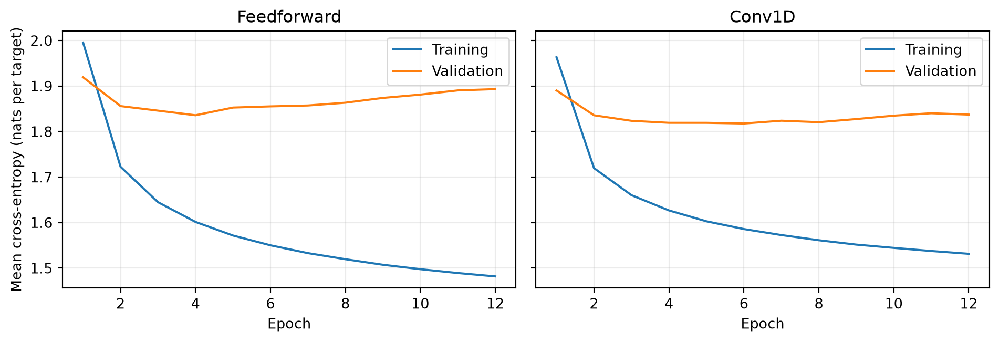

# Learning to generate text, one character at a time (optional)

A Tiny Shakespeare companion to Lectures 14 and 15

Author

Marcel Turcotte

Published

November 11, 2026

**This material will not appear on course tests.**

How much of a play could a network learn by predicting its next character? We compare a feedforward network and a one-dimensional convolutional network (CNN) on continuous text and look for spelling, dialogue layout, and coherence. The experiment connects Lecture 14’s cross-entropy with Lecture 15’s convolution.

This notebook extends the name-generation exercise and can be run on its own. [Name-generation notebook](https://turcotte.xyz/teaching/csi-4106/lectures/15/name_generation.html)

## Preparation

Run the cells in order from a fresh kernel with NumPy, Matplotlib, and TensorFlow with Keras. Each training call reports its elapsed time.

Show setup

``` python
import os
os.environ["KERAS_BACKEND"] = "tensorflow"

from pathlib import Path
from time import perf_counter

import numpy as np
import matplotlib.pyplot as plt
import tensorflow as tf
from tensorflow import keras

SEED = 42
CONTEXT_LENGTH = 32
HIDDEN_UNITS = 128
FILTERS = 64
KERNEL_SIZE = 3
EPOCHS = 12
BATCH_SIZE = 256
LEARNING_RATE = 0.003

keras.utils.set_random_seed(SEED)
print(f"TensorFlow {tf.__version__}, Keras backend: {keras.backend.backend()}")
```

    TensorFlow 2.21.0, Keras backend: tensorflow

## The corpus and its partitions

**Tiny Shakespeare** contains approximately 1.1 million characters from Shakespeare’s works. Capitalization, punctuation, spaces, and newlines all contribute to the patterns the model learns. [Tiny Shakespeare corpus](https://github.com/karpathy/char-rnn#data)

The setup uses the bundled `data/tiny_shakespeare.txt` or downloads the pinned copy.

Show data loading and splitting

``` python
DATA_URL = (
    "https://raw.githubusercontent.com/karpathy/char-rnn/"
    "6f9487a6fe5b420b7ca9afb0d7c078e37c1d1b4e/data/tinyshakespeare/input.txt"
)
DATA_HASH = "86c4e6aa9db7c042ec79f339dcb96d42b0075e16b8fc2e86bf0ca57e2dc565ed"
data_path = keras.utils.get_file(
    fname="tiny_shakespeare.txt", origin=DATA_URL, file_hash=DATA_HASH,
    cache_dir=".", cache_subdir="data"
)
text = Path(data_path).read_text(encoding="utf-8")
train_end = int(0.8 * len(text))
valid_end = int(0.9 * len(text))
train_text = text[:train_end]
valid_text = text[train_end:valid_end]
test_text = text[valid_end:]

print(f"Corpus: {len(text):,} characters")
print(f"Partitions: {len(train_text):,} training, "
      f"{len(valid_text):,} validation, {len(test_text):,} test")
```

    Corpus: 1,115,394 characters
    Partitions: 892,315 training, 111,539 validation, 111,540 test

We split the text into contiguous 80%, 10%, and 10% blocks before making examples. Each window and target stay in the same block. Later blocks can contain different plays and speakers.

## From text to training examples

The input is a window of characters. The target is the character immediately after it. Moving the window one character forward gives another example.

``` python
print("First context", repr(train_text[:CONTEXT_LENGTH]))
print("Next character", repr(train_text[CONTEXT_LENGTH]))
```

    First context 'First Citizen:\nBefore we proceed'
    Next character ' '

Each character is a token. We assign integer IDs using the 65 characters in the training block and reuse that vocabulary throughout. One-hot encoding sets the channel for the current character to 1 and all other channels to 0. The default input has shape `(32, 65)`, and the target stays an integer ID.

``` python
vocabulary = sorted(set(train_text))
VOCAB_SIZE = len(vocabulary)
char_to_id = {char: index for index, char in enumerate(vocabulary)}

def encode(passage):
    return np.array([char_to_id[char] for char in passage], dtype="int32")

train_ids = encode(train_text)
valid_ids = encode(valid_text)
test_ids = encode(test_text)

print("Vocabulary size", VOCAB_SIZE)
```

    Vocabulary size 65

The text supplies the targets. To keep memory use manageable, we store the character IDs and build one-hot inputs a batch at a time. The first `CONTEXT_LENGTH` characters in each block supply context for the first example.

Show batch construction

``` python
def make_dataset(token_ids, training=False):
    tokens = tf.constant(token_ids)
    starts = tf.data.Dataset.from_tensor_slices(
        np.arange(len(token_ids) - CONTEXT_LENGTH, dtype="int32")
    )
    if training:
        starts = starts.shuffle(len(token_ids) - CONTEXT_LENGTH, seed=SEED)

    def make_batch(start_positions):
        positions = start_positions[:, None] + tf.range(CONTEXT_LENGTH)[None, :]
        contexts = tf.gather(tokens, positions)
        targets = tf.gather(tokens, start_positions + CONTEXT_LENGTH)
        return tf.one_hot(contexts, depth=VOCAB_SIZE), targets

    return starts.batch(BATCH_SIZE).map(
        make_batch, num_parallel_calls=tf.data.AUTOTUNE
    ).prefetch(tf.data.AUTOTUNE)

valid_data = make_dataset(valid_ids)
```

## A feedforward next-character classifier

The feedforward network flattens the context and uses a Dense layer to combine its positions. It returns one logit per possible next character. Cross-entropy averages the negative log probability of the observed targets. `from_logits=True` tells Keras that the model returns scores before softmax.

``` python
mlp = keras.Sequential([
    keras.layers.Input(shape=(CONTEXT_LENGTH, VOCAB_SIZE)),
    keras.layers.Flatten(),
    keras.layers.Dense(HIDDEN_UNITS, activation="relu"),
    keras.layers.Dense(VOCAB_SIZE)
], name="feedforward")

def train_model(model):
    model.compile(
        optimizer=keras.optimizers.Adam(learning_rate=LEARNING_RATE),
        loss=keras.losses.SparseCategoricalCrossentropy(from_logits=True)
    )
    start = perf_counter()
    history = model.fit(
        make_dataset(train_ids, training=True), validation_data=valid_data,
        epochs=EPOCHS, verbose=2
    )
    print(f"{model.name}: {model.count_params():,} parameters, "
          f"{perf_counter() - start:.1f} s training")
    return history
```

## Turn the classifier into a generator

**Autoregressive generation** samples a character, appends it, and repeats with the updated context. The model’s weights stay fixed. Use a prompt with at least `CONTEXT_LENGTH` characters from the vocabulary. We generate a fixed number of characters, including any punctuation and newlines sampled.

``` python
PROMPT = train_text[:max(64, CONTEXT_LENGTH)]

def next_probabilities(model, prefix, temperature=1.0):
    context = encode(prefix[-CONTEXT_LENGTH:])[None, :]
    inputs = tf.one_hot(context, depth=VOCAB_SIZE)
    logits = model(inputs, training=False)
    probabilities = keras.ops.softmax(logits / temperature, axis=-1)
    return keras.ops.convert_to_numpy(probabilities)[0]

def generate_text(model, prefix, new_characters=240, temperature=0.8, seed=SEED):
    if len(prefix) < CONTEXT_LENGTH:
        raise ValueError("The prompt must contain at least CONTEXT_LENGTH characters.")
    rng = np.random.default_rng(seed)
    passage = prefix
    for _ in range(new_characters):
        probabilities = next_probabilities(model, passage, temperature)
        token = rng.choice(VOCAB_SIZE, p=probabilities)
        passage += vocabulary[token]
    return passage[len(prefix):]

untrained_sample = generate_text(mlp, PROMPT)
```

We save a continuation from the untrained model, then train it on next-character examples.

``` python
mlp_history = train_model(mlp)
```

    Epoch 1/12

    /Users/turcotte/GoogleDrive/30_Areas/Teaching/CSI4106/quarto/.venv/lib/python3.12/site-packages/keras/src/trainers/epoch_iterator.py:74: UserWarning: `shuffle=True` was passed, but will be ignored since the data `x` was provided as a tf.data.Dataset. The Dataset is expected to already be shuffled (via `.shuffle(buffer_size)`).
      self.data_adapter = data_adapters.get_data_adapter(

    3486/3486 - 8s - 2ms/step - loss: 1.9955 - val_loss: 1.9192
    Epoch 2/12
    3486/3486 - 7s - 2ms/step - loss: 1.7225 - val_loss: 1.8559
    Epoch 3/12
    3486/3486 - 7s - 2ms/step - loss: 1.6448 - val_loss: 1.8459
    Epoch 4/12
    3486/3486 - 7s - 2ms/step - loss: 1.6014 - val_loss: 1.8358
    Epoch 5/12
    3486/3486 - 8s - 2ms/step - loss: 1.5716 - val_loss: 1.8527
    Epoch 6/12
    3486/3486 - 8s - 2ms/step - loss: 1.5501 - val_loss: 1.8553
    Epoch 7/12
    3486/3486 - 7s - 2ms/step - loss: 1.5329 - val_loss: 1.8572
    Epoch 8/12
    3486/3486 - 8s - 2ms/step - loss: 1.5195 - val_loss: 1.8633
    Epoch 9/12
    3486/3486 - 8s - 2ms/step - loss: 1.5073 - val_loss: 1.8739
    Epoch 10/12
    3486/3486 - 8s - 2ms/step - loss: 1.4976 - val_loss: 1.8811
    Epoch 11/12
    3486/3486 - 8s - 2ms/step - loss: 1.4891 - val_loss: 1.8904
    Epoch 12/12
    3486/3486 - 8s - 2ms/step - loss: 1.4817 - val_loss: 1.8932
    feedforward: 274,753 parameters, 90.6 s training

## A convolutional next-character classifier

The CNN applies shared filters to triples of characters before flattening. The Dense layer combines those responses across the whole window. At the default context length the two models have similar parameter counts. They train on the same examples with the same settings.

``` python
keras.utils.set_random_seed(SEED)
cnn = keras.Sequential([
    keras.layers.Input(shape=(CONTEXT_LENGTH, VOCAB_SIZE)),
    keras.layers.Conv1D(FILTERS, KERNEL_SIZE, padding="valid", activation="relu"),
    keras.layers.Flatten(),
    keras.layers.Dense(HIDDEN_UNITS, activation="relu"),
    keras.layers.Dense(VOCAB_SIZE)
], name="convolutional")

cnn_history = train_model(cnn)
```

    Epoch 1/12
    3486/3486 - 14s - 4ms/step - loss: 1.9632 - val_loss: 1.8902
    Epoch 2/12
    3486/3486 - 14s - 4ms/step - loss: 1.7196 - val_loss: 1.8357
    Epoch 3/12
    3486/3486 - 14s - 4ms/step - loss: 1.6602 - val_loss: 1.8236
    Epoch 4/12
    3486/3486 - 14s - 4ms/step - loss: 1.6267 - val_loss: 1.8192
    Epoch 5/12
    3486/3486 - 14s - 4ms/step - loss: 1.6028 - val_loss: 1.8192
    Epoch 6/12
    3486/3486 - 14s - 4ms/step - loss: 1.5857 - val_loss: 1.8176
    Epoch 7/12
    3486/3486 - 14s - 4ms/step - loss: 1.5726 - val_loss: 1.8238
    Epoch 8/12
    3486/3486 - 14s - 4ms/step - loss: 1.5612 - val_loss: 1.8206
    Epoch 9/12
    3486/3486 - 14s - 4ms/step - loss: 1.5516 - val_loss: 1.8274
    Epoch 10/12
    3486/3486 - 14s - 4ms/step - loss: 1.5444 - val_loss: 1.8349
    Epoch 11/12
    3486/3486 - 14s - 4ms/step - loss: 1.5375 - val_loss: 1.8402
    Epoch 12/12
    3486/3486 - 14s - 4ms/step - loss: 1.5314 - val_loss: 1.8372
    convolutional: 266,817 parameters, 169.5 s training

## Compare three continuations

The three samples use the same prompt, 240 generated characters, the same temperature, and the same seed.

- Which spellings and short phrases look plausible?
- Where do punctuation, line breaks, and speaker labels look like dialogue?
- Do the speakers and subjects stay consistent across sentences?

``` python
print("Prompt\n")
print(PROMPT)
for label, sample in (
    ("Untrained feedforward", untrained_sample),
    ("Trained feedforward", generate_text(mlp, PROMPT)),
    ("Trained Conv1D", generate_text(cnn, PROMPT)),
):
    print(f"\n{label}\n")
    print(sample)
```

    Prompt

    First Citizen:
    Before we proceed any further, hear me speak.

    Al

    Untrained feedforward

    lPqf,xkm.QLuboPBX$obkLysl?R!3dixILS?.RCePogHpmLGe3?
    mdglPW3-eRXkbXWF!OANpC$FGdWmeNn: 'gR:T3fOLHbJ'-xtfExlhPF,sQAGY?qjgObZc'N!TJ3,Z;uXJZ xRl'RTvYSEIUO os3W-eFeil,uC!XKonIwFUDv;$PzsjssVHldL,iEvD-p3;aq?HlxT.
    C3f-UeY?ngj..vNGSdwGu Xb,3NxZvnQm
    -

    Trained feedforward

    l: new, and steat the would beet
    Lest Tobsens. France, sish resties,
    Let hath my homb, if guil of cruretand blood,
    Which save in thus nawns live can Now nessaxe ther to the wailus.

    DORSET:
    Ye parns inia a bill of thank in werarge not;
    My b

    Trained Conv1D

    l:
    Now, and the marriay. He have lie less.

    QUEEN ELIZABETH:
    I shall leave if the sea.

    CORIOLANUS:
    What, make he from the hand and please and plaenided
    The quick and thrife. Amy, to must revent coungly a denance to cere those
    Than your sai

## Follow learning on held-out text

Validation loss measures next-character prediction on unseen passages. Compare it with training loss across epochs.

Show learning curve code

``` python
fig, axes = plt.subplots(1, 2, figsize=(10, 3.5), sharey=True)
for ax, history, title in zip(
    axes, (mlp_history, cnn_history), ("Feedforward", "Conv1D")
):
    epochs = np.arange(1, len(history.history["loss"]) + 1)
    ax.plot(epochs, history.history["loss"], label="Training")
    ax.plot(epochs, history.history["val_loss"], label="Validation")
    ax.set(title=title, xlabel="Epoch")
    ax.legend()
    ax.grid(alpha=0.25)
axes[0].set_ylabel("Mean cross-entropy (nats per target)")
fig.tight_layout()
plt.show()
```



## A visible limit on context

Each model sees only the last `CONTEXT_LENGTH` characters. What happens when two prompts share that entire suffix? Compare the two predictions for each model.

``` python
shared_context = PROMPT[-CONTEXT_LENGTH:]
prefix_a = "The king is angry.\n" + shared_context
prefix_b = "The king is pleased.\n" + shared_context
print("Shared context", repr(shared_context))
for model in (mlp, cnn):
    probabilities_a = next_probabilities(model, prefix_a)
    probabilities_b = next_probabilities(model, prefix_b)
    difference = np.max(np.abs(probabilities_a - probabilities_b))
    print(f"{model.name} largest probability difference {difference:.1e}")
```

    Shared context ' any further, hear me speak.\n\nAl'
    feedforward largest probability difference 0.0e+00
    convolutional largest probability difference 0.0e+00

Both calls give each model the same input, so its predictions agree exactly.

## Try a different context length

For an optional experiment, change `CONTEXT_LENGTH` from 32 to 8, restart the kernel, and rerun through the validation plots. Compare the samples and validation loss. The shorter context also reduces the number of parameters.

## Final evaluation on the test block

Run this cell once after choosing settings. The table shows mean cross-entropy in nats per target. The bigram reference uses only the immediately preceding character.

Show final evaluation code

``` python
bigram_counts = np.ones((VOCAB_SIZE, VOCAB_SIZE))
np.add.at(bigram_counts, (train_ids[:-1], train_ids[1:]), 1)
bigram_probabilities = bigram_counts / bigram_counts.sum(axis=1, keepdims=True)
previous = test_ids[CONTEXT_LENGTH - 1:-1]
targets = test_ids[CONTEXT_LENGTH:]
bigram_loss = -np.log(bigram_probabilities[previous, targets]).mean()

test_losses = {"Bigram": bigram_loss}
test_data = make_dataset(test_ids)
for label, model in (("Feedforward", mlp), ("Conv1D", cnn)):
    test_losses[label] = model.evaluate(test_data, verbose=0)

print(f"{'Model':<15} {'Cross-entropy (nats per target)':>32}")
for label, loss in test_losses.items():
    print(f"{label:<15} {loss:>32.3f}")
```

    Model            Cross-entropy (nats per target)
    Bigram                                     2.503
    Feedforward                                2.348
    Conv1D                                     2.372

## References

- Shakespeare, W. Text compiled as Tiny Shakespeare in Karpathy, A., [char-rnn](https://github.com/karpathy/char-rnn#data). The loading cell specifies the exact corpus revision and checksum.
